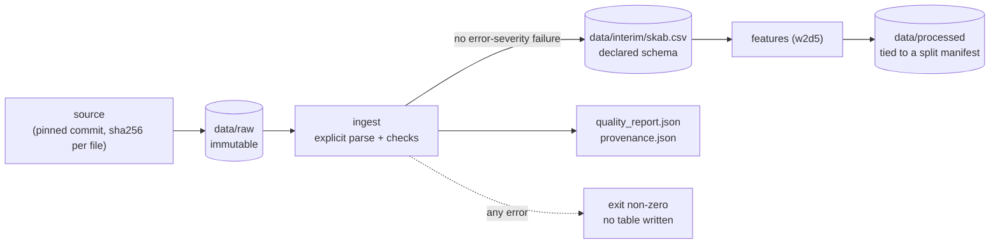
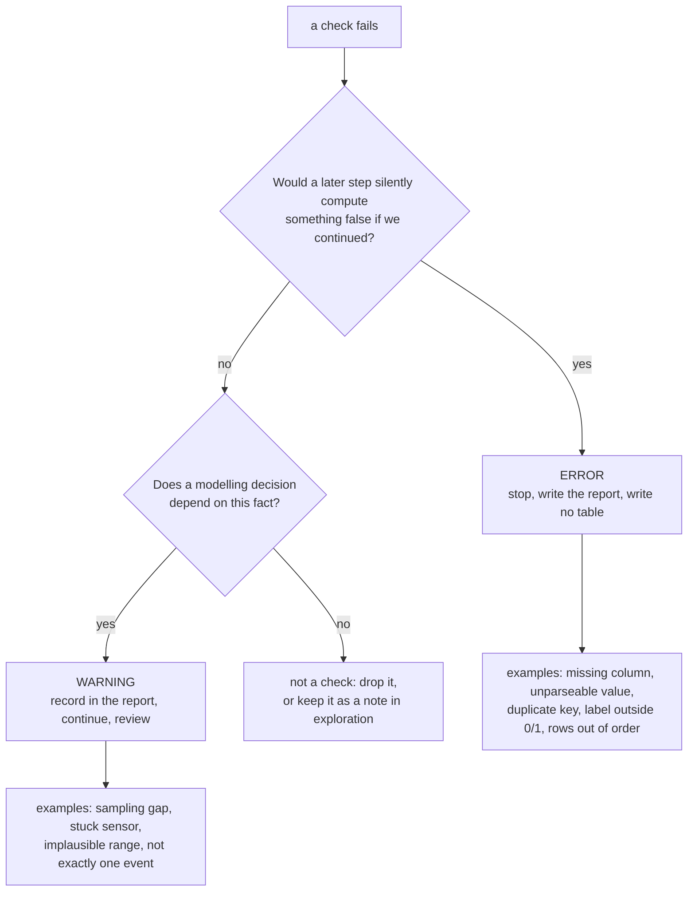
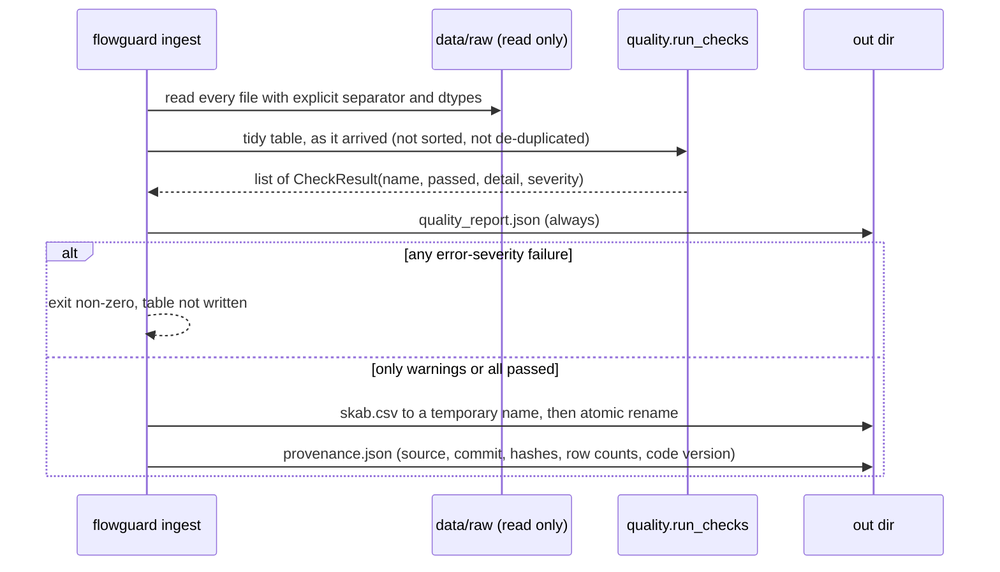
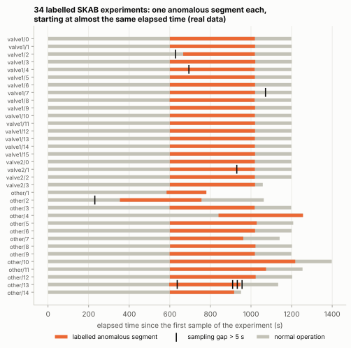
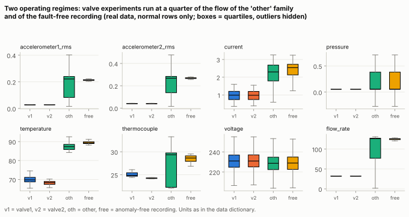

# W2D3 — pandas ingestion, schemas and data-quality checks (the project data arrives)

**Unit id:** `w2d3` · **Week 2, day 3** · **Content status:** Execution verified (see [Verification record](#verification-record))
**Handbook:** [H3.3 Ingestion and schemas](../../handbook/ch03_sql_data_pipelines/h3_3_ingestion_schemas.md) · [H4.1 Quality checks as code; exploratory analysis that changes decisions](../../handbook/ch04_data_quality_eda/h4_1_quality_checks_and_eda.md)
**Data:** the worked example and lab step 5 use the **real** SKAB files (`python project/get_skab.py`; GPL-3.0, not redistributed). The automated checks and the challenge use **SYNTHETIC** tables built for this lesson; they say nothing about SKAB or about any real shop.

---

## 1. Purpose

**Primary objective.** Ingest the project dataset through one documented, re-runnable step that
declares its schema, checks the data with code, stops when the contract is broken, and records
where every byte came from.

**What you will learn**

- Separating *raw* (immutable), *interim* (validated, tidy) and *processed* (model-ready) data.
- Making every parsing decision explicit: separator, decimal mark, dtypes, datetime format, time zone.
- Writing a schema as an executable contract: structural, row-level, relational and distributional checks.
- Choosing severity: what must stop a pipeline and what is recorded and carried forward.
- Idempotence and provenance, and how to test both with a hash.
- Doing exploratory analysis whose only acceptable output is a decision.

**Why an applied ML engineer needs it.** Most production ML incidents are data incidents: a column
changes unit, an upstream job writes a batch twice, a sensor freezes. None of these raises an
exception in a training script; they change numbers. The engineer who owns a model is expected to
have put a gate in front of it and to be able to say, months later, exactly which files produced
which table. Interviewers probe this with "how do you know your training data is correct?" — an
answer that names specific checks, severities and what happens on failure is the difference between
research and engineering experience.

**Prerequisites.** [W1D6](../w1d6_notebook_to_package/README.md) (the `flowguard` skeleton and `flowguard.data`;
this lab ships a snapshot of that module, so it runs on its own). [W1D4](../w1d4_config_logging/README.md)
for run provenance, [W1D5](../w1d5_testing_ml_code/README.md) for test design. Diagnostic `a3` reviewed.

**Time budget — essential path 2 h**

| Activity | Time |
|---|---|
| Read sections 1–2 | 25 min |
| Worked example: run both scripts, read the output against section 3 | 20 min |
| Guided lab, tasks 1–5 | 55 min |
| Independent challenge: start (read the contract, write the first three rules) | 10 min |
| Assessment questions 1–3 and reflection | 10 min |

**Optional extension (≤ 1 h):** finish the challenge and its report (35 min); assessment
questions 4–5 and the interview rep (25 min).

**Deliverable.** `flowguard ingest` producing `skab.csv`, `quality_report.json` and
`provenance.json`, plus `lab/DATA_NOTES.md` recording the decisions the data forced.

**Completion criteria.** `python wb.py check w2d3` passes; the command has been run on the real
files and its warnings are explained in `DATA_NOTES.md`; you can state, without looking, which of
your checks stop the pipeline and why.

---

## 2. Conceptual explanation

### 2.1 Three layers, one direction

```
data/raw/       exactly what the source delivered; never edited, never "fixed"
   |  ingest: parse explicitly, validate, tidy            <- this lesson
data/interim/   one validated table in a declared schema; reproducible from raw + code
   |  features: causal windows, train-only statistics     <- w2d5
data/processed/ model-ready arrays tied to a split manifest
```

Raw is immutable because it is the only layer you cannot regenerate. Every other layer is a pure
function of raw plus code, which is what makes "delete `interim/` and rebuild" a safe sentence. The
moment someone opens a raw file and corrects a value by hand, the function has a hidden argument.

You have lived this rule already: the acquisition file (`.edf`, `.vhdr`, BIDS `sourcedata/`) is
never overwritten by the filtered version, and a derivative is always traceable to it. Ingestion is
the same discipline applied to tables.




### 2.2 Parsing is a set of decisions; make each one in code

A CSV has no types. `pd.read_csv(path)` succeeds on almost anything, and the ways it succeeds
wrongly are quiet (section 3.1 shows three). An ingestion step therefore states, for each file kind:

| Decision | For SKAB | What the default would do |
|---|---|---|
| Separator | `;` | One column named `datetime;Accelerometer1RMS;...`; no error |
| Decimal mark | `.` | With a decimal comma: numeric columns become strings; no error |
| Dtypes | sensors `float64`, labels `int64` (0/1) | Inferred per file, so one stray token changes a column's dtype for that file only |
| Missing-value tokens | none expected; read as text, convert explicitly | `"NA"`, `"null"`, `""`, `"n/a"` and others silently become NaN |
| Datetime | fixed format `%Y-%m-%d %H:%M:%S` | Format guessed; ambiguous day/month orders can be read inconsistently |
| Time zone | naive, as recorded; documented as such | Naive stamps compared with aware ones raise later, or worse, get localised somewhere implicit |
| Row order | preserved from the file | preserved (and then someone sorts it, hiding a defect) |

The pattern used by the reference loader is *read everything as text, convert column by column
with `errors="coerce"`*. A cell that does not match the declared type becomes NaN/NaT, which a check
can count and attribute. The alternative — letting the reader raise, or letting it infer — gives you
either one traceback without row identifiers or a different valid-looking value.

**Time zones.** SKAB timestamps carry no offset. The honest schema says "timezone-naive local
laboratory time"; inventing UTC would be a fabrication. For this dataset only *differences* within
an experiment matter, so naivety is harmless. In business data it usually is not: a daily aggregate
depends on which midnight you mean, and daylight-saving transitions produce 23- and 25-hour days and
a repeated hour. Rule: store instants in UTC with an explicit offset; convert to local time only at
the point where a business definition demands it (diagnostic `a3` turned on exactly this).

### 2.3 The schema as a contract, in four kinds of check

Let the tidy table be rows $r_i$ with experiment $e_i$, timestamp $\tau_i$ and sensors $x_{ij}$.

1. **Structural** — the table has the declared shape. Required columns present; dtypes as declared.
2. **Row-level (domain)** — each row is valid alone: $x_{ij}$ finite; labels in $\{0, 1\}$;
   values inside physical plausibility limits $[\ell_j, u_j]$.
3. **Relational (set-level)** — properties of rows *together*:
   - key uniqueness: $(e_i, \tau_i) \ne (e_k, \tau_k)$ for $i \ne k$;
   - order: $\tau$ non-decreasing in file order within each $e$;
   - sampling: gaps $\Delta_i = \tau_i - \tau_{i-1}$ within an experiment (never across experiments);
   - constancy: longest run of identical consecutive values of a sensor;
   - label structure: number of anomalous segments per experiment,
     $S(e) = \#\{i : y_i = 1 \wedge y_{i-1} = 0\}$, with $y_{-1} = 0$.
4. **Distributional** — properties of the batch against expectation: row counts, class balance,
   missing-value share. These are judged with tolerances, not equalities, and they belong mostly to
   *monitoring* (Week 7); at ingestion you record them so that a later batch has something to be
   compared with.

Column-wise validation (kinds 1–2) is what schema libraries make easy, and it is where most people
stop. The defects that hurt a time-series model are nearly all of kind 3: they are invisible when
each value is inspected alone.

**Where thresholds come from.** A gap limit or a stuck-sensor run length is not a universal
constant. In SKAB the flow sensor is quantised and legitimately repeats a value for up to 43
samples; a rule "flag 10 identical values" would fail every file and be switched off within a week.
Derive thresholds from the data's normal behaviour, write the derivation down, and leave a margin
(the reference warns at 120).

### 2.4 Severity: what must stop the pipeline

| Severity | Meaning | On failure | SKAB examples |
|---|---|---|---|
| **error** | The table violates something every later step assumes. Continuing produces wrong numbers with no symptom. | Non-zero exit, no table written, report written | missing column; unparseable value; label outside {0,1}; duplicate key; rows out of time order |
| **warning** | The data is valid as recorded, and a modelling decision depends on the fact. | Recorded in the report; ingestion continues | sampling gaps; stuck sensor; implausible range; not exactly one anomalous segment |

The test for "error" is not how bad it looks but whether a downstream step would silently compute
something false. Duplicated timestamps make every rolling window wrong; a 247 s gap does not make
any row wrong — it makes a naive *windowing* wrong, which is w2d5's problem to handle and this
step's duty to announce.

Two failure modes sit on either side. A gate that never stops anything is decoration. A gate that
stops on every oddity gets bypassed with `--force` by Thursday. Keep the error set small, mechanical
and defensible; put judgement calls in warnings and review them.

**Validate, do not repair.** The checker looks at data as it arrived. Sorting or de-duplicating
*before* checking makes the corresponding checks unfalsifiable and hides an upstream fault that will
recur. If a repair is ever adopted (say, "keep the last of duplicated rows"), it is a separate,
named, tested transformation with its own line in the report: how many rows it touched.




### 2.5 Idempotence and provenance

A step is **idempotent** if running it again on the same input changes nothing:
$f(\text{raw}) = f(\text{raw})$ byte for byte, and re-running into an existing output directory
leaves it identical. This is testable with a hash, and it buys three things: safe retries after a
crash, "did anything change?" answered by comparing two digests, and caches keyed on content.

What breaks it: wall-clock timestamps inside outputs, unordered iteration (set or directory order),
appending instead of replacing, random sampling without a seed, float formatting that depends on
library version. Put *when it ran* in the log (w1d4), not in the artefact.

**Provenance** is the record that lets a table be traced and regenerated: source URL, upstream
commit, licence, SHA-256 and row count of each input, SHA-256 and row count of the output, code
version. It answers "which files produced this table?" without anyone's memory. Note the honest
limit: byte-identical output is guaranteed within one environment; a different pandas version may
format a float differently, which is why the code and library versions are part of the record.




### 2.6 Data validation is not model evaluation

| | Data validation | Model evaluation |
|---|---|---|
| Question | Is this input well-formed and as expected? | Is this model useful for the decision? |
| Needs labels / a model | No | Yes |
| Outcome | Pass / fail per rule, deterministic | An estimate with uncertainty |
| When | Every batch, before anything else | After training; periodically in production |
| Failure means | Do not train / do not score; fix the feed | Do not ship / roll back; fix the model |

Both can fail independently. Clean data can train a useless model; a good model can be fed a
frozen sensor. A falling metric is a poor data-quality alarm (late, unspecific), and a passing
quality report says nothing about leakage or generalisation.

### 2.7 Exploratory analysis that changes a decision

Exploration at ingestion has one acceptance test: *each finding ends in a decision or it is cut.*
Section 3.2 does this on the real data. The habit to drop is the notebook of forty plots; the habit
to keep from your research is looking at raw traces before trusting a summary.

### 2.8 From hand-written checks to tools

This lesson writes checks by hand because the concepts — kinds of check, severity, attribution,
never-raise — are what transfer. Tools then remove boilerplate:

- **pydantic**: validates one *record* at a time against a typed model. Right for API payloads
  (Week 5); slow and awkward for a 50,000-row table and blind to relational rules.
- **pandera**: declarative dataframe schemas (dtypes, ranges, uniqueness, custom checks). A
  compact way to express kinds 1–2 and simple kind-3 rules.
- **Great Expectations** and similar suites: expectation catalogues plus stored results and
  generated documentation. Worth their weight when many datasets and people share the checks.

None of them decides *which* rules matter, what the thresholds are, or what stops the pipeline.
(These descriptions are from general knowledge and were not re-verified against current
documentation in this session; no lab depends on them.)

### 2.9 Industry example

A retailer's demand model degrades every few weeks. The cause turns out to be a warehouse system
that re-sends a day's shipments when its nightly job is retried: the ingestion job appends, so those
days count double, and the model learns phantom demand spikes. Nothing ever raised. The fix is three
lines of this lesson: a uniqueness check on `(shipment_id)` with severity *error*, replace-not-append
writes (idempotence), and input hashes in a provenance record so the duplicated delivery is visible
as "same file, second time".

### 2.10 Bridge from EEG, and where it breaks

| Your practice | Ingestion equivalent |
|---|---|
| Checking the montage and channel count before analysis | Required-columns and dtype checks |
| Flat-line / saturated channel detection | Stuck-sensor run length; plausibility range |
| Rejecting epochs with amplifier discontinuities | Sampling-gap check; windows that must not span a gap |
| Checking event markers against the protocol | Label-structure check (one segment per experiment) |
| Keeping `sourcedata/` untouched, derivatives regenerated | Raw immutability, idempotent ingest |
| Recording amplifier, reference, filter settings | Provenance record |

Where it breaks: in the lab a human looks at every recording and rejection is a judgement. In a
pipeline nobody looks; the rule must be mechanical, its threshold written down, and its firing must
*do* something (exit code). And artefact rejection removes data, whereas ingestion checks refuse or
annotate a batch — silent removal is precisely what they are there to prevent.

### 2.11 Limits and misconceptions

- *"No exception, so it loaded correctly."* The dangerous reads are the ones that succeed.
- *"I cleaned it in the loader."* Then no check can ever tell you the feed is broken.
- *"More checks are safer."* Each noisy check trains people to ignore the report.
- *"The quality report passed, so the data is right."* It passed the rules you thought of. Checks
  encode known failure modes; exploration finds new ones, which then become checks.
- *"Idempotent means deterministic."* Deterministic output is necessary; idempotence also requires
  that re-running into existing state does not accumulate (no appends, no stale files).
- *"Warnings are harmless."* A warning is a debt assigned to a later step. Section 3.2 shows a
  warning that would corrupt every windowed feature in six experiments if ignored.

---

## 3. Worked example

Two scripts in [`example/`](example/). Outputs below are copied from runs on 2026-11-21
(Python 3.13.18, pandas 3.0.5).

### 3.1 Part 1 — three wrong reads that raise nothing

```bash
python lessons/w2d3_data_quality_ingestion/example/parsing_pitfalls.py
```

**Data:** a three-row inline file written for the example (SYNTHETIC): semicolon separator, decimal
comma, day-first dates — a common European export. Schema: `datetime;Pressure;Voltage;anomaly`.

```
--- defaults (sep=',')
shape=(3, 1)  dtypes={'datetime;Pressure;Voltage;anomaly': 'str'}
...
--- sep=';' only
shape=(3, 4)  dtypes={'datetime': 'str', 'Pressure': 'str', 'Voltage': 'str', 'anomaly': 'int64'}
...
--- per-cell date guessing
2020-03-04 10:14:33
2020-03-04 10:14:34
2020-04-13 10:14:35

--- explicit separator, decimal, format, dtypes
shape=(3, 4)  dtypes={'datetime': 'datetime64[us]', 'pressure': 'float64', 'voltage': 'float64', 'anomaly': 'int64'}
           datetime  pressure  voltage  anomaly
2020-04-03 10:14:33     0.054    233.1        0
2020-04-03 10:14:34     0.382    236.0        0
2020-04-13 10:14:35     1.120    231.7        1

seconds between rows: [nan, 1.0, 864001.0]
```

**Reading it.**

1. With defaults the file "loads": shape `(3, 1)`. Asserting the expected column set is the
   cheapest check there is, and it catches this.
2. With the right separator the decimal-comma columns are strings. Arithmetic on them fails late or,
   after a careless `astype`, fails loudly somewhere far from the cause.
3. Guessing the date cell by cell reads `03/04` as 4 March in rows 1–2 and `13/04` as 13 April in
   row 3 — one column, two conventions, and a 40-day jump that is pure artefact. (pandas emits a
   `UserWarning` on stderr for the third cell; a warning in a batch job's log is not a control.)
4. With everything explicit, the dates are 3 and 13 April and the last interval is 864,001 s, which
   is now a true statement about the data that a gap check can report.

**Key code decisions.** Read as text (`dtype=str, keep_default_na=False`) so that nothing is
converted implicitly; convert with `errors="coerce"` so that a bad cell becomes a countable NaN
instead of an exception without a row number; give `to_datetime` a `format`. `pd.read_csv(...,
decimal=",", parse_dates=[...], date_format=...)` reaches the same table in one call (verified), and
is fine when you also check the resulting dtypes; the text-first route makes each failure attributable.

### 3.2 Part 2 — exploration of the real files, one decision per finding

```bash
python project/get_skab.py                                           # once
python lessons/w2d3_data_quality_ingestion/example/explore_skab.py
```

**Data:** SKAB v0.9, 35 files; schema in [`project/README.md`](../../project/README.md) and, after
renaming, in [`docs/FLOWGUARD_SPEC.md`](../../docs/FLOWGUARD_SPEC.md). The script uses the reference
loader. Output, abridged only where marked:

```
rows=46806  experiments=35  labelled rows=37401

1. sampling interval (s): {1.0: 44222, 2.0: 2479, 3.0: 30, 4.0: 26} ... 9 steps > 5 s
experiment_id    t  anomaly  gap_s  start  end        where
     other/13  515        1   33.0    495  759 inside event
     other/13  750        1   19.0    495  759 inside event
     other/13  754        1   21.0    495  759 inside event
     other/13  760        0   16.0    495  759  after event
      other/2  104        1  247.0    104  487 inside event
     valve1/2  566        1   76.0    566  902 inside event
     valve1/4  638        1   54.0    573  921 inside event
     valve1/7 1001        0   65.0    578  982  after event
     valve2/1  838        1   64.0    560  892 inside event

2. anomalous fraction per experiment: min=0.252 median=0.350 max=0.492; pooled=0.349

3. per-sensor resolution (worst experiment) and range
                    min_distinct_values  longest_constant_run      min      max
accelerometer1_rms                  739                     2    0.016    0.723
pressure                              5                    19   -1.257    1.694
thermocouple                        421                     4   22.021   33.415
flow_rate                            33                    43    0.556  133.688
(other sensors: 718-743 distinct values, runs of 1-2)

4. normal-operation level: SD of experiment means / median within-experiment SD
accelerometer1_rms    209.20
accelerometer2_rms     83.19
current                 2.34
pressure                0.12
temperature            14.05
thermocouple           60.94
voltage                 0.12
flow_rate              84.78

5. within-experiment shift under anomaly (normal-SD units): median per family
family              other  valve1  valve2
accelerometer1_rms  -0.20    0.16    0.13
accelerometer2_rms   0.73    0.08    0.13
temperature         -0.63   -0.20    0.04
thermocouple        -0.09   -0.44   -0.98
flow_rate           -1.18   -4.38   -3.85
   share of experiments where the sensor moves by more than 1 SD in either direction
family              other  valve1  valve2
accelerometer1_rms   0.57    0.00    0.00
accelerometer2_rms   0.57    0.06    0.00
thermocouple         0.50    0.19    0.50
flow_rate            0.57    0.94    1.00
(current, pressure, voltage: 0.00 in every family)
```

**Interpretation, finding by finding.**

1. **The sampling is not uniform.** About 5 % of steps are 2 s, and nine steps in six experiments
   exceed 5 s (largest 247 s). Seven of the nine lie *inside* the anomalous segment, two just after
   it; in `other/2` and `valve1/2` the gap is at the very first anomalous sample, so the onset
   itself was not recorded continuously. **Decision:** windows are defined so that they never span a
   gap, or are defined in seconds; "the last 60 rows" is not "the last minute" (w2d5). Detection
   delay must be measured in seconds, not rows (w3d4). This is a *warning*, not an error: every row
   is valid.
2. **About one sample in three is anomalous.** **Decision:** point-level metrics must be read
   against a base rate of 0.35 (a constant scorer has precision 0.35). The scarce unit is the event:
   34 of them. This is not the rare-event regime most anomaly-detection writing assumes.
3. **Two sensors are coarsely quantised.** Pressure takes as few as 5 distinct values in an
   experiment; flow rate repeats for up to 43 samples. **Decision:** the stuck-sensor rule uses a
   run length (120) far above what quantisation produces. Also noted: pressure goes negative
   (minimum −1.257 bar). The upstream README does not say whether this is gauge pressure or sensor
   noise around zero; the plausibility limit is set to accommodate it, and the open question is
   written in `DATA_NOTES.md` rather than "cleaned".
4. **Experiments have their own baselines.** For both accelerometers, thermocouple and flow rate the
   spread of experiment means is 60–200 times the within-experiment spread during normal operation.
   This is the between-subject offset you know from EEG. **Decision:** a global threshold on raw
   values mostly identifies the experiment. Features need a per-experiment causal reference (w2d5),
   and any model must be evaluated on experiments it has not seen (w2d4).
5. **The fault signature differs by family.** Within an experiment, flow rate drops by about 4 SD in
   essentially every valve experiment. In `other` no single sensor moves in more than 57 % of
   experiments. **Decision:** generalisation across families is a separate question from
   generalisation across experiments; protocol B holds out a family (w2d4).

Findings 1 and 2 in one picture, and one the table does not show: the anomalous segment starts at nearly
the same elapsed time in almost every experiment.



*Real data. The anomaly begins at row 550-600 in 31 of 34 experiments, so position in the recording
predicts the label. That is an artefact of the experimental protocol, not a property of faults; it is
recorded here and becomes a leakage probe in w2d6 and w3d1. Black ticks are the nine gaps longer than 5 s.*

Finding 4, per family, on normal rows only:



*Real data. The two valve families run at about 32 L/min with low vibration; the `other` family and the
fault-free recording run at about 126 L/min. A threshold on raw values separates operating regimes
before it separates faults. Regenerate both figures with
`python lessons/w2d3_data_quality_ingestion/figures/make_figures.py`.*


**A correction worth keeping.** The first version of block 5 pooled all rows of a family and
subtracted pooled means. It reported a 243-SD accelerometer shift for `other`. That number was an
artefact of finding 4: anomalous rows came disproportionately from experiments with a high baseline.
Computed within each experiment, the median shift is −0.20 SD. Aggregating across groups before
differencing is the tabular form of a subject-confounded effect, and it is as easy to commit here
as there.

**Reproducibility.** `project/get_skab.py --verify` confirms the files match the pinned manifest;
both scripts are deterministic (no randomness).

---

## 4. Guided lab

**Result to produce:** a working `flowguard ingest`, run on the real files, and `lab/DATA_NOTES.md`.

Work in [`lab/`](lab/). `src/flowguard/data.py` (the loader, to the project spec) and `cli.py` are
given. You write `quality.py` and `ingest.py`. Read the docstrings at the top of both stubs: they
are the contract the checks grade.

```bash
python wb.py check w2d3            # or: python -m pytest lessons/w2d3_data_quality_ingestion/checks -q
```

All 19 checks run offline on small synthetic raw directories (300 rows per experiment, values near
the real sensor levels, 1 s sampling, one anomalous segment). The starter fails 18 of them.

### Task 1 — read the loader, then break it on purpose (10 min)

Open `lab/src/flowguard/data.py`. Note three choices: text-first reading, `errors="coerce"`, and
that it does **not** sort. Then, in a Python shell from `lab/`:

```python
import sys; sys.path.insert(0, "src")
from flowguard.data import load_raw
tidy = load_raw("../../../data/raw/skab")      # after: python project/get_skab.py
tidy.dtypes; tidy.groupby("family").size()
```

*Checkpoint:* 46,806 rows, 14 columns, labels `int64`, four families. Why would a loader that
sorts by `datetime` be the wrong design? (Answer before task 2; it is assessment question 1.)

### Task 2 — error-severity checks (15 min)

Implement in `run_checks`: required columns; no missing/unparseable values; labels in {0, 1};
`(experiment_id, datetime)` unique; rows in non-decreasing time order within each experiment.

Design rules the checks enforce:

- one `CheckResult` per check, **every check evaluated** (collect, never `return` early — except
  that with columns missing nothing else can be computed);
- `detail` of a failing result names each offending `experiment_id`, and no others;
- never raise on bad data, never modify `tidy`.

*Checkpoint:* `python -m pytest lessons/w2d3_data_quality_ingestion/checks/test_quality.py -q -k "duplicate or unsorted or non_binary or missing_column"` passes.

*Debugging.* "clean experiment was blamed" — you computed something across the whole table that
must be computed per experiment (`groupby("experiment_id")`). A `KeyError` in the missing-column
test — you index a column before checking it exists.

### Task 3 — warning-severity checks, with thresholds you can defend (10 min)

Add: sampling gaps; stuck sensors; and at least one more of your choosing (plausible ranges, number
of anomalous segments, minimum rows). Take the thresholds from section 3.2, not from intuition.

*Checkpoint:* `test_quality.py` passes entirely, including
`test_thresholds_tolerate_ordinary_jitter_and_quantisation` (a 2 s step and a 30-sample plateau
must not fire).

### Task 4 — `ingest` (15 min)

Implement the contract in the `ingest.py` docstring: report always; table and provenance only when
no error check failed; no stale table after a failed re-run; byte-identical outputs on repetition.

*Checkpoint:* `python wb.py check w2d3` passes (19 tests).

*Debugging.* Idempotence test fails — look for a timestamp, a set iterated without sorting, or
`json.dumps` without `sort_keys=True`. Provenance test fails — hash the *bytes you wrote*, and carry
`source`/`commit`/`licence` over from `raw_dir/MANIFEST.json`. "Traceback" assertion fails — catch
your `QualityError`/`ValueError` in `cli.main` (already done in the given `cli.py`; check that
`ingest` raises those types).

### Task 5 — run it on the real data and write down what it told you (5 min)

```bash
cd lessons/w2d3_data_quality_ingestion/lab
python -m pip install -e .                      # in your course venv; or use PYTHONPATH=src
flowguard ingest --raw-dir ../../../data/raw/skab --out-dir ../../../data/interim
```

Expected with checks equivalent to the reference (stderr, then stdout; run on 2026-11-21):

```
[warning] sampling_gaps: other/13: 4 gap(s) > 5 s, largest 33 s at t=515; other/2: 1 gap(s) > 5 s, largest 247 s at t=104; valve1/2: 1 gap(s) > 5 s, largest 76 s at t=566; valve1/4: 1 gap(s) > 5 s, largest 54 s at t=638; valve1/7: 1 gap(s) > 5 s, largest 65 s at t=1001; valve2/1: 1 gap(s) > 5 s, largest 64 s at t=838
{"rows": 46806, "experiments": 35, "n_checks": 11, "n_failed_errors": 0, "n_failed_warnings": 1, "sha256": "30646971eb5e8f5fd81f69311ad578e5250e4cd1bc875779c2c03a1822d365d0"}
```

Exit code 0: one warning, no errors, a 5.4 MB `skab.csv`. Your check names, count and the SHA-256
will differ if your CSV formatting differs; the six experiments and the row count should not. If
one of *your* warnings fires on real data where the reference's does not, decide whether your
threshold or the reference's is wrong and say why.

Fill in `lab/DATA_NOTES.md` (template provided): the data dictionary as ingested, each warning with
the decision it forces, and open questions (negative pressure; naive timestamps).
`data/interim/` is yours to regenerate at any time; it is derived data and should not be committed.

---

## 5. Independent challenge

[`challenge/README.md`](challenge/README.md): an orders export from an invented web shop
(SYNTHETIC) with a written data contract. Turn the contract into a checker and write the quality
report you would send to the team that owns the export. Different domain, no sensors, relational
rules across columns, and two distribution-level warnings. No solution is given here.

```bash
python wb.py check w2d3 --challenge
```

## 6. Progressive hints

Open in order, and only when stuck for more than ten minutes:

1. [Concept](hints/hint1_concept.md) — what to think about.
2. [Approach](hints/hint2_approach.md) — a structure that works.
3. [Partial implementation](hints/hint3_partial.md) — the core pattern, two rules done.

The full reference is in `solutions/lessons/w2d3_data_quality_ingestion/` (lab, challenge, the
wrong submissions the checks reject, and model answers).

## 7. Assessment

[`assessment.md`](assessment.md): five reasoning questions (one is a design-choice defence), a
rubric, and a 10–15 minute interview rep on missingness mechanisms. Automated checks: 19 for the
lab, 22 for the challenge. Passing them earns `guided`; set `independent` only if the challenge was
done without hints.

## 8. Reflection and review

**You should now be able to, without help:**

- write an ingestion step for an unfamiliar file format with every parsing decision explicit;
- name four kinds of data check and give a time-series example of each;
- argue for a given check being an error or a warning;
- make a step idempotent and prove it with a hash;
- turn an exploratory finding into a recorded decision.

**Reflection (5 min, write it in `progress/notes.md` via `python wb.py note w2d3 "..."`).** Think of
a dataset from your own research where a defect of kind 3 (duplicates, ordering, gaps, stuck
channel, marker inconsistency) reached analysis. What mechanical check would have caught it, and
would you have made it an error or a warning?

**Retrieval question for later (answer from memory at the start of w2d5):** *Six SKAB experiments
have sampling gaps longer than 5 s. Why did ingestion not reject them, and what exactly must the
feature step do differently because of them?*

**Next:** [`w2d4_problem_framing_splits`](../w2d4_problem_framing_splits/README.md) — with a validated table in
hand, define the unit of prediction, the label, and a versioned split by experiment. Findings 4 and 5
above are its starting evidence.

---

## Verification record

Executed on 2026-11-21, Python 3.13.18, pandas 3.0.5, NumPy 2.5.3, pytest 9.1.1.

| What | Result |
|---|---|
| `example/parsing_pitfalls.py` | ran; output in 3.1 copied from the run |
| `example/explore_skab.py` on the real 35 files | ran; output in 3.2 copied from the run |
| Reference `flowguard ingest` on the real files | exit 0; 46,806 rows; 11 checks, 0 errors, 1 warning (six experiments); two runs byte-identical |
| `python tools/verify_checks.py lessons/w2d3_data_quality_ingestion` | lab: reference passes, 4 wrong submissions rejected; challenge: reference passes, 4 rejected |
| Shipped starters | lab: 18 failed, 1 passed; challenge: 22 failed |
| Not verified | Python 3.11/3.12; `pip install -e` of this lab (checks import via `PYTHONPATH`); the tool descriptions in 2.8; time budget |
