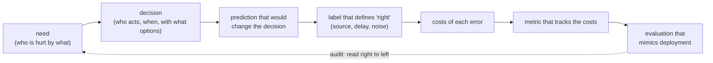
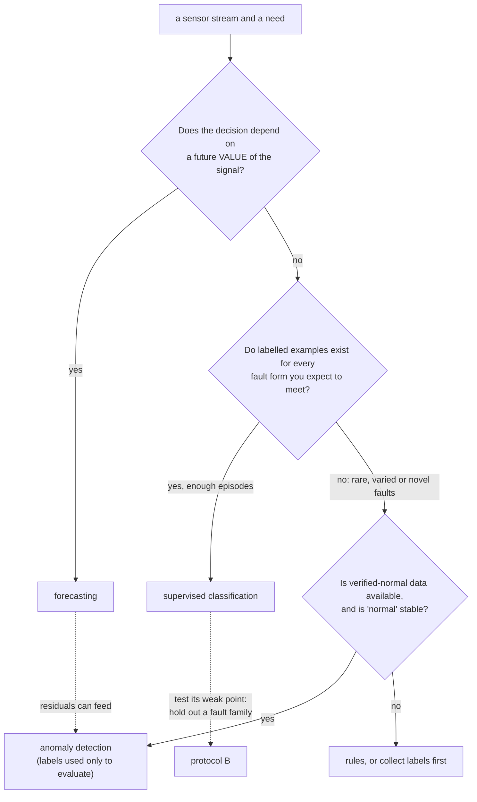
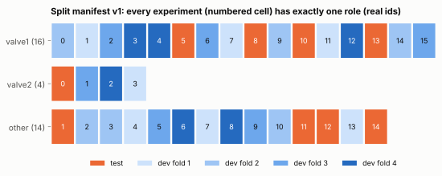
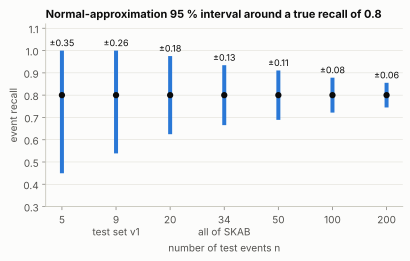
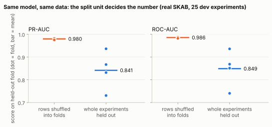

# W2D4 — Problem framing and versioned split definitions

**Unit id:** `w2d4` · **Week 2, day 4** · **Content status:** Execution verified (see [Verification record](#verification-record))
**Handbook:** [H1.1 From stakeholder need to prediction target](../../handbook/ch01_problem_formulation/h1_1_stakeholder_need_to_prediction_target.md) ·
[H1.2 Units, labels, costs and constraints](../../handbook/ch01_problem_formulation/h1_2_units_labels_costs_constraints.md) · H6.1 Leakage taxonomy (planned, w3d1)
**Data:** the lab uses the real SKAB recordings (`python project/get_skab.py`, GPL-3.0, not redistributed).
The worked example parts 1–3, all checks and the challenge table are SYNTHETIC and say so where they appear.

---

## 1. Purpose

**Primary objective.** Turn a stakeholder's need into an ML task you can defend, in writing, and
freeze the evaluation splits for the portfolio project in a versioned manifest that code can validate.

**What you will learn**

- A ten-item framing worksheet: decision, unit, prediction time and horizon, label, error costs,
  constraints, metric chain, baseline, splits, out of scope.
- Why the available labels and sampling structure, not model preference, decide between forecasting,
  classification and anomaly detection on the same sensor stream.
- How to derive the unit of splitting from the deployment situation, and why a split is *data*
  (a manifest under version control) and not a seed in code.
- What must not change once the first result has been computed.

**Why an applied ML engineer needs it.** Most failed ML projects fail before any model is trained:
the wrong thing is predicted, at a time when it cannot be acted on, measured by a number nobody's
decision depends on. In interviews, "how would you approach X?" is this lesson; candidates who jump
to architectures are marked down for it. For you specifically: your research gave you the task
pre-framed (a benchmark, a label file, a community-standard metric). In industry you write the frame.

**Prerequisites.** [W2D3](../w2d3_data_quality_ingestion/README.md) (ingestion; the lab ships the `flowguard.data`
snapshot it needs, so you can proceed without it) and the downloaded SKAB files. From Week 1: a
src-layout package and pytest. Your subject-wise evaluation experience is assumed, not re-taught.

**Time budget — essential path 2 h**

| Activity | Time |
|---|---|
| Read sections 1–2 | 30 min |
| Worked example: run both scripts, read the output against section 3 | 15 min |
| Guided lab, tasks 1–5 (the split) | 45 min |
| Guided lab, task 6 (problem statement) | 20 min |
| Assessment Q1–Q5 | 10 min |

**Optional extension — up to 1 h:** independent challenge (40–50 min), interview rep (10–15 min).

---

## 2. Conceptual explanation

### 2.1 Intuition: a model is an input to somebody's decision

A prediction has no value of its own. It has value when some person or system *does something
different* because of it. Framing is the act of writing down that causal chain precisely enough that
each link can be checked:

```
need  ->  decision  ->  prediction that would change the decision  ->  label that defines "right"
      ->  costs of being wrong  ->  metric that tracks those costs  ->  evaluation that mimics deployment
```

Read from the left, it is a design procedure. Read from the right, it is an audit: an evaluation that
does not mimic deployment makes the metric meaningless, a metric that ignores costs makes model
selection arbitrary, and so on back to "nobody needed this".




### 2.2 The worksheet, with precise terms

| # | Item | The question | Typical failure |
|---|---|---|---|
| 1 | **Decision supported** | Who does what differently, compared with today? | "Predict churn" (a model, not a decision) |
| 2 | **Unit of prediction** | One output per what? | Unit of prediction confused with unit of decision or of generalisation |
| 3 | **Prediction time and horizon** | At what moment, about which time span, with information up to when? | Features that did not exist at prediction time |
| 4 | **Label definition** | What exactly is a positive, who says so, how late, how wrong? | Label taken as ground truth; delay ignored |
| 5 | **Cost of errors** | What does each error type cost, to whom? | "Maximise F1" with no cost argument |
| 6 | **Constraints** | Latency, compute, cold start, interpretability, data rights | Discovered after the model is built |
| 7 | **Success metric chain** | Business quantity → operational proxy → development metric | Optimising the last without checking it tracks the first |
| 8 | **Baseline** | Result of doing nothing; result of the rule an expert would write | Comparing only against other models |
| 9 | **Splits** | What does a deployed model meet that it has not seen? | Random row split |
| 10 | **Out of scope** | Which nearby questions will this *not* answer? | Scope creep; over-claiming |

Three units are routinely conflated; keep them apart.

- **Unit of prediction:** what one model output refers to (a timestamp, a window, a customer-month).
- **Unit of decision:** what the user acts on (an alert, a call list). Often coarser; many predictions
  feed one decision.
- **Unit of generalisation:** what is new at deployment (a recording, a patient, a future month). This
  one determines the split.

### 2.3 Costs turn into thresholds and metrics

If a score `s` is a calibrated probability of the positive class and acting on a negative costs
`c_FP` while failing to act on a positive costs `c_FN`, act when the expected cost of acting is lower:

```
(1 - s) * c_FP  <  s * c_FN      <=>      s  >  c_FP / (c_FP + c_FN)
```

A ten-to-one cost ratio puts the threshold near 0.09, not 0.5. Two consequences: a stated cost ratio,
however rough, is more useful than a tuned F1 (F1 silently assumes a particular trade-off); and when
capacity rather than cost binds ("we can make 500 calls"), the decision is a top-k selection and the
matching metric is precision/recall at k.

Assumptions hidden in that formula: calibrated scores, costs that do not depend on the instance, and
independent decisions. Alert streams violate the last one (the tenth alert in an hour is worth less
than the first), which is why detection problems are scored per *event* (w3d4).

### 2.4 One sensor stream, three framings

The eight SKAB sensors sampled each second admit at least three tasks.

| Framing | Output | Labels needed | Fits when | Fails when |
|---|---|---|---|---|
| Forecasting | future sensor values | none beyond the signal | a decision depends on a future *value*; or as a source of residuals | nobody acts on the forecast itself |
| Supervised classification | P(fault) per window | positives **and** negatives for each fault form expected | faults recur in known forms with enough labelled episodes | new fault mechanisms appear (silent failure) |
| Anomaly detection | deviation from learned normal | verified-normal data; fault labels only to evaluate | faults are rare, varied, or novel | "normal" changes legitimately (new operating mode) |

What decides is in the data description, not in taste: SKAB has per-sample fault labels (so
classification is *possible*), one episode per recording and three families with different mechanisms
(so generalisation across fault types is the open question), and a designated fault-free recording
(so learning "normal" is supported). There is no future quantity anyone wants (so forecasting is at
most a means). Protocol B in the split exists precisely to test the classification framing's weak point.




### 2.5 From EEG to equipment, and where the analogy breaks

| Seizure / HFO detection | Fault detection on SKAB | Where it breaks |
|---|---|---|
| Patient is the unit of generalisation | Experiment (recording) is the unit | All SKAB recordings come from *one* testbed. There is no analogue of "new patient": cross-installation generalisation cannot be tested at all |
| Expert annotation of onset, with inter-rater disagreement | Label marks when the experimenter applied the cause | The protocol timestamp precedes the visible effect; early "positives" may be undetectable in principle |
| Event sensitivity, false detections per hour, latency | Event recall, false alerts per hour, detection delay | Same structure. The costs differ: a clinical false alarm burdens staff, an industrial one stops production |
| Interictal baseline for normalisation | Fault-free recording for reference statistics | One reference recording, from one day; "normal" is narrower than in multi-day EEG |
| Montage / hardware differences across sites | Sensor recalibration, different installations | Industrial drift is often deliberate and documented outside the data (a set-point change) |

The habit that transfers intact: *never split below the level at which samples are exchangeable.*
The habit that does not: reaching for the subject-wise split by reflex. In industry the recurring
entity is often supposed to be in both train and test (the same 200 shops next quarter), and the
thing that is new is *time*. Derive the unit; do not assume it.

### 2.6 Splits: why the experiment, and why a file

**Why the experiment.** Consecutive samples in a recording are strongly dependent. With `m` samples
per group and within-group correlation `ρ`, the information in `n` samples is roughly that of

```
n_eff = n / (1 + (m - 1) * ρ)
```

independent ones (the design effect). With about 1,100 rows per experiment and `ρ` far from zero,
34 recordings are much closer to 34 observations than to 37,401. A row-level split puts
near-duplicates of every test row in the training set, so it measures interpolation within a
recording, which deployment never asks for.

**Structure of the manifest** (`splits/v1.json`, [spec](../../docs/FLOWGUARD_SPEC.md)):

- `test`: whole experiments, stratified by family, opened for final reporting only;
- `dev_folds`: the rest, in grouped folds, for every modelling choice;
- `reference_normal`: the fault-free recording; used to learn "normal", never scored for recall;
- `protocol_b`: hold out the whole `other` family, to estimate behaviour on unseen fault mechanisms.

**Why stratify groups.** With a small family (`valve2`: 4 experiments), an unstratified draw omits it
from the test set in about 27 % of draws (9 of 34 drawn without regard to family:
`C(30,9)/C(34,9) = 0.27`), and the headline number then says nothing about it.

**Why a file and not a seed.** `GroupShuffleSplit(random_state=0)` is a function of the seed *and of
the list of groups*. Add one recording, change the order in which files are listed, or upgrade the
library, and "the same split" is a different split; experiments that were test become training data
and old results stop being comparable without anyone deciding so. A manifest is the decision itself:
it can be diffed, reviewed, hashed, and validated against the data. The seed stays in the manifest as
provenance, not as the definition.

**What is frozen after the first result.** Membership of the test set; the definition of an event and
of the metrics; the rule for excluding data. Changing any of them afterwards is legitimate only as a
new version, with every reported number recomputed and labelled with the version.

**How much the test set can tell you.** Event recall estimated from `n` events has standard error
`sqrt(p(1-p)/n)`. With the 9 test events of the reference split and true recall 0.8 that is 0.13: a
95 % interval of roughly 0.5 to 1.0. This is not a flaw of the split; it is the size of the dataset
stated honestly, and it is why w3d5 attaches intervals to everything.

The reference manifest drawn as a grid. Each numbered cell is one experiment; its colour is its only role.



*Real experiment ids from `splits/v1.json`: 4 + 1 + 4 test experiments, and development folds of
7/6/6/6. (This is manifest v1; w3d1 revises it so that experiments sharing duplicated rows stay together.)*



*What nine test events can tell you. The formula is the one above; the upper ends are clipped at 1.
No data is involved, only arithmetic.*


### 2.7 A concrete industry example

A logistics company asks for "a model that predicts late deliveries". Framing questions change the
project: the dispatcher can only re-route *before* a van leaves the depot, so prediction time is
loading, not en route; GPS features from the journey are unavailable then (they would have produced a
spectacular offline score); "late" is recorded by drivers pressing a button, often in batches at the
end of the shift, so label timestamps are unreliable; the depot can re-plan about 30 routes a day, so
the metric is precision in the top 30, and the baseline is "routes with more than 40 stops". The
split is by day (future days are new; drivers and postcodes recur). None of this involves choosing a model.

### 2.8 Limitations and common misconceptions

- **"Framing is a preamble; the real work is modelling."** The frame determines the ceiling. No model
  recovers from predicting at a time when action is impossible.
- **"Grouped splitting is always right."** It is right when groups are new at deployment. See 2.5.
- **"A fixed seed makes the split reproducible."** Only while the group list, its order and the
  library are unchanged (worked example, part 2).
- **"The test set shows the true performance."** It shows one estimate with an interval; on 9 events
  the interval is wide.
- **"Cost estimates are too uncertain to write down."** An explicit, wrong-by-a-factor-of-two ratio
  can be argued with and corrected. An unstated one is still there, hidden inside F1 or a 0.5 threshold.
- **Limits of this lesson's frame for SKAB:** a single laboratory testbed, induced faults, one
  episode per recording, a role-played stakeholder. The problem statement must say so.

---

## 3. Worked example

Two scripts in [`example/`](example/). Run from the repository root.

### 3.1 Synthetic: what a split estimates, and why a seed is not a split

```bash
python lessons/w2d4_problem_framing_splits/example/split_unit_demo.py     # about 15 s
```

**Data (SYNTHETIC, generated in the script).** 24 machines × 200 windows, 6 features. Each machine has
a sensor *fingerprint* (a constant offset on every feature, visible to the model) and an unobserved
*fault propensity*. The label depends on a genuinely transferable signal mixed into feature 0 and on
the machine's propensity. Schema: `X` (float, 6 columns), `y` (0/1), `g` (machine id).

**Output of the authoring run**

```
Part 1: what does each split estimate?  (ROC AUC, 5 split seeds)
  row-level split      mean 0.784   range 0.771-0.795
  machine-level split  mean 0.536   range 0.383-0.669
  truth: 200 new machines   0.525

Part 2: same code, same random_state=0, one extra machine in the list
  test set before: 6 machines; after: 7 machines
  machines that were test and are now training data: 4 -> ['M01', 'M10', 'M14', 'M20']

Part 3: a manifest is data
  sha256 of the manifest text: 5394bc4a85016a70
  adding machine M24 to the fleet changes this file by: nothing (M24 is simply unassigned,
  and validation fails loudly until someone decides where it goes)
```

**Key code decisions.** The "truth" is computed on 200 freshly simulated machines, which is possible
only because the data is synthetic; that is the one thing simulation is good for here. The random
forest is deliberately flexible enough to memorise fingerprints. Five split seeds are shown because
one seed would hide the spread.

**Interpretation.**
*Part 1.* The row-level split reports 0.78; the model in fact barely transfers (0.53 on new
machines), because it has learned which machine a window comes from and that machine's fault rate.
The machine-level split is centred on the truth but ranges from 0.38 to 0.67 with six test machines:
an honest estimate from few groups is *noisy*, and a single grouped split can mislead in either
direction. The size of the gap is a property of this simulation (strong fingerprints, weak signal);
the mechanism is general.
*Part 2.* Identical code and seed; one machine added to the fleet; four of the six former test
machines are now training data. Nothing warned anyone.
*Part 3.* The manifest does not move when the fleet changes, and a validator can refuse to proceed
until the new machine is assigned.

### 3.2 Real data: the same comparison on SKAB (development experiments only)

```bash
python project/get_skab.py                                                     # once
python lessons/w2d4_problem_framing_splits/example/skab_row_vs_experiment.py   # about 25 s
```

**Data.** The 25 development experiments of the reference manifest (27,804 rows); eight raw sensor
values per timestamp, label `anomaly`. The test set is not read. Schema: [project data dictionary](../../project/README.md).

**Output of the authoring run**

```
development pool: 25 experiments, 27804 rows, positive fraction 0.353
row-level 4-fold         PR-AUC 0.980 (folds 0.975-0.982)   ROC-AUC 0.986 (folds 0.982-0.987)
experiment-level 4-fold  PR-AUC 0.841 (folds 0.731-0.936)   ROC-AUC 0.849 (folds 0.740-0.936)
```

**Interpretation.** A random forest on raw sensor values "achieves" ROC-AUC 0.986 if rows are shuffled
into folds, and 0.849 when whole experiments are held out. Two things are worth as much attention as
the drop: the row-level folds agree with each other almost perfectly (0.982–0.987), which looks like
stability and is in fact four copies of the same leak; and the experiment-level folds range from 0.74
to 0.94, which is what six held-out recordings can tell you. The experiment-level number is itself
flattered (point-level metric at 35 % prevalence, raw values rather than causal features, no
threshold chosen); it is a baseline for the *protocol*, not a model result. Expect small differences
across library versions.

**Reproducibility.** Both scripts fix their seeds. Versions used: [docs/TESTED_VERSIONS.md](../../docs/TESTED_VERSIONS.md).

The same output as a picture, one dot per fold:



*Real SKAB, development experiments only. Look at the spread as much as the level: the tight orange
cluster is four copies of the same leak; the wide blue one is the honest uncertainty of six held-out
recordings. Regenerate with `python lessons/w2d4_problem_framing_splits/figures/make_figures.py`.*


---

## 4. Guided lab

Work in [`lab/`](lab/). It contains a `flowguard` package (v0.1.0) with a finished `data.py`
(the loader from the spec), a stub `splits.py`, a minimal `cli.py`, and a `PROBLEM_STATEMENT.md` template.

Use the package without installing it, from the repository root:

```bash
export PYTHONPATH=lessons/w2d4_problem_framing_splits/lab/src
python -c "from flowguard.data import load_raw; t = load_raw('data/raw/skab'); print(t.shape, t.experiment_id.nunique())"
```

Expected: `(46806, 14) 35`. If you see `FileNotFoundError`, run `python project/get_skab.py` first.
(An editable install in a virtual environment, as in w1d3, works equally well.)

Run the checks at any time; they use small synthetic tables, never the download:

```bash
python wb.py check w2d4
```

### Task 1 — Look before you split (10 min)

In a scratch session, answer from the tidy table: how many experiments per family; rows per
experiment; positive fraction per experiment; how many positive segments per experiment.

**Checkpoint.** 16 / 4 / 14 labelled experiments plus one fault-free recording; exactly one positive
segment in each labelled experiment. Write down, before coding, how many test experiments per family
a 25 % stratified split should give.

### Task 2 — `make_splits` (15 min)

Implement it in `lab/src/flowguard/splits.py` to the contract in the file's docstring.

Requirements the checks enforce: every labelled experiment in the test set or in exactly one dev
fold; each family with at least two experiments present in both test and development; about
`test_fraction` of experiments in test; `n_folds` non-empty, reasonably balanced folds; same seed →
same manifest, independent of row order; the seed actually used; the fault-free recording only under
`reference_normal`.

**Checkpoint.** `python -m pytest lessons/w2d4_problem_framing_splits/checks/test_make_splits.py -q`
passes.

**Debugging.**
- *Different result when rows are shuffled:* you are iterating over `unique()` in order of
  appearance. Sort the experiment ids before drawing.
- *A family missing from test for some seeds:* you shuffled all experiments as one pool. Draw within
  each family.
- *`valve2` entirely in test:* cap the per-family test count at `n - 1`.

### Task 3 — `validate_splits` (10 min)

Raise `ValueError`, naming the offending ids, for: an experiment on two sides or in two folds;
an id not in the data; a labelled experiment missing from the manifest; the fault-free recording in
test or a fold; a labelled experiment listed as reference-normal; a manifest whose `unit` is not
`experiment_id` or whose entries are not ids.

**Checkpoint.** `test_rejects_broken_manifests` passes for all eight cases. If only the overlap cases
pass, re-read the list: a validator earns its keep on the failures you did not think of.

### Task 4 — `save_splits` / `load_splits` (5 min)

Stable, diff-friendly JSON (sorted keys, indentation, trailing newline). `save_splits` raises
`FileExistsError` if the file exists and `overwrite` is false.

### Task 5 — `flowguard split` and the real manifest (10 min)

Add the subcommand described in `lab/src/flowguard/cli.py`, then freeze the project split:

```bash
python -m flowguard.cli split --raw-dir data/raw/skab --out lessons/w2d4_problem_framing_splits/lab/splits/v1.json
```

**Checkpoint.** Running it a second time fails with a one-line message and leaves the file
untouched. The reference implementation prints

```
wrote splits/v1.json: test=9 experiments, dev folds=[7, 6, 6, 6], reference_normal=1
```

with test = 4 `valve1` (`5, 8, 10, 13`), 1 `valve2` (`0`), 4 `other` (`1, 11, 12, 14`). Your
membership will differ unless your drawing procedure is identical; that is fine. What must match are
the properties: 34 experiments assigned once, every family in both test and development, 8–9 in test.

Copy `splits/v1.json` into your own project repository and commit it **now**, before any model exists.
From here on it changes only by becoming `v2`.

### Task 6 — The problem statement (20 min)

Fill in `lab/PROBLEM_STATEMENT.md`. One page, ten sections, positions rather than descriptions,
assumptions marked. The automated check verifies completeness only. Then score yourself with the
rubric in [assessment.md](assessment.md) and compare with the reference statement in the solutions tree.

**Completion criteria for the lab.** `python wb.py check w2d4` passes; `splits/v1.json` is committed
in your project repository; your problem statement scores no zero on *Decision*, *Label* or *Splits*.
Then `python wb.py mark w2d4 guided`.

---

## 5. Independent challenge

[challenge/README.md](challenge/README.md): frame a subscription-churn problem from a product
manager's brief and implement a split that is correct in **time** (a three-month label horizon) and
in **group** (customers the model has never seen), on a synthetic customer-month table. It transfers
the lesson to a case where the unit of generalisation is *not* simply "the group", and contains one
trap that does not exist in SKAB.

```bash
python wb.py check w2d4 --challenge
```

Set `python wb.py mark w2d4 independent` only if the checks pass without hints or the solution.

## 6. Progressive hints

For the challenge, in increasing strength: [1 concept](hints/hint1_concept.md) ·
[2 approach](hints/hint2_approach.md) · [3 partial implementation](hints/hint3_partial.md).
Full reference: `solutions/lessons/w2d4_problem_framing_splits/` (lab, challenge, model answers).

## 7. Assessment

[assessment.md](assessment.md): five reasoning questions (Q5 is the design-choice explanation), the
rubric for the written problem statement, and one interview rep on validation and leakage. Automated
checks cover the split code; the rubric covers the writing. Model answers and common incorrect answers:
`solutions/lessons/w2d4_problem_framing_splits/assessment_answers.md`.

## 8. Reflection and review

**You should now be able to, without notes:** fill the ten-item worksheet for an unfamiliar problem
in 15 minutes; name the unit of generalisation and derive the split from it; explain why a manifest
beats a seed; say what the test set of your project can and cannot resolve.

**Reflection (3 minutes, in `progress/notes.md`).** Take one of your published studies. What was the
decision it supported, and what would a product manager say was missing from its evaluation?

**Retrieval question (answer on the Week 2 review day, from memory).** A recording has 1,100 samples
with within-recording correlation 0.5. Roughly how many independent observations is that, and what
does it imply for a confidence interval computed over samples?

**Next:** `w2d5_feature_pipeline` — causal rolling features with train-only statistics. The manifest
you froze today decides which rows those statistics may see.

---

## Verification record

Executed 2026-11-21 on Python 3.13.18, NumPy 2.5.3, pandas 3.0.5, scikit-learn 1.9.1.

| What | Result |
|---|---|
| `example/split_unit_demo.py` | ran; output above copied from the run |
| `example/skab_row_vs_experiment.py` (real SKAB, dev experiments) | ran; output above copied from the run |
| Reference `flowguard split` on real SKAB | 9 test / 25 dev (folds 7, 6, 6, 6) / 1 reference; second run exits 2, file unchanged |
| `python tools/verify_checks.py lessons/w2d4_problem_framing_splits` | lab: reference passes, 6 mutants rejected; challenge: reference passes, 5 mutants rejected |
| Shipped starters | lab checks: 32 failed, 13 errors, 1 passed; challenge checks: 5 failed, 8 errors |
| Challenge numbers (churn rates 0.163 / 0.199, row counts) | computed from the committed CSV with the reference solution |

Not verified: time boxes (estimates); Python 3.11/3.12 (CI only); the industry example in 2.7 is
illustrative, not a documented case.
