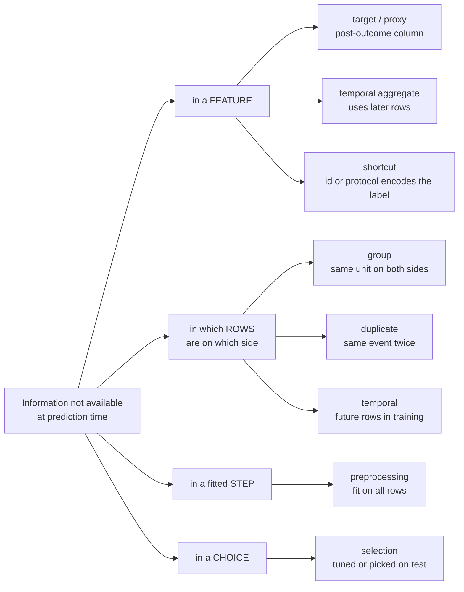
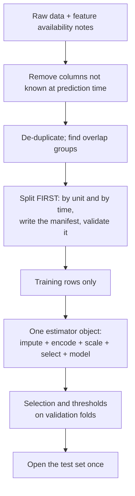
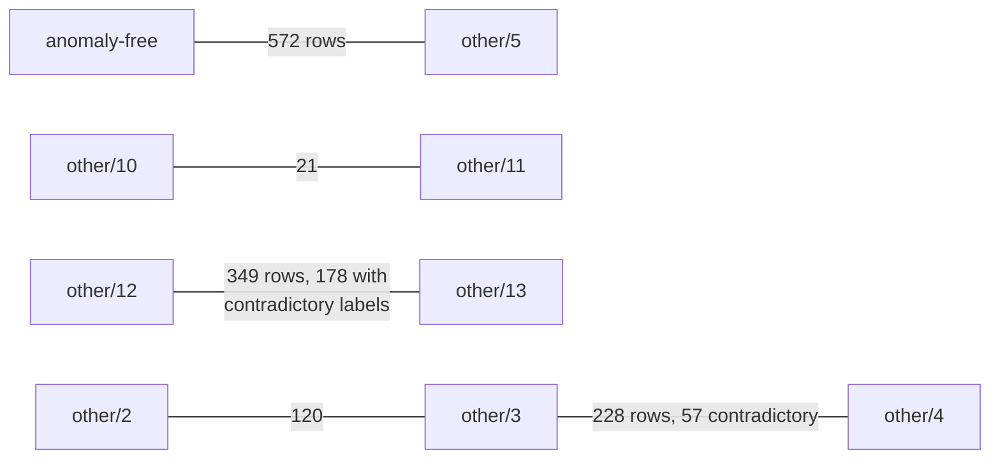
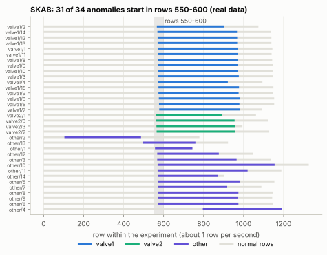
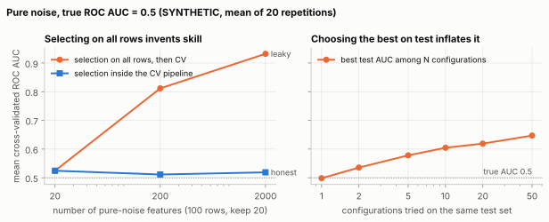

# w3d1 - Leakage: a taxonomy and prevention by construction

Status: see [STATUS.md](../../STATUS.md). Handbook:
[H6.1 Leakage taxonomy](../../handbook/ch06_evaluation_leakage_uncertainty/h6_1_leakage_taxonomy.md).
Solutions live in `solutions/lessons/w3d1_leakage/`; open them after your own attempt.

## 1. Purpose

**Objective.** Classify and remove target, preprocessing, temporal, group, duplicate, shortcut and
selection leakage; build evaluations in which the correct thing is the default rather than a
discipline you have to remember.

**Why an applied ML engineer needs it.** A leak is the single most common reason a model that looked
excellent offline disappoints in production, and it is invisible in code review because every line is
individually reasonable. In industry you rarely build the dataset yourself: it arrives as an export,
taken after outcomes were known, from systems that were never designed for modelling. Your job is to
ask of every column, row and step: *would this exist, in this form, at the moment the prediction is
made?* In this session an inherited script reports average precision 0.997 on a payment-risk problem;
the honest number is 0.297, and it is the honest number that predicts what later invoices get (0.280).

**Deliverables.**

1. `flowguard.splits` v2: `find_overlap_groups`, `make_splits(..., keep_together=...)`,
   `repair_splits`, and a `validate_splits` that rejects manifests separating experiments that share rows.
2. `flowguard.leakcheck`: `audit_features`, `time_monotone_columns`, `clock_probe`.
3. The project's repaired manifest `splits/v2.json` and the v1-versus-v2 table.
4. A leak report and a leak-free evaluation for a SYNTHETIC late-payment dataset (`lab/leakhunt/`).

**Prerequisites.** [w2d4](../w2d4_problem_framing_splits/README.md) (split manifest v1),
[w2d6](../w2d6_baselines_metrics/README.md) (baselines, PR-AUC, the clock finding), the "Amendments after
Week 2" in [docs/FLOWGUARD_SPEC.md](../../docs/FLOWGUARD_SPEC.md). Snapshots of the upstream `flowguard`
modules are in `lab/src/`, so neither lesson has to be finished. SKAB downloaded:
`python project/get_skab.py`.

**Time budget (2 h essential).**

| Activity | Minutes |
|---|---|
| Read section 2 | 25 |
| Worked example: `skab_leaks.py` (start `selection_leak_demo.py` in the background, it takes about 4 min) | 15 |
| Lab task 1: `find_overlap_groups` | 15 |
| Lab task 2: `make_splits(keep_together)`, `repair_splits`, `validate_splits`; run `v1_vs_v2.py` | 25 |
| Lab task 3: `leakcheck` | 10 |
| Lab task 4: leak hunt, `honest_eval.py` and `LEAK_REPORT.md` | 25 |
| Assessment questions 1-3 | 5 |
| **Optional extension (up to 1 h):** independent challenge (45), interview rep (15) | 60 |

## 2. Conceptual explanation

### 2.1 Definition

> **Leakage** is information used in training or evaluation that will not be available, or not in that
> form, when the model makes its predictions in deployment.

Two things follow from the definition and are worth holding on to.

* Leakage is defined **relative to a deployment moment**. `prior_late_rate` is legitimate for a model
  that scores invoices at issue time; `days_past_due` is legitimate for a model that scores them at
  day 45, and is a target leak for a model that scores at issue. No column is leaky in the abstract.
* Leakage affects two different things: the **model** (it learns a relationship that will not hold)
  and the **estimate** (the number you report is not the number you will get). A leak in evaluation
  only (for example choosing the best of many runs on the test set) leaves the model unchanged and
  corrupts only the estimate. Both are failures; they are fixed in different places.

### 2.2 The taxonomy, each kind with a test that detects it



| Kind | Mechanism | Detection probe | Prevention by construction |
|---|---|---|---|
| **Target / proxy** | a column is a consequence of the label (reminders sent after a late payment; a discharge code; a "resolved" flag) | single-feature AP or AUC near 1; feature importance dominated by one column; ask *when is this column written?* | a feature contract: each column documented with the time it becomes known; `audit_features` refuses the rest |
| **Temporal aggregate** | a statistic over the entity's history that includes the row itself or later rows (customer late rate over the whole export) | recompute the feature point-in-time and compare; the value changes for old rows when new data arrives | compute features as-of the prediction time (w2d2, w2d5); never `groupby().transform` over the whole table |
| **Shortcut / protocol** | an identifier, ordering or recording artefact that correlates with the label in this dataset only (ledger number range; elapsed time in SKAB; EEG session or site) | single-feature probe; **clock probe**; check correlation of features with time, id, batch | forbid ids and clocks by name; test whether a feature is a clock in disguise (`time_monotone_columns`) |
| **Group** | rows of one unit (patient, customer, machine, experiment) on both sides; the model learns the unit | grouped versus random split gives a large gap | split by unit; validate the manifest |
| **Duplicate / near-duplicate** | the same event appears twice (re-issues, copied files, overlapping windows) | exact-row hashing across sides; nearest-neighbour distance from test rows to training rows | de-duplicate before splitting; keep connected duplicates together |
| **Temporal** | training rows later than evaluation rows, or windows/labels that cross the boundary | forward split versus random split; purge test (w3d2) | split by time with a purge; causal features |
| **Preprocessing** | scaler, imputer, encoder, feature selector or PCA fitted on rows that include evaluation rows | change evaluation rows and see whether anything else moves | every fitted step inside the estimator (`Pipeline`, `ColumnTransformer`) |
| **Selection** | configurations, thresholds, features or seeds chosen by looking at test results | count the test looks; compare the best-of-N with a fresh hold-out | one-time test set; selection on validation only (w3d3) |

Two remarks on the table.

* **Preprocessing leakage is often numerically tiny and always wrong.** Standardising 100 rows with
  20 features on all rows before cross-validation changes the AUC from 0.522 to 0.521 in the worked
  example. A *supervised* fitted step is different: selecting 20 of 2,000 noise features on all rows
  turns a true AUC of 0.5 into 0.932. The rule is the same for both because you cannot know in advance
  which case you are in, and because a served model never sees statistics computed from the test period.
* **Protocol leakage is the one researchers know best and engineers meet most.** You have seen it as
  session, amplifier or site effects in EEG, or as time-on-task confounding a vigilance label. In SKAB
  it is elapsed time: faults were injected at about row 570 in almost every experiment.

### 2.3 Why leaks inflate, and by how much

For a target leak the arithmetic is trivial: a column that is a noisy copy of the label gives the model
the label. Two less obvious mechanisms are worth the mathematics.

**Selection on all rows.** With $p$ independent noise features and $n$ rows, each feature's sample
correlation with the label is roughly $\mathcal{N}(0, 1/n)$. Keeping the top $k$ of $p$ keeps
correlations of size about $\sqrt{2\ln(p/k)/n}$. Those correlations are real *in this sample*, including
in the rows that later become validation folds, so cross-validation rewards them. The effect grows with
$p$ and shrinks with $n$, which is what the worked example shows (0.524, 0.812, 0.932 for $p$ = 20, 200,
2,000 at $n = 100$; 0.691 at $n = 1{,}000$, $p = 2{,}000$).

**Best of N on the test set.** If each of $N$ equally useless configurations has a test AUC with
standard error $\sigma$, the expected maximum is about $0.5 + \sigma\sqrt{2\ln N}$ for large $N$
(independent estimates; correlated estimates inflate less). With 60 test rows $\sigma \approx 0.075$,
and the best of 50 is about 0.65 in the simulation. [w3d3](../w3d3_hyperparameter_selection/README.md)
develops this into nested validation.

### 2.4 Detection: probes that are cheap enough to run every time

* **"Too good to be true."** Compare with the best published or in-house result and with the
  difficulty of the task for a human. AP 0.997 for predicting late payment at issue time should start
  an investigation, not a celebration.
* **Single-feature probe.** Fit a one-feature model for each column and rank by validation score. A
  single column that nearly solves the task is either the whole story or a leak; find out which.
* **Shuffled-label probe.** Permute the labels and rerun the whole pipeline. Anything above chance is
  manufactured by the pipeline (selection, duplicates across sides).
* **Clock probe.** Score every row by elapsed time, or by the row's position in the recording. If that
  "detector" beats prevalence, the protocol predicts the label, and every feature correlated with time
  inherits that advantage.
* **Cross-side duplicate search.** Hash rows (or round and hash), join test against training; for
  near-duplicates, nearest-neighbour distance from each test row to the training set.
* **Availability audit.** For each feature write the system that produces it and the time at which it
  is known relative to the prediction. This is a conversation with a data owner, not a computation.
* **Perturbation test.** Change evaluation rows and check that nothing fitted moves (the checks of this
  lab use it to detect preprocessing leakage without looking at your code).

### 2.5 Prevention by construction



The common thread: make the leaky version *harder to write than the correct one*. A `Pipeline` makes
"fit the scaler on the test rows" impossible without deliberately breaking it; a manifest that
`validate_splits` checks against the data makes "random split" a visible, reviewable decision; a
forbidden-feature list makes `t` impossible to slip in.

### 2.6 The project's two verified leaks

Found on the real SKAB files in Week 2 and now made into code:



**Duplicate leakage.** Five pairs of files share 1,290 identical rows (timestamp and all eight sensors);
the connected components are the four overlap groups above. A split that puts `other/12` in test and
`other/13` in development evaluates the model partly on rows it was trained on, some of them with the
opposite label. The manifest v1 from w2d4 does exactly that.

**Protocol (clock) leakage.** In 31 of 34 experiments the anomaly starts in rows 550-600.



*Real data. Each row is one experiment; the coloured part is the labelled anomaly. Look at the vertical
alignment: position in the recording almost determines the label. A rule "row >= 570 is anomalous",
using no sensor at all, reaches point-level F1 0.808.*

### 2.7 A concrete industry example

*Illustrative composite, not a documented incident.* A hospital-operations team builds a model to
predict 30-day readmission from discharge records and reports AUC 0.93. The strongest feature is
"follow-up appointment scheduled", which in the export is filled in retrospectively when a patient is
readmitted and re-booked. At discharge time the field is empty for almost everyone. After the fix the
model reaches 0.71, which is still useful and is what the deployed model achieves. The same structure
appears in churn models with "cancellation reason", in fraud models with "chargeback filed", and in
predictive maintenance with "work order closed".

### 2.8 Limits and misconceptions

* **"I dropped the label column, so there is no target leakage."** Proxies of the label are the
  problem, and they rarely have the label's name.
* **"The leak only adds a few points."** It adds an unknown amount. On the invoice data the duplicates
  add 0.03, the temporal aggregate 0.06, the id 0.53. The small ones are the dangerous ones, because
  the result still looks plausible.
* **"Fitting the scaler on all rows is fine in practice."** It is often numerically harmless and always
  inconsistent with serving, where the test period's statistics do not exist. Fix it because the fix
  costs nothing and the check cannot tell harmless from harmful.
* **"Cross-validation protects me."** Cross-validation protects only what happens inside its loop.
  Anything fitted, selected or de-duplicated outside it leaks into every fold.
* **"Removing the leak made the model worse."** It made the *estimate* honest. The model was never as
  good as the leaky number.
* **"No probe fired, so there is no leak."** Probes find known kinds. The availability audit is the
  only general defence, and it needs someone who knows how the data were produced.

## 3. Worked example

Two scripts. Run them from the repository root. Outputs below were copied from runs on Python 3.13.18,
NumPy 2.5.3, pandas 3.0.5, scikit-learn 1.9.1.

### 3.1 The project's leaks on the real files

```bash
python project/get_skab.py                            # once
python lessons/w3d1_leakage/example/skab_leaks.py     # about 4 s, pandas only
```

```
files sharing identical rows (timestamp + 8 sensors):
                   file_a   file_b  shared_rows  contradictory_labels  share_of_b
anomaly-free/anomaly-free  other/5          572                     0       0.495
                 other/10 other/11           21                     0       0.018
                 other/12 other/13          349                   178       0.378
                  other/2  other/3          120                     0       0.106
                  other/3  other/4          228                    57       0.191
total shared rows 1290, with contradictory labels 235

anomaly onset row by family (min / median / max):
        count  min  median  max
family
other      14  104   570.5  796
valve1     16  566   573.0  578
valve2      4  560   563.0  565
experiments with onset in rows 550-600: 31 of 34
rule 'row >= 570 is anomalous', no sensors: precision 0.697, recall 0.961, F1 0.808
```

**Key decisions.** Rows are matched on timestamp *and* all eight sensors, not on sensors alone: two
experiments at the same operating point can have equal readings at different times without being
copies. Labels are deliberately excluded from the key: a duplicate with a contradictory label is still
a duplicate (it is the *worst* kind, because it puts label noise on both sides). `share_of_b` tells you
how much of the second file is a copy: half of `other/5` is the fault-free recording.

**Interpretation.** These are data-provenance facts, not modelling results. What they imply is a
constraint on any split (keep each component together; keep anything overlapping the fault-free
reference out of the test set) and a constraint on features (nothing that tracks elapsed time).

### 3.2 Three mechanisms on pure noise (SYNTHETIC)

```bash
python lessons/w3d1_leakage/example/selection_leak_demo.py     # about 4 min; start it and keep reading
```

```
1. feature selection (keep 20) outside vs inside the CV folds; true AUC = 0.5
   n     p   | selection on all rows | selection in pipeline
   100   20   |        0.524          |        0.524
   100   200  |        0.812          |        0.511
   100   2000 |        0.932          |        0.519
   1000  2000 |        0.691          |        0.493

2. scaling on all rows vs in pipeline (n=100, p=20): 0.521 vs 0.522

3. best test AUC among N equally useless configurations (n=200, test 60 rows)
   N = 1   -> 0.498
   N = 2   -> 0.536
   N = 5   -> 0.578
   N = 10  -> 0.605
   N = 20  -> 0.619
   N = 50  -> 0.647
```



*SYNTHETIC; features and labels are independent, so every point above 0.5 is manufactured by the
procedure. Left: with $p = 20$ selecting 20 of 20 is no selection, so both agree; the gap opens with $p$.
Right: the curve is what "we tried a few things and report the best test score" buys.*

**Key decisions.** Pure noise is the only setting where the right answer is known exactly, so it is the
right place to *measure* a procedure. Each number is a mean over 20 repetitions; individual runs vary by
several points. The scaling result is reported because it is the honest counterexample: a leak by
construction that this data cannot detect.

## 4. Guided lab

Work in `lessons/w3d1_leakage/lab/`. Given: `flowguard.data`, `flowguard.metrics`,
`flowguard.baselines`, `flowguard.benchmark`, the v1 manifest `splits/v1.json`, the complete scripts
`v1_vs_v2.py` and `leakhunt/leaky_baseline.py`. You write the parts marked `NotImplementedError`.

```bash
python wb.py check w3d1          # or: python -m pytest lessons/w3d1_leakage/checks -q
```

The starter fails 35 checks and errors on 18. One passes (`test_validate_accepts_clean_data`): the
v1 validator already accepts clean data; your job is to make it reject the rest. Check data are SYNTHETIC and tiny; the leak hunt is graded on the shipped export and on a
re-seeded one, so hard-coded answers fail.

**Task 1 - `find_overlap_groups(tidy, min_shared_rows=1)`** in `src/flowguard/splits.py`. Hash each row
on `datetime` plus the eight sensors, find hashes that occur in more than one experiment, count shared
rows per pair, and return the connected components (union-find, or repeated merging) as a list of sets,
sorted by smallest member.
*Checkpoint:* on the real data you get the four groups in the diagram above.
*Debugging:* if `other/12`/`other/13` is missing you included the label in the key; if you get one giant
group you hashed sensors without the timestamp.

**Task 2 - keep groups together.**

* `make_splits(tidy, seed, ..., keep_together=groups)`: the unit of assignment becomes the group; a
  group touching the reference recording is never placed in test; per-family stratification as before;
  the result has `"version": "v2"` and an `"overlap_groups"` key.
* `repair_splits(v1, groups)`: the *smallest* change to an existing manifest that keeps each group on
  one side. It never moves a development experiment into the test set (those were used for tuning), and
  leaves a group that is entirely in the test set where it is.
* `validate_splits(manifest, tidy)`: also raise when a group is separated or a group touching the
  reference is in test, **recomputing the groups from `tidy`**: a v1 manifest has no `overlap_groups`
  key and must still be rejected.

Then run:

```bash
python lessons/w3d1_leakage/lab/v1_vs_v2.py            # about 15 s; --write freezes splits/v2.json
```

Reference output:

```
overlap groups: [['anomaly-free/anomaly-free', 'other/5'], ['other/10', 'other/11'], ['other/12', 'other/13'], ['other/2', 'other/3', 'other/4']]
v1 is rejected: experiments ['other/10', 'other/11'] share rows but are separated: ['dev fold 1', 'test']

moved by the repair:
  other/11   test -> dev fold 1
  other/12   test -> dev fold 0
  other/4    dev fold 0 -> dev fold 1

| manifest | test experiments | test rows also in dev (contradictory labels) | flow_rate burn-in z: test PR-AUC | logistic regression: test PR-AUC | clock: test PR-AUC | test prevalence |
|---|---|---|---|---|---|---|
| v1 | 9 | 370 (178) | 0.805 | 0.827 | 0.513 | 0.373 |
| v2 | 7 | 0 (0) | 0.884 | 0.900 | 0.524 | 0.373 |

logistic regression on the 7 experiments that are test in both manifests: v1 training 0.899, v2 training 0.900

clock probe, all labelled experiments: PR-AUC 0.503 against prevalence 0.349; anomaly onset at t = 104..796 (median 572)
```

**Read this table carefully; it is not "the leak cost 0.07".** The v2 numbers are higher, but the test
set changed: two experiments (`other/11`, `other/12`) left it. On the seven experiments that are in test
under both manifests, training with or without the duplicates gives 0.899 versus 0.900, so the leak did
not measurably inflate this model's estimate. What it did was put 370 test rows into training, 178 of
them with the opposite label, which *lowers* v1's numbers for any model that fits training labels. The
right summary: v1 was wrong by construction; the size and direction of its error depended on the model;
v2 is the manifest every later lesson uses. Note also that the test set now has seven experiments, which
makes w3d5's intervals wider.

**Task 3 - `flowguard.leakcheck`.**

* `audit_features(columns, forbidden=FORBIDDEN_FEATURES)`: raise `ValueError` naming every forbidden
  column (`t`, `datetime`, labels, ids, family).
* `time_monotone_columns(features, tidy, threshold=0.95)`: Spearman correlation with `t` **within each
  experiment**, median of the absolute values; constant columns never reported. A cumulative counter
  restarts in every experiment, so correlating with the pooled row number misses it.
* `clock_probe(tidy, experiments=None, burn_in=0)`: average precision of the score `t` against
  prevalence, and onset statistics. *Checkpoint:* the last line of `v1_vs_v2.py` above.

**Task 4 - the leak hunt** (`lab/leakhunt/`, data `lessons/w3d1_leakage/data/invoices.csv`, SYNTHETIC).

The task: predict, when an invoice is **issued**, whether it will be paid late, so the credit team can
call early; the model will score invoices issued after the export. Schema (11,786 rows, one per invoice
in the export):

| Column | Meaning |
|---|---|
| `invoice_id`, `customer_id` | identifiers |
| `issue_date` | 2023-01-01 to 2024-12-31 |
| `amount`, `payment_terms_days`, `discount_offered` | invoice terms |
| `segment`, `industry`, `tenure_months` | customer attributes |
| `n_prior_invoices`, `prior_late_rate` | customer history up to the month before issue |
| `customer_late_rate` | the customer's late rate as stored in the export |
| `reminders_sent` | number of payment reminders sent |
| `ledger_ref` | accounting ledger number |
| `aux_0`, `aux_1`, `aux_2` | numeric fields from the source system |
| `paid_late` | label (prevalence 0.186) |

```bash
python lessons/w3d1_leakage/lab/leakhunt/leaky_baseline.py
```

```
rows 11786, late rate 0.186
test average precision: 0.997
top features:
reminders_sent        0.563
ledger_ref            0.305
customer_late_rate    0.031
prior_late_rate       0.016
amount                0.013
```

Five leaks are planted, of five different kinds, plus one structural flaw that has no measurable effect
on this data. Find them with probes, not by reading the generator (it is in `data/`, and reading it
defeats the exercise). Then implement `honest_eval.py` to its contract (`prepare`, `split`, `fit_model`,
`evaluate`) and fill in `LEAK_REPORT.md`.

*Checkpoints.* Your honest average precision should be roughly 0.25-0.35 at a test prevalence of about
0.18. The checks compare your reported AP with the AP your model gets on later invoices *as the scoring
service would see them*, generated separately: they must agree within 0.08.
*Debugging.*

* "the model reads 'X'": scrambling column X changed your result, so X is still a model input.
* "N invoices appear in training and again (re-issued) in the test period": find what a re-issue
  keeps from the original. Ids and dates change; look at what does not.
* "test rows influenced the fitted preprocessing": something in `prepare` or `split` computes a
  statistic over all rows. Move it into the estimator.
* "a row's score cannot depend on its batch": you normalised inside `predict_proba` per call.

**Completion criteria.** All lab checks pass; `v1_vs_v2.py --write` has produced `splits/v2.json`;
`LEAK_REPORT.md` names five leaks with kind, evidence and measured effect, and the structural flaw.

## 5. Independent challenge

A slide says "marketing touches predict lead conversion with AUC 0.9". The analysis behind it,
`challenge/published_analysis.py`, cross-validates and uses a held-out test set, and its number is still
meaningless. Measure why, and write the honest estimate. Task and acceptance criteria:
[challenge/README.md](challenge/README.md). No solution is given there.

```bash
python wb.py check w3d1 --challenge
```

## 6. Progressive hints

Open in order, and only after a real attempt.

1. [Concept](hints/hint1_concept.md) - the question to ask of each column, row and step.
2. [Approach](hints/hint2_approach.md) - which probe finds which leak, in what order.
3. [Partial implementation](hints/hint3_partial.md) - skeletons for `find_overlap_groups` and `honest_eval.py`.

## 7. Assessment

[assessment.md](assessment.md): reasoning questions, a design-choice explanation, a rubric and an
interview rep (validation and leakage). Model answers and common incorrect answers:
`solutions/lessons/w3d1_leakage/assessment_answers.md`.

## 8. Reflection and review

**You should now be able to, without help:**

* define leakage relative to a prediction moment, and classify a leak into one of eight kinds;
* name a probe that detects each kind and run it;
* explain why selection on all rows and best-of-N on test inflate estimates, with the order of magnitude;
* build an evaluation in which preprocessing, selection and de-duplication cannot leak;
* repair a split manifest minimally and validate it against the data.

**Reflection prompt (5 minutes, in `progress/notes.md`).** Think of one published EEG/iEEG result you
know well, yours or someone else's. Which of the eight kinds could have been present, and which probe
would have caught it? Was any step (channel selection, artefact thresholds, band choice) made on all
subjects before cross-validation?

**Retrieval question for later.** You are handed a churn table with a `cancellation_reason` column,
customers with several contracts, and a `days_since_last_login` computed at export time. Name the leak
kind of each and the fix.

**Next.** [w3d2 - group-aware and temporal validation](../w3d2_group_temporal_validation/README.md):
with leaks removed from the data, the remaining question is which validation scheme estimates the
deployment question. It uses the v2 manifest from today.

## Verification record

Executed 2026-11-22 on Python 3.13.18, NumPy 2.5.3, pandas 3.0.5, scikit-learn 1.9.1: both example
scripts, `leaky_baseline.py`, the reference `honest_eval.py`, `v1_vs_v2.py` with the reference package on
the 35 downloaded SKAB files, `make_invoices.py --check` (identical to the committed file),
`published_analysis.py` and the reference challenge solution, `figures/make_figures.py`, and
`python tools/verify_checks.py lessons/w3d1_leakage` for both parts. Not verified: Python 3.11/3.12
(CI only), time boxes. The industry example is illustrative, not a cited case.
