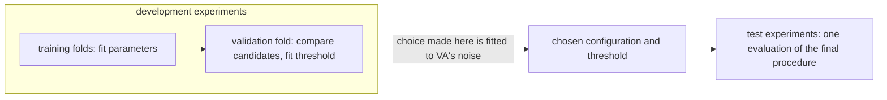
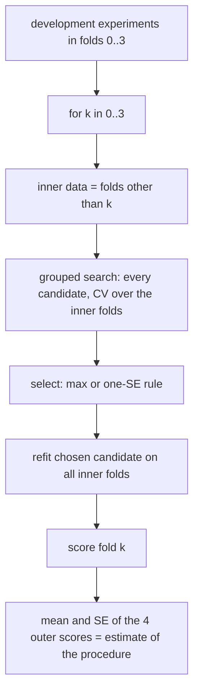
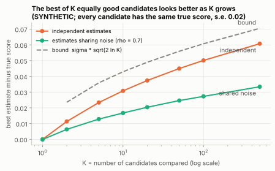
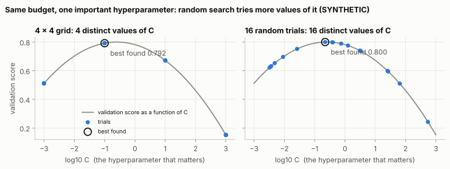
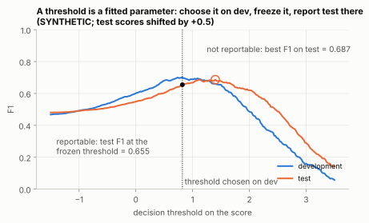
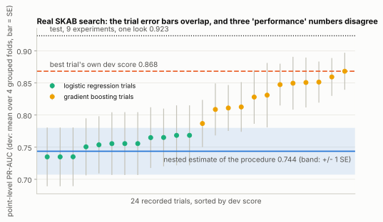

# w3d3 - Hyperparameter and threshold selection without fooling yourself

Status: see [STATUS.md](../../STATUS.md). Handbook: [H6.4](../../handbook/ch06_evaluation_leakage_uncertainty/h6_4_selection_and_nested_validation.md).
Solutions live in `solutions/lessons/w3d3_hyperparameter_selection/`; open them after your own attempt.

## 1. Purpose

**Objective.** Select hyperparameters and decision thresholds using only training and validation data,
and quantify the optimism of selection with nested validation.

**Why an applied ML engineer needs it.** Every model that ships was chosen: among families, settings,
feature sets, thresholds, seeds, "the run that worked". Each choice is a small fit to the data used to
compare candidates, and the score of the winner on that data is too high. In research the cost is an
inflated table; in a product it is a launch decision made on a number that will not be met, and a
threshold that pages people at a rate nobody predicted. Today you will see a real search on SKAB in which
the best trial's own score is 0.868, the honest estimate of the procedure is 0.744, and the four outer
folds cannot even agree on a model family.

**Deliverable.** `flowguard.selection` (tested), and `lab/SELECTION.md`: protocol, the three dev-side
numbers, one test evaluation at frozen thresholds, and your reading.

**Prerequisites.** [w3d2](../w3d2_group_temporal_validation/README.md) (grouped folds, the split manifest);
[w2d6](../w2d6_baselines_metrics/README.md) (PR-AUC, thresholds from dev). The lab ships snapshots of
`flowguard.data`, `splits` (manifest v2, overlap groups kept together), `features` (causal, burn-in
normalised, no clock features) and `metrics`. SKAB downloaded: `python project/get_skab.py`.

**Time budget (2 h essential).**

| Activity | Minutes |
|---|---|
| Read section 2, run the worked example | 30 |
| Lab tasks 1-3: candidates, grouped search, selection rules | 30 |
| Lab task 4: nested estimate | 20 |
| Lab task 5: thresholds | 15 |
| Lab task 6: run on SKAB (about 3-8 min of compute), write `SELECTION.md` | 15 |
| Assessment questions 1-3 | 10 |
| **Optional extension (up to 1 h):** challenge (60 recorded trials, one test look); interview rep | 60 |

## 2. Conceptual explanation

### 2.1 Selection is a second fit

Training fits parameters to training rows. Selection fits *choices* to validation scores. The two have
the same failure: the fitted object is adapted to the noise in the data it was fitted on, so its score on
that data is optimistic. The difference is only one of scale: a threshold is a one-parameter model fitted
to dev scores; choosing among 24 configurations is a model with 24 discrete options.



The quantity worth reporting is the performance of the **procedure** (search, select, refit, threshold)
on new experiments, not the dev score of the configuration it happened to pick.

### 2.2 The optimism of the maximum

Let K candidates have true scores `μ_i` and CV estimates `μ̂_i = μ_i + ε_i`. Choosing the largest
estimate and reporting it overstates the chosen candidate by `E[ε_winner] > 0`.

* If all candidates are equally good and the errors are independent `N(0, σ²)`, the optimism is
  `σ · E[max of K standard normals]`: 0.56σ for K=2, 1.54σ for K=10, 2.25σ for K=50, growing like
  `σ√(2 ln K)`.
* Candidates scored on the same folds share part of their error (correlation ρ). The shared part moves
  all candidates together and does not change the winner, so the optimism shrinks by `√(1−ρ)`.
* When candidates differ, the winner is good *and* lucky (the winner's curse): selection still helps, but
  the reported score is too high.

These are not exotic. With σ = 0.02 (a typical SE of a 4-fold PR-AUC) and 50 candidates, the winner looks
0.045 better than it is.

### 2.3 Nested validation

Wrap the procedure in an outer loop. For each outer fold k: run the whole search on the other folds only,
select, refit the selected candidate on those folds, and score fold k. Fold k never fitted a model, never
scored a candidate, never moved a threshold.



What it estimates is a property of the procedure. Different outer folds may pick different candidates;
that is information, not a malfunction: it says the search cannot separate the candidates with this data.

Two broken versions look nested and are not: (a) search once on all folds, then "cross-validate the
tuned model" (each outer fold has already voted for its winner); (b) inner folds split by rows (every
experiment on both sides of every inner split). Both are mutants in this lab.

### 2.4 Searching

* **Random beats grid** when few hyperparameters matter: with a budget of B trials, a grid over d
  dimensions tries `B^{1/d}` values of each, random search tries B. In the worked example (16 trials, one
  relevant hyperparameter) random search finds a better value than a 4×4 grid in 90 % of runs.
* **Log scales** for strengths and rates (`C`, learning rate).
* **Record every trial.** The lab's `grouped_search` returns all of them; selecting from a list you did not
  keep is how researcher degrees of freedom become invisible.
* **Budgets.** Successive halving and Hyperband (concept only) spend less on poor candidates; early stopping
  is a hyperparameter chosen on validation data. None changes the need to nest the estimate.

### 2.5 The one-standard-error rule

Among candidates whose mean is within one SE (of the best candidate) of the best mean, choose the
simplest. When the SEs exceed the gaps between the top means, the ordering among them is noise, and
simplicity (variance, latency, maintenance) is a better tiebreak than noise. It needs an explicit
complexity ordering; it does **not** remove optimism from the number attached to the choice.

### 2.6 Thresholds are hyperparameters

A decision threshold is fitted on development scores and frozen:

* the development scores must be **out-of-fold** (each row scored by a model that never saw its experiment);
* the test result is reported **at the frozen threshold**, never at the test-optimal one;
* an alert-budget threshold (lowest threshold whose false-alarm fraction on normal dev rows is within a
  budget) obeys the same rule.

### 2.7 How many times may you look at test?

Once per question. Every look that can change a decision is a selection on test. A bug discovered after a
test look is fixed, and the new test number is reported as obtained after a second look. The challenge
logs your looks.

### 2.8 Connection to what you know

EEG decoding papers often tune hyperparameters, channel sets or frequency bands with cross-validation that
includes the test subjects, or tune per-subject thresholds on the subject being scored. You will recognise
both as the broken versions of section 2.3. Leave-one-subject-out with an inner leave-one-subject-out for
tuning is nested validation; it is expensive, which is why it is often skipped, and the skipped version is
optimistic in exactly the way quantified here.

### 2.9 Industry example

A fraud team runs 300 trials of gradient-boosting hyperparameters on last quarter's data and reports the
best validation AUC, 0.912, to justify a launch. A nested estimate would have given about 0.89; live AUC
after a month is 0.887. The launch was still right, but the business case, which promised a 12 % reduction in
losses based on 0.912, was not met, and the next model's (honest) evaluation looked like a regression.
(Illustrative composite.)

### 2.10 Limits and misconceptions

* "CV is unbiased" - for a fixed configuration, approximately; not for the configuration CV selected.
* "Nested CV gives the performance of the final model" - it estimates the procedure; the final model is
  one draw from it.
* "If test beats the nested estimate, the nested estimate was pessimistic" - with 9 test experiments and
  4 outer folds both numbers are noisy; one comparison says little (see the lab).
* "The one-SE rule corrects optimism" - it changes the choice, not the bias of the attached number.
* "A threshold is post-processing, not a parameter" - it is fitted, so it must be fitted on dev.

## 3. Worked example: what selection does to the number you report

[`example/selection_demo.py`](example/selection_demo.py) is a SYNTHETIC simulation (NumPy only).

```bash
python lessons/w3d3_hyperparameter_selection/example/selection_demo.py
```

Output (run 2026-11-22, last four parts):

```
A/B. All K candidates have true score 0.70; each estimate has standard error 0.02.
     Mean amount by which the BEST estimate exceeds the truth:
        K   independent   correlated(rho=0.7)   sigma*sqrt(2 ln K)
        1      -0.0000          -0.0001              0.0000
        2      0.0114          0.0063              0.0235
        5      0.0234          0.0129              0.0359
       10      0.0308          0.0167              0.0429
       20      0.0374          0.0204              0.0490
       50      0.0450          0.0246              0.0559
      100      0.0501          0.0273              0.0607
      500      0.0607          0.0334              0.0705

C. 60 candidates whose true scores differ (s.d. 0.01), selected by a dev estimate with s.e. 0.02:
     dev estimate of the winner   0.7518
     true score of the winner     0.7104   (optimism 0.0415)
     true score of the true best  0.7232   (regret   0.0128)
     true score of a random one   0.6999
     the winner is the truly best candidate in 11.2% of repetitions

D. Budget 16 trials, score depends only on C (optimum 0.800):
     4x4 grid:  4 distinct values of C, best score found 0.7920
     random:   16 distinct values of C, best score found 0.7970 on average; beats the grid in 89.7% of runs
```



*Figure 1 (SYNTHETIC, σ = 0.02).* The optimism grows slowly with K (like √ln K) and is smaller when
candidates share noise, as they do when scored on the same folds. The bound is loose at small K.



*Figure 2 (SYNTHETIC).* A 4×4 grid spends its 16 trials on 4 values of the hyperparameter that matters;
random search tries 16.

Interpretation. Part C is the realistic case: the winner is better than a random candidate (0.710 vs
0.700), so selection helps, but its dev estimate (0.752) overstates it by 0.04, and it is the truly best
candidate only 11 % of the time. Selection is worth doing; its score is not worth reporting.



*Figure 3 (SYNTHETIC, test scores shifted by +0.5).* The circled test-optimal F1 belongs to no deployable
detector. The reportable number is test F1 at the threshold frozen on dev.

## 4. Guided lab: `flowguard.selection` on SKAB

Work in `lessons/w3d3_hyperparameter_selection/lab/`. Given and complete: `data.py`, `splits.py`,
`features.py`, `metrics.py`, `selection_report.py`. Yours: every function in `src/flowguard/selection.py`
and `SELECTION.md`.

Check at any time (offline, synthetic data, a few seconds):

```bash
python wb.py check w3d3          # or: python -m pytest lessons/w3d3_hyperparameter_selection/checks -q
```

All 40 checks fail on the starter.

**Task 1 - candidates (10 min).** `param_grid` (full product, deterministic order) and `sample_params`
(`loguniform`, `uniform`, `int`, `choice`; same seed, same list).

*Checkpoint.* `checks/test_candidates.py` passes 5 tests; one checks that log-uniform draws are uniform in
the exponent.

**Task 2 - grouped search (15 min).** `grouped_search`: for every candidate and fold k, fit a fresh
estimator on the rows of the *other folds* and score fold k. Rows outside the folds (test experiments,
the reference recording) are never fitted or scored.

*Checkpoint.* `test_search.py` passes 7 tests, including an independent oracle and a test that plants
rows outside the folds and detects any use of them.

*Debugging.* Oracle mismatch only on some folds: you build the training mask as "not in fold k", which
includes test rows. Non-determinism: you reused one estimator object across fits.

**Task 3 - selection rules (5 min).** `select_best` with `"max"` and `"one_se"` and the documented
tie-breaks.

*Checkpoint.* `test_select_best.py` passes 7 tests.

**Task 4 - nested estimate (20 min).** `nested_estimate`: outer loop over folds; inner search on the
others; select; refit on all inner folds; score the outer fold. Return the outer scores, their mean and SE,
the chosen params and the inner best score per fold.

*Checkpoint.* `test_nested.py` passes 9 tests. The one to read: on pure-noise data the best inner score is
visibly optimistic while the nested estimate stays near chance; the poisoned-fold test plants an outer fold
that would change the inner choice if it were used.

**Task 5 - thresholds (15 min).** `evaluate_at_threshold`, `select_threshold` (`best_f1`, `alert_budget`),
`frozen_threshold_evaluation`.

*Checkpoint.* `test_threshold.py` passes 12 tests (some parametrised). Two of them change only the test
data and require the threshold not to move.

**Task 6 - run on SKAB and read (15 min).**

```bash
python lessons/w3d3_hyperparameter_selection/lab/selection_report.py                    # 24 candidates
python lessons/w3d3_hyperparameter_selection/lab/selection_report.py --n-candidates 6   # quick look
```

The report searches two families (logistic regression and histogram gradient boosting, each with a
feature-window hyperparameter) with grouped 4-fold CV on the 25 development experiments, computes the
nested estimate with the one-SE rule, chooses thresholds on out-of-fold dev scores, and evaluates once on
the 9 test experiments. The search took 110 s on the original authoring run and 463 s on a busy
container; expect 2-8 minutes.

Expected with the reference implementation (yours must match to three decimals; all randomness is seeded):

```
dev experiments 25 in 4 folds, test 9; 24 candidates; metric = point-level PR-AUC

search: dev CV PR-AUC over candidates: min 0.735, median 0.778, max 0.868
  best trial    #17: 0.868 +/- 0.029 (SE over folds)  hgb, window 10, max_depth 4, learning_rate 0.045, max_iter 200
  one-SE choice #12: 0.859 +/- 0.029                   hgb, window 10, max_depth 4, learning_rate 0.262, max_iter 50

nested estimate of search + one-SE selection + refit: 0.744 +/- 0.036
  outer fold 0: inner selected mean 0.861 -> outer score 0.796  hgb, window 10
  outer fold 1: inner selected mean 0.821 -> outer score 0.637  logreg, window 10, C 0.0015
  outer fold 2: inner selected mean 0.834 -> outer score 0.758  hgb, window 0
  outer fold 3: inner selected mean 0.742 -> outer score 0.783  logreg, window 10, C 0.0015

TEST (looked at once), selected candidate refitted on all dev experiments:
  test PR-AUC 0.923   (dev CV of the selected trial 0.859, best dev CV of any trial 0.868, nested 0.744)
  threshold [best_f1] = 0.257:        dev P 0.741 R 0.776 F1 0.758 FAR 0.165 | test P 0.834 R 0.797 F1 0.815 FAR 0.106
  threshold [alert_budget 5%] = 0.915: dev P 0.854 R 0.482 F1 0.616 FAR 0.050 | test P 0.987 R 0.536 F1 0.694 FAR 0.005

for scale: elapsed time alone (no sensors) has test PR-AUC 0.535; test prevalence 0.401
```



*Figure 4 (real SKAB, 25 development and 9 test experiments).* The SE bars of the top trials overlap
heavily; the best trial's own score (dashed) sits far above the nested estimate of the procedure (solid,
band ±1 SE). The single test look (dotted) lands above both.

Things to see for yourself before reading the reference interpretation:

* why 0.868 is not "expected performance", and which number is;
* what it means that two outer folds chose logistic regression and two chose boosting;
* whether test 0.923 against nested 0.744 is evidence that nesting was pessimistic. Count the independent
  units on each side (4 outer folds of 6-7 experiments; 9 test experiments) and look at the spread of the
  four outer scores (0.637 to 0.796) before answering;
* what the alert-budget threshold buys (test false-alarm rate 0.5 % of normal rows) and costs (recall 0.54).

**Completion criteria.** All 40 lab checks pass; `SELECTION.md` is filled from your own run, states the
protocol (including the number of test looks: one), and gives the nested estimate, not the best trial's
score, as the expected performance, with its limitations.

## 5. Independent challenge

[`challenge/README.md`](challenge/README.md). Sixty recorded trials (SYNTHETIC) with five fold scores
each; choose one, attach an honest estimate, look at its sealed test score exactly once, and design a
simulation of the optimism of the maximum. Graded on 200 freshly generated tables: your estimate must be
unbiased for the trial you choose.

```bash
python wb.py check w3d3 --challenge
```

## 6. Progressive hints (open in order, only when stuck)

1. [Concept](hints/hint1_concept.md)
2. [Approach](hints/hint2_approach.md)
3. [Partial implementation](hints/hint3_partial.md)

If you open a hint, the work counts as guided, not independent.

## 7. Assessment

[`assessment.md`](assessment.md): six reasoning questions, one design-choice explanation, a rubric, and an
interview rep (ML fundamentals: regularisation and bias-variance). Automated checks: `checks/` (40 tests)
and `checks_challenge/` (16 tests), validated against the reference solution and against nine plausible
wrong submissions.

## 8. Reflection and review

**You should now be able to do, alone:** identify every selection step in an evaluation and the data it
used; estimate the optimism of a best-of-K result; implement nested grouped validation and explain what it
estimates; run a recorded random search; apply the one-SE rule with a justified complexity ordering;
choose and freeze thresholds on out-of-fold dev scores; keep a test-look budget.

**Reflection prompt** (5 lines, `python wb.py note w3d3 "..."`): in one of your published EEG/iEEG
results, list every choice that was made after looking at a score (band, channels, window, model,
threshold, epoch). Which data was each choice made on?

**Retrieval question for later** (w3d7 review and Week 4): you ran 50 configurations, the best has CV
score 0.81 with SE 0.02 per configuration, and errors are moderately correlated (ρ ≈ 0.5). Roughly how
much of 0.81 is selection optimism, and what would you compute instead?

**Next.** [w3d4 point versus event evaluation](../w3d4_point_vs_event_evaluation/README.md): the threshold
you froze today becomes alarms, and the post-processing parameters become two more hyperparameters to
select on dev.

## Verification record

Authored 2026-11-21/22, executed on Python 3.13.18, NumPy 2.5.3, pandas 3.0.5, scikit-learn 1.9.1,
matplotlib 3.11.2 (figures only), SKAB at commit `b2c0d46`.

* `python tools/verify_checks.py lessons/w3d3_hyperparameter_selection`: reference passes lab (40) and
  challenge (16); 5 lab and 4 challenge mutants rejected.
* Shipped starter: 40 of 40 lab checks fail; challenge 14 fail, 2 error.
* Worked example, `selection_report.py` (rerun on the reference solution; numbers above copied from that
  run), the challenge reference (`selection_rule.py`, `optimism.py`) and `figures/make_figures.py` executed.
* Not verified: time budgets; the industry example is an illustrative composite.
