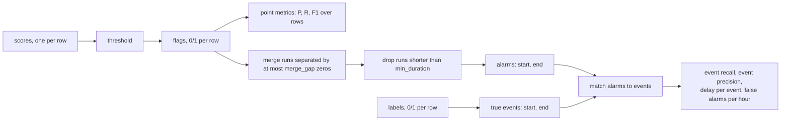
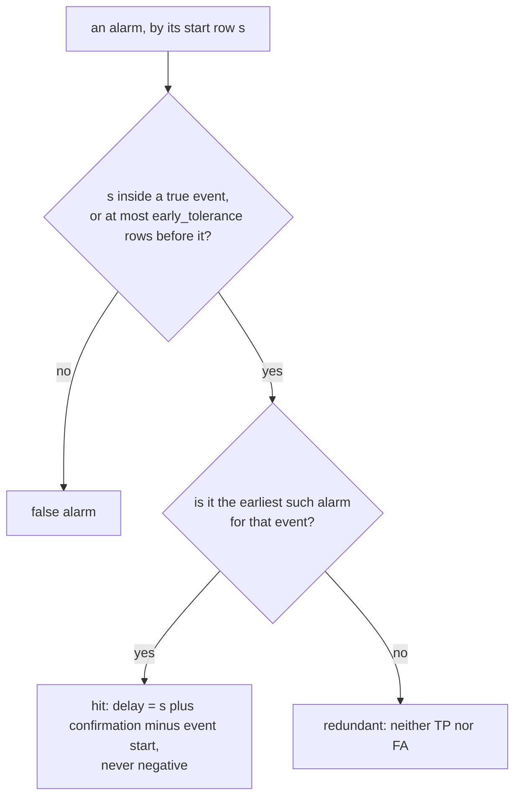
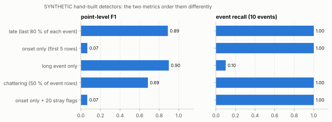
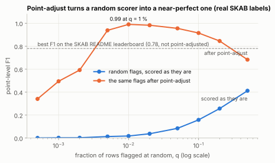
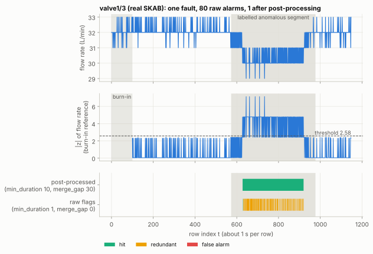
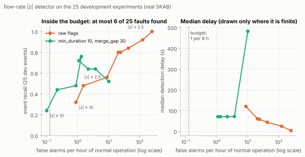

# w3d4 - Point-level versus event-level evaluation for detection

Status: see [STATUS.md](../../STATUS.md). Handbook: [H6.5](../../handbook/ch06_evaluation_leakage_uncertainty/h6_5_point_vs_event_evaluation.md),
[H7.3](../../handbook/ch07_timeseries_grouped_modeling/h7_3_event_matching.md).
Solutions live in `solutions/lessons/w3d4_point_vs_event_evaluation/`; open them after your own attempt.

## 1. Purpose

**Objective.** Implement and interpret point-wise metrics, event matching, detection delay and false
alarms per hour of normal operation, and explain when each one misleads.

**Why an applied ML engineer needs it.** The person who receives a detector's output does not
experience rows. They experience *alarms*: a pager going off, a ticket opened, a pump stopped for
inspection. Whether the detector is worth deploying depends on three numbers they can feel: how many
faults it catches, how long after onset, and how often it cries wolf. Point-level precision and
recall answer none of these directly, and on contiguous events they can rank detectors in the wrong
order. In this session the same flags will score point F1 0.785 and produce 403 separate alarms for
nine faults.

**Deliverable.** `flowguard.evaluation` (tested), and `lab/EVENT_EVAL.md`: the point-versus-event
table for the w2d6 baselines on real SKAB data, with the project's reporting decision.

**Prerequisites.** [w2d6](../w2d6_baselines_metrics/README.md) (baselines, point metrics, frozen
dev thresholds) and the split discipline of [w3d2](../w3d2_group_temporal_validation/README.md). The
lab ships snapshots of `flowguard.data`, `splits` (manifest v2, overlap groups kept together),
`baselines`, `metrics` and `benchmark`. SKAB downloaded: `python project/get_skab.py`. Your HFO and
seizure-detection evaluation experience transfers almost directly; section 2.7 says where it does not.

**Time budget (2 h essential).**

| Activity | Minutes |
|---|---|
| Read sections 2-3, run both worked examples | 30 |
| Lab tasks 1-2: write your own cases, then `extract_events` and `point_adjust` | 20 |
| Lab task 3: matching, recall, precision | 25 |
| Lab task 4: delay and false alarms per hour | 20 |
| Lab task 5: run the tables, write `EVENT_EVAL.md` | 15 |
| Assessment questions 1-3 | 10 |
| **Optional extension (up to 1 h):** challenge part A (alert budget) and part B (another domain); interview rep | 60 |

## 2. Conceptual explanation

### 2.1 Two units of analysis

A detector emits a score per row. A threshold turns scores into flags. Up to here everything is
per row, and point metrics (precision, recall, F1, PR-AUC) count rows. But faults are not rows: in
SKAB each labelled experiment contains exactly one contiguous anomalous segment of 188 to 586 rows.
The operator does not act on rows either; they act on *alarms*, which are runs of flags.



Everything after the flags is part of the detector, not of the metric: `merge_gap` and
`min_duration` are hyperparameters, chosen on development data like the threshold (w3d3).

### 2.2 Why point metrics mislead on contiguous events

Three mechanisms, each visible in the worked example:

1. **Long events dominate.** Point recall weights an event by its length. If one event holds 82 % of
   the anomalous rows, a detector that finds only that event scores point recall 0.82 and event
   recall 1/10.
2. **Timing is invisible.** Flagging the *last* 80 % of every event and flagging the *first* 5 rows
   of every event both find all events. Point F1 rates the late detector 0.89 and the early one 0.07.
   For a fault alarm the early one is the useful one.
3. **Fragmentation is invisible.** Flagging every other row of every event gives a moderate point
   recall and a stream of hundreds of alarms. Point precision does not see the operator's load.

The opposite failure also exists: a handful of stray flags in normal operation barely moves point
precision when anomalous rows are plentiful (35 % of SKAB rows), but each stray run is a separate
false alarm, and false alarms are what make operators switch detectors off.

### 2.3 Events, half-open intervals and post-processing

An event is a half-open pair `(start, end)`: rows `start .. end-1`. Half-open intervals make lengths
`end - start`, make adjacent events `(a, b), (b, c)` not overlap, and make slicing `x[start:end]`
exact. The lab's conventions (module docstring of `evaluation.py`) are:

* runs of flags separated by at most `merge_gap` zeros are merged (hysteresis in time);
* merged runs shorter than `min_duration` rows are dropped (confirmation);
* merge first, then filter: filtering first would delete the short fragments that merging was
  meant to join (one of the mutants does exactly this).

A minimum duration has a price that must be reported: an alarm that needs `d` rows of confirmation
is raised `d - 1` rows after its first flag. The lab adds that wait to the detection delay.

### 2.4 Matching rules

Matching decides which alarms "detect" which events. Every published scheme makes choices that
change the numbers:

| Choice | Options | This course's default |
|---|---|---|
| What counts as detecting | any overlap; IoU above a threshold; **alarm starts inside the event**; starts within a tolerance window around the onset | start inside, `early_tolerance = 0` rows |
| Several alarms in one event | each a true positive; **first is a hit, the rest are redundant**; extras are false alarms | first is a hit, rest redundant |
| Alarm running from normal operation into an event | detects it; **false alarm** | false alarm |
| Alarm before the labelled onset | detection with negative delay; **false alarm** unless within the tolerance | false alarm |

The reasoning: an alarm is news at the moment it starts. An alarm that started during normal
operation and stays on told the operator "something is wrong" before anything was wrong; when the
fault does start, the alarm carries no new information. Any-overlap would credit it with a detection
at delay zero. The tolerance exists because onsets are labelled imprecisely: SKAB marks a
`changepoint`, and maintenance logs in industry lag the true onset. A tolerance must be set from
what is known about label timing, stated, and kept fixed.



### 2.5 The event-level metrics

For one protocol, pooled over the test experiments:

* **Event recall** = detected events / true events.
* **Event precision** = hits / (hits + false alarms). Redundant alarms are excluded from both counts.
* **Detection delay** per true event: time from the true onset to the moment the hit is raised,
  `inf` for a missed event. Report the median and a high percentile **over all events, missed ones
  counted as infinite**. Averaging only over detected events rewards a detector for missing hard
  cases (a censoring error; one mutant drops the missed delays).
* **False alarms per hour of normal operation** = false alarms / hours outside true events. Hours come
  from timestamps, never from row counts: SKAB is "about 1 Hz" but has gaps up to 247 s. Decide
  explicitly what to do with gaps (the lab caps nothing by default and reports the alternatives).

Because false alarms are counts over an exposure, the honest report is the pair (count, hours) and
an upper confidence bound, not just the rate. For zero false alarms in `T` hours the one-sided 95 %
upper bound on a Poisson rate is `-ln(0.05) / T ≈ 3 / T` (the "rule of three"); in general it is
`chi2.ppf(0.95, 2(n+1)) / (2T)`. With 1.63 hours of normal operation in the SKAB test experiments,
zero false alarms is compatible with 1.84 per hour.

### 2.6 Point-adjust, and why it is not used here

A large part of the time-series anomaly-detection literature evaluates with **point-adjust**: if any
row of a true event is flagged, every row of that event is counted as detected, and point F1 is
computed afterwards. On long events this rewards a detector for a single lucky flag. The worked
example shows it on the real SKAB labels: flagging 1 % of rows *at random* gives point F1 0.021 raw
and 0.984 after point-adjust, above every non-adjusted entry of the SKAB leaderboard (best 0.78).
The phenomenon has been documented in the literature (Kim et al., AAAI 2022, "Towards a Rigorous
Evaluation of Time-Series Anomaly Detection"; cited from memory, not re-opened this session). The
course implements `point_adjust` only to demonstrate the effect. Point-adjusted numbers are never
reported.

### 2.7 Connection to what you know

This is HFO, spike and seizure-detection scoring. You have already chosen overlap criteria, counted
false detections per hour, and reported latency to seizure onset. Three things differ in industrial
monitoring:

* **Event rates.** Equipment faults are rare relative to normal hours; budgets are stated as "one false
  alarm per shift" or "per week". A per-hour rate measured on a few hours cannot certify such budgets
  (challenge part A makes you compute how many hours you would need).
* **Labels come from logs.** Onsets are recorded by a technician or a ticket system, late and with
  jitter; ends are often unknown. The tolerance window and "detected after the label" logic have to be
  built for that (challenge part B).
* **Alarm fatigue is the dominant cost.** A detector that triggers often is switched off, after which
  its recall is zero. Clinical seizure detection has the same problem; in industry it is usually the
  binding constraint.

### 2.8 Industry example

A water utility monitors pumping stations. A leak-detection model is evaluated by the data team at
point-level F1 0.81. Deployed, it pages the on-call engineer 30 times a night, mostly fragments of the
same few events plus brief pressure transients. After two weeks the alert is muted. Re-evaluated by
events, the same model finds 9 of 10 leaks at a median delay of 4 minutes but raises 12 false alarms
per hour; with a 10-minute confirmation and merging of gaps under 5 minutes it raises 0.3 per hour
and finds 8 of 10 at 14 minutes. That second configuration ships. (Illustrative composite, not a
documented incident.)

### 2.9 Limits and misconceptions

* "Event metrics fix leakage." They do not. On SKAB the elapsed-time "detector" finds 4 of 9 test
  events within 8 s under the strict rule and 8 of 9 under any-overlap, because onsets cluster near
  row 570 (see the lab's clock row). Held-out conditions fix leakage; metrics do not.
* "Higher event recall is better." Not without the false-alarm rate and delay next to it: flagging
  everything has event recall 1.0 under any-overlap.
* "p90 delay is a robust statistic." With nine events it is the worst or second-worst case.
* "A per-hour rate is a measurement." It is a count divided by an exposure; with few hours, the
  upper bound is the number to act on.
* "Post-processing is evaluation." It is part of the detector and must be tuned on dev only.

## 3. Worked examples

Both are complete and run from the repository root.

### 3.1 Hand-built detectors: the two metrics disagree

[`example/toy_point_vs_event.py`](example/toy_point_vs_event.py) builds a SYNTHETIC recording (6 h at
one row per 2 s, ten events, one of them long) and five hand-built detectors with known behaviour.

```bash
python lessons/w3d4_point_vs_event_evaluation/example/toy_point_vs_event.py
```

Output (run 2026-11-22):

```
rows 10800, sampling 2 s, anomalous rows 1470 (13.6%), events 10; the long event holds 82% of the anomalous rows

                                point P point R point F1 events found alarms false alarms/h median delay s
late (last 80 % of each event)      1.0     0.8    0.889        10/10     10            0.0           12.0
onset only (first 5 rows)           1.0   0.034    0.066        10/10     10            0.0            0.0
long event only                     1.0   0.816    0.899         1/10      1            0.0            0.0
chattering (50 % of event rows)     1.0   0.521    0.685        10/10    389            0.0            1.0
onset only + 20 stray flags       0.714   0.034    0.065        10/10     30           3.86            0.0
```



*Figure 1 (SYNTHETIC).* Read across a row: "long event only" is the best detector by point F1 and the
worst by events; "onset only" is the reverse. The chattering detector's 389 alarms do not appear in
either bar chart; that column of the table is what an operator would notice first.

Interpretation. Point F1 ranks by "share of anomalous rows covered", which is the right question for a
segmentation task and the wrong one for an alarm. "Onset only + 20 stray flags" still has point
precision 0.71 while raising 3.86 false alarms per hour.

### 3.2 Point-adjust on real labels

[`example/point_adjust_random.py`](example/point_adjust_random.py) flags rows at random with rate `q`
on all 34 labelled SKAB experiments (real labels, random detector) and scores the flags raw and after
point-adjust.

```bash
python lessons/w3d4_point_vs_event_evaluation/example/point_adjust_random.py
```

Output (run 2026-11-22):

```
34 experiments, 37401 rows, prevalence 0.349, event length 188-586 rows (median 399)

| flag rate q | raw P | raw R | raw F1 | PA P | PA R | PA F1 | events counted | expected events |
|---|---|---|---|---|---|---|---|---|
| 0.0005 | 0.292 | 0.001 | 0.001 | 0.994 | 0.206 | 0.341 | 7/34 | 5.9 |
| 0.0020 | 0.459 | 0.002 | 0.004 | 0.995 | 0.532 | 0.693 | 18/34 | 18.1 |
| 0.0100 | 0.371 | 0.011 | 0.021 | 0.981 | 0.986 | 0.984 | 33/34 | 33.1 |
| 0.0500 | 0.364 | 0.051 | 0.090 | 0.918 | 1.000 | 0.957 | 34/34 | 34.0 |
| 0.2000 | 0.350 | 0.200 | 0.254 | 0.729 | 1.000 | 0.843 | 34/34 | 34.0 |

Reference points on the same rows: flag everything gives F1 0.518; the best F1 on the SKAB README leaderboard (not point-adjusted) is 0.78.
```



*Figure 2 (real SKAB labels, random flags).* The orange curve is the same random detector after
point-adjust. It crosses the best published non-adjusted F1 at well under 1 % of rows flagged.

Interpretation. "Expected events" is `34 - Σ (1-q)^len`: the chance that at least one of an event's
rows is flagged. With events of ~400 rows, `q = 0.01` hits almost every event, so point-adjust credits
every row of nearly every event. The leaderboard figure (0.78) was read from the SKAB README at the
pinned commit.

## 4. Guided lab: `flowguard.evaluation` and the point-versus-event table

Work in `lessons/w3d4_point_vs_event_evaluation/lab/`. Given and complete: `data.py`, `splits.py`,
`baselines.py`, `metrics.py`, `benchmark.py`, `_seconds` and `evaluate_experiments` in
`evaluation.py`, and the scripts `event_table.py` and `tradeoff_curve.py`. Yours: every TODO in
`evaluation.py`, your own cases in `tests/test_evaluation.py`, and `EVENT_EVAL.md`.

Check at any time (offline, synthetic sequences, under 2 s):

```bash
python wb.py check w3d4          # or: python -m pytest lessons/w3d4_point_vs_event_evaluation/checks -q
```

All 54 checks fail on the starter.

**Task 1 - your cases first (10 min).** Before writing any code, add at least five cases to
`tests/test_evaluation.py`, drawn on paper first (a row of 0/1 for the truth, a row for the alarms):
an event touching the first and last rows; two alarms inside one event; an alarm starting two rows
before an event; a missed event; a recording sampled every 2 s; a logging gap of 300 s inside normal
operation. Write the answer you expect under the docstring conventions.

*Checkpoint.* Your tests fail with `NotImplementedError`, not with import errors.

**Task 2 - events from flags, and point-adjust (10 min).** Implement `extract_events` (merge, then
minimum duration) and `point_adjust`.

*Checkpoint.* `python -m pytest lessons/w3d4_point_vs_event_evaluation/checks/test_extract_events.py lessons/w3d4_point_vs_event_evaluation/checks/test_point_adjust.py -q` passes.

*Debugging.* An event that runs to the last row disappears: you only close a run when a 0 follows it;
append a sentinel. Off-by-one ends: you used the index of the last 1 as `end`; `end` is exclusive.

**Task 3 - matching (25 min).** Implement `match_events`, `event_recall`, `event_precision`. Process
alarms in order of start; for each, find the true event it detects (if any) under the tolerance rule.

*Checkpoint.* `test_matching.py` passes. The tests that matter most: an alarm that starts in normal
operation and runs into an event is a false alarm and does *not* detect it; two alarms in one event
give one hit and one redundant.

*Debugging.* Recall above 1.0: you count hits per alarm instead of per event. Precision changes when
you add a redundant alarm: redundant alarms must not enter either count.

**Task 4 - time (20 min).** Implement `detection_delay`, `delay_summary`, `normal_hours`,
`false_alarms_per_hour`. Delays use `times`, include the confirmation rows of a minimum duration, are
never negative, and are `inf` when missed.

*Checkpoint.* `test_time.py` passes, including the 2 s sampling case and the gap case.

*Debugging.* Hours too small by a factor of about 1.1 on SKAB: you counted rows. Median delay
suspiciously small: you dropped missed events before taking the median.

**Task 5 - run and read (15 min).**

```bash
python lessons/w3d4_point_vs_event_evaluation/lab/event_table.py
python lessons/w3d4_point_vs_event_evaluation/lab/event_table.py --min-duration 10 --merge-gap 30
python lessons/w3d4_point_vs_event_evaluation/lab/tradeoff_curve.py
```

Expected with the reference implementation (yours must match exactly; the metrics are deterministic):

```
experiments: dev 25, test 9 (other/2, other/3, other/4, other/6, valve1/10, valve1/12, valve1/14, valve1/3, valve2/3)
test rows evaluated: 8923 (3577 anomalous, 9 events); burn-in 100 rows; min_duration=1, merge_gap=0

| detector | point P | point R | point F1 | F1 after point-adjust | events found | alarms | false alarms | redundant | event P | false alarms / h | median delay s | p90 delay s |
| random | 0.401 | 1.000 | 0.572 | 0.572 | 0/9 | 10 | 10 | 0 | 0.000 | 6.1 | missed | missed |
| elapsed time t (no sensors) | 0.679 | 0.889 | 0.770 | 0.772 | 4/9 | 9 | 5 | 0 | 0.444 | 3.1 | missed | missed |
| flow_rate abs z, burn-in | 0.889 | 0.703 | 0.785 | 0.958 | 9/9 | 403 | 156 | 238 | 0.055 | 95.8 | 34 | 58 |
| max abs z, burn-in | 0.715 | 0.458 | 0.558 | 0.793 | 7/9 | 221 | 98 | 116 | 0.067 | 60.2 | 60 | missed |
| Mahalanobis, burn-in | 0.721 | 0.509 | 0.596 | 0.851 | 8/9 | 238 | 127 | 103 | 0.059 | 78.0 | 60 | missed |
| logistic regression (supervised) | 0.906 | 0.744 | 0.817 | 0.963 | 8/9 | 387 | 144 | 235 | 0.053 | 88.4 | 43 | missed |

normal operation in the evaluated test rows: 1.63 h (wall clock, gaps included)
```

With `--min-duration 10 --merge-gap 30` the single-sensor detector drops to 15 alarms (7 false,
4.3 per hour) and finds 8 of 9 events at a median delay of 52 s.



*Figure 3 (real SKAB, `valve1/3`).* One fault. The raw flags (orange, bottom row) are 80 separate
alarms, all inside the event: one hit and 79 redundant. After merging gaps of up to 30 rows and
requiring 10 rows of confirmation, one alarm remains.



*Figure 4 (real SKAB, 25 development experiments).* The curve an operating point is chosen from. The
dashed line is a budget of one false alarm per 8 hours. Note that with post-processing recall is not
monotone in the threshold: at low thresholds the merged alarm starts before the onset and becomes a
false alarm. Missing delays in the right panel are where the median event was missed.

Things you should be able to see for yourself, before reading the reference `EVENT_EVAL.md`:

* the detector whose rank changes most between point F1 and the event columns, and why;
* what point-adjust does to every row, including the random one;
* how many test events the clock "detects", and what the any-overlap rule would have said;
* why no false-alarm rate in this table supports an operational claim.

**Completion criteria.** All 54 lab checks pass; your own tests in `lab/tests` pass and include the
six cases of task 1; `EVENT_EVAL.md` contains both tables, the clock analysis, and a one-sentence
reporting decision and matching rule for the project.

## 5. Independent challenge

[`challenge/README.md`](challenge/README.md), two parts:

* **A - an alert budget.** Choose threshold, `min_duration` and `merge_gap` on development data so
  the detector raises at most one false alarm per eight hours, evaluate once on test, and write the
  sentence you would send the reliability engineer. Graded by checks (selection logic, exact Poisson
  bound) and a rubric (the claim must be one the data supports).
* **B - another domain.** Intermittent network outages of 3-20 s with ticket-log labels that lag by
  0-8 s (SYNTHETIC). The SKAB rule gets both detectors wrong; design, implement and defend a rule.

```bash
python wb.py check w3d4 --challenge
```

## 6. Progressive hints (open in order, only when stuck)

1. [Concept](hints/hint1_concept.md)
2. [Approach](hints/hint2_approach.md)
3. [Partial implementation](hints/hint3_partial.md)

Reference solutions: `solutions/lessons/w3d4_point_vs_event_evaluation/`. If you open a hint, the
work counts as guided, not independent.

## 7. Assessment

[`assessment.md`](assessment.md): six reasoning questions, one design-choice explanation, a rubric,
and one interview rep (Python: interval merging and overlap). Automated checks: `checks/` (54 tests)
and `checks_challenge/` (13 tests), validated against the reference solution and against eleven
plausible wrong submissions. Passing them means your functions follow the conventions; it does not
mean your matching rule is the right one for a new domain.

## 8. Reflection and review

**You should now be able to do, alone:** turn scores into alarms with explicit post-processing; state
a matching rule and its consequences; compute event recall, event precision, censored delays and
false alarms per hour from timestamps; explain why point-adjusted numbers are uninformative; express a
false-alarm rate as count, exposure and upper bound; choose an operating point from dev data under a
budget.

**Reflection prompt** (5 lines, `python wb.py note w3d4 "..."`): in your HFO or seizure-detection
work, which matching rule did you use, was it written down before the results, and would any-overlap
have changed a headline number?

**Retrieval question for later** (w3d7 review, and again in Week 7): a detector raised zero false
alarms in 2 hours of held-out normal operation. The requirement is at most one per 8 hours. What can
you claim, and how many hours of clean operation would you need to claim the requirement is met at
95 % confidence?

**Next.** [w3d5 uncertainty](../w3d5_uncertainty/README.md) puts intervals on these counts: nine events
and 1.63 hours are the reason every number in today's table needs one.

## Verification record

Authored 2026-11-21/22, executed on Python 3.13.18, NumPy 2.5.3, pandas 3.0.5, scikit-learn 1.9.1,
matplotlib 3.11.2 (figures only), SKAB at commit `b2c0d46`.

* `python tools/verify_checks.py lessons/w3d4_point_vs_event_evaluation`: reference passes lab (54)
  and challenge (13); 7 lab and 4 challenge mutants rejected.
* Shipped starter: 54 of 54 lab checks fail; challenge 9 fail, 4 error.
* Both worked examples, `event_table.py` (two settings), `tradeoff_curve.py`, the challenge
  `budget_report.py` and `outages.py`, and `figures/make_figures.py` were run on the reference
  solution; outputs above are copied from those runs. Interview-rep reference: 5 tests pass.
* Not verified: the Kim et al. citation (from memory); time budgets.
