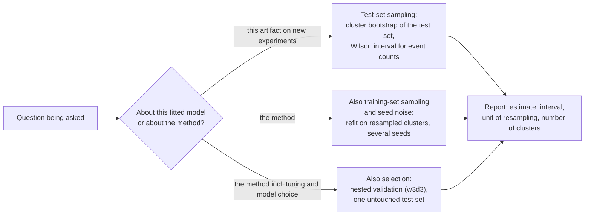
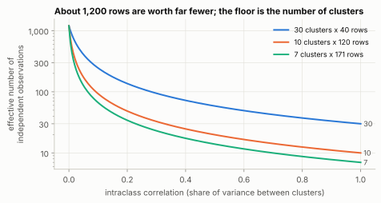
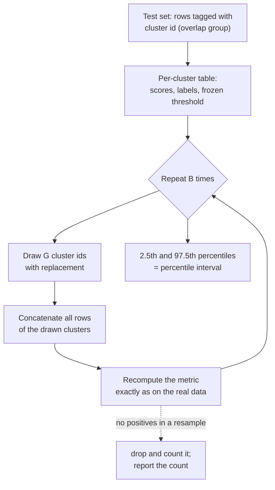
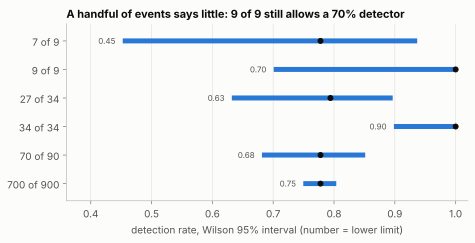
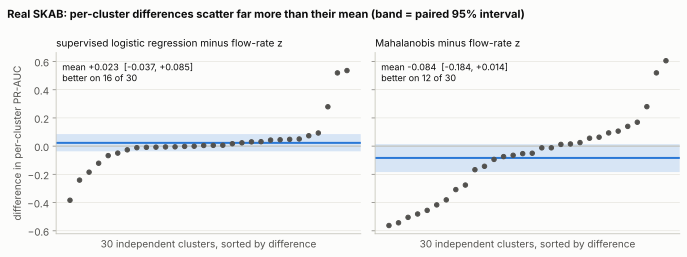
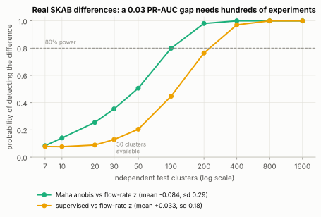
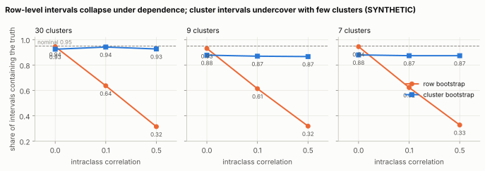
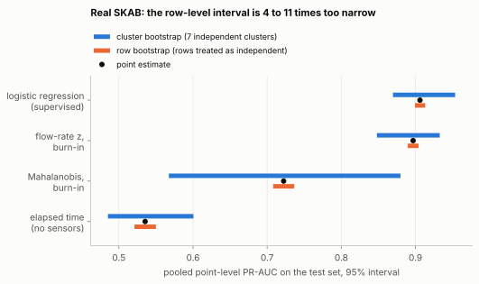

# W3D5 — Uncertainty: cluster bootstrap, paired comparisons, small-n honesty

Unit id `w3d5_uncertainty` · Week 3, day 5 · Handbook: [H6.6](../../handbook/ch06_evaluation_leakage_uncertainty/h6_6_bootstrap_and_paired_comparisons.md)
· Content status: see [STATUS.md](../../STATUS.md)

## 1. Purpose

**Objective.** Attach defensible intervals to evaluation metrics when the independent unit is the
experiment and not the sample, and compare two models with paired resampling on the experiments
they share.

**Why an applied ML engineer needs it.** Every model decision in industry is a comparison: ship B
instead of A, keep the simple baseline, pay for more labelled data. The comparison is made on a
finite evaluation set whose rows are almost never independent (many rows per machine, customer,
store, session, patient). A metric reported to three decimals without an interval invites decisions
on noise; an interval computed on the wrong unit is worse, because it looks rigorous. You will be
asked "is that difference real?" in design reviews and in interviews, and the honest answer is often
"we cannot tell yet, and here is what it would take".

**Deliverable.** A tested `flowguard.uncertainty` module, and the project's baseline table with
intervals and paired comparisons, with a stated unit of resampling (`lab/INTERVALS.md`).

**Completion criteria.**

* `python wb.py check w3d5` passes (guided practice).
* `lab/INTERVALS.md` contains your tables from the real data and four short answers.
* Independent skill: the challenge checks pass and `challenge/CLAIMS.md` is written without hints.

**Prerequisites.** [w2d6](../w2d6_baselines_metrics/README.md) (baseline scorers, point-level metrics;
the lab ships snapshots), the split manifest idea from [w2d4](../w2d4_problem_framing_splits/README.md),
and the overlap groups described in [project/README.md](../../project/README.md). Event-level
metrics (w3d4) are *not* required; one table uses a simple event count as a preview.
Assumed: you know what a sampling distribution and a p-value are, and you have reported
per-subject statistics in papers.

**Time budget (2 h essential).**

| Activity | Minutes |
|---|---|
| Read sections 2-3, run the two worked examples | 40 |
| Guided lab: implement `flowguard.uncertainty`, run it on SKAB, write `INTERVALS.md` | 55 |
| Independent challenge: start (finish in the extension or on the review day) | 15 |
| Assessment and reflection | 10 |
| *Optional extension: finish the challenge, BCa comparison, McNemar power* | *up to 60* |

Data needed for the real-data steps: `python project/get_skab.py` (once). Checks need no download.

## 2. Conceptual explanation

### 2.1 What an interval is a statement about

A 95% confidence interval is the output of a procedure that, over repeated draws of *the thing you
declared random*, contains the fixed true value 95% of the time. It is not "the metric is in here
with probability 0.95", and it is silent about anything you held fixed.

So the first question is always: **what is being imagined as redrawn?** For an evaluation number
there are four candidates, and each procedure captures only some of them.

| Source of variation | "If we repeated..." | Captured by | Not captured by |
|---|---|---|---|
| Test-set sampling | ...the evaluation on other experiments from the same population | cluster bootstrap of the test set; Wilson interval on events | seed repeats |
| Training-set sampling | ...the data collection used for fitting | refitting on resampled training clusters; cross-validation spread (roughly) | test-set bootstrap with a fixed model |
| Optimisation / seed noise | ...training with another seed, same data | mean ± sd over seeds | any single-model interval |
| Selection | ...the whole process of choosing features, hyperparameters, thresholds, *and which model to report* | nested validation (w3d3); a held-out test used once | everything else |

Today's intervals condition on the fitted model: they describe **test-set sampling** only. That is
the right quantity for "how well does *this* artifact do on new experiments like these". It is the
wrong quantity for "how good is this *method*", which also needs the second and third rows.



### 2.2 Why rows are the wrong unit

Take `G` clusters with `m` rows each. Suppose rows within a cluster are correlated with intraclass
correlation `ρ` (ICC): the share of total variance that is between clusters. For a pooled mean,

```
Var(mean) = σ² / (G·m) · [1 + (m − 1)·ρ]
                          └── design effect ──┘
```

The design effect is the factor by which a row-level analysis underestimates the variance. The
*effective sample size* is `G·m / deff`. With `m = 40` and `ρ = 0.5`, 1,200 rows are worth
`1200 / 20.5 ≈ 59` independent observations; as `ρ → 1` they are worth `G`.



*Formula, no data. The same 1,200 rows arranged as 30, 10 or 7 clusters: at an ICC of 0.2 they are
worth about 136, 48 and 34 independent observations. Source: `handbook/figures/h6_6/make_figures.py`.*

You know this structure. Windows from one subject share electrode placement, impedance, skull
thickness, medication and state; epochs are not independent trials of "a human". In an EEG decoding
paper the subject is the random effect and the test is across subjects. On SKAB the experiment is
the unit for the same reason: one valve setting, one fill level, one day's temperature, one
labelling decision. In a churn model it is the customer; in demand forecasting, the store-week block.

Metrics such as PR-AUC are not means, but the mechanism is identical: rows of one experiment move
together, so resampling rows manufactures replicate datasets that are far more alike than two real
test sets would be.

### 2.3 The cluster bootstrap

The bootstrap replaces the unknown population by the sample and asks how the statistic varies when
the sample is redrawn from itself. The redraw must mimic the real sampling process. Experiments
were what got sampled, so **experiments are what get redrawn**:

1. Draw `G` cluster ids with replacement from the `G` clusters.
2. Build the pseudo-dataset from all rows of the drawn clusters (a cluster drawn twice appears twice).
3. Recompute the metric exactly as on the real data.
4. Repeat `B` times. The 2.5th and 97.5th percentiles of the `B` values are the **percentile interval**.



Decisions hidden in "recompute the metric exactly":

* **Thresholds stay frozen.** A threshold chosen on dev is part of the model. Re-choosing it inside
  each replicate would answer a different question (and leak test labels).
* **Pooled versus per-cluster metrics.** Pooled PR-AUC weights long experiments more and mixes score
  scales across experiments; the mean of per-experiment PR-AUC weights experiments equally. They
  are different estimands with different intervals. Say which one you report.
* **The cluster is the unit of independence, which is not always the file.** Five pairs of SKAB
  files share identical rows, so `other/2`, `other/3` and `other/4` are one cluster: all 34
  labelled experiments form **30** independent clusters. The frozen v2 test set (w3d1) has 7
  experiments, each its own cluster, because w3d1 moved every overlap group to development.

**When the bootstrap fails, and it fails exactly where you are working.**

* *Few clusters.* With `G = 7` there are only `C(13, 7) = 1,716` distinct resamples, and the
  resampled variance is biased low by about `(G − 1)/G`. In the worked example a nominal 95%
  interval covers the truth about 87-88% of the time with 7 or 9 clusters. The interval you
  compute on 7 clusters is a lower bound on the uncertainty.
* *Extreme statistics.* Maximum, minimum, "worst experiment": the bootstrap distribution cannot
  exceed the sample extreme.
* *Ratio metrics with empty resamples.* Recall or PR-AUC is undefined when a resample has no
  positives; precision when nothing is flagged. Decide in advance (drop and count, as the lab does),
  and report the count.
* *Boundary values.* If all 7 events are detected, every resample gives recall 1.0 and the
  percentile interval is [1, 1]. Use a binomial interval (2.4).

**BCa in brief.** The bias-corrected and accelerated interval shifts the percentile points to
correct for median bias and for a standard error that changes with the parameter. It is second-order
accurate and is the default of `scipy.stats.bootstrap`. It needs a jackknife over clusters and
still cannot rescue 7 clusters. On the real per-cluster PR-AUC of the flow-rate baseline it moves
the lower limit by about 0.025 (7 test clusters: percentile [0.822, 0.913], BCa [0.797, 0.907];
`scipy.stats.bootstrap`, 9,999 resamples, seed 0).

### 2.4 Proportions with few trials

Event recall with `n` events and `k` detections is a binomial proportion. The textbook (Wald)
interval `p̂ ± z·sqrt(p̂(1 − p̂)/n)` collapses at the boundary and leaves [0, 1]. The **Wilson score
interval** inverts the score test instead:

```
centre = (p̂ + z²/2n) / (1 + z²/n)
half   = z · sqrt( p̂(1 − p̂)/n + z²/4n² ) / (1 + z²/n)
```

| k/n | Wald | Wilson | exact (Clopper-Pearson) |
|---|---|---|---|
| 7/9 | [0.506, 1.049] | [0.453, 0.937] | [0.400, 0.972] |
| 9/9 | [1.000, 1.000] | [0.701, 1.000] | [0.664, 1.000] |
| 34/34 | [1.000, 1.000] | [0.898, 1.000] | [0.897, 1.000] |
| 700/900 | [0.751, 0.805] | [0.749, 0.804] | [0.749, 0.805] |

"7 of 9 events detected" is compatible with a true rate anywhere from 45% to 94%. A perfect 9 of 9
still allows 70%. The binomial model assumes independent events, so here too count clusters, not
files, if you want to be strict. (Useful to remember: zero failures in `n` trials gives an upper
95% bound of roughly `3/n` on the failure rate.)



*Formula, no data (Wilson score interval). The black dot is the observed rate, the bar the interval,
the number its lower limit. Values in `figures/wilson_widths.csv`.*

### 2.5 Paired comparisons

Two detectors scored on the **same** experiments are not two independent samples. Per experiment,
both face the same fault severity, the same noise, the same labelling quirks. For per-cluster
scores `a_i`, `b_i`,

```
Var(mean(a) − mean(b)) = (σ_a² + σ_b² − 2·r·σ_a·σ_b) / G
```

When the correlation `r` between the models across experiments is high, most of the variance
cancels. Three consequences:

* **Overlapping intervals do not mean "no difference".** The separate intervals contain the shared
  between-experiment variance; the difference does not. In the worked example A beats B by 0.017
  on all 12 experiments, the two 95% intervals overlap almost entirely, the unpaired interval for
  the difference is [−0.063, +0.090], and the paired interval is [+0.0155, +0.0191].
* **The paired bootstrap** draws one set of cluster ids per replicate and applies it to both
  models, then takes the percentile interval of the differences.



*REAL SKAB results, all 30 independent clusters (logistic-regression scores on development clusters
are out-of-fold). Each dot is one cluster's difference; the blue line and band are the mean and its
paired 95 % bootstrap interval. Supervised minus flow-rate z: +0.033 [−0.026, +0.095], better on 18
of 30. Mahalanobis minus flow-rate z: −0.084 [−0.184, +0.014], better on 12 of 30. (These pooled-over-
clusters means differ slightly from the pooled-PR-AUC differences in table C of the lab.)*
* **Tests on per-cluster differences `d_i = a_i − b_i`:**
  * *Sign test*: counts wins only; exact binomial; needs nothing but independence. Insensitive to
    magnitudes.
  * *Wilcoxon signed-rank*: uses ranks of `|d_i|`; assumes the differences are symmetric about
    their centre.
  * *Sign-flip permutation test*: under "the two models are exchangeable within each experiment",
    each `d_i` could equally have had the opposite sign; compare the observed mean with the means
    under all `2^G` sign patterns. Exact for small `G`. With 7 clusters the smallest possible
    two-sided p-value is `2/128 = 0.016`; with 5 it is `0.0625`, so nothing can reach 0.05.

Pairing is also why you should keep per-experiment results on disk, not only the pooled number.

### 2.6 Significance, effect size, and many comparisons

* **Statistical significance** says the data are hard to reconcile with zero difference.
  **Effect size** says how big the difference is. **Practical significance** says whether that size
  changes a decision (alert budget, maintenance cost, engineering effort). Report the difference
  with its interval; let the p-value be secondary.
* "Not significant" is not "equal". With 7 clusters almost nothing is significant.
* **Ranking many models.** With `k` independent comparisons at α = 0.05 the chance of at least one
  false "win" is `1 − 0.95^k` (40% for 10). The top of a leaderboard is also biased upward: the
  winner is partly the luckiest (selection, section 2.1). Options: pre-specify the one comparison
  that matters; Holm's step-down correction for a handful; a fresh confirmation set for the winner.
* **Seed variance is reported separately.** For a stochastic learner run several seeds and give
  mean ± sd over seeds *on the fixed test set*, next to the test-set interval for one model. In the
  worked example the seed sd is 0.012 and the test-set interval half-width is 0.039: neither can
  stand in for the other. Never bootstrap over seeds and call it a confidence interval for the
  metric, and never pick the best seed.

### 2.7 How small a difference could you have seen?

For paired differences with standard deviation `σ_d` across clusters, a two-sided test at α = 0.05
has 80% power when the true mean difference is about

```
δ_min ≈ (z_0.975 + z_0.80) · σ_d / sqrt(G) = 2.80 · σ_d / sqrt(G)
```

(a normal approximation, optimistic for `G < 15`). On SKAB the per-cluster PR-AUC difference
between the supervised baseline and the flow-rate z-score has `σ_d = 0.18`. Simulation gives a
minimum detectable difference of about 0.25 PR-AUC with 7 clusters, 0.20 with 9, 0.10 with 30 and
0.09 with 34. Differences of a few hundredths, which is what the tables show, are far below what
this dataset can resolve. That calculation, by simulation, is the challenge.



*Simulation driven by the REAL per-cluster differences (sign-flip permutation test, α = 0.05).
With the 30 clusters available, power is 0.35 for Mahalanobis versus flow-rate z and 0.13 for
supervised versus flow-rate z; the latter needs between 200 and 400 clusters for 80 % power.
This figure gives away part of the challenge's answer: if you want to work it out yourself, skip it.*

### 2.8 Industry example

A fleet-monitoring team evaluates a new vibration model on 60,000 one-minute windows from 14
compressors and reports recall 0.83 against 0.81 for the incumbent, "p < 0.001, n = 60,000". The
row-level test is answering whether these two numbers differ on *these 14 machines*, which nobody
doubts. The business question is about the next 300 machines. Redone per machine, the new model
wins on 8 of 14 with a paired interval for the difference of roughly ±0.05, and the decision
becomes "run both in shadow for a quarter" instead of "replace". (Illustrative composite, not a
cited incident.)

### 2.9 Misconceptions

* *"More rows means tighter intervals."* More rows per cluster shrink only the within-cluster part.
  The width is governed by the number of clusters.
* *"The interval contains the true value with 95% probability."* The procedure has 95% coverage
  under its assumptions; with 7 clusters it has less.
* *"Cross-validation standard deviation is the standard error."* Fold scores share training data and
  are not independent; the spread over folds is a rough diagnostic, not an interval.
* *"Report the best of five seeds; it shows what the method can do."* That is selection on noise.
* *"Non-overlapping error bars are required for a claim."* For paired designs that is far too
  strict; the interval of the difference is the relevant one.
* *"An interval makes the result trustworthy."* It quantifies sampling variation only. Leakage, a
  clock-predictable label, or an unrepresentative testbed are untouched by any interval.

## 3. Worked example

Both scripts use **SYNTHETIC** data and need no download. They establish how the procedures behave
when the truth is known; they say nothing about SKAB.

### 3.1 Coverage: does a "95%" interval deliver 95%?

```bash
python lessons/w3d5_uncertainty/example/coverage_simulation.py      # about 20 s
```

Data: `y_ij = u_i + e_ij` with `u_i ~ N(0, ρ)`, `e_ij ~ N(0, 1 − ρ)`, 40 rows per cluster, true mean
0. For each setting 1,000 datasets are simulated and a 95% percentile interval for the pooled mean
is built by row bootstrap and by cluster bootstrap. Output of the run on 2026-11-21:

| clusters | ICC | design effect | row bootstrap: coverage (width) | cluster bootstrap: coverage (width) |
|---|---|---|---|---|
| 30 | 0.0 | 1.0 | 0.945 (0.112) | 0.925 (0.109) |
| 30 | 0.1 | 4.9 | 0.637 (0.112) | 0.942 (0.243) |
| 30 | 0.5 | 20.5 | 0.315 (0.111) | 0.927 (0.491) |
| 9 | 0.0 | 1.0 | 0.931 (0.204) | 0.878 (0.186) |
| 9 | 0.1 | 4.9 | 0.614 (0.202) | 0.870 (0.409) |
| 9 | 0.5 | 20.5 | 0.319 (0.197) | 0.867 (0.838) |
| 7 | 0.0 | 1.0 | 0.945 (0.231) | 0.880 (0.202) |
| 7 | 0.1 | 4.9 | 0.623 (0.230) | 0.874 (0.454) |
| 7 | 0.5 | 20.5 | 0.328 (0.222) | 0.874 (0.929) |

Reading it:

* The row bootstrap's width does not react to the ICC at all (0.11 in every row with 30 clusters).
  It cannot see dependence. Even a mild ICC of 0.1 drops its coverage to 64%.
* The cluster bootstrap widens as it should and stays near nominal with 30 clusters (0.93-0.94).
* With 7 or 9 clusters it covers 87-88%, not 95%. This is the few-clusters failure of section 2.3,
  visible even when rows *are* independent (ICC 0). The honest statement about a 7-cluster interval
  is "at least this wide".
* When rows really are independent (ICC 0) and clusters are few, the row bootstrap is the better
  procedure. The cluster bootstrap is not free; it is the price of not knowing the ICC is zero.



*SYNTHETIC simulation (the table above, 1,000 datasets per point). Orange is the wrong unit, blue
the correct one, in every figure of this lesson. Values in `figures/coverage.csv`.*

Key code decision: both intervals are computed on the same simulated dataset in each repetition, so
the comparison is itself paired.

### 3.2 Pairing, proportions, seeds

```bash
python lessons/w3d5_uncertainty/example/paired_and_proportions.py   # about 6 s
```

```
Part 1: same 12 experiments, A = B + 0.02 on each
  mean A = 0.703  95% CI [0.651, 0.758]
  mean B = 0.685  95% CI [0.634, 0.741]   <- the two intervals overlap
  difference A - B = +0.0173
    unpaired bootstrap of the difference: [-0.063, +0.090]  (includes 0)
    paired bootstrap of the difference:   [+0.0155, +0.0191]  (excludes 0)
    A better on 12/12 experiments; sign test p = 0.0005; Wilcoxon signed-rank p = 0.0005
  sd of per-experiment scores 0.099; sd of per-experiment differences 0.0034
  correlation between A and B across experiments: 0.9994
```

The paired interval is about 40 times narrower than the unpaired one because the correlation is
0.9994: plug `σ_a ≈ σ_b ≈ 0.099`, `r = 0.9994` into the variance formula of 2.5. Real model pairs
are less extreme. On SKAB the per-cluster PR-AUC of the supervised and flow-rate baselines correlate
at 0.40, and Mahalanobis and flow-rate at -0.12, where pairing buys nothing. Expect a gain when two
models fail on the same experiments, not a miracle.

Part 2 prints the proportion table of section 2.4. Part 3:

```
Part 3: one fixed test set of 9 clusters, random forest retrained with 20 seeds
  ROC AUC over seeds: mean 0.703, sd 0.0115, range [0.686, 0.735]      <- optimisation/seed noise
  seed-0 model, cluster bootstrap over the 9 test clusters: 0.701 [0.662, 0.740]   <- test-set sampling
```

The range over seeds (0.686-0.735) is wide enough that "best seed versus a deterministic baseline"
would manufacture a 0.03 advantage from nothing.

**Reproducibility.** Both scripts are seeded; rerunning reproduces the numbers above on NumPy 2.5 /
SciPy 1.18 / scikit-learn 1.9. Other versions may differ in late decimals.

## 4. Guided lab

Work in `lessons/w3d5_uncertainty/lab/`. It contains `flowguard` 0.4.0: snapshots of `data`,
`splits` (v2, overlap groups kept together), `metrics`, `baselines`, `benchmark`, and a stub
`uncertainty.py`. `baseline_intervals.py` is complete and uses your module.

```bash
python wb.py check w3d5          # 30 checks, about 2 s; all fail on the starter
```

### Task 1 — `wilson_interval(k, n, level=0.95)` (10 min)

Implement the formula of section 2.4. Use `statistics.NormalDist().inv_cdf` for `z`.

*Checkpoint.* `wilson_interval(7, 9)` → `(0.4526, 0.9368)`; `wilson_interval(9, 9)` → `(0.7009, 1.0)`.
*If it fails:* a lower bound of 0.506 for 7/9 means you wrote the Wald interval. Bounds like
`1.0000000000000002` mean the edge cases `k = 0` and `k = n` need pinning to exactly 0 and 1.

### Task 2 — `cluster_bootstrap` (15 min)

Follow the docstring contract: resample cluster *results* (opaque objects) with replacement, call
`metric_fn` on the list, percentile interval over finite replicates, count the rest in `n_failed`.

*Checkpoint.*

```python
import numpy as np, sys; sys.path.insert(0, "lessons/w3d5_uncertainty/lab/src")
from flowguard.uncertainty import cluster_bootstrap
rng = np.random.default_rng(0)
data = {i: rng.normal(i % 3, 1.0, size=50) for i in range(12)}
print(cluster_bootstrap(lambda rs: float(np.mean(np.concatenate(rs))), data, n_boot=2000, seed=0))
```

The reference prints `estimate` 0.977 with interval [0.513, 1.449]. An interval near
[0.87, 1.08] means rows are being resampled.

*Debugging.* If `test_clusters_are_never_split_or_altered` fails, you are copying, concatenating or
indexing into the results before handing them to `metric_fn`; pass the original objects. If the
coverage check reports about 0.3, see the previous paragraph. If `n_failed` is always 0, check that
NaN replicates are excluded before taking quantiles (`np.quantile` on an array containing NaN
returns NaN).

### Task 3 — `paired_bootstrap_diff` (10 min)

One draw of cluster ids per replicate, applied to both models; match clusters by id, not position.

*Checkpoint.* Passing the same mapping twice must give `estimate == low == high == 0.0` exactly.
If the interval for identical models has width, the two models are being drawn independently.

### Task 4 — `sign_test` and `paired_permutation_test` (10 min)

Exact binomial for the sign test (drop zeros). For the permutation test enumerate all `2^n` sign
patterns when `n` is small and sample otherwise; the p-value must never be 0.

*Checkpoint.* `sign_test([0.1]*9 + [-0.1])` → `0.0215`; `paired_permutation_test([0.1]*10)` →
`0.00195` (= 2/1024).

### Task 5 — the project table with intervals (10 min + writing)

```bash
python project/get_skab.py                                   # if not done yet
python lessons/w3d5_uncertainty/lab/baseline_intervals.py    # about 1 minute
```

The script reads the split from `lab/splits/v2.json`, the manifest repaired and frozen in
[w3d1](../w3d1_leakage/README.md): the test set is never redrawn once results have been seen, so every
Week 3 lesson reports on the same seven test experiments. The reference run (2026-11-22, SKAB at
commit `b2c0d46`, rows with `t >= 100`, 2,000 resamples, seed 0) printed:

```
split v2: 7 test experiments = 7 independent clusters; 34 labelled experiments = 30 clusters; n_boot = 2000

A. Test set, pooled point-level PR-AUC, 95% intervals
| baseline | cluster bootstrap (correct unit) | row bootstrap (wrong unit) | width ratio |
|---|---|---|---|
| elapsed time t (no sensors) | 0.524 [0.484, 0.588] | [0.507, 0.540] | 3.1x |
| flow_rate abs z, burn-in | 0.884 [0.811, 0.928] | [0.872, 0.895] | 5.0x |
| Mahalanobis, burn-in | 0.759 [0.611, 0.869] | [0.740, 0.776] | 7.2x |
| logistic regression (supervised) | 0.900 [0.852, 0.938] | [0.889, 0.913] | 3.6x |

B. All labelled experiments (valid only for scorers that were never fitted to labels)
| baseline | pooled PR-AUC | mean per-cluster PR-AUC |
|---|---|---|
| elapsed time t (no sensors) | 0.503 [0.485, 0.526] | 0.524 [0.488, 0.569] |
| flow_rate abs z, burn-in | 0.789 [0.716, 0.857] | 0.812 [0.751, 0.864] |
| Mahalanobis, burn-in | 0.703 [0.615, 0.784] | 0.728 [0.649, 0.806] |

C. Paired comparisons (difference in pooled PR-AUC, A minus B)
| A | B | data | clusters | difference [95% CI] | A better in | sign test p | permutation p |
|---|---|---|---|---|---|---|---|
| logistic regression (supervised) | flow_rate abs z, burn-in | test | 7 | +0.016 [-0.003, +0.049] | 6/7 | 0.1250 | 0.0781 |
| Mahalanobis, burn-in | flow_rate abs z, burn-in | test | 7 | -0.125 [-0.278, -0.013] | 2/7 | 0.4531 | 0.1875 |
| Mahalanobis, burn-in | flow_rate abs z, burn-in | all labelled | 30 | -0.086 [-0.212, +0.029] | 12/30 | 0.3616 | 0.1202 |
| flow_rate abs z, burn-in | elapsed time t (no sensors) | all labelled | 30 | +0.286 [+0.217, +0.349] | 27/30 | 0.0000 | 0.0001 |

D. Event-level sanity count on the test set (threshold = best F1 on dev; an event counts as
   detected if at least one of its rows is flagged; false alarms are NOT counted, see w3d4)
| baseline | events detected | Wilson 95% interval |
|---|---|---|
| flow_rate abs z, burn-in | 7/7 | [0.65, 1.00] |
| logistic regression (supervised) | 7/7 | [0.65, 1.00] |
```

Your numbers should match to the printed precision if you use `np.random.default_rng(seed)` and
draw `rng.integers(0, n, size=n)` once per replicate; a different but valid drawing scheme moves
the limits in the second or third decimal.

What these results say, as found:

* **Row-level intervals are 3 to 7 times too narrow** on this data.
* **The split moved the headline number more than any model difference.** The flow-rate baseline
  scored test PR-AUC 0.805 on the w2d6 (v1) test set and scores 0.884 on the frozen v2 test set:
  same detector, two experiments moved. The cluster interval on all 30 clusters, [0.716, 0.857],
  says the same thing in one line.
* **Supervised versus flow-rate z-score: cannot be distinguished.** +0.016 with an interval from
  −0.003 to +0.049; the supervised model is better on 6 of 7 clusters, but with 7 clusters the sign
  test gives p = 0.125 and the permutation test p = 0.078.
* **Mahalanobis versus flow-rate z-score: lower, not established.** On the 7 test clusters the
  bootstrap interval, −0.125 [−0.278, −0.013], excludes zero, but the sign test (p = 0.45) and the
  permutation test (p = 0.19) do not reject, and with 7 clusters the percentile interval undercovers
  (section 3.1). When the tests disagree like this, report the disagreement, not the convenient one.
  On all 30 clusters: −0.086, interval [−0.212, +0.029], permutation p = 0.12. The two detectors'
  per-cluster scores are nearly uncorrelated (−0.12): they fail on different experiments, which is
  worth knowing in itself.
* **Sensors versus a clock: established.** +0.286 [+0.217, +0.349], better on 27 of 30 clusters.
  This is the only comparison in the table the data can carry, and it is the one that matters
  after w2d6's finding that elapsed time predicts the label.
* **Event count:** 7 of 7 at the dev threshold, Wilson interval [0.65, 1.00]. It ignores false
  alarms entirely and is superseded by w3d4's matching.
* With 7 clusters the percentile intervals above undercover (section 3.1). Treat them as optimistic.



*REAL SKAB, frozen v2 test set (7 experiments, 7 independent clusters), table A above as a picture. The
row-level bars (orange) look precise and are not; the Mahalanobis interval on the correct unit spans
0.61 to 0.87. Values in `figures/skab_intervals.csv`; regenerate with
`python lessons/w3d5_uncertainty/figures/make_figures.py` (about 1.5 minutes).*

Paste your own tables into `lab/INTERVALS.md` and answer its four questions. A reference reading is
in the solutions tree; write yours first.

### If the lab runs long

Tasks 1-3 and the run of task 5 are the essential path. Task 4 can move to the review day; table C
then needs `sign_test` and `paired_permutation_test` stubbed to return `float("nan")`.

## 5. Independent challenge

[`challenge/README.md`](challenge/README.md): a power analysis by simulation. Given the real
per-cluster PR-AUC of three detectors (`challenge/per_cluster_pr_auc.csv`), implement `power` and
`required_experiments`, estimate how many independent test experiments would be needed to
distinguish the detectors, and write what the project can and cannot claim today.

```bash
python wb.py check w3d5 --challenge      # 10 checks, about 3 s on the reference
```

No solution is shown here. Acceptance criteria are in the challenge README; the written part is
graded against the rubric in the solutions tree after you have written yours.

## 6. Progressive hints

Open in order, only as far as needed, and note in `progress/notes.md` which level you used.

1. [Conceptual hint](hints/hint1_concept.md)
2. [Suggested approach](hints/hint2_approach.md)
3. [Partial implementation](hints/hint3_partial.md)

Full reference: `solutions/lessons/w3d5_uncertainty/` (lab, challenge, answers).

## 7. Assessment

[assessment.md](assessment.md): six reasoning questions, one design-choice explanation, the rubric,
and a 10-15 minute interview rep (ML fundamentals / statistics). Model answers and common incorrect
answers are in `solutions/lessons/w3d5_uncertainty/assessment_answers.md`.

Automated checks: `python wb.py check w3d5` and `python wb.py check w3d5 --challenge`. They verify
behaviour on synthetic data with known truth (coverage, pairing, known interval values,
reproducibility). They do not verify your interpretation of the real tables; the rubric does.

## 8. Reflection and review

**You should now be able to, without notes:**

* name the unit of independence in a dataset and justify it;
* implement a cluster bootstrap and a paired bootstrap, and say what variation each covers;
* give a sensible interval for "k of n" with small n;
* say why overlapping intervals do not settle a paired comparison;
* estimate the smallest difference a test set can resolve, and say when a result is "cannot
  distinguish" instead of "no difference".

**Reflection prompt** (5 minutes, in `progress/notes.md`). Think of one result you have published
or presented with a per-window or per-epoch statistic. What was the independent unit? What would the
interval have been at that unit, roughly, and would the claim have survived?

**Retrieval question for later** (answer from memory on the review day): a colleague's test set has
40,000 rows from 8 machines with an ICC of about 0.2 and 5,000 rows per machine. Roughly how many
independent observations is that worth for a pooled mean, and what ceiling applies however many more
rows per machine are logged?

**Next.** [w3d6: error analysis and the timed transfer exercise](../w3d6_error_analysis_transfer/README.md). The
intervals tell you how much you do not know; error analysis asks *which experiments* drive the
numbers. Keep `per_cluster_pr_auc.csv` open: the clusters where the detectors disagree most
(`other/6`, `other/7`, `valve1/4`, `valve1/6`, `valve2/1`) are where that analysis starts.

---

### Verification record

Figures: `figures/make_figures.py` and `handbook/figures/h6_6/make_figures.py` were rerun on
2026-11-22 and reproduced the plotted values above.
On 2026-11-22 the challenge's reproducibility check was found to let an unseeded simulation
pass by chance (two equal estimates, a few per cent of runs); it now requires four identical
results, and `verify_checks` was rerun three times with all mutants rejected each time. Executed on 2026-11-21 with Python 3.13.18, NumPy 2.5.3, pandas 3.0.5, SciPy 1.18.1,
scikit-learn 1.9.1: both worked examples; the reference lab on the real SKAB files; the reference
challenge and its power run; `python tools/verify_checks.py lessons/w3d5_uncertainty` (reference
passes both parts; 4 lab mutants and 3 challenge mutants rejected); the shipped starters fail
(lab 30 of 30, challenge 10 of 10). Not verified: Python 3.11/3.12; time boxes.


2026-11-22: real-data scripts switched to the frozen w3d1 manifest (`lab/splits/v2.json`, 7 test
experiments) instead of redrawing a split with `make_splits`; every real-SKAB number and figure in this
unit was regenerated from a fresh run.
