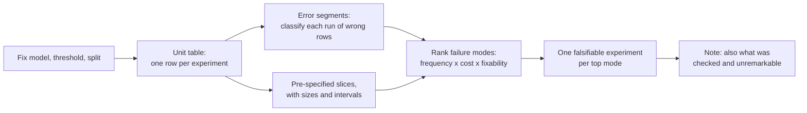
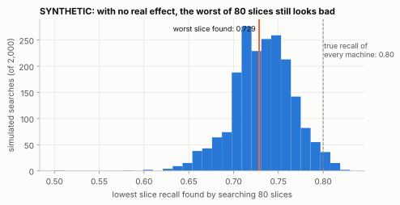
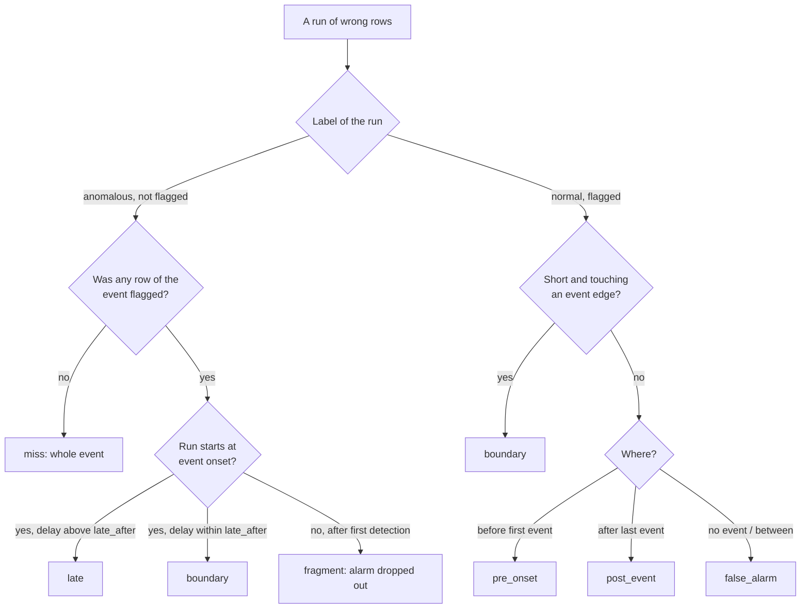
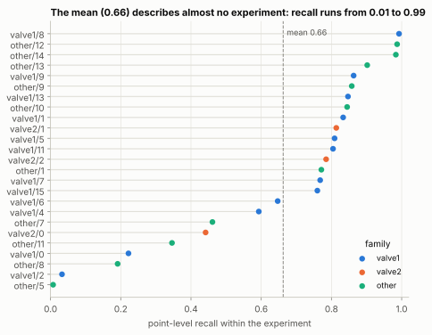
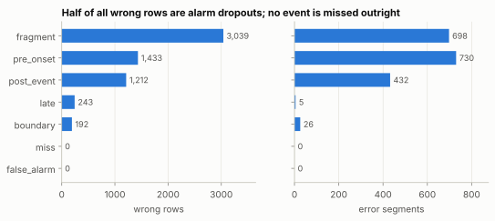
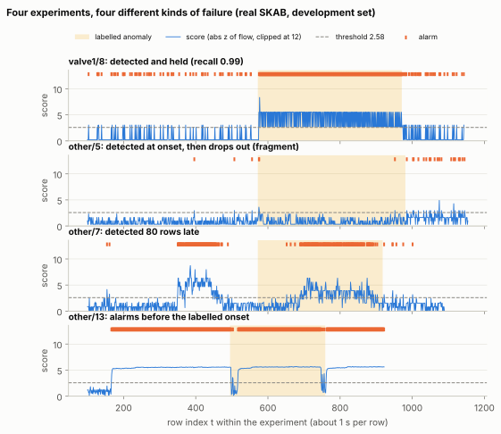

# W3D6 — Error analysis and timed transfer exercise

Unit id `w3d6_error_analysis_transfer` · Week 3, day 6 · Handbook: [H6.7](../../handbook/ch06_evaluation_leakage_uncertainty/h6_7_error_analysis.md)
(uses [H6.6](../../handbook/ch06_evaluation_leakage_uncertainty/h6_6_bootstrap_and_paired_comparisons.md) for slice intervals)
· Content status: see [STATUS.md](../../STATUS.md)

This session has two halves with different rules. The first is a short guided lab: turn one
detector's errors on SKAB into a ranked failure list. The second is the course's **transfer
exercise, part 2**: a complete, leak-free evaluation of an unfamiliar business problem, unassisted
and timed at 90 minutes.

## 1. Purpose

**Objective.** Turn a model's errors into a ranked failure taxonomy with sized slices, and then,
independently and under time pressure, carry out a complete evaluation on a tabular business problem
you have not seen.

**Why an applied ML engineer needs it.** After the first model, the job is choosing the next piece
of work. "Recall is 0.67" does not say what to change; "half of all wrong rows are the alarm dropping
out after the first detection, on 26 of 27 experiments" does. In interviews and in design reviews you
will be asked "what does your model get wrong?", and an answer with sizes and a next experiment is
what separates analysis from anecdote. The timed half measures whether the Week 2-3 habits (framing,
leak audit, a split that matches deployment, a decision metric, an interval, a baseline) hold when
nobody prompts them.

**Deliverables.**

1. A tested `flowguard.erroranalysis` module and `lab/ERROR_ANALYSIS.md`: a one-page error analysis of
   the w2d6 flow-rate baseline on the SKAB development experiments.
2. `challenge/evaluate.py` and `challenge/REPORT.md` for the LedgerLine late-payment problem
   (SYNTHETIC data), produced in one 90-minute sitting.

**Completion criteria.**

* `python wb.py check w3d6` passes (guided practice) and `ERROR_ANALYSIS.md` is written from your run.
* `python wb.py check w3d6 --challenge` passes *and* the sitting was unassisted and timed (independent
  skill). The report is then read against the scoring guidance in the solutions tree.

**Prerequisites.** [w2d6](../w2d6_baselines_metrics/README.md) (the flow-rate baseline, point
metrics; its challenge was transfer part 1), w3d1 ([leak audit](../w3d1_leakage/README.md)),
[w3d2](../w3d2_group_temporal_validation/README.md) (splits that match deployment),
[w3d5](../w3d5_uncertainty/README.md) (cluster intervals). Event matching from
[w3d4](../w3d4_point_vs_event_evaluation/README.md) helps but is not required: the lab classifies
error *runs* itself. If some Week 3 lessons are not finished yet, the lab still runs (it ships its own
`flowguard` snapshot).

**Time budget.** This session deliberately uses most of the optional extension: the transfer
exercise needs one unbroken 90-minute block.

| Activity | Minutes |
|---|---|
| Read sections 2-3, run the two worked examples | 20 |
| Guided lab: implement three functions, run the report, write `ERROR_ANALYSIS.md` | 40 |
| Break | 10 |
| **Transfer exercise, timed, unassisted** | **90** |
| Assessment and reflection | move to the review day (w3d7) |

If you have only two hours today, do the guided half now and the 90-minute sitting as its own session
before w3d7. Do not split the sitting.

Data: `python project/get_skab.py` (once) for the lab's real-data run. Checks and the challenge need
no download.

## 2. Conceptual explanation

The handbook section [H6.7](../../handbook/ch06_evaluation_leakage_uncertainty/h6_7_error_analysis.md)
is the full treatment. This section gives what the lab and the challenge need.

### 2.1 Error analysis generates hypotheses

The output of error analysis is a short ranked list of failure modes, each with a **size**, a
**suspected cause**, and a **falsifiable next experiment**, plus an explicit list of what was examined
and found unremarkable. Three rules make it analysis rather than storytelling:

1. **Fix the object.** One model, one threshold, one split, written down.
2. **Work on development data.** Reading test errors and then changing the model converts the test
   set into a second development set.
3. **Quantify, and stay at the unit of independence.** Slices are compared by per-experiment
   (per-customer) values with their sizes, not by pooled rows.



### 2.2 The unit table and the two kinds of average

The **unit table** has one row per experiment: counts (rows, positives, flagged, TP, FP, FN) and the
metrics computed inside the experiment. Every later step is a group-by on it.

A slice value can be the **mean of per-unit metrics** or a **row-pooled** metric:

$$
\text{mean recall}_S = \frac{1}{|S|}\sum_{u \in S} \frac{TP_u}{TP_u + FN_u}
\qquad\text{vs}\qquad
\text{pooled recall}_S = \frac{\sum_{u\in S} TP_u}{\sum_{u\in S}(TP_u + FN_u)} .
$$

They agree when units are of similar size and behave alike, and diverge when one large unit dominates
the pooled figure. The reliability engineer asks "on a typical experiment, how much of the fault is
flagged?" (mean over units); someone sizing alert storage asks "what share of anomalous rows is
flagged?" (pooled). Report the one that matches the question, with sizes, and the other if they differ.

**Undefined is not zero.** Recall on an experiment with no anomalous rows, or precision when nothing is
flagged, cannot be computed. Store `NaN` and keep it out of means; report how many units were defined.
Writing 0.0 turns "not measurable" into "measured as terrible" and silently drags slice means down.

**Uncertainty of a slice.** A slice of `k` experiments has a standard error of about `s/√k` for its mean;
with between-experiment standard deviation 0.3, ten experiments give a 95 % half-width near 0.19. The
lab bootstraps experiments within a slice and refuses an interval below five defined experiments.

### 2.3 Slice hunting is multiple testing

Search enough slices and one will look bad by chance. The worked example simulates 24 machines with
*identical* true recall 0.80 and 40 arbitrary binary attributes (80 slices): the worst slice found
averages 0.729, and 45 % of searches with no real effect find one at least that bad. The same slice
re-measured on fresh machines gives 0.764 against 0.800 for the rest.



*SYNTHETIC simulation, 2,000 searches (`example/slice_traps.py`, part 2). A "worst slice" at 0.73 is
what chance produces here; it is not a finding.*

Discipline: write the slicing variables before looking; prefer variables computable without labels;
count how many slices you examined; and treat a surprising slice as a hypothesis to test on other
units. Slices *defined using the labels* (for example "experiments where the fault barely moves the
flow") usually restate the failure rather than explain it.

**Simpson's paradox** is the other trap: a detector can be better in every regime and worse pooled when
the regimes are mixed differently. In the worked example detector B has higher recall in both steady
and variable load (0.990 vs 0.882 and 0.537 vs 0.480) and lower pooled recall (0.628 vs 0.802), because
B was tested mostly under variable load. Standardised to the same 50/50 mix, B leads 0.764 to 0.681.

### 2.4 Label noise versus model error

Some errors no model can avoid. In SKAB, 235 distinct measurements occur in two files with opposite
labels (`other/12`/`other/13`: 178; `other/3`/`other/4`: 57). A detector that is a function of the
sensors alone must be wrong on one copy of each, so 235 of those 470 rows are irreducible errors. With
burn-in normalisation the two copies can get different scores, so the observed baseline error on
contradictory rows (24) is not that floor. Report such units separately, with and without, so later
comparisons are not driven by rows nobody can get right.

### 2.5 Error kinds for detectors

Per-row errors in event detection are not independent: they come in runs, and the run's position
relative to the labelled event says what went wrong. The lab classifies each run of wrong rows:



Each kind has a different cause and fix: *misses* and *late* detections need a more sensitive signal;
*fragments* point at threshold noise (hysteresis or a hold time) or a transient response; *pre-onset*
runs are threshold noise, genuine precursors, or label timing; *post-event* runs suggest the reference
no longer describes normal after a fault. This is the same vocabulary you use for HFO or seizure
detectors (detection latency, fragmented detections, false detections per hour); the difference in
industry is that the cost of each kind comes from an operator's alert queue, not a reviewer.

### 2.6 Ranking: frequency × cost × fixability

Frequency caps the gain: fixing a mode that causes 5 % of wrong rows can improve the metric by at
most 5 %. Cost is the stakeholder's, not the metric's (a late detection may cost more than a hundred
post-event alarms). Fixability is your honest estimate of the chance a cheap change works. The product
is a ranking heuristic, not a measurement; state the assumptions so someone can disagree with them.

### 2.7 An industry example

A payments team's fraud model loses recall in one quarter. Error analysis by merchant category finds the
loss concentrated in 3 of 40 categories, all onboarded the same month, all using a new payment
processor whose transaction timestamps arrive in UTC instead of local time; the "hour of day" feature
was shifted. The fix was a data-contract check at ingestion, not a new model. (Illustrative composite,
not a cited incident.) The pattern generalises: the top failure mode is often in the data, and slicing
by *how the data was produced* (source, firmware, site, onboarding cohort) finds it more often than
slicing by model internals.

### 2.8 Misconceptions

* *"Look at the 20 worst examples."* They over-represent label errors and corrupted inputs; sample
  errors systematically instead.
* *"The slice with the lowest metric is the problem."* With small slices, the lowest is mostly noise.
* *"An undefined metric is a zero."* It is a missing measurement.
* *"Error analysis on the test set is fine if we don't retrain."* Any decision informed by it is a
  selection on test.
* *"A bigger model will fix it."* Only if the failure mode is capacity. Here the top mode is a
  threshold policy and the second involves label timing.

## 3. Worked example

Two scripts. The first is SYNTHETIC and shows the slice arithmetic; the second uses REAL SKAB files
and measures label conflicts.

### 3.1 Two slice traps

```bash
python lessons/w3d6_error_analysis_transfer/example/slice_traps.py      # about 1 s
```

Output of the run on 2026-11-22:

```
Part 1: recall of two detectors, by regime and overall
detector        regime  events  detected  recall
       A   steady load     400       353   0.882
       A variable load     100        48   0.480
       B   steady load     100        99   0.990
       B variable load     400       215   0.537

pooled over regimes:
          events  detected  recall
A            500       401   0.802
B            500       314   0.628

standardised to the same regime mix (50/50):
A   0.681
B   0.764

Part 2: 24 machines, identical true recall 0.80, 10 events each, 40 arbitrary binary attributes
overall mean recall 0.804
three 'worst' slices found by searching:
   slice  n_machines  recall
attr21=1           7   0.729
attr06=1          13   0.731
attr13=1          15   0.753

minimum slice recall under 'no real slice effect': median 0.733, 5th percentile 0.675
observed minimum 0.729 -> fraction of null searches at least this low: 0.45
same slice definition on 24 fresh machines: recall 0.764 vs rest 0.800
```

Reading it: in part 1 the pooled comparison is dominated by *where* each detector was tested, not how
well it detects; standardising to a common mix reverses the conclusion. In part 2 the "worst slice"
is exactly what the null distribution predicts, and it partly regresses on fresh machines. Key code
decision: the null distribution is simulated with the *same* search procedure (same number of slices,
same machines), because the multiplicity is a property of the search, not of any single slice.

### 3.2 Label conflicts in SKAB

```bash
python project/get_skab.py                                                     # once
python lessons/w3d6_error_analysis_transfer/example/label_conflicts_skab.py    # about 1 s
```

```
labelled rows: 37401
rows that also occur in another labelled file: 1436
of those, rows whose copies carry contradictory labels: 470 (235 distinct measurements)

by experiment:
               rows  labelled_anomalous
other/12        178                 178
other/13        178                   0
other/3          57                  57
other/4          57                   0

baseline errors in the affected experiments ['other/12', 'other/13', 'other/3', 'other/4']: 1028
  of which on contradictory rows: 24
...
  irreducible errors = 235 of 470 contradictory rows
```

Interpretation: `other/12` and `other/13` contain 178 identical measurements labelled anomalous in one
file and normal in the other. Any error analysis that ranks `other/13` as "the detector's worst
false-alarm experiment" must say this first. Data schema: the tidy SKAB table of
[docs/FLOWGUARD_SPEC.md](../../docs/FLOWGUARD_SPEC.md) (`experiment_id, family, t, datetime`, eight
sensors, `anomaly`). Rows are compared on all eight sensor values plus timestamp.

**Reproducibility.** Part 2 of `slice_traps.py` is seeded; `label_conflicts_skab.py` is deterministic
given SKAB at commit `b2c0d46` (`project/get_skab.py --verify`).

## 4. Guided lab

Work in `lessons/w3d6_error_analysis_transfer/lab/`. It ships `flowguard` with snapshots of `data`,
`splits` (v2, overlap groups kept together), `metrics`, `baselines`, and a stub
`erroranalysis.py` whose docstrings are the specification. `error_report.py` is complete; it runs the
w2d6 bar baseline (`|z|` of `flow_rate` against each experiment's first 100 rows) on the **27
development experiments** with the best-F1 development threshold, and prints the tables. The split is
read from `lab/splits/v2.json`, the manifest repaired and frozen in [w3d1](../w3d1_leakage/README.md):
the test set is never redrawn once results have been seen, so every Week 3 lesson uses the same seven
test experiments, and they are never scored here.

### Task 1 — `per_experiment_table` (10 min)

One row per experiment with counts, precision, recall, false-alarm rate (FP over normal rows), onset,
first detection, detection delay. A flag before onset is a false alarm, not an early detection.

*Checkpoint:* `python -m pytest lessons/w3d6_error_analysis_transfer/checks/test_per_experiment_table.py -q`
(each function has its own check file). *Debugging:* if delays are negative you counted pre-onset flags as detections; if a
recall is 0.0 on an experiment without anomalies, it should be `NaN`.

### Task 2 — `slice_metrics` (10 min)

Mean over experiments within each slice, with `n_experiments`, `n_defined`, `n_rows`, min, max and a
percentile bootstrap over experiments (seeded; `NaN` below five defined experiments). Levels requested
but absent appear with `n_experiments == 0`.

*Debugging:* the checks plant a slice where one large bad experiment and several small good ones give a
row-pooled value of 0.87 and a per-experiment mean of 0.25. If you get 0.87, you pooled rows.

### Task 3 — `error_segments` (15 min)

Classify every run of wrong rows using the tree in section 2.5. *Invariant to test yourself:* the
segments' `n_rows` must sum to the number of wrong rows, and no segment crosses experiments.

### Task 4 — run it on SKAB and write the note (5 min run + writing)

```bash
python lessons/w3d6_error_analysis_transfer/lab/error_report.py      # about 1 s
```

Checkpoint values from the reference run (2026-11-22, SKAB `b2c0d46`, frozen manifest v2): threshold
2.404 (development F1 0.700); row-pooled recall 0.674, mean of per-experiment recalls 0.674; failure
kinds

```
      kind  n_segments  n_rows  n_experiments
  fragment         698    3039             26
 pre_onset         730    1433             24
post_event         432    1212             23
      late           5     243              5
  boundary          26     192             19
```

No event is missed outright. If your numbers differ, check the threshold convention (`score >=
threshold` is flagged) and that `burn_in=100` rows are excluded.



*REAL SKAB, development experiments only. The mean describes almost no experiment; the families are
interleaved, which is the first hint that "family" will not be the explanation.*



*REAL SKAB, same run. Left: wrong rows by kind; right: number of segments. Rows and segments rank the
kinds differently for `late`: few segments, each long.*



*REAL SKAB, development experiments. One experiment per failure kind: `valve1/12` (detected and held), `other/5` (fragment),
`other/7` (late), `other/13` (pre-onset, the experiment with contradictory labels). Look at the
shaded label and the alarm ticks, not the score scale.*

Now fill in `lab/ERROR_ANALYSIS.md` from your own run: object, headline, the ranked failure-mode table
(size, evidence, suspected cause, cost, fixability), slices examined and found unremarkable, label
issues, one next experiment per top mode with the result that would falsify it, and limits. One page.
Figures regenerate with `python lessons/w3d6_error_analysis_transfer/figures/make_figures.py`.

**If the lab runs long:** finish the note on the review day. Do not let it eat into the 90-minute
sitting.

## 5. Independent challenge: transfer exercise, part 2 (90 minutes, timed)

[`challenge/README.md`](challenge/README.md). LedgerLine, an invented B2B software vendor (SYNTHETIC
data, schema in [`data/README.md`](data/README.md)), wants to know whether a model could choose its
15 weekly collection calls better than a simple rule. You implement the evaluation in
`challenge/evaluate.py` (fixed signatures) and write a one-page `challenge/REPORT.md`: framing, leak
audit, split, baseline and model, decision metric, interval, one error slice, limitations.

Rules: one unbroken sitting, timer on, no hints, no solutions, no assistant. Record start and stop time
and anything you looked up in the report's conditions box. An unfinished honest evaluation is worth
more than a finished one with a leak.

```bash
python lessons/w3d6_error_analysis_transfer/challenge/evaluate.py
python wb.py check w3d6 --challenge        # 19 checks, about 5 s on the reference
```

The checks grade what the model may see, how the data is split, what the metric computes, and whether
the reported performance is possible at all. They do not reward a higher score. The report is read
against `solutions/lessons/w3d6_error_analysis_transfer/challenge/SCORING.md` after you stop.

## 6. Progressive hints

For the **lab** only, open in order and note in `progress/notes.md` which level you used. The hint files
also contain challenge hints; using them during the sitting makes it a guided attempt, which you then
record as `review`, not `independent`.

1. [Conceptual hint](hints/hint1_concept.md)
2. [Suggested approach](hints/hint2_approach.md)
3. [Partial implementation](hints/hint3_partial.md)

Full reference: `solutions/lessons/w3d6_error_analysis_transfer/` (lab, reference error analysis,
challenge reference, scoring guidance, answers).

## 7. Assessment

[assessment.md](assessment.md): seven reasoning questions (five on the lab, two on the challenge,
answer those after your sitting), one design-choice explanation (how to choose a hysteresis rule
without fooling yourself), a rubric, and an interview rep on the **debugging** strand: a fraud model
whose AUC drops from 0.97 to 0.71 after launch, narrated aloud. Model answers and common incorrect
answers: `solutions/lessons/w3d6_error_analysis_transfer/assessment_answers.md`.

Automated checks: `python wb.py check w3d6` (32 checks on planted SYNTHETIC frames: the functions must
recover the planted worst slice, classify constructed segments, keep undefined values undefined) and
`--challenge` (19 checks). Neither grades the quality of your written analysis; the rubric does.

## 8. Reflection and review

**You should now be able to, without notes:**

* build a per-unit error table and say which average a stakeholder needs;
* classify detector errors into runs by kind and size them;
* say when a slice difference is evidence and when it is the multiplicity of the search;
* separate irreducible label noise from model error and report both;
* run a complete, leak-free evaluation of an unfamiliar tabular problem in 90 minutes.

**Reflection prompt** (5 minutes, `progress/notes.md`). In the timed sitting, which step did you
spend the most time on, and which step did you skip or rush? Was that the step most likely to make
the number wrong?

**Retrieval question for later** (review day): a slice of 6 experiments has mean recall 0.41 against
0.70 for the other 19, and it was the lowest of 12 slices you examined. List three things you must
check before writing it in a report, and the one-line test you would run on new data.

**Next.** [w3d7 review](../w3d7_review/README.md), then Week 4: time-series models and evidence-based
model choice. The top failure mode here (fragmentation) and the late detections set up w4d1: a
detector whose score uses temporal context instead of a per-row threshold.

---

### Verification record

Executed on 2026-11-22 with Python 3.13.18, NumPy 2.5.3, pandas 3.0.5, SciPy 1.18.1, scikit-learn
1.9.1: both worked examples (outputs above); the reference `error_report.py` on SKAB at `b2c0d46`
(tables above); `figures/make_figures.py` (four figures, values printed and matching the report);
the reference challenge (`evaluate.py`: rule 0.727, model 0.722 with customer-bootstrap interval
0.651-0.783 on 209 calls); `data/make_invoices.py --check` (byte-identical);
`python tools/verify_checks.py lessons/w3d6_error_analysis_transfer` (reference passes both parts; 4
lab and 5 challenge mutants rejected); the shipped starters fail (lab 32 of 32; challenge 14 failed,
5 errors). Not verified: Python 3.11/3.12; the time boxes, in particular whether 90 minutes suffices.


2026-11-22: real-data scripts switched to the frozen w3d1 manifest (`lab/splits/v2.json`, 7 test
experiments) instead of redrawing a split with `make_splits`; every real-SKAB number and figure in this
unit was regenerated from a fresh run.
