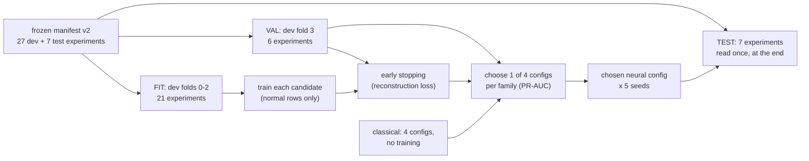
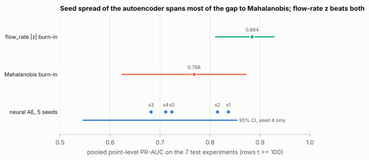
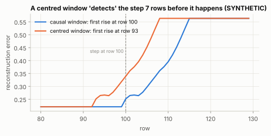
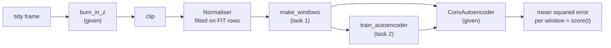
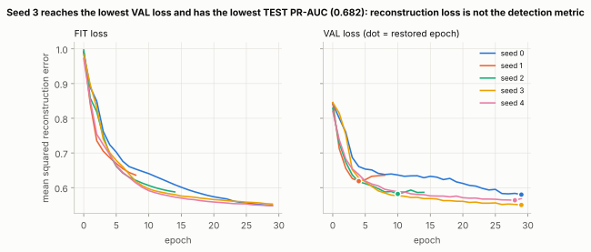
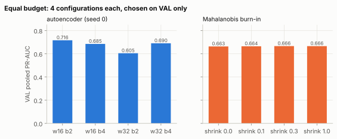

# W4D3 — A neural comparison, where it is justified

Unit id `w4d3_neural_comparison` · Week 4, day 3 · Handbook: [H7.6](../../handbook/ch07_timeseries_grouped_modeling/h7_6_neural_sequence_models.md)
· Content status: see [STATUS.md](../../STATUS.md)

## 1. Purpose

**Objective.** Train a small 1-D convolutional autoencoder on CPU under the same protocol as the
classical detectors (same splits, same rows scored, same threshold-free metric, an equal tuning budget,
early stopping on development data only), repeat it over five seeds, and report the result with its
seed spread and its test-set interval, whichever way it comes out.

**Why an applied ML engineer needs it.** "Did you try deep learning?" is asked in every model review.
The useful answer is not a model but a *comparison you can defend*: what was held equal, how much the
neural result moves when only the seed changes, what it costs to train and serve, and whether the
difference survives the uncertainty of a small test set. You already know how to build and train the
network. This session is about the evidence around it, which is where industry reviews (and
interviewers) push.

**Deliverable.** A tested `flowguard.neural` module (causal windows, early stopping that restores the
best epoch, a scorer with the project's fit/score contract) and `lab/NEURAL_REPORT.md`: the real SKAB
comparison table with seed spread, intervals and cost, and a one-paragraph recommendation.

**Completion criteria.**

* `python wb.py check w4d3` passes (guided practice).
* `lab/NEURAL_REPORT.md` contains your table from `compare_seeds.py` and answers its four questions.
* Independent skill: the challenge checks pass and `challenge/PROTOCOL.md` is written without hints.

**Prerequisites.** The frozen split manifest and its reasons ([w3d1](../w3d1_leakage/README.md)),
validation design ([w3d2](../w3d2_group_temporal_validation/README.md)), selection on development data
([w3d3](../w3d3_hyperparameter_selection/README.md)), cluster bootstrap and paired comparisons
([w3d5](../w3d5_uncertainty/README.md)), and the classical detectors of
[w4d2](../w4d2_classical_detectors/README.md) (the lab ships Mahalanobis and single-sensor baselines in
its snapshot, so w4d2 is not strictly required). Assumed and not taught: PyTorch training loops, Conv1d,
autoencoders, Adam.

**Set-up (once, about 5 minutes).** The lab needs PyTorch on CPU; nothing else in the course does.

```bash
pip install torch --index-url https://download.pytorch.org/whl/cpu   # CPU-only wheel, smaller download
# or, if that index is unreachable from your network:
pip install torch                                                    # default wheel (bundles CUDA libraries)
python -c "import torch; print(torch.__version__)"
```

The authoring environment could not reach `download.pytorch.org`, so the material was executed with
the default PyPI wheel (`torch 2.15.0+cu132`, run on CPU). The CPU-index command is the documented
route and was **not** executed here. Without PyTorch the lab checks are *skipped* with a message; a skip
is not a pass.

**Time budget (2 h essential).**

| Activity | Minutes |
|---|---|
| Read section 2, run the worked example (section 3) | 35 |
| Guided lab: implement `flowguard.neural` (tasks 1-4) | 50 |
| Guided lab: run the real comparison, write `NEURAL_REPORT.md` (task 5) | 20 |
| Assessment and reflection | 15 |
| *Optional extension: the challenge; an LSTM variant under the same protocol* | *up to 60* |

Data needed for task 5: `python project/get_skab.py` (once). The checks need no download.

## 2. Conceptual explanation

### 2.1 Which objective do these labels support?

A sequence model needs a training objective, and the objective must fit the labels and the sampling
structure, not the other way round.

| Objective | Trains on | Fits SKAB? | Why |
|---|---|---|---|
| **Reconstruction** (autoencoder) | normal windows only | yes | Labels only select which rows are normal. Faults never seen in training can still raise the error. Matches the semi-supervised framing of the classical detectors. |
| **Forecasting** (predict x(t+1) from the past) | normal windows only | yes, as a residual score | Same framing as w4d1's residual detectors; the score is the forecast error. Not a forecasting *task*: nobody needs the next flow value. |
| **Classification** (window → anomaly?) | labelled normal and anomalous windows | weakly | Only 27 development experiments with one fault segment each, three fault families, and labels that disagree on duplicated rows (w3d1). A classifier learns these 27 faults; it has little reason to generalise to a fourth family. |

This lesson uses reconstruction. The comparison protocol below is the same for any of the three.

### 2.2 Windows and causality at inference

The model sees a window of the last `w` rows and outputs a reconstruction of all of them; the score of
row `t` is the mean squared error of the window **ending** at `t`.

```text
rows:        ... t-15  t-14  ...  t-1   t   | t+1  t+2 ...
causal       [=============================]                  score(t) uses rows <= t       deployable
centred                [=====================|========]        score(t) uses rows up to t+8  not deployable
```

Two consequences you will see in the lab:

* **Causality is a property of the window and of every step before it.** The per-experiment burn-in
  calibration uses the first 100 rows (all in the past once `t >= 100`); the global normaliser is fitted
  once at training time. A centred window, a whole-series normalisation, or a bidirectional layer leaks
  the future exactly like a centred rolling mean in w2d5. The worked example measures it: on a step at
  row 100, the centred window's score rises at row 93.
* **A window average smooths and delays.** Averaging the error over 16 rows means a short fault raises
  the score by at most `L/16` of its full effect if it lasts `L < 16` rows, and a step reaches its full
  effect `w-1` rows late. Window length is a detection-delay knob, as in H7.1.

### 2.3 Normalisation: two layers, two rules

1. **Per-experiment burn-in calibration** (`burn_in_z`): each sensor is standardised with the mean and
   sd of that experiment's first 100 rows. This is the same calibration the classical baselines use, so
   the comparison is about the model, not about the preprocessing. It is causal for `t >= 100`.
2. **A global normaliser fitted on FIT rows only** (`Normaliser`): after calibration the features still
   drift; the network trains better on unit-scale inputs. Its statistics come from the training rows and
   are never updated at scoring time.

Rule 2 is the scaler-inside-the-pipeline rule from w1d3 and w3d1 in a new place. The usual mistakes
are fitting it on train + validation ("more data, better statistics") or re-fitting it on the frame being
scored (which normalises the fault away). Both are lab mutants.

### 2.4 A fair comparison protocol



What "fair" means here, item by item:

| Held equal | How |
|---|---|
| Data seen | Same FIT/VAL/TEST experiments for every detector; TEST read once. |
| Rows scored | `t >= 100` for everyone: the burn-in rows calibrate, they are not scored. |
| Preprocessing | The same per-experiment burn-in calibration. |
| Tuning budget | Four configurations per family, chosen on VAL PR-AUC. Neural: window {16, 32} x bottleneck {2, 4}; Mahalanobis: shrinkage {0, 0.1, 0.3, 1}. |
| Stopping rule | Early stopping on VAL reconstruction loss (patience 4, at most 30 epochs). Never on TEST. |
| Metric | Pooled point-level PR-AUC (threshold-free) plus a cluster-bootstrap interval over test experiments. |
| Randomness | Five seeds for the neural model; classical detectors are deterministic, so their seed spread is 0. |

What is *not* equal, and should be said: the neural model has 3,658 parameters and a training loop
whose own choices (learning rate 1e-3, batch 256, Adam, `hidden = 16`) were fixed, not tuned. A
reviewer could argue it deserved more. The honest response is to report the budget, not to keep
tuning until it wins.

### 2.5 One run is not a result

Training is stochastic (initialisation, shuffling). The worked example trains one tiny autoencoder
ten times on identical data: test AP ranges from 0.738 to 0.864 (sd 0.037). If you try `k` seeds and
report the best, the expected reported number rises with `k` (0.792 for one seed, 0.864 for ten), for
the same reason as the optimism of the maximum in w3d3.

Two uncertainties, which answer different questions, belong in the report:

* **Seed spread** (mean ± sd over seeds, same test set): "how much does retraining move this method?"
* **Test-set interval** (cluster bootstrap over the 7 test experiments, one fitted model):
  "how much would the number move on other experiments like these?" With 7 test experiments this is
  usually the larger one.

Neither replaces the other, and neither covers the selection step (w3d3).

### 2.6 Determinism on CPU, and its limits

`torch.manual_seed` before building the model plus a seeded generator for shuffling makes a run
reproducible **on the same machine, library versions and thread settings**. The authoring runs show
the limits:

* With 4 intra-op threads, seed 0 of the chosen configuration reached VAL PR-AUC 0.735; with 1 thread,
  0.716. A 6-epoch fit ended at validation loss 0.61109 (4 threads) versus 0.61169 (1 thread).
  Parallel reductions sum floating-point numbers in a different order, so the trajectories diverge.
* The same 6-epoch fit took 94.5 s with 4 threads and 1.6 s with 1 thread on the authoring container.
  For a model this small the thread overhead dominates. `compare_seeds.py` therefore pins one thread
  (`--threads 1`) and records it in its output. Measure on your own machine before believing either number.

On GPU there are more sources (non-deterministic kernels; `torch.use_deterministic_algorithms(True)` and
the cuDNN flags trade speed for repeatability), and `DataLoader` workers need their own seeds. The
practical rule: record seed, thread count, device and library versions with every run (w4d4), and
compare methods by seed *distributions*, not by single runs.

### 2.7 Cost is part of the result

| | Autoencoder (chosen config) | Mahalanobis burn-in |
|---|---|---|
| Learned parameters | 3,658 (global) | 8 means, 8 sds, 8x8 precision, per experiment |
| Training time | about 6 s per seed (1 CPU thread) | none |
| Scoring latency (authoring container) | about 6.5 ms per 1,000 rows | about 1.7 ms per 1,000 rows |
| Operational extras | PyTorch dependency; a weights file to version; GPU/CPU numeric differences; retraining pipeline | NumPy only |

The latency numbers are single measurements on one machine (best of three repeats), not a benchmark.
Both are far below a 1 Hz sensor's budget; at this scale the cost that matters is the operational one.

### 2.8 When is a neural model justified?

When at least one of these holds, *and* the protocol above shows a difference larger than both
uncertainties: the signal has structure that hand-built features miss (long-range temporal patterns,
cross-sensor interactions with lags, raw high-rate waveforms such as the vibration data of w1d3); there
is enough data from enough independent units to fit it (here 21 experiments for training); or one model
must serve many sensor configurations where per-sensor feature engineering does not scale. Otherwise
the simpler model is the default, because every later week (packaging, serving, monitoring, retraining)
costs more for the neural one.

### 2.9 Connection to your research, an industry example, misconceptions

**From EEG.** You have probably trained the same CNN decoder with several seeds and seen subject-level
accuracy move by several points. The same applies here, with experiments in place of subjects: the
seed spread and the test-set interval over experiments are the two error bars a decoding paper should
show. The difference in industry is that the comparison is usually against a cheap baseline that is
already deployed, so the burden of proof is on the new model.

**Industry example.** A team replaces a threshold rule on pump current with an LSTM autoencoder after
one training run beats the rule on last quarter's incidents. Two retrains later the "same" model misses
an incident the rule caught, and nobody can say whether the first result was the model or the seed.
The review that follows asks for exactly the table in section 4, task 5.

**Misconceptions.**

* "Lower validation loss means a better detector." In the authoring run the seed with the lowest VAL
  reconstruction loss (seed 3, 0.550) had the *lowest* TEST PR-AUC (0.682). Reconstruction loss is a
  training signal, not the detection metric.
* "Setting the seed makes it reproducible." Only with the same threads, device and versions (2.6).
* "Early stopping on the test set is harmless because it only picks an epoch." It is selection on test
  (w3d3), and it is invisible in the final number.
* "Neural loses, so neural is bad." This comparison is one architecture, one budget, 21 training
  experiments. The claim it supports is narrow: *under this protocol*, no evidence of improvement.



*Figure 1 (real SKAB, 7 test experiments).* Dots are the five neural seeds; bars are 95% cluster-bootstrap
intervals for one fitted model of each detector. The neural seed spread alone is about as wide as the gap
to Mahalanobis.

## 3. Worked example: the seed lottery (SYNTHETIC)

`example/seed_lottery.py` trains a small MLP autoencoder on windows of a SYNTHETIC 4-sensor signal and
scores a test signal with three injected faults (sensor 3 decouples from the others). Only the seed
changes between runs.

**Data.** 3,000 training rows and 3,000 test rows, 4 sensors (three sinusoids and one coupled to the
first), Gaussian noise; 200 anomalous test rows in three segments. Windows of 16 rows, flattened.

**Key decisions.** Each run seeds the weights (`torch.manual_seed`) and the shuffling (`torch.Generator`)
separately; one thread (`torch.set_num_threads(1)`) for reproducibility and speed; AP is computed
directly so the example does not depend on the lab.

```bash
python lessons/w4d3_neural_comparison/example/seed_lottery.py      # about 10 seconds
```

Output of the authoring run (Python 3.13, torch 2.15.0, 1 thread):

```text
1. Ten seeds, identical data and model; test average precision (SYNTHETIC)
   seed 0: 0.805
   seed 1: 0.773
   seed 2: 0.864
   seed 3: 0.811
   seed 4: 0.814
   seed 5: 0.785
   seed 6: 0.740
   seed 7: 0.738
   seed 8: 0.788
   seed 9: 0.811
   mean 0.793, sd 0.037, range [0.738, 0.864]

2. 'Best of k seeds' as a reported number (expected value over 5000 random subsets)
   k =  1: 0.792  (optimism over the seed mean: +0.000)
   k =  2: 0.814  (optimism over the seed mean: +0.021)
   k =  3: 0.825  (optimism over the seed mean: +0.032)
   k =  5: 0.838  (optimism over the seed mean: +0.045)
   k = 10: 0.864  (optimism over the seed mean: +0.071)

3. Same seed twice on CPU
   bitwise identical scores: True

4. Causal versus centred window: when does the score of a step change start to rise?
    causal window: score first rises at row 100 (the step is at row 100)
   centred window: score first rises at row 93 (the step is at row 100)
```

**Interpretation.** A spread of 0.126 AP between the best and worst seed is larger than many
"improvements" reported between architectures. Reporting the best of ten seeds adds about 0.07 that
no deployed model will deliver. Exact reproducibility holds here because seed, threads, versions and
machine are all fixed. The centred window "detects" the step 7 rows early, which is information the
detector will not have in deployment. Expect different exact values on another machine or torch
version; the qualitative results (a spread of several points, monotone best-of-k optimism, 7 rows of
look-ahead for a 16-row centred window) should hold.



*Figure 2 (SYNTHETIC).* The centred window starts reacting half a window before the event.

## 4. Guided lab

Work in `lessons/w4d3_neural_comparison/lab/`. The snapshot package contains the data loader, the
frozen manifest, the classical baselines, metrics and the w3d5 uncertainty tools. `flowguard/neural.py`
gives you `burn_in_z`, `Normaliser`, `ConvAutoencoder`, `n_parameters` and `_mean_loss`; you write the
rest. Run the checks after each task:

```bash
python wb.py check w4d3           # or: python -m pytest lessons/w4d3_neural_comparison/checks -q
```



### Task 1 — `make_windows(x, window)` (10 min)

Return an array of shape `(n, window, features)`, float32, where row `i` holds `x[i-window+1 .. i]` and
the positions before the first row repeat `x[0]`. Use one `np.concatenate` for the padding and one
fancy-indexing step; no Python loop over rows.

*Checkpoint:* the four `test_window*` checks pass. `make_windows(np.arange(20.).reshape(10, 2), 4)[6]`
is rows 3-6.

### Task 2 — `train_autoencoder(...)` (15 min)

Implement the loop described in the docstring: shuffle with a seeded `torch.Generator`, Adam on the mean
squared error, validation loss after each epoch (use `_mean_loss`), keep a `copy.deepcopy` of the best
`state_dict`, stop after `patience` epochs without improvement, **restore the best weights**, return the
history.

*Checkpoint:* `test_early_stopping_restores_the_best_validation_epoch` passes for both patience values.
The check uses a one-parameter model whose validation loss is minimal in the middle of training.

*Debugging.* If the restored model's loss is the last epoch's: `state_dict()` returns references to the
live tensors, so storing it without `copy.deepcopy` stores weights that keep changing.

### Task 3 — `NeuralScorer.fit(train_tidy, val_tidy)` and `_usable_rows` (15 min)

`_usable_rows` is the mask of rows the model may learn from: past the burn-in **and** labelled normal.
In `fit`: features of the training frame, then `self.normaliser_ = Normaliser().fit(...)` on its usable
rows only; training and validation windows through `self._training_windows`; `torch.manual_seed(self.seed)`
**before** building `ConvAutoencoder`; train; record `history_`, `train_seconds_`, `n_train_windows_`,
`n_parameters_`.

*Checkpoint:* the normaliser, contamination and determinism checks pass.

*Debugging.* Same seed, different results inside one process: the model was built before the seed was
set (or not seeded at all), so it took weights from wherever the global RNG happened to be.

### Task 4 — `NeuralScorer.score(tidy)` (10 min)

Per experiment, sorted by `t`: features, `normaliser_.transform` (never refit), `make_windows`, the model
in `eval()` under `torch.no_grad()`, the mean squared error per window. Return one score per row in the
order of `tidy`.

*Checkpoint:* all checks pass, including causality (changing rows after 120 must not change scores up to
120) and experiment independence. The suite takes a few seconds.

### Task 5 — the real comparison and `NEURAL_REPORT.md` (20 min)

```bash
python project/get_skab.py                                       # once
python lessons/w4d3_neural_comparison/lab/compare_seeds.py       # about 80 s on one CPU thread
```

Output of the reference solution on the authoring container (1 thread):

```text
FIT 21 experiments, VAL 6, TEST 7 (read once at the end)

1. Tuning on VAL (pooled PR-AUC, rows t >= 100)
   neural window=16 bottleneck=2: VAL 0.716 (best epoch 29, stopped 29, 11 s)
   neural window=16 bottleneck=4: VAL 0.685 (best epoch 27, stopped 29, 8 s)
   neural window=32 bottleneck=2: VAL 0.605 (best epoch 28, stopped 29, 11 s)
   neural window=32 bottleneck=4: VAL 0.690 (best epoch 29, stopped 29, 11 s)
   Mahalanobis shrinkage=0.0: VAL 0.663
   Mahalanobis shrinkage=0.1: VAL 0.664
   Mahalanobis shrinkage=0.3: VAL 0.666
   Mahalanobis shrinkage=1.0: VAL 0.666
   chosen: neural window=16 bottleneck=2; Mahalanobis shrinkage=0.3

2. Chosen neural configuration, 5 seeds (FIT -> early stop on VAL -> TEST)
   seed 0: VAL 0.716  TEST 0.724  best epoch 29 (stopped 29)  8 s
   seed 1: VAL 0.744  TEST 0.837  best epoch 4 (stopped 8)  3 s
   seed 2: VAL 0.761  TEST 0.815  best epoch 10 (stopped 14)  4 s
   seed 3: VAL 0.636  TEST 0.682  best epoch 29 (stopped 29)  8 s
   seed 4: VAL 0.741  TEST 0.711  best epoch 28 (stopped 29)  8 s
   TEST over seeds: mean 0.754, sd 0.068, range [0.682, 0.837]

3. TEST, pooled PR-AUC with 95% cluster-bootstrap interval over the 7 test experiments
| detector | TEST PR-AUC [95% CI] |
|---|---|
| neural AE (seed 4, median seed by VAL) | 0.711 [0.546, 0.853] |
| Mahalanobis burn-in (shrinkage 0.3) | 0.768 [0.625, 0.871] |
| flow_rate |z| burn-in (w2d6 best single sensor) | 0.884 [0.811, 0.928] |
   neural minus Mahalanobis burn-in (shrinkage 0.3): -0.057 [-0.194, +0.104]
   neural minus flow_rate |z| burn-in (w2d6 best single sensor): -0.173 [-0.327, -0.035]

4. Cost (this machine)
   neural: 3658 parameters, 6 s training per seed, 6.5 ms per 1000 rows scored
   Mahalanobis: no training, 1.7 ms per 1000 rows scored
```

Training times vary run to run on a shared machine; the PR-AUC values were identical in two complete
runs with one thread.

**Reading it.**

* On VAL the chosen autoencoder (0.716) beats every Mahalanobis setting (at most 0.666). On TEST its seed
  mean (0.754) is below Mahalanobis (0.768), and the paired difference for the median-by-VAL seed,
  -0.057 [-0.194, +0.104], contains zero. Under this protocol there is no evidence that either is better.
* The flow-rate single-sensor detector, which was chosen in w2d6 on development data, is ahead of the
  median neural seed by 0.173 [0.035, 0.327]. Its interval excludes zero, but remember it is one of
  several detectors compared on these 7 experiments (w3d5 on multiple comparisons).
* Seeds 1 and 2 stopped early (epochs 4 and 10) and scored highest on TEST; seeds 0, 3 and 4 ran to the
  epoch limit. With 30 epochs maximum, "early stopping" mostly did not trigger; the budget, not the
  stopping rule, ended most runs.
* The single run you would have got from seed 3 (0.682) or seed 1 (0.837) would have told opposite stories.

Now fill in `lab/NEURAL_REPORT.md` (template provided) with your own output and its four questions.



*Figure 3 (real SKAB).* Learning curves of the five seeds. The seed with the lowest validation loss is
not the best detector on TEST.



*Figure 4 (real SKAB, VAL only).* The tuning budget. The neural family varies much more across
configurations, which is also a cost: more selection, more optimism (w3d3).

### If the lab runs long

Stop after task 4 (the checks), run `compare_seeds.py --quick` (one configuration, two seeds, under a
minute) to see the shape of the output, and leave the report for the review day.

## 5. Independent challenge

[challenge/README.md](challenge/README.md): write a comparison protocol for a new situation and
implement seed-variance reporting with a conservative verdict rule, graded by checks. No solution in
this folder.

## 6. Progressive hints

Open only as far as you need, in order:
[1 - concept](hints/hint1_concept.md) · [2 - approach](hints/hint2_approach.md) · [3 - partial code](hints/hint3_partial.md)

## 7. Assessment

[assessment.md](assessment.md): reasoning questions, a design-choice explanation, a rubric, and a
15-minute debugging interview rep. Model answers are in
`solutions/lessons/w4d3_neural_comparison/assessment_answers.md` (open after attempting).

## 8. Reflection and review

**You should now be able to, without notes:**

* state which training objective a given label structure supports, and why;
* build causal windows and say where else in a pipeline look-ahead can enter;
* run a neural-versus-classical comparison with an equal budget and report seed spread and a test-set
  interval separately;
* explain what makes a CPU run reproducible and what breaks it;
* argue for or against a neural model from evidence and cost.

**Reflection prompt (5 minutes, in `progress/notes.md`).** In your own decoding papers, how many seeds
was each reported number based on, and would the conclusion survive the seed spread you saw today?

**Retrieval question for the review day.** *Two detectors are compared on 7 test experiments. One is
deterministic, the other was trained with 5 seeds whose test scores have sd 0.07. The difference in means
is 0.03 and the paired bootstrap interval for one seed is [-0.12, +0.09]. What can you claim, and what
would you need to claim more?*

**Next.** [w4d4 — experiment tracking](../w4d4_experiment_tracking/README.md): today you ran 9 trainings
and kept their results in one JSON file. Tomorrow every run gets its own directory, id and provenance,
and the table is rebuilt from them.

---

### Verification record

Executed on 2026-11-22 with Python 3.13.18, torch 2.15.0+cu132 (CPU only), NumPy 2.5.3, pandas 3.0.5,
scikit-learn 1.9.1: the worked example (output above); the reference `compare_seeds.py` on the real
SKAB files, twice with one thread (identical PR-AUC values); `figures/make_figures.py`;
`python tools/verify_checks.py lessons/w4d3_neural_comparison` (reference passes both parts; 5 lab and 4
challenge mutants rejected, each on its intended check); the shipped starters fail (lab 14 of 15 checks;
the one passing check tests the given `ConvAutoencoder`; challenge 9 of 9). Thread-count observations in
2.6 come from runs made while writing this lesson on the authoring container. Not verified: the
CPU-only install command, Python 3.11/3.12, GPU behaviour, time boxes.
