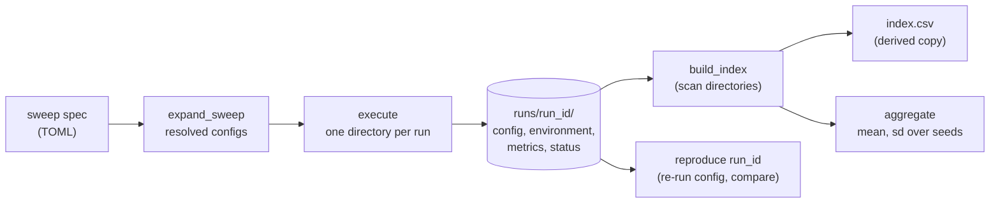
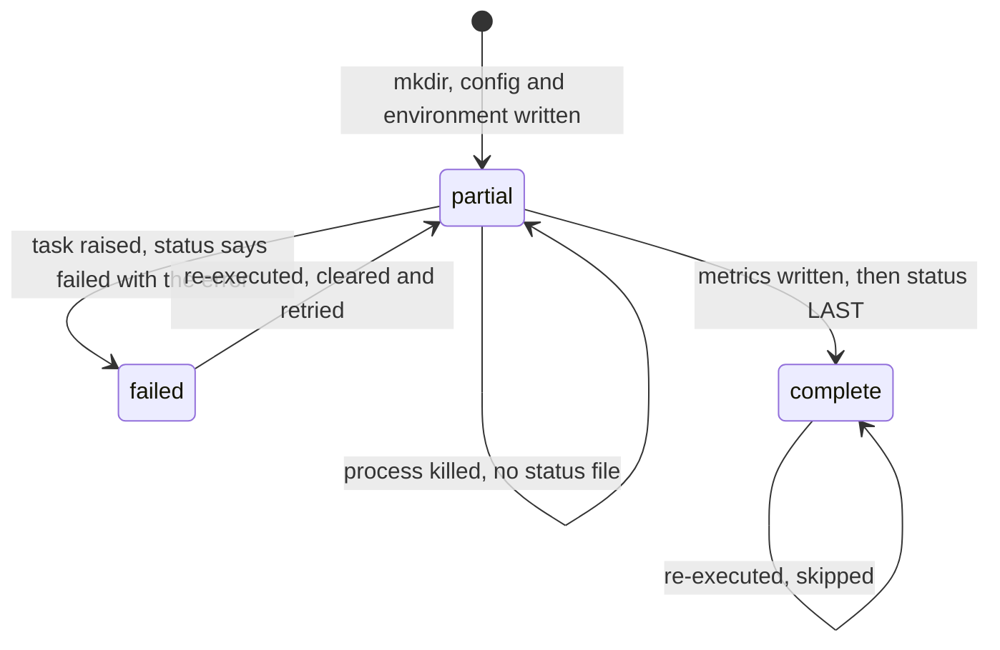
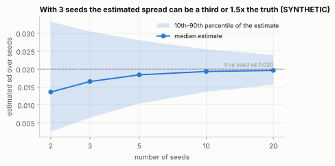
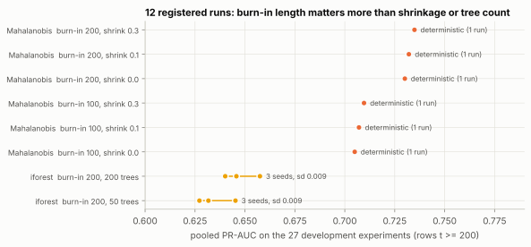

# W4D4 — Experiment tracking: sweeps, a run registry, and reproducing any row

Unit id `w4d4_experiment_tracking` · Week 4, day 4 · Handbook: [H8.1](../../handbook/ch08_reproducible_experiments/h8_1_run_registries_and_sweeps.md),
[H8.2](../../handbook/ch08_reproducible_experiments/h8_2_seeds_and_variance.md) · Content status: see [STATUS.md](../../STATUS.md)

## 1. Purpose

**Objective.** Manage many runs as data: expand a sweep definition into resolved per-run configurations,
execute each into its own immutable run directory, rebuild a registry index from those directories,
aggregate it into a results table over seeds, and reproduce any row from its run id.

**Why an applied ML engineer needs it.** After week 3 you have dozens of results and the question
"which config produced the 0.735 in the slide?" is already hard. In a team it becomes "can anyone rerun
the model we shipped in March?". Tracking is how results stay attributable, comparable and repeatable.
Tools such as MLflow or Weights & Biases implement it; this session builds the mechanism by hand (about
200 lines) so that you know what those tools must record, and can judge them.

**Deliverable.** `flowguard` v0.7 with `flowguard sweep`, `flowguard runs table` and
`flowguard runs reproduce`, and the project's first registered sweep on SKAB (12 runs) with its table in
`lab/SWEEP_NOTES.md`.

**Completion criteria.**

* `python wb.py check w4d4` passes (guided practice).
* `lab/SWEEP_NOTES.md` holds your SKAB table and one reproduced run id.
* Independent skill: the challenge checks pass without hints.

**Prerequisites.** Run directories and config files from [w1d4](../w1d4_config_logging/README.md) (this
lesson generalises them), the frozen manifest from [w3d1](../w3d1_leakage/README.md), selection on
development data from [w3d3](../w3d3_hyperparameter_selection/README.md), and seed variance from
[w4d3](../w4d3_neural_comparison/README.md). No PyTorch needed.

**Time budget (2 h essential).**

| Activity | Minutes |
|---|---|
| Read section 2, run the worked example | 30 |
| Guided lab tasks 1-6 (`tracking.py`) | 60 |
| Task 7: SKAB sweep, table, reproduction, notes | 15 |
| Assessment and reflection | 15 |
| *Optional extension: the challenge; the same sweep in MLflow* | *up to 60* |

## 2. Conceptual explanation

### 2.1 What a run must record

A result is only useful if you can say what produced it. For every run:

| Record | Why | Where here |
|---|---|---|
| Resolved configuration, including seed | the full recipe; also the run's identity | `config.json` |
| Code version | the same config on different code is a different run | `environment.json: git_commit` (with `-dirty`) and package version |
| Data fingerprint | "same path" is not "same data" | `environment.json: data` (SHA-256 of files or the download manifest) |
| Environment | interpreter, library versions, platform | `environment.json` |
| Metrics | the result | `metrics.json` |
| Completion status | a crashed run must not look like a result | `status.json`, written last |
| Artifacts (models, plots) | to serve or inspect later | next to the above (Week 5 adds model artifacts) |

Thread counts, devices and hardware belong in the environment record for anything numerically
sensitive (w4d3, 2.6).

### 2.2 Identity: the run id is a hash of the configuration

```text
config (dict) --canonical JSON (sorted keys)--> sha256 --first 12 hex--> run_id = "0668c9c60359"
```

Content addressing gives three properties for free: the same configuration always maps to the same
directory (rerunning a sweep skips completed runs), two runs differing only in seed get different ids,
and an id can be recomputed from a config without a database. The canonical form matters: Python dicts
keep insertion order, so `json.dumps` of the same configuration built in a different order gives a
different string (the worked example shows two different hashes for one config). The seed belongs in
the hash: "the seed is not a hyperparameter" is true for selection and false for identity.

**Immutability.** A completed run directory is never rewritten. Re-executing a config that is complete
does nothing; one that is partial or failed is cleared and retried. If you need a different result, you
need a different configuration (or a different code version, which the run records).

### 2.3 Sweeps are configuration, not code

```toml
[sweep]
name = "mahalanobis"
task = "skab_detector"
mode = "grid"          # or "random" with n_samples, sample_seed and a [space] table
seeds = [0]

[base.data]
raw_dir = "data/raw/skab"
manifest = "lessons/w4d4_experiment_tracking/lab/splits/v2.json"

[base.detector]
kind = "mahalanobis"

[grid.detector]
shrinkage = [0.0, 0.1, 0.3]
burn_in = [100, 200]
```

Expansion is deterministic: grid keys sorted, values in the listed order, seeds innermost, each config a
deep copy of the base. A random search draws with its own `sample_seed`, so the *set of configurations*
is reproducible too (log-uniform for scale parameters, H6.4).

### 2.4 The registry: directories are the truth, the index is derived



The index (here a CSV; in larger systems SQLite or a server) is a *cache*. It is rebuilt from the run
directories every time it is needed and never read back as the source of truth. That way deleting a bad
run, adding runs from another machine (copy the directories), or repairing a partial run is reflected
automatically. Tools differ here: MLflow keeps a backend store (a database) plus an artifact store, and
the database is authoritative. The trade-off is discussed in H8.1.

### 2.5 The life of a run



Writing `status.json` last, and atomically (write a temporary file, then `os.replace`), means a reader
never mistakes a half-finished run for a finished one. "`metrics.json` exists" is not a completion
signal: a process can be killed after writing metrics and before finishing whatever came next.

### 2.6 Aggregation, missing parameters and failed runs

The results table groups complete runs by configuration (the sweep plus every parameter) and reports
`n`, mean, sample sd over seeds, min and max. Three details decide whether it is honest:

* **Excluded runs are counted, not hidden.** A configuration with 3 seeds of which one failed shows
  `n = 2, excluded = 1`.
* **Configurations from different sweeps have different parameters**, so each is missing (NaN) in the
  other's columns. `pandas.groupby` drops rows whose group key contains NaN unless told otherwise; the
  worked example shows a table losing both sweeps entirely.
* **n = 1 has no sd.** A deterministic detector run once shows `sd = NaN`; that is information, not an error.

### 2.7 Reproducing a row

`reproduce(run_id)` reads the stored configuration, runs the task again in memory, and compares every
metric with a tolerance. A match is evidence that config + code + data + environment are enough to
regenerate the number; a mismatch means one of them is not captured (or the task is non-deterministic).
Comparing the stored metrics with themselves, or with a cached copy, proves nothing.

### 2.8 Connection to your research, an industry example, misconceptions

**From research.** A results table in a paper is an aggregate over runs; a reviewer asking for "the
exact configuration of row 3" is asking for a registry. Many research codebases keep results in
spreadsheets filled by hand, which fails exactly where this lesson's checks look: duplicated runs under
different names, crashed runs averaged in, missing configurations.

**Industry example.** A recommendation team's dashboard shows a model at 0.412 NDCG; the retrained model
scores 0.398 and the release is blocked. Two days later someone finds that the 0.412 came from a run on a
data snapshot that included a week of test traffic, and the config file was edited afterwards. With a
data fingerprint and an immutable run record the question is answered in minutes.

**Misconceptions.**

* "The index is the registry." It is a view; the directories are the record.
* "Tracking means installing MLflow." The tool helps; deciding *what* to record and enforcing
  immutability is the substance.
* "Three seeds measure the seed variance." Three seeds give a very rough sd: in the worked example the
  middle 80% of 3-seed estimates of a true sd of 0.020 range from 0.006 to 0.031.
* "The sweep picks the model." A sweep on development data is a selection procedure; its best row is
  optimistic (w3d3), and test metrics do not belong in sweep runs.

## 3. Worked example: four ways a registry lies (SYNTHETIC)

`example/registry_pitfalls.py` is self-contained (standard library, NumPy, pandas) and does not use the
lab package.

```bash
python lessons/w4d4_experiment_tracking/example/registry_pitfalls.py      # about 3 seconds
```

Output of the authoring run:

```text
=== 1. The same configuration, two different run ids
json.dumps(config)                 -> 36dfee58d2ce vs df79d7204e3d  (equal: False)
json.dumps(config, sort_keys=True) -> e3852b11bdd0 vs e3852b11bdd0  (equal: True)
1.0 vs 1: {"alpha": 1.0} vs {"alpha": 1} - the canonical form still distinguishes int and float; keep config values typed consistently

=== 2. A results table that silently drops configurations
groupby(keys):                {}   <- both sweeps gone
groupby(keys, dropna=False):  {('forest', nan, 200.0): 0.85, ('ridge', 0.1, nan): 0.8}

=== 3. 'metrics.json exists' is not 'the run finished'
mean over dirs with metrics.json: 0.790  (n = 3)
mean over dirs with status.json : 0.710  (n = 2)

=== 4. How well do n seeds estimate the seed spread? (true sd = 0.020)
| seeds | median estimated sd | 10th-90th percentile of the estimate |
|---|---|---|
| 2 | 0.0136 | 0.0026 - 0.0332 |
| 3 | 0.0165 | 0.0064 - 0.0305 |
| 5 | 0.0184 | 0.0104 - 0.0280 |
| 10 | 0.0193 | 0.0137 - 0.0255 |
| 20 | 0.0196 | 0.0156 - 0.0239 |
```

**Interpretation.** (1) Identity must be canonical, and types matter (`1` and `1.0` hash differently, so
configs should be parsed with consistent types). (2) A plain `groupby` over sparse parameter columns
returned an *empty* table, without an error. (3) One crashed run with an interim metric moved the mean
from 0.710 to 0.790. (4) The sample sd is biased low for small `n` (its median is 0.0136 at `n = 2`) and
wildly variable; five seeds are a minimum for a rough spread, not a precise one. All four are checks in
today's lab.



*Figure 1 (SYNTHETIC, 20,000 simulations per n).* How precisely `n` seeds estimate a true seed sd of 0.020.

## 4. Guided lab

Work in `lessons/w4d4_experiment_tracking/lab/`. Given: `tasks.py` (a SYNTHETIC ridge task used by the
checks, and `skab_detector`), `cli.py`, the snapshot modules, three sweep specs, and in `tracking.py` the
helpers `flatten`, `set_dotted`, `load_spec`, `_write_json` (atomic), `_read_json`, `_flatten_space`,
`_sample`, `collect_environment`, `write_index`. You write the six functions marked TODO.

```bash
python wb.py check w4d4           # or: python -m pytest lessons/w4d4_experiment_tracking/checks -q
```

Run directory layout you are producing:

```text
runs/
  index.csv                 derived; rebuilt by every `runs table`
  0668c9c60359/
    config.json             {"data": {...}, "detector": {...}, "seed": 2, "sweep": "iforest", "task": "skab_detector"}
    environment.json        python, packages, git_commit, data fingerprints
    metrics.json            {"dev_pooled_pr_auc": 0.6457..., ...}
    status.json             {"status": "complete", "seconds": ..., "finished": ...}   <- written last
```

### Task 1 — `config_hash(config)` (5 min)

Canonical JSON (`sort_keys=True`, fixed separators, `default=str` for anything unusual), SHA-256, first
12 hex characters. *Checkpoint:* `test_hash_ignores_key_order_and_sees_every_value`.

### Task 2 — `expand_sweep(spec)` (15 min)

Grid mode: flatten `spec["grid"]`, sort the keys, `itertools.product` over the value lists. Random mode:
`_flatten_space(spec["space"])`, sorted keys, `np.random.default_rng(sweep["sample_seed"])`, `n_samples`
draws with `_sample`. For every point and every seed: deep-copy `spec["base"]`, `set_dotted` each value,
add `seed`, `task`, `sweep`. *Checkpoint:* the three expansion checks.

*Debugging.* If changing one config changes another, you copied the base dict shallowly.

### Task 3 — `_status(run_dir)` and `execute(config, runs_dir)` (15 min)

`_status`: `"complete"` only if `status.json` says complete *and* `metrics.json` is readable; `"failed"` if
it says failed; anything else `"partial"`. `execute`: skip complete runs; otherwise clear stale
`metrics.json`/`status.json`, write `config.json` and `environment.json`, run the task inside
`try/except`, write `metrics.json`, then `status.json` last. A failing task is recorded (error message,
short traceback), not raised. *Checkpoint:* the three `execute` checks.

### Task 4 — `build_index(runs_dir)` (10 min)

One row per subdirectory with a `config.json`: `run_id`, `status`, `sweep`, `task`, `seed`,
`param.<dotted key>` for the other config values, `metric.<name>` for complete runs. Never read
`index.csv`. *Checkpoint:* the three index checks.

### Task 5 — `aggregate(index, metric)` (10 min)

Complete runs only; group by `sweep` and every `param.*` column; `n`, `mean`, `sd` (ddof 1), `min`, `max`;
an `excluded` count of non-complete runs per configuration. Make missing parameters a value (for example
replace NaN with `"-"`) or use `dropna=False`. *Checkpoint:* the three aggregation checks.

### Task 6 — `reproduce(run_id, runs_dir)` (5 min)

Refuse unknown and non-complete runs (`ValueError`). Re-run `get_task(config["task"])(config)`, compare
each metric with `math.isclose(rel_tol=rtol, abs_tol=atol)`, return `match`, both metric dicts and
`max_abs_diff`. *Checkpoint:* all 17 checks pass (about 5 s).

### Task 7 — the SKAB sweep (15 min)

From the repository root:

```bash
python project/get_skab.py                                                     # once
export PYTHONPATH=lessons/w4d4_experiment_tracking/lab/src                     # or pip install -e the lab
python -m flowguard.cli sweep --spec lessons/w4d4_experiment_tracking/lab/sweeps/mahalanobis.toml --runs-dir runs
python -m flowguard.cli sweep --spec lessons/w4d4_experiment_tracking/lab/sweeps/iforest.toml --runs-dir runs
python -m flowguard.cli runs table --runs-dir runs --metric dev_pooled_pr_auc
python -m flowguard.cli runs reproduce <one run_id from the table> --runs-dir runs
```

Run them twice: the second time every run is `skipped`. `runs/` is git-ignored.

Output of the reference solution (authoring run; 6 Mahalanobis runs in about 3 s, 6 isolation-forest runs
in about 17 s):

```text
same for every row: data.manifest=lessons/w4d4_experiment_tracking/lab/splits/v2.json, data.raw_dir=data/raw/skab
metric: dev_pooled_pr_auc  (runs: 12; complete: 12; failed: 0; partial: 0)
| sweep | param.detector.burn_in | param.detector.kind | param.detector.n_estimators | param.detector.shrinkage | n | mean | sd | min | max | excluded |
|---|---|---|---|---|---|---|---|---|---|---|
| iforest | 200 | iforest | 50 | - | 3 | 0.6347 | 0.0094 | 0.6272 | 0.6453 | 0 |
| iforest | 200 | iforest | 200 | - | 3 | 0.6478 | 0.0089 | 0.6401 | 0.6575 | 0 |
| mahalanobis | 100 | mahalanobis | - | 0.0000 | 1 | 0.7050 | nan | 0.7050 | 0.7050 | 0 |
| mahalanobis | 100 | mahalanobis | - | 0.1000 | 1 | 0.7071 | nan | 0.7071 | 0.7071 | 0 |
| mahalanobis | 100 | mahalanobis | - | 0.3000 | 1 | 0.7096 | nan | 0.7096 | 0.7096 | 0 |
| mahalanobis | 200 | mahalanobis | - | 0.0000 | 1 | 0.7301 | nan | 0.7301 | 0.7301 | 0 |
| mahalanobis | 200 | mahalanobis | - | 0.1000 | 1 | 0.7321 | nan | 0.7321 | 0.7321 | 0 |
| mahalanobis | 200 | mahalanobis | - | 0.3000 | 1 | 0.7349 | nan | 0.7349 | 0.7349 | 0 |
```

Reproducing an isolation-forest run (`0668c9c60359`, seed 2) took about 5 s and matched exactly
(`max_abs_diff` 0.0).

**Reading it.**

* Every configuration is scored on the same 24,642 development rows (`t >= 200`), whatever its burn-in;
  otherwise a longer burn-in would also mean an easier evaluation set. `skab_detector` enforces this.
* A 200-row burn-in beats 100 rows by about 0.025 for every shrinkage; shrinkage moves the result by at
  most 0.005. The isolation forest is about 0.08 below Mahalanobis, and 200 trees beat 50 by 0.013 on
  average with a seed sd of about 0.009 per configuration (the challenge looks at that difference
  properly).
* These are **development** numbers from a selection procedure: the best row (0.735) is optimistic for
  its configuration (w3d3), and the test experiments were not used.

Write `lab/SWEEP_NOTES.md`: your table, the reproduced run id and its `max_abs_diff`, and two sentences
on what you would sweep next and why.



*Figure 2 (real SKAB, 27 development experiments).* Each dot is one registered run. Deterministic
configurations have one dot; isolation forests have one per seed.

### If the lab runs long

Stop after task 5 with the checks for tasks 1-5 green, run task 7 with the synthetic spec
(`lab/sweeps/synthetic.toml`, milliseconds per run), and do the SKAB sweep on the review day.

### Optional extension — the same sweep in MLflow (not executed in the authoring environment)

If you want to see how a tracking server maps onto what you built: `pip install mlflow`, then in
`execute` wrap the task call in `with mlflow.start_run(run_name=rid):` and call
`mlflow.log_params(flatten(config))`, `mlflow.log_metrics(metrics)` and
`mlflow.set_tag("git_commit", env["git_commit"])`. Run the SKAB sweep and open `mlflow ui`. Compare: where
does MLflow store the truth (its backend store), what happens to a crashed run (its status stays
`RUNNING` or becomes `FAILED`), and how would you reproduce a row from it? MLflow's API changes between
major versions; check the documentation of the version you install. This extension was **not** executed
while writing the lesson.

## 5. Independent challenge

[challenge/README.md](challenge/README.md): a paired comparison of two groups of runs from the registry
(for example 200 versus 50 trees), pairing on the seed. Graded by checks; no solution in this folder.

## 6. Progressive hints

[1 - concept](hints/hint1_concept.md) · [2 - approach](hints/hint2_approach.md) · [3 - partial code](hints/hint3_partial.md)

## 7. Assessment

[assessment.md](assessment.md): reasoning questions, a design-choice explanation, a rubric, and a 15-minute
Python interview rep on nested dict and JSON manipulation. Model answers:
`solutions/lessons/w4d4_experiment_tracking/assessment_answers.md`.

## 8. Reflection and review

**You should now be able to, without notes:**

* list what a run must record and why each item is needed to reproduce it;
* give a run a content-addressed identity and keep completed runs immutable;
* tell a complete, failed and partial run apart from the files on disk;
* rebuild a results table from run directories, with excluded runs visible;
* reproduce a row and say what a mismatch would mean.

**Reflection prompt.** Which result in your last paper could you regenerate today from a single
identifier? What is missing for the others: config, code version, data version, or environment?

**Retrieval question for the review day.** *A sweep of 4 configurations x 3 seeds reports n = 1 for every
configuration. Name two bugs that produce exactly this symptom.*

**Next.** [w4d5 — choosing complexity on evidence](../w4d5_model_choice/README.md): the registry and the
neural comparison feed a one-page decision memo on which model goes to Week 5.

---

### Verification record

Executed on 2026-11-22 with Python 3.13.18, NumPy 2.5.3, pandas 3.0.5, scikit-learn 1.9.1: the worked
example (output above); the reference CLI on the synthetic spec and on the real SKAB sweeps (12 runs, the
table above; a second sweep invocation skipped all runs; one run reproduced exactly);
`figures/make_figures.py`; `python tools/verify_checks.py lessons/w4d4_experiment_tracking` (reference
passes both parts; 6 lab and 4 challenge mutants rejected, each on its intended check); the shipped
starters fail (lab 17 of 17, challenge 8 of 8). Not verified: Python 3.11/3.12, the optional MLflow
extension (not executed), time boxes.
