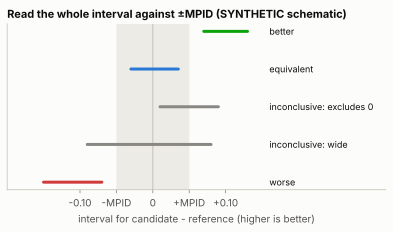
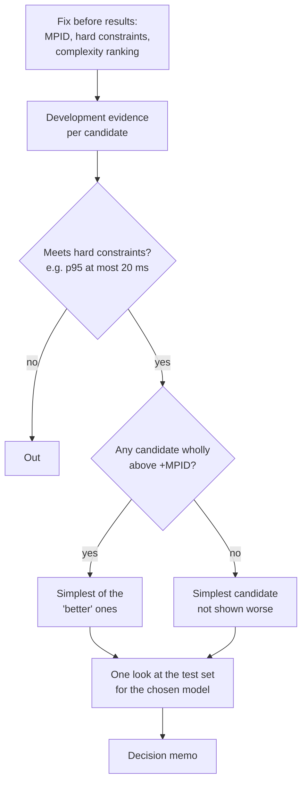
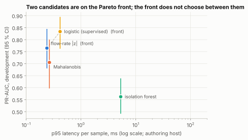
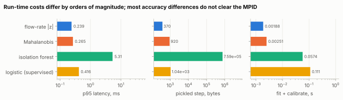

# W4D5 — Choosing complexity on evidence

Unit id `w4d5_model_choice` · Week 4, day 5 · Handbook: [H5.4](../../handbook/ch05_classical_ml_baselines/h5_4_complexity_versus_evidence.md),
[H16.1](../../handbook/ch16_system_design_communication/h16_1_decision_memos.md) · Content status: see [STATUS.md](../../STATUS.md)

## 1. Purpose

**Objective.** Decide between candidate models using effect size against uncertainty, error costs,
latency, size and maintenance burden. Then write the decision down so that someone else could
check it.

**Why an applied ML engineer needs it.** Industry rarely asks "which model has the highest score?".
It asks "which model should we run for the next year?". That model will be retrained, monitored,
debugged at night and explained to the person who acts on its alerts. A larger model has to pay for
its latency, its new dependencies and the fact that fewer people understand it. Its accuracy gain
has to be shown, and it has to be large enough to matter. In interviews this comes up as "why
didn't you use a deep model?", and the strong answer is a table with intervals and costs.

**Deliverable.** A tested `flowguard.decision` module, the project's decision table for four
candidates on real SKAB data, and a one-page `lab/DECISION_MEMO.md`.

**Completion criteria.**

* `python wb.py check w4d5` passes (guided practice).
* `lab/DECISION_MEMO.md` is complete, its numbers come from your own run of `lab/decision_table.py`,
  and it scores at least "meets" on every row of the rubric in [assessment.md](assessment.md).
* Independent skill: `python wb.py check w4d5 --challenge` passes and `challenge/MEMO.md` is
  written without opening the hints.

**Prerequisites.**
* [w3d3](../w3d3_hyperparameter_selection/README.md): selection belongs to development data, and the
  test set gets one look.
* [w3d4](../w3d4_point_vs_event_evaluation/README.md): event metrics and the alert-budget operating point.
* [w3d5](../w3d5_uncertainty/README.md): the cluster bootstrap and paired comparisons.

The lab ships snapshots of all of them, and of the frozen manifest v2 from
[w3d1](../w3d1_leakage/README.md). Assumed: you have argued for a method in a paper's discussion
section. Here the reader is a reliability engineer and a budget owner, not a reviewer.

**Time budget (2 h essential).**

| Activity | Minutes |
|---|---|
| Read section 2, run the worked example | 30 |
| Guided lab: implement `flowguard.decision`, run the real decision table, write the memo | 65 |
| Independent challenge: start (finish in the extension or on the review day) | 15 |
| Assessment and reflection | 10 |
| *Optional extension: finish the challenge; latency under batching; a fifth candidate* | *up to 60* |

Data needed for the real-data steps: `python project/get_skab.py` (once). The checks need no download.

## 2. Conceptual explanation

### 2.1 A decision is not a leaderboard

A leaderboard ranks candidates by one number on one data set. A decision chooses an artifact to
build, run and maintain. It needs four kinds of evidence that a leaderboard leaves out:

| Evidence | Question it answers | Measured today by |
|---|---|---|
| **Effect size with uncertainty** | Is the better score a real difference, and is it large enough to matter? | paired cluster-bootstrap interval for (candidate - reference), read against an MPID |
| **Error costs at the operating point** | What does the operator experience? | event recall, false alarms per hour and detection delay at the alert budget (w3d4) |
| **Cost to run** | Can we afford to run it where it must run? | p95 latency per sample, size on disk, retraining time |
| **Cost to own** | Can the team keep it working? | dependencies, need for labels to retrain, whether an engineer can see *why* it alarmed |

The first row is where research habits help and also mislead. A paper asks "is B better than A?" and
answers it with a significance test. An engineering decision asks "is B better **by enough to pay
for B**?". That needs one more number, fixed in advance.

### 2.2 The minimum practically important difference (MPID)

The **MPID** is the smallest improvement that would change what the business does. You fix it
*before* seeing results. For flowguard we fix it at **+0.05 PR-AUC**. Below that, the reliability
engineer would not notice a difference in which faults get caught. A demand planner might say "one
percentage point of MAPE". A churn team might say "0.02 AUC, because below that the offer targeting
does not change".

With an interval `[lo, hi]` for (candidate - reference), higher is better, there are four readings:



*Figure 1 (SYNTHETIC schematic). Read the whole interval, not its centre or whether it excludes zero.*

* **better**: the whole interval is above `+MPID`. The improvement is shown and it matters.
* **worse**: the whole interval is below `-MPID`.
* **equivalent**: the whole interval is inside `(-MPID, +MPID)`. Any difference is too small to matter.
  This is the only reading that *positively supports* "they are the same".
* **inconclusive**: anything else. Note the third bar: its interval excludes zero, so a
  significance test would call it "significant", but it still reaches inside the band. The
  difference is detectable and is **not shown to matter**.

The same logic is used in clinical trials as equivalence and non-inferiority testing. A difference
in means also has a standardised version, `d = Δ / σ`. Here we stay in the metric's own units,
because the stakeholder thinks in those units.

### 2.3 When nothing is shown to be better, choose the simplest

Suppose no candidate is "better" than the simplest one. Then the evidence gives you no reason to pay
for complexity, so the default is the simplest candidate that is **not shown to be worse**. This is
not timidity. It is the same rule as the one-standard-error rule in w3d3, applied to a decision. Every
extra moving part has a cost that is certain, while the accuracy gain is uncertain.

What counts as "simpler" must be written down as a **complexity ranking**, before results, in
terms the team agrees on. For flowguard the order is:

1. one sensor, no training;
2. eight sensors, no training;
3. a tree ensemble per run;
4. a model trained on labelled faults.

The ensemble ranks below the supervised model because retraining the supervised model needs new
labelled faults, which are the scarcest thing in maintenance.

### 2.4 Dominance and the Pareto front

Candidate X **dominates** Y if X is at least as good as Y on every objective and strictly better on
at least one. The **Pareto front** is the set of candidates nobody dominates. The front removes
options that are never worth choosing, whatever the weights. It does **not** choose among the
options that remain: picking a point on the front requires a preference, such as an MPID, a hard
constraint or a complexity ranking.

Two details matter in code:

* Identical candidates do not dominate each other, so ties stay on the front.
* Objectives have a direction: PR-AUC is maximised, latency and false alarms are minimised.

### 2.5 Measuring cost to run honestly

**Latency.** Time the thing that runs in production: one call of the deployed step on the batch
size production uses. Here that is one row per second per machine. Use `time.perf_counter`, a
monotonic high-resolution clock. Make warm-up calls first and discard them, because the first calls
pay for lazy imports, memory allocation and cold caches. Report percentiles (p50, p95, p99), not the
mean, because users and timeouts feel the tail. Write down the host. In the worked example below, on
a shared 4-core machine with a load average of 11, the gradient-boosting model's p95 latency for one
prediction batch was **8,153 ms** with default OpenMP threading. With `OMP_NUM_THREADS=1` it was
**3.5 ms**. Neither number describes the model alone; each describes a model on a host.

**Size.** Serialise the deployed step and measure the file. `sys.getsizeof` measures only the Python
object header: it reports a few hundred bytes for a model that holds a 1.6 MB array.

**Retraining cost.** Measure the wall-clock time to refit, and also write down the *inputs*
retraining needs. A model that needs new labelled faults to retrain cannot be retrained on a
schedule.

### 2.6 Connection to what you know

In BCI papers you choose between a CSP+LDA pipeline and a CNN. The usual argument is a per-subject
accuracy table and a Wilcoxon test. Two of today's ideas change that argument:

* "Significantly better" is not "better by enough to justify the GPU, the calibration session and
  the opaque features".
* The per-subject paired comparison you already know is the cluster-level paired bootstrap here.
  The overlap group (`other/2-3-4`) plays the role of a subject recorded in several sessions.

### 2.7 Industry example

A team replaced a logistic regression fraud scorer with a gradient-boosted model that scored 0.006
AUC higher offline. The new model added a feature service with a 40 ms tail latency, and checkout
timeouts rose. Nobody had written down a latency budget or an MPID, so the offline gain looked like
pure profit. *(Illustrative composite, not a cited incident.)* The memo format in section 3 exists to
put those numbers in one table before the decision, not in a post-incident review.

### 2.8 Misconceptions

* **"The interval excludes zero, so B is better."** It may exclude zero and still not be shown to
  matter (Figure 1, third bar).
* **"Inconclusive means equivalent."** It means the data cannot tell. "Equivalent" needs the whole
  interval inside the band.
* **"Pick from the Pareto front by eye."** The front leaves the choice open; the rule that closes it
  must be stated in advance.
* **"Latency is the mean time of 1,000 calls in a loop."** That mixes warm-up into the sample and
  hides the tail.
* **"Test results decide between candidates."** That is selection on the test set (w3d3). The choice
  is made on development data; the test set confirms the chosen model once.



## 3. Worked example: a demand-forecasting choice

`example/forecast_choice.py` (about 2 s) uses **SYNTHETIC** data: 60 stores × 104 weeks of unit
sales, each store with its own level, trend, yearly season, and promotions that are not in the
features.

**Schema.**

| Column | Meaning |
|---|---|
| `store` | the unit of resampling |
| `week` | 0-103 |
| `sales` | Poisson counts |
| `lag1`-`lag8`, `lag52` | past sales |
| `level_ratio` | recent level relative to a year ago |

**Setup.** Three candidates forecast next week's sales: a seasonal-naive rule, ridge regression,
and boosted trees. Training uses weeks 53-90; evaluation uses weeks 91-104. MPID: 1 percentage
point of MAPE. Hard constraint: all stores scored in under 1 s.

**Key decisions in the code.**
* The paired bootstrap resamples **stores**, not store-weeks.
* Because lower MAPE is better, "better" means the interval is wholly **below** `-MPID`.
* Latency is the time to forecast every store for one week, which is the production call.
* The script sets `OMP_NUM_THREADS=1` before importing scikit-learn; see section 2.5 for why.

```text
$ python lessons/w4d5_model_choice/example/forecast_choice.py
SYNTHETIC panel: 60 stores, train 2100 rows (weeks 53-90), test 780 rows (91-104)

          name  complexity   mape  diff_vs_naive     lo     hi    verdict  p95_ms_all_stores  size_bytes  fit_s
seasonal-naive           0 12.441          0.000  0.000  0.000 equivalent              0.075           4  0.000
         ridge           1  9.247         -3.194 -4.028 -2.452     better              0.763         696  0.014
 boosted trees           2 10.219         -2.222 -3.189 -1.263     better              3.501     1076968  0.309

Pareto front (MAPE, p95 latency, size; all minimised): ['seasonal-naive', 'ridge']
choice: ridge  (rule: the simplest candidate among those shown practically better than seasonal-naive, else the simplest not shown worse; MPID 1.0 points)
```

**Interpretation.**
* Both learned models are practically better than the rule: their intervals lie wholly beyond 1
  point. The rule therefore picks the simplest of the two "better" models, ridge.
* Ridge is also more accurate here. That is not why it wins: it would win even at equal MAPE,
  because it is simpler.
* Boosted trees fall off the Pareto front: ridge beats them on MAPE, latency and size together.
* Latency, size and fit time depend on the host. MAPE and intervals are deterministic (seeded).
  Rerun to see your own costs.

## 4. Guided lab

Work in `lessons/w4d5_model_choice/lab/`. The package `src/flowguard/` contains snapshots of
everything up to Week 3, plus `detectors.py`, which defines the four deployable candidates and is
given complete. You implement `src/flowguard/decision.py`. Its module docstring is the contract: read
it first.

**Task 1. Latency (15 min).** Implement `measure_latency`.

* Make the `n_warmup` calls without timing them, then time `n_repeat` calls.
* Time each call as `t0 = clock(); scorer.score(batch); t1 = clock()`. Accepting `clock` as a
  parameter is what makes this testable: the checks pass a fake clock with known readings.
* Form batches cyclically from `tidy`.

*Checkpoint:* `python -m pytest lessons/w4d5_model_choice/checks -q -k latency` passes 5 tests.

**Task 2. Size (5 min).** Implement `model_size_bytes` with `pickle` protocol 5 to a real file.

*Checkpoint:* `-k size` passes 2 tests.

**Task 3. Dominance (15 min).** Implement `dominated_by`, then `pareto_front` on top of it.

* Orient every objective so that larger is better (negate the `"min"` columns).
* Then j dominates i iff `all(v[j] >= v[i]) and any(v[j] > v[i])`.
* Reject unknown directions, missing columns and NaNs with `ValueError`. A NaN means you have not
  decided what a missing value means, and silently ranking it would be a decision.

*Checkpoint:* `-k "pareto or dominated"` passes 5 tests.

**Task 4. Practical difference and recommendation (20 min).** Implement `classify_difference`,
`decision_table` and `recommend`, exactly as specified.

*Debugging.*
* If `test_classify_difference[0.05-0.09-inconclusive]` fails, check whether you use `>=` where the
  contract says "wholly above": an interval that touches `+MPID` is not wholly above it.
* If `test_recommend_prefers_simple...` fails, check whether you sort by the primary metric before
  complexity. That is the leaderboard mistake.

**Task 5. The real decision table (10 min, mostly waiting).**

```bash
python lessons/w4d5_model_choice/lab/decision_table.py        # about 2 minutes
```

The authoring run printed the table below (development data: 27 experiments in 23 clusters). Your
latencies, sizes and fit times will differ; every other number should match exactly.

| Candidate | PR-AUC [95 % CI] | Δ vs flow-rate [95 % CI] | Reading (MPID 0.05) | Events at budget | p95 ms | Size, bytes | Fit s | Pareto |
|---|---|---|---|---|---|---|---|---|
| flow-rate \|z\| | 0.765 [0.680, 0.845] | reference | equivalent | 11/27 | 0.239 | 370 | 0.002 | yes |
| Mahalanobis | 0.705 [0.597, 0.800] | -0.060 [-0.212, +0.071] | inconclusive | 8/27 | 0.265 | 920 | 0.003 | no |
| isolation forest | 0.562 [0.491, 0.639] | -0.203 [-0.299, -0.120] | **worse** | 3/27 | 5.313 | 759,036 | 0.057 | no |
| logistic (supervised) | 0.834 [0.762, 0.895] | +0.069 [+0.022, +0.128] | inconclusive | 13/27 | 0.416 | 1,045 | 0.111 | yes |

At the operating point chosen for the alert budget of one false alarm per 8 hours, every candidate
raised zero false alarms on development data and detected fewer than half of the 27 development
events. So the median detection delay is "missed" for all four. The budget is strict for this data;
w3d4 discusses why.

Recommendation printed by the script: *flow-rate |z|: no candidate is shown to be practically
better, so the simplest candidate that is not shown to be worse.*

![Interval plot: Mahalanobis -0.060 [-0.212, +0.071] inconclusive; isolation forest -0.203 [-0.299, -0.120] worse; logistic +0.069 [+0.022, +0.128] inconclusive, against a shaded ±0.05 band](figures/dev_intervals.svg)

*Figure 2 (real SKAB, development data).*
* The logistic model's interval excludes zero but reaches inside the practically-equivalent band.
* The isolation forest is the only candidate shown to differ, and it is worse.



*Figure 3 (real SKAB, development data; latency from the authoring host).* The front keeps two
candidates. Choosing between them takes the MPID and the complexity ranking.



*Figure 4 (real SKAB; host-dependent costs).* The isolation forest's step holds 100 trees per
calibrated run: 759 kB against a few hundred bytes for the z-score.

Then, **once**, the test set (7 experiments, frozen in w3d1). Only the chosen candidate's line is
the result; the others are printed for the record:

```text
  flow-rate |z|          [CHOSEN     ] PR-AUC 0.884; events 5/7 (Wilson 95% [0.36, 0.92]); false alarms/h 0.00; median delay 100 s
  Mahalanobis            [record only] PR-AUC 0.759; events 1/7 (Wilson 95% [0.03, 0.51]); false alarms/h 0.00; median delay missed
  isolation forest       [record only] PR-AUC 0.547; events 1/7 (Wilson 95% [0.03, 0.51]); false alarms/h 0.00; median delay missed
  logistic (supervised)  [record only] PR-AUC 0.901; events 4/7 (Wilson 95% [0.25, 0.84]); false alarms/h 0.00; median delay 186 s
```

The logistic model's test PR-AUC is higher than the chosen model's (0.901 against 0.884). This is
exactly the moment a leaderboard habit would reopen the decision. It must not:

* the difference is smaller than the MPID;
* seven experiments cannot resolve it (w3d5);
* choosing by it would turn the test set into a selection set.

At the frozen operating point the chosen model detected 5 of 7 test events with no false alarms. With
7 events, the Wilson interval for event recall runs from 0.36 to 0.92.

**Task 6. The memo (20 min).** Fill in `lab/DECISION_MEMO.md` from your run, using the template's
headings: context, options, evidence table with intervals, decision and the rule that produced it,
risks, and what would change the decision. One page. Grade it against the rubric in
[assessment.md](assessment.md).

## 5. Independent challenge

[challenge/README.md](challenge/README.md): a churn-model decision for an invented subscription
business (SYNTHETIC). Model B scores about 0.01 AUC higher than model A, is about 20 times slower,
and needs a GPU model server. You write `analyse()` (graded by checks on four variants of the case)
and a one-page memo. No solution is provided until you have attempted it.

## 6. Progressive hints

Open one at a time, only after 10 minutes stuck:
[hint 1, concept](hints/hint1_concept.md) · [hint 2, approach](hints/hint2_approach.md) ·
[hint 3, partial implementation](hints/hint3_partial.md). The full reference solution is in
`solutions/lessons/w4d5_model_choice/` and is for after you have finished.

## 7. Assessment

[assessment.md](assessment.md): reasoning questions, a design-choice explanation, the memo rubric
and a 10-15 minute interview rep ("why didn't you ship the bigger model?"). Model answers are in
`solutions/lessons/w4d5_model_choice/assessment_answers.md`.

## 8. Reflection and review

**You should now be able to, without notes:**
* state an MPID and hard constraints before seeing results;
* read a paired interval as better, worse, equivalent or inconclusive;
* compute a Pareto front with correct directions and ties;
* measure p95 latency so that warm-up and thread contention do not pollute it;
* write a one-page memo whose decision a reader could predict from its evidence table.

**Reflection prompt (3 sentences in `progress/notes.md`).** Think of a model choice from your own
papers. What would its MPID have been, and does your reported comparison show "better" by that
standard, or only "significant"?

**Retrieval question for the review day.** An interval for B - A is [+0.004, +0.031] and the MPID is
0.02. Is B better, equivalent or inconclusive? What would you tell the product owner in one sentence?

**Next.**
* [w4d6, project milestone 1](../w4d6_project_milestone_1/README.md): turns today's table, the error
  analysis and the protocol into a report that one command regenerates from raw data.
* Week 5 starts serving the model chosen here.

## Verification record

Execution verified on 2026-11-22, Python 3.13.18, scikit-learn 1.9.1, pandas 3.0.5:

| What | Command | Outcome |
|---|---|---|
| Worked example | `python lessons/w4d5_model_choice/example/forecast_choice.py` | output above |
| Real decision table | `python lessons/w4d5_model_choice/figures/make_figures.py` | runs the reference `decision_table.py` in about 2 min; table and test look as quoted (latency, size and fit times host-dependent) |
| Checks | `python tools/verify_checks.py lessons/w4d5_model_choice` | reference passes lab and challenge; 6 lab and 4 challenge wrong submissions rejected |
| Starter | `python -m pytest lessons/w4d5_model_choice/checks -q` | all 27 fail |
| Challenge case | `python lessons/w4d5_model_choice/challenge/make_case.py --check` | identical |
