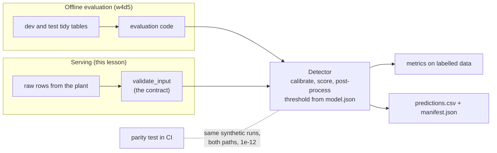
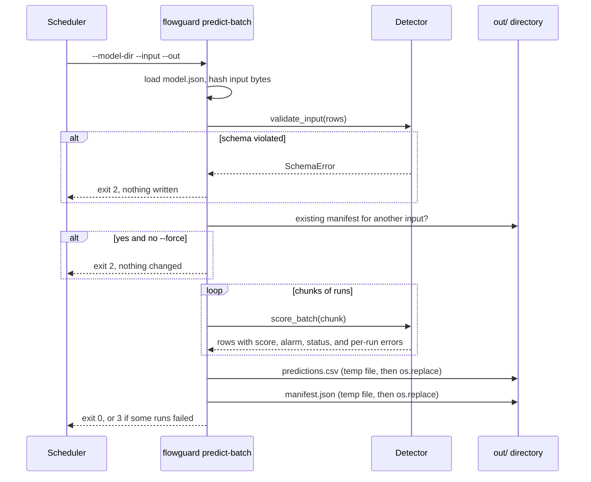
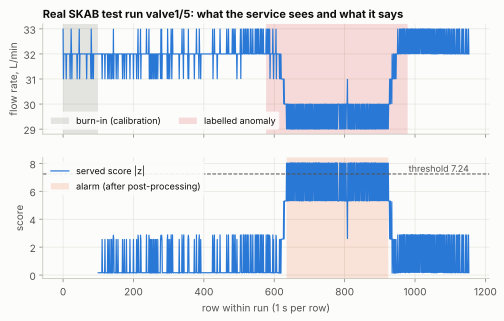
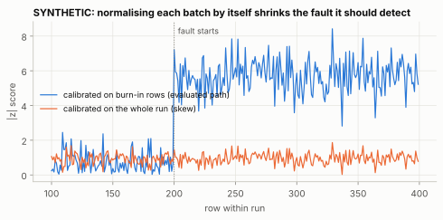
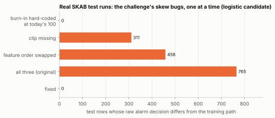

# W5D1 — Research experimentation versus production inference

Unit id `w5d1_inference_pipeline` · Week 5, day 1 · Handbook: [H10.1](../../handbook/ch10_batch_online_inference/h10_1_one_pipeline_for_training_and_serving.md) ·
Content status: see [STATUS.md](../../STATUS.md)

## 1. Purpose

**Objective.** Package preprocessing and model as one inference object that is used identically by
offline evaluation and by serving, and build a batch inference command on top of it.

**Why an applied ML engineer needs it.** Most production ML failures are not bad models. They are
good models served through a function that is not quite the function that was evaluated: a scaler
re-implemented with a different default, features stacked in another order, a threshold re-derived on
the wrong data, a reference statistic recomputed per request. None of these raise an exception.
Interviews probe the topic as "training/serving skew"; on the job it shows up as "the offline numbers
were great and production is mediocre".

**Deliverable.** `flowguard.inference` (the `Detector` object and its input contract),
`flowguard.batch` (`predict_batch`), a working `flowguard predict-batch` command, and a parity report
showing that the served detector reproduces the w4d5 test numbers exactly.

**Completion criteria.**

* `python wb.py check w5d1` passes (guided practice).
* `python lessons/w5d1_inference_pipeline/lab/parity_report.py` prints `identical metrics: True` and a
  score difference of exactly 0 on the real test experiments.
* Independent skill: `python wb.py check w5d1 --challenge` passes, with `test_parity.py` and
  `SKEW_REPORT.md` written without opening the hints.

**Prerequisites.**
* [w4d5](../w4d5_model_choice/README.md): the shipped model is the flow-rate |z| detector chosen there,
  with the alert-budget operating point from development data.
* [w3d4](../w3d4_point_vs_event_evaluation/README.md): `extract_events` and the post-processing
  parameters `min_duration` and `merge_gap`.
* [w1d4](../w1d4_config_logging/README.md) (configuration as data) and [w1d5](../w1d5_testing_ml_code/README.md)
  (tolerances in tests).

The lab ships snapshots of all of them and of the frozen manifest v2 from [w3d1](../w3d1_leakage/README.md).

**Time budget (2 h essential).**

| Activity | Minutes |
|---|---|
| Read section 2, run the worked example | 25 |
| Guided lab: input contract, Detector, batch command, real parity report | 70 |
| Independent challenge: start (finish in the extension or on the review day) | 15 |
| Assessment and reflection | 10 |
| *Optional extension: finish the challenge; profile `predict-batch` on 100x the data; a `--since` filter* | *up to 60* |

Data needed for the real-data steps: `python project/get_skab.py` (once). The checks need no download.

## 2. Conceptual explanation

### 2.1 What changes between research and production

In research the unit of work is an experiment: a script loads a fixed dataset, fits, evaluates, writes
a table. Everything is in memory, labels are present, and the code that computed a feature and the
code that scored it are the same lines in the same process. In production the unit of work is a
request or a batch. Several things change at once:

| | Research experiment | Production inference |
|---|---|---|
| Inputs | a curated table, complete, labelled | raw rows from another team's system, partial, unlabelled, sometimes malformed |
| Who calls the code | you, interactively | a scheduler or a service, at 03:00, with nobody watching |
| Failure | an exception you read and fix | must be contained: one bad run must not stop the others |
| State | rebuilt on every run | some state is fitted once (threshold), some is per entity (a run's calibration) |
| Output | a metric | a record that someone acts on and may later audit |
| Code path | the evaluation script | whatever the service imports |

The last row is the one that matters most. The model you evaluated is a *function* from raw inputs to
decisions. Its parameters are only part of it; the rest is preprocessing, feature order, defaults
for missing values, post-processing and threshold. Production is correct only if it runs that same
function.



*Figure 1. One object, two callers. The parity test keeps the evaluation code and the `Detector` from
drifting apart.*

### 2.2 Training/serving skew: a precise definition

Let *f* be the function evaluated offline and *g* the function deployed. **Skew** is any input *x* in
the deployment distribution for which *g(x) ≠ f(x)* by more than numerical noise, or for which the
two lead to different decisions. Its usual sources:

1. **Re-implemented preprocessing.** The same formula written twice. One copy uses `pandas.std()`
   (ddof=1), the other NumPy (ddof=0): every score is off by a factor sqrt(n/(n-1)), about 0.5 % for
   n = 100.
2. **Different defaults.** A constant in the serving script (burn-in of 60 rows, a fill value of 0)
   where training read it from configuration.
3. **Feature order.** A matrix of the right shape with columns in another order. Nothing fails; every
   coefficient multiplies the wrong feature.
4. **Stale or recomputed statistics.** A reference mean computed from last month's data, or worse,
   from the batch being scored ("normalising the input"). The second removes exactly the deviation
   the model should detect (Figure 5).
5. **Types and parsing.** Integers that become floats, a decimal comma, a time zone, a CSV reader whose
   float parser is not round-trip exact.

Numerical noise is not skew. Two correct implementations that sum in a different order can differ by
a few units in the last place: a relative difference of about 1e-16 per operation (H9.1 discusses
tolerances). A parity test therefore compares with a relative tolerance (here 1e-12) *and* requires
identical decisions.

### 2.3 One object owns the function

The remedy is structural, not a matter of being careful: the function is defined once and imported
by both the evaluation and the service. For the shipped detector that object holds:

* **configuration fixed at fit time:** sensor, burn-in length `n_burn`, threshold, `min_duration`,
  `merge_gap`, name and version. All plain data, saved as `model.json` (`to_config` / `from_config`);
* **per-run state computed at serving time:** the calibration of each run (mean and population
  standard deviation of flow rate over its first `n_burn` rows);
* **the scoring path:** `|x − mean| / std`, the threshold, then `extract_events` post-processing.

The boundary between *fit time* and *predict time* is the important line. Everything learned from
labelled development data (here, the operating point) is frozen in the configuration. Nothing
computed from the batch being scored may change it. The per-run calibration is computed at serving
time, but only from the rows the method defines (the first 100 of that run), never from the rows it
is about to judge.

### 2.4 The inference boundary: validation is not data quality

`validate_input` is a **contract check**: does this input have the shape the function is defined on?
Exactly the expected columns, in the expected order, numeric sensors, parseable timestamps. A
violation raises `SchemaError` and nothing is scored: the function is undefined there. This is a
different activity from the data-quality checks of w2d3, which ask whether *valid-shaped* data is
plausible (gaps, stuck sensors, duplicated rows). Data-quality problems in serving are reported per
run (a run with a missing flow-rate value is not scored, the others are), and from Week 7 on they
feed monitoring.

Two decisions in the contract deserve a sentence each:

* **Never match columns by position.** If a producer swaps two columns and you rename by position,
  you have silently swapped two sensors. The contract here refuses a reordered file, which is the
  strict version. Selecting by name is the relaxed version (assessment question 3 discusses it).
* **Labels are an unexpected column.** A file that contains `anomaly` is refused. Serving input that
  carries labels is almost always the evaluation export sent to the wrong place.

### 2.5 Batch inference design

A batch command is a small data pipeline with an owner it never meets. The design choices, and the
property each one buys:

| Choice | Property |
|---|---|
| process runs in chunks (`--chunk-runs`) | memory bounded by the chunk, not the file; output must not depend on the chunk size |
| one output row per input row, input order, `status` column | a consumer can join or zip without guessing; burn-in and failed rows are explicit, not missing |
| model name, version and threshold in every row and in the manifest | any prediction can be traced to the function that made it |
| `input_sha256` and `predictions_sha256` in `manifest.json` | provenance: which bytes went in, which came out |
| no wall-clock time in the outputs | idempotence: the same model on the same input gives byte-identical files |
| write to a temporary file, then `os.replace` | a reader never sees half a file; a crash leaves the old output intact |
| refuse an output directory that holds another input's predictions | a retry pointed at the wrong date cannot overwrite what was already acted on |
| per-run failure, exit code 3 | one truncated upload does not silence every machine; the scheduler can still tell |



*Figure 2. What `predict-batch` does, and the three ways it can end.*

### 2.6 Connection to what you know

You have lived this distinction in brain-computer interfaces. The offline decoding pipeline filters a
whole session with a zero-phase filter, normalises each channel with session statistics and
cross-validates. The online loop sees one block at a time: it must use a causal filter, normalisation
statistics frozen from the calibration run, and the classifier exactly as trained. A BCI that
normalises each incoming block by its own statistics fails in the same way as the "normalise the
batch" bug in Figure 5: the event-related change it should decode is divided away. The calibration
run of a BCI session is the `n_burn` rows of a flowguard run.

### 2.7 Industry example

A payments company trains a fraud model on a feature store's offline tables: "number of transactions
on this card in the last 24 h" computed with a SQL window over settled transactions. The online service
computes the same feature from a streaming counter that includes declined attempts and resets at
midnight UTC. Offline PR-AUC looks excellent; online, the feature has a different distribution, the
fixed threshold fires at a different rate and nothing errors. Teams that avoid this define the
feature once and materialise it for both paths, and they replay logged online requests through the
offline pipeline to compare scores row by row. (Illustrative composite, not a documented incident.)

### 2.8 Limitations and misconceptions

* *"Same library, same model file, therefore no skew."* The model file is a fraction of the function;
  the skew lives in the code around it.
* *"Parity means bit-identical."* Bit-identity is fragile across summation order, BLAS builds and CSV
  readers. Parity means agreement within a stated numerical tolerance and identical decisions.
* *"Validating inputs is enough."* Validation proves the input has the right shape, not that it has the
  right meaning. A sensor in the wrong unit passes every schema check; monitoring (Week 7) catches it.
* *"Recomputing statistics on fresh data keeps the model current."* Only if it is part of the method and
  was evaluated that way. Otherwise it is an unevaluated new model.
* *"Batch inference is just a loop."* Without idempotence, atomic writes and per-run failure handling it
  is a loop that corrupts outputs on retry.

## 3. Worked example: two re-implementations of the same scaler

[`example/skew_demo.py`](example/skew_demo.py) uses a SYNTHETIC churn table: `tenure_months`,
`monthly_spend`, `support_tickets` and a churn label, 400 training rows and 10,000 "live" rows. A
data scientist fits `StandardScaler` + `LogisticRegression`. A serving engineer re-implements the
scaling "from the notebook". Three serving paths are compared with the trained pipeline at a 0.5
decision threshold:

```bash
python lessons/w5d1_inference_pipeline/example/skew_demo.py
```

```text
training rows 400, live rows 10000, decision threshold 0.5
scaler std (ddof=0) vs pandas std (ddof=1), tenure: 15.4767 vs 15.4961
  A. re-implemented, ddof=1, alphabetical columns    max |dp| = 9.91e-01; decisions flipped: 1704
  B. re-implemented, ddof=1, trained column order    max |dp| = 6.22e-04; decisions flipped: 1
  C. the trained object itself                       max |dp| = 0.00e+00; decisions flipped: 0
```


*Figure 3 (SYNTHETIC).* Path A is wrong everywhere. Path B looks right and flips one decision in
10,000. Only path C is the evaluated function.

**Interpretation.**
* The column-order bug is catastrophic and would be noticed within a day.
* The ddof bug is the dangerous one. With n = 400 training rows it scales every standard deviation by
  sqrt(400/399), a 0.13 % change, moves probabilities by at most 6e-4 and flips 1 decision in 10,000.
  No dashboard shows it. It is still a different function from the one that was evaluated: with 40
  training rows (`make_table(40, seed=1)`, a 1.3 % change) the same bug moves probabilities by up to
  4.8e-3 and flips 34 decisions in 10,000.
* The fix in C is not "be more careful". It is "do not have two copies".

## 4. Guided lab

Work in `lessons/w5d1_inference_pipeline/lab/`. The package `src/flowguard/` holds the Week 2-4
snapshots (including `detectors.py`, the evaluated path from w4d5) and a complete `cli.py`. You
implement `src/flowguard/inference.py` and `src/flowguard/batch.py`. Each module docstring is the
contract: read it first. `model/model.json` is the shipped configuration, built by `build_model.py`.

```bash
cd lessons/w5d1_inference_pipeline/lab
python -m pip install -e .               # optional: gives you the `flowguard` command
cd -
```

**Task 1. The input contract (15 min).** Implement `validate_input`.

* Compute the missing and the unexpected columns first and name both in one message. Only when the set
  is right compare the order, and say "order" in that message.
* Coerce sensors with `pd.to_numeric(errors="coerce")`. A value that became NaN but was not empty
  before is a non-numeric value; name its column.
* NaN in a sensor is *not* a schema error.

*Checkpoint:* `python -m pytest lessons/w5d1_inference_pipeline/checks -q -k schema` passes 13 tests.

**Task 2. Calibrate and score (10 min).** Implement `calibrate`, `score_rows` and `alarm_mask`.
Use NumPy's population standard deviation (`ndarray.std()`, ddof=0): that is what the evaluated path
used. `alarm_mask` turns `extract_events(scores >= threshold, min_duration, merge_gap)` into a 0/1 array.

**Task 3. `score_batch` (20 min).** One output row per input row, in the input order; per run:
`burn_in` rows, then `scored` rows, or `error` for the whole run with a reason in `errors`.

*Checkpoint:* `python -m pytest lessons/w5d1_inference_pipeline/checks -q -k detector` passes 11 tests. If
`test_scores_match_the_evaluated_path` fails by a factor of about 1.005, you used ddof=1. If
`test_a_later_fault_does_not_change_earlier_scores` fails, your calibration sees more than the first
`n_burn` rows.

**Task 4. The batch command (15 min).** Implement `_atomic_write` and `predict_batch`.

* Hash the raw input bytes before parsing. Read the CSV with `float_precision="round_trip"`.
* Check an existing manifest *before* writing anything.
* Serialise both outputs to bytes, put `predictions_sha256` in the manifest, write each file atomically.
* No timestamps.

*Checkpoint:* `python wb.py check w5d1` passes all 31 checks. Debugging: if the byte-identical re-run
fails, search your manifest for anything time-dependent; if the chunking test fails, you are sorting
the output by run instead of restoring the input order.

**Task 5. The real model and parity (10 min).**

```bash
python lessons/w5d1_inference_pipeline/lab/build_model.py --check     # rebuilds model.json from dev data
python lessons/w5d1_inference_pipeline/lab/parity_report.py
```

The authoring run printed:

```text
batch: 7359 rows, 7 runs in 0.12 s (59,611 rows/s, including file I/O); runs failed: 0
burn-in rows reported as burn_in: True; scored rows: 6659 of 6659
score parity on scored rows: max |served - evaluated| = 0
alarm parity: 0 rows differ; 1134 alarm rows in total

event metrics on the 7 frozen test experiments (operating point fixed on development data):
  evaluated path (w4d5 code)   PR-AUC 0.884; events 5/7 (Wilson 95% [0.36, 0.92]); false alarms/h 0.00; median delay 100 s
  served path (predict-batch)  PR-AUC 0.884; events 5/7 (Wilson 95% [0.36, 0.92]); false alarms/h 0.00; median delay 100 s

identical metrics: True
```

These are the w4d5 test numbers, now produced by the command a scheduler would run. Throughput depends
on your machine. `build_model.py` reproduces the w4d5 operating point exactly: threshold 7.2441,
`min_duration` 30, `merge_gap` 10, 11 of 27 development events at the alert budget.

**An honest detail from authoring.** The first version of `parity_report.py` read `predictions.csv`
with pandas' default parser and reported a maximum difference of 1.4e-14. The in-memory scores were
identical. The default C parser is not round-trip exact: on this file it changed the last digit of
2,017 of 6,659 scores, by at most a relative 5.9e-16. That is noise, not skew. It is also why the
contract says `float_precision="round_trip"` and why the checks compare with a tolerance and demand
identical alarms.



*Figure 4 (real SKAB, test run valve1/5).* Flow rate is quantised to whole litres per minute, so the
score jumps between a few levels. The alarm band begins at row 635, 58 rows after the labelled onset
at row 577: the first drop in flow is small. In a batch the whole event is marked, including its first
29 rows; a live service only knows about it once `min_duration` = 30 rows have stayed above the
threshold, which is why w3d4 counts those rows in the detection delay. w5d3 serves the same detector
as a stream.



*Figure 5 (SYNTHETIC).* The "normalise the batch" bug. Median score after a 6-SD fault: 5.67 with
burn-in calibration, 0.93 with whole-run calibration. The detector would report health during the fault.

## 5. Independent challenge

[challenge/README.md](challenge/README.md): the supervised logistic candidate's serving path, written
by a colleague, has three skew bugs. Write a parity test that would have caught each, fix the code and
write a skew report. The checks run your test against each bug reintroduced on its own. No solution is
provided until you have attempted it.

## 6. Progressive hints

Open one at a time, only after 10 minutes stuck:
[hint 1, concept](hints/hint1_concept.md) · [hint 2, approach](hints/hint2_approach.md) ·
[hint 3, partial implementation](hints/hint3_partial.md). The full reference solution is in
`solutions/lessons/w5d1_inference_pipeline/` and is for after you have finished.

## 7. Assessment

[assessment.md](assessment.md): reasoning questions, a design-choice explanation, a rubric, and a
10-15 minute debugging interview rep ("alerts are a third of what offline evaluation predicted").
Model answers are in `solutions/lessons/w5d1_inference_pipeline/assessment_answers.md`.



*Figure 6 (real SKAB test runs; open after the challenge).* What the challenge's bugs do to real
decisions, one at a time. The hard-coded burn-in changes nothing *today*, because today's model happens
to use the same value. That is why it is the hardest bug to find, and why the checks test burn-in
lengths other than 100.

## 8. Reflection and review

**You should now be able to, without notes:**
* define training/serving skew and distinguish it from numerical noise with a stated tolerance;
* name five sources of skew and the test that catches each;
* say which values are fixed at fit time and which state is computed per entity at serving time;
* design a batch command that is idempotent, atomic, traceable and contains per-run failures;
* write a parity test between an evaluated path and a served path.

**Reflection prompt (3 sentences in `progress/notes.md`).** Think of a real-time system from your BCI
work. Which statistic did the online loop compute differently from the offline analysis, and how did
you find out?

**Retrieval question for the review day.** A served model and its evaluation code agree to 1e-15 on
every score, yet production raises twice as many alarms as the offline estimate at the same
threshold. Give two explanations that are not skew, and the check that tells them apart.

**Next.** [w5d2, model artifacts and versioning](../w5d2_artifacts_versioning/README.md): today's
`model.json` is trusted because you built it. Tomorrow it gets checksums, a model card, a
compatibility policy and a registry with an immutable version and a `current` pointer.

## Verification record

Execution verified on 2026-11-22, Python 3.13.18, pandas 3.0.5, NumPy 2.5.3, scikit-learn 1.9.1:

| What | Command | Outcome |
|---|---|---|
| Worked example | `python lessons/w5d1_inference_pipeline/example/skew_demo.py` | output above |
| Model build | `python lessons/w5d1_inference_pipeline/lab/build_model.py --check` (reference) | reproducible; threshold, `min_duration`, `merge_gap` equal to the w4d5 decision table |
| Real parity | `python .../lab/parity_report.py` (reference) | output above; score difference 0, alarms identical; byte-identical outputs on re-run |
| Challenge, real data | `python .../challenge/skew_on_real_data.py`, original and fixed `serve_scores.py` | original: PR-AUC 0.336, 1/7 events, 765 alarm decisions differ; fixed: 0.901, 4/7, 0 differ |
| Figures | `python lessons/w5d1_inference_pipeline/figures/make_figures.py` | all numbers above |
| Checks | `python tools/verify_checks.py lessons/w5d1_inference_pipeline` | reference passes lab (31) and challenge (16); 7 lab and 4 challenge wrong submissions rejected |
| Starter | `python -m pytest lessons/w5d1_inference_pipeline/checks -q` | 29 of 31 fail (the two that pass test given code) |
