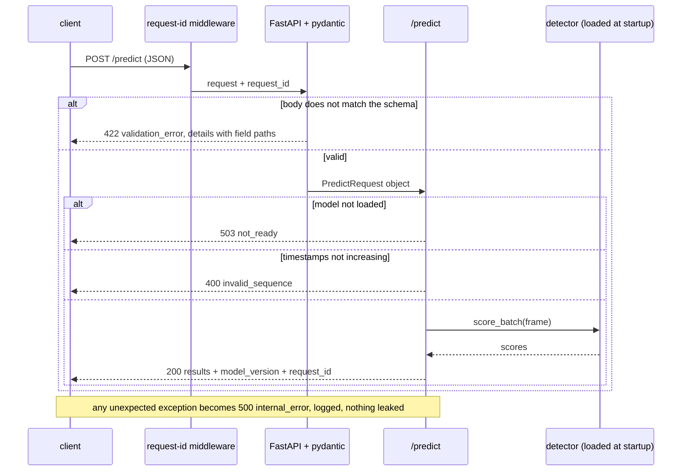
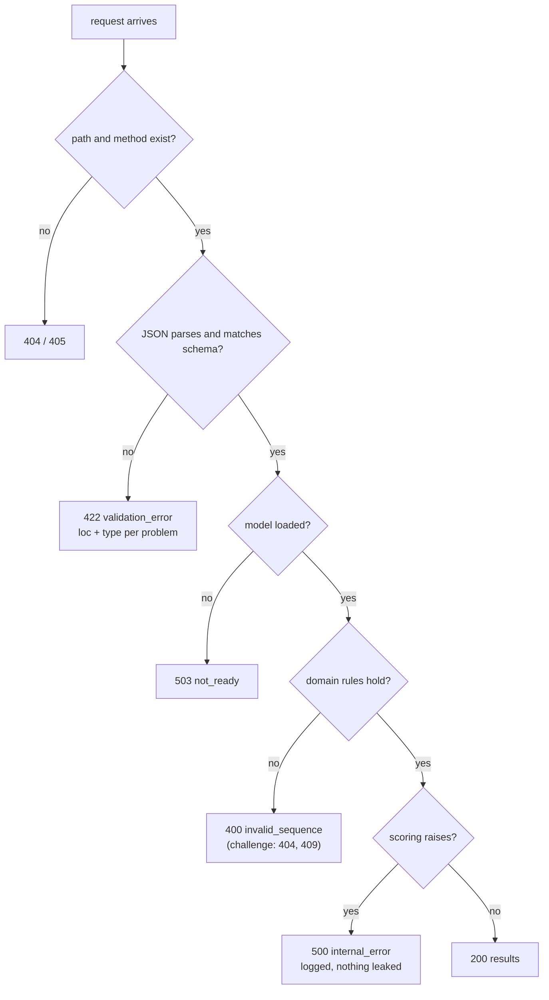
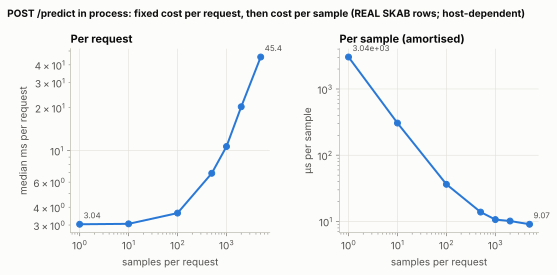
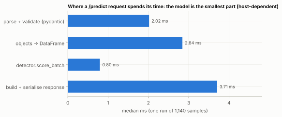

# w5d4 - FastAPI I: endpoints, schemas and input validation

**Status: Execution verified** (see the verification record at the end).

| | |
|---|---|
| **Primary objective** | Expose the detector's predictions through a typed HTTP API that rejects bad input precisely, separates client errors from server errors, and says when it is not ready. |
| **Deliverable** | `flowguard.api.create_app(model_dir)` with `/predict`, `/healthz`, `/readyz`, `/version`, schemas with constraints, one error format, and a real smoke test with uvicorn on your machine. |
| **Completion criteria** | `python wb.py check w5d4` passes; the uvicorn smoke test returns 313 exceedances for valve1/13; you can say, without notes, which status code each failure in the error table gets and why. |
| **Handbook** | [H11.1 HTTP for ML engineers](../../handbook/ch11_fastapi_input_validation/h11_1_http_for_ml_engineers.md), [H11.2 Schemas and validation](../../handbook/ch11_fastapi_input_validation/h11_2_schemas_and_validation.md) |

---

## 1. Purpose

**What you will learn.** How to put a model behind HTTP so that a client in another team, written in
another language, can use it correctly without reading your code: a published schema with
constraints, status codes that tell the client what to do next, one error body for every failure, a
model loaded once at startup, and endpoints that let a load balancer tell "alive" from "ready".

**Why an applied ML engineer needs it.** The API is a trust boundary. Inside your research code every
input came from you; behind an API it comes from anyone, including a client that sends flow in m³/s
instead of L/min, a sentinel value of -9999, `NaN`, a field name with a typo, or ten million rows.
Every one of those becomes either a precise 4xx that the client can act on, or a silently wrong
prediction. In interviews, "how would you serve this model?" is answered at exactly this level.

**Prerequisites.**
* [w5d3](../w5d3_online_inference/README.md) (the shipped detector, `score_batch`, the model bundle;
  this lab ships its own snapshots, so the API can be built even if w5d3 is unfinished).
* [w5d2](../w5d2_artifacts_versioning/README.md) (artifact bundles); the snapshot `flowguard.bundle`
  is written to its description.
* Diagnostic section b3 (HTTP status codes and pydantic) if you took it.
* Installed: `fastapi`, `pydantic` 2, `uvicorn`, `httpx` (for `TestClient`). See section 4.

**Time budget (2 h essential + optional extension up to 1 h).**

| Activity | Minutes |
|---|---|
| Read sections 2 and 3 | 25 |
| Run and read the worked example | 10 |
| Guided lab: schemas, lifespan, endpoints, error handlers, real smoke test | 70 |
| Start the independent challenge (streaming endpoints) | 5 |
| Assessment questions and reflection | 10 |
| *Optional extension*: finish the challenge; add a byte limit with `max_body_size` and a test for its 413 | up to 60 |

---

## 2. Conceptual explanation

### 2.1 Intuition: an API is a contract with three layers of checks

A request passes three gates before the model sees it, and each gate has its own failure answer:

1. **Transport and syntax.** Is it JSON at all? Is it too large? (Malformed JSON: 422 in FastAPI.
   Oversize bodies: 413, from a reverse proxy, or from FastAPI itself when `max_body_size=` is set;
   that option exists in the FastAPI 0.165 used here, so check your version's documentation. A byte
   limit protects memory *before* parsing; the 5,000-sample limit of the schema applies only *after*
   the whole body has been parsed.)
2. **Schema.** Does it have the right fields, types and ranges? (422, with the path of every bad field.)
3. **Domain.** Is it meaningful as a whole: are timestamps increasing, is the machine known, does the
   sample fit the current state? (400, 404 or 409, with a stable code.)

Only then does the model run. If anything fails *after* that point, it is the server's fault (500),
and the client is told so without being told internals. If the model is not loaded, the honest
answer is 503: "try again later or elsewhere".



*Diagram 1. Every path through the service ends in one of a small set of documented answers.*

### 2.2 Precise terms

* **Endpoint / path operation**: a method + path pair, e.g. `POST /predict`.
* **Idempotent method**: repeating it has the same effect as doing it once (`GET`, `PUT`, `DELETE`;
  `POST` in general is not). `/predict` is a POST that happens to be safe to repeat because it has no
  side effects; the streaming endpoint of the challenge is a POST that is made idempotent on purpose.
* **Schema validation**: checking a payload against declared types and constraints (pydantic models).
* **Domain validation**: checks that need more than one field or server state.
* **Liveness** (`/healthz`): the process can answer. **Readiness** (`/readyz`): it can do its job
  (the model is loaded and compatible). Orchestrators restart on failed liveness and stop routing
  traffic on failed readiness; confusing the two restarts healthy pods or routes traffic to useless ones.
* **Lifespan**: code that runs once before the app accepts requests and once after it stops
  (FastAPI's `lifespan=` async context manager; the older `@app.on_event` hooks are deprecated).
* **Request id**: an identifier attached to a request and echoed in the response and in the logs, so a
  user's complaint can be matched to a log line.

### 2.3 Status codes: what each one tells the client to do

| Code | Meaning for the client | Used here for |
|---|---|---|
| 200 OK | here is the answer | predictions, health, readiness |
| 201 Created | a new resource exists | (challenge) a new stream registered |
| 204 No Content | done, nothing to return | (challenge) stream deleted |
| 400 Bad Request | your request is well-formed but not acceptable as a whole; fix it | timestamps not increasing |
| 404 Not Found | the thing you name does not exist | unknown path; (challenge) unknown machine |
| 405 Method Not Allowed | right path, wrong method | `GET /predict` |
| 409 Conflict | your request conflicts with the current state of the resource | (challenge) late or conflicting sample |
| 413 Content Too Large | the body is too big | not produced by the lab's app (optional extension: `FastAPI(max_body_size=...)`) |
| 422 Unprocessable Content | the body does not match the schema; the details say where | every schema violation |
| 429 Too Many Requests | slow down; usually with `Retry-After` | not produced here (week 6/7 topic) |
| 500 Internal Server Error | our bug; retrying may or may not help | anything unexpected |
| 503 Service Unavailable | not now; retry later or elsewhere | model not loaded |

The rule of thumb: **4xx means "change your request", 5xx means "it is not your fault".** A client
retries 503 and 429, fixes and resends 400/422, and reports 500 with the request id.



*Diagram 2. The decision order the lab implements. The order is part of the contract: a request to a
service without a model gets 422 if its body is invalid, because validation runs first.*

### 2.4 The mathematics of a constraint, and why NaN needs its own

A constraint is a predicate on the input; validation is evaluating all of them and reporting every
failure, not just the first. Two details matter:

* **NaN compares false with everything.** `ge=0, le=500` rejects NaN, because both `nan >= 0` and
  `nan <= 500` are false, but pydantic then reports it as `less_than_equal`: the client is told the
  value is too large. `allow_inf_nan=False` reports `finite_number` instead, which is the truth, and it
  also protects fields that have no range. Python's JSON parser, which FastAPI uses, accepts the
  non-standard tokens `NaN`, `Infinity` and `-Infinity`, so a client really can send them.
* **Lax versus strict parsing.** By default pydantic coerces `"23.5"` to `23.5` (lax mode). That is
  convenient for clients and a source of surprises (`"1e3"` is a valid float string). Strict mode
  rejects strings for floats. This lab keeps the default and documents it; the worked example shows it.

Sanity limits are not the training distribution. `flow_rate` must be in [0, 500] L/min: anything
outside is a unit error or a broken sensor, not an anomaly. Values that are physically possible but
unlike training data are the detector's business (that is what it scores) and monitoring's (week 7).

### 2.5 Connection to what you already know

In a closed-loop BCI, the acquisition software, the decoder and the feedback display trust each other:
you wrote all three, and a malformed packet is a bug you fix in the lab. An API removes that trust.
The closest research analogue is a shared dataset in BIDS format: a validator rejects files that do
not match the specification before anyone analyses them, and its messages name the file and field.
`extra="forbid"` is the equivalent of rejecting an unknown sidecar key instead of silently ignoring
it. And the difference between "the recording is malformed" (422) and "the recording is valid but the
event markers are out of order" (400) is one you already make when curating data.

### 2.6 An industry example

A predictive-maintenance vendor added a `units` field to its client SDK so that customers could send
temperatures in °F. The scoring service, built with an untyped JSON handler, ignored unknown fields;
the SDK was released before the server learned to convert. For two weeks every US customer's
temperatures were scored as if they were °C: 86 °F became 86 °C, the detector flagged every machine
as overheating, and the alert channel was muted by the operators, which hid a real failure later. A
schema with `extra="forbid"` would have rejected the first request from the new SDK with a 422 naming
`units`, and the integration test of the SDK would have failed before release. (Illustrative composite,
not a cited incident.)

### 2.7 Limitations and common misconceptions

* *"The status code does not matter as long as the message is clear."* Clients branch on the code
  (retry or not, alert or not). Messages are for humans; codes are for programs.
* *"Return the exception text so users can debug."* Exception messages contain paths, hostnames, SQL,
  sometimes secrets. Log them with the request id; return the id.
* *"Validation makes the input safe for the model."* It makes it well-formed. Whether it resembles the
  training data is a separate, statistical question (week 7).
* *"`async def` is faster."* Only for code that awaits I/O. A CPU-bound handler declared `async def`
  blocks the event loop and every other request; a plain `def` handler runs in FastAPI's thread pool.
  The detector is CPU-bound, so the lab uses `def`.
* *"The API is done when it works with curl."* It is done when every failure in the error table has a
  test. This lab has 30.
* This service holds no per-machine state; the challenge adds some, and with it concurrency: two
  requests for one machine must not update its state at the same time.

---

## 3. Worked example: the same tiny API, naive and careful

`example/tiny_api.py` is a SYNTHETIC "room comfort" service (a comfort index from temperature and
humidity, with coefficients loaded from a JSON file that stands in for a model bundle). It is built
twice: `naive_app()` with types only, FastAPI's default errors, coefficients read per request and the
exception text returned on failure; `careful_app()` with the patterns of this lesson.
`example/demo_requests.py` sends the same requests to both, in process.

```bash
python lessons/w5d4_fastapi_validation/example/demo_requests.py
```

Output of the authoring run (long bodies are cut at 150 characters by the script):

```text
NAIVE (body is a bare list of readings)
  valid                                        200  {"comfort":[90.0]}
  string number '23.5'                         200  {"comfort":[90.0]}
  humidity 4500 (per-mille sent as percent)    200  {"comfort":[-3470.0]}
  extra field 'co2'                            200  {"comfort":[90.0]}
  missing humidity                             422  {"detail":[{"type":"missing","loc":["body",0,"humidity_pct"],"msg":"Field required","input":{"temperature_c":23.5}}]}
  empty list                                   200  {"comfort":[]}
  NaN temperature                              500  Internal Server Error

CAREFUL
  valid                                        200  {"comfort":[90.0]}
  string number '23.5'                         200  {"comfort":[90.0]}
  humidity 4500 (per-mille sent as percent)    422  {"error":{"code":"validation_error","message":"request does not match the schema","details":[{"loc":["body","readings",0,"humidity_pct"],"type":"le...
  extra field 'co2'                            422  {"error":{"code":"validation_error","message":"request does not match the schema","details":[{"loc":["body","readings",0,"co2"],"type":"extra_forbi...
  missing humidity                             422  {"error":{"code":"validation_error","message":"request does not match the schema","details":[{"loc":["body","readings",0,"humidity_pct"],"type":"mi...
  empty list                                   422  {"error":{"code":"validation_error","message":"request does not match the schema","details":[{"loc":["body","readings"],"type":"too_short"}]}}
  NaN temperature                              422  {"error":{"code":"validation_error","message":"request does not match the schema","details":[{"loc":["body","readings",0,"temperature_c"],"type":"f...
  internal bug (missing coefficient)           500  {"error":{"code":"internal_error","message":"internal error","details":null}}

OpenAPI fragment of the careful Reading schema:
  {"type": "number", "maximum": 100.0, "minimum": 0.0, "title": "Humidity Pct"}
```

**Interpretation, row by row.**
* *humidity 4500*: the naive service returns a comfort index of -3,470 with status 200. A wrong
  answer with a success code is the worst outcome an API can produce.
* *extra field*: silently ignored by the naive service; a client that believed `co2` mattered never
  finds out. The careful one names the field.
* *string number*: both accept `"23.5"` (pydantic's lax mode). This is a decision, not an accident;
  it is documented in H11.2.
* *NaN temperature*: the naive handler computes a NaN comfort index; its `try/except` does not help,
  because the failure happens later, when the response is serialised (JSON has no NaN), so the client
  gets a bare text 500 and no hint. The careful service rejects the input with the true reason
  (`finite_number`).
* *missing humidity*: the naive service's 422 echoes the client's input back (`"input": ...`), and
  its error format (`detail`) differs from its 500 format. The careful service has one format.
* *internal bug*: the careful 500 says nothing about the missing key; the log would.
* The constraints appear in the OpenAPI schema (`maximum`, `minimum`), so clients can generate
  validators and documentation from it.

**Reproduce.** No randomness; the output is identical on every run with FastAPI 0.165 / pydantic
2.13. Older pydantic versions word some messages differently; codes and types are stable.

---

## 4. Guided lab

Work in `lessons/w5d4_fastapi_validation/lab/`. Given: snapshots of `data`, `splits`, `inference`
(the detector), `bundle` (verified loading), and the committed model bundle `models/flowguard-z/1.0.0/`
(the w4d5 choice, rebuilt in w5d3). You complete `src/flowguard/schemas.py` and
`src/flowguard/api.py`. **The module docstring of `api.py` is the contract**, including the error
table; read it completely first.

```bash
python -m pip install "fastapi>=0.115" "pydantic>=2.6" "uvicorn>=0.30" "httpx>=0.27"
python -m pip install -e lessons/w5d4_fastapi_validation/lab
python wb.py check w5d4                         # 30 checks, about 1 s; all but one fail at first
python -m pytest lessons/w5d4_fastapi_validation/checks -q -k readyz      # a subset while you work
```

**Task 1. Constraints (15 min).** In `schemas.py`, add `model_config = ConfigDict(extra="forbid")` to
`Sample` and `PredictRequest`, a `Field(ge=..., le=..., allow_inf_nan=False)` for every sensor from
`SENSOR_LIMITS`, the `pattern` for `machine_id`, and `min_length`/`max_length` for `samples`. A helper
that builds the `Field` from a sensor name saves eight near-identical lines.

*Checkpoint (no API needed yet):*

```bash
python - <<'EOF'
from flowguard.schemas import Sample
from pydantic import ValidationError
ok = dict(timestamp="2026-01-01T00:00:00", accelerometer1_rms=0.2, accelerometer2_rms=0.3, current=1.9,
          pressure=0.3, temperature=80, thermocouple=25, voltage=230, flow_rate=32)
Sample(**ok)
for bad in ({"flow_rate": float("nan")}, {"flow_rate": 9999}, {"rpm": 1}):
    try:
        Sample(**{**ok, **bad}); print("ACCEPTED", bad)
    except ValidationError as e:
        print(bad, "->", e.errors()[0]["type"])
EOF
```

You should see `finite_number`, `less_than_equal` and `extra_forbidden`. If NaN gives
`less_than_equal`, you relied on the range to catch it (section 2.4).

**Task 2. Lifespan and readiness (15 min).** Write an `@asynccontextmanager` `lifespan(app)` inside
`create_app` that calls `load_bundle(model_dir)`, stores the detector in `app.state.detector`, and
catches `BundleError` (leaving `None` and logging the reason). Pass it as `FastAPI(lifespan=...)`.
Add `/readyz` and `/version`.

*Checkpoint:* `-k "healthz or readyz or not_ready or corrupt or version"` passes (5 tests).

*Debugging.* If `app.state.detector` does not exist in a test: lifespan runs only when `TestClient` is
used as a context manager (`with TestClient(app) as c:`); the checks do that, your own experiments
must too. If `create_app` raises on a missing directory, you are loading outside the lifespan.

**Task 3. The request id (10 min).** An `@app.middleware("http")` function: accept an incoming
`X-Request-ID` matching `^[A-Za-z0-9._-]{1,64}$`, else generate `uuid.uuid4().hex`; store it in
`request.state.request_id`; set the response header.

*Checkpoint:* `-k request_id` passes.

**Task 4. `/predict` (20 min).** A plain `def` endpoint taking `body: PredictRequest` and
`request: Request`. Return 503 if there is no detector; check that timestamps are strictly increasing
(and do not mix timezone-aware with naive values; comparing them raises `TypeError`); build a
DataFrame with a `datetime` column and the sensor columns; call `score_batch`; map NaN to
`score=None, status="warming_up"`. Return a `PredictResponse`. Raise your own exception class for the
400/503 cases and turn it into the error body in one handler (task 5).

*Checkpoint:* `-k "predict_equals or burn_in or loaded_once or non_increasing or mixed"` passes.

*Debugging.* `assert False is True` on `exceeds_threshold`: you returned a NumPy `bool_`; convert with
`bool(...)`. A 500 on the mixed-timezone test means the comparison raised before your check.

**Task 5. One error format (10 min).** Handlers for your exception class, for
`RequestValidationError` (422; details as `{"loc", "type", "msg"}` from `exc.errors()`, *without* the
`input` field, so the client's data is not echoed back), for Starlette's `HTTPException` (404/405), and
for `Exception` (500, generic message, `logger.exception(...)` with the request id).

*Checkpoint:* `python wb.py check w5d4` passes completely (30 tests).

*Debugging.* If the 500 test fails because the exception propagates: the checks use
`TestClient(..., raise_server_exceptions=False)`; your own tests must too. If 404 still returns
`{"detail": "Not Found"}`, register the handler for `starlette.exceptions.HTTPException`, not only
`fastapi.HTTPException`.

**Task 6. A real server, on your machine only (10 min).**

```bash
python project/get_skab.py                                       # once, if data/raw/skab is missing
python lessons/w5d4_fastapi_validation/lab/make_request.py --out /tmp/req.json
cd lessons/w5d4_fastapi_validation/lab
FLOWGUARD_MODEL_DIR=models/flowguard-z/1.0.0 \
  uvicorn --factory flowguard.api:create_app_from_env --host 127.0.0.1 --port 8765
# in a second terminal:
curl -s -i http://127.0.0.1:8765/readyz
curl -s -X POST http://127.0.0.1:8765/predict -H 'content-type: application/json' \
     -H 'X-Request-ID: smoke-001' --data @/tmp/req.json | head -c 400; echo
curl -s -X POST http://127.0.0.1:8765/predict -H 'content-type: application/json' --data @/tmp/req.json \
  | python -c "import json,sys; r=json.load(sys.stdin)['results']; ex=[i for i,x in enumerate(r) if x['exceeds_threshold']]; print('exceeding samples:', len(ex), 'first at row', ex[0])"
# stop the server with Ctrl+C
```

`--host 127.0.0.1` binds to your machine only. Never use `0.0.0.0` on a network you do not control
for a service without authentication. Open `http://127.0.0.1:8765/docs` to see the contract FastAPI
generated from your schemas.

The authoring run of the reference solution (valve1/13, 1,140 samples) printed:

```text
HTTP/1.1 200 OK
date: Sun, 22 Nov 2026 17:00:37 GMT
server: uvicorn
content-length: 54
content-type: application/json
x-request-id: 3bcc38c7f67d4139a0435167dee092a4

{"status":"ready","model_version":"flowguard-z-1.0.0"}
{"request_id":"smoke-001","model_version":"flowguard-z-1.0.0","machine_id":"valve1/13","threshold":7.244130714098134,"n_samples":1140,"results":[{"timestamp":"2020-03-09T14:34:41","score":null,"status":"warming_up","exceeds_threshold":null},{"timestamp":"2020-03-09T14:34:42","score":null,"status":"warming_up","exceeds_threshold":null},{"timestamp":"2020-03-09T14:34:43","score":null,"status":"warmi
exceeding samples: 313 first at row 612
```

313 exceeding samples is exactly what the streaming replay of w5d3 counted for the same experiment.
Five repeated requests took 10.2-10.7 ms each as measured by curl on the same host.



*Figure 1 (REAL SKAB rows, in-process TestClient, host-dependent).* A request has a fixed cost of
about 3 ms; above about 1,000 samples the cost is about 10 µs per sample. Sending samples one per
request would cost 300 times more per sample than batching them: one reason the challenge's streaming
endpoint is a different design, not a free one.



*Figure 2 (same conditions).* The model is the smallest of the four stages. Before optimising a
model for latency, measure where the time goes.

---

## 5. Independent challenge: a stateful streaming endpoint

Read [challenge/README.md](challenge/README.md). In short: copy your finished lab into `challenge/`,
add the w5d3 streaming module (yours, or the snapshot in `challenge/given/`), and expose
`PUT/GET/DELETE /streams/{machine_id}` and `POST /streams/{machine_id}/samples`, so that every
exception of the streaming contract becomes the right status code, and streamed scores equal
`/predict` scores for the same samples. Acceptance criteria are in the challenge README;
`python wb.py check w5d4 --challenge` grades it (11 checks).

---

## 6. Progressive hints

1. [Hint 1 - concept](hints/hint1_concept.md)
2. [Hint 2 - approach](hints/hint2_approach.md)
3. [Hint 3 - partial implementation](hints/hint3_partial.md)

Reference solutions and the wrong submissions the checks were validated against are in
`solutions/lessons/w5d4_fastapi_validation/`. Open them after submitting.

---

## 7. Assessment

[assessment.md](assessment.md): reasoning questions, a design-choice explanation, a rubric, and a
12-minute interview rep on API concepts.

---

## 8. Reflection and review

**You should now be able to, without notes:**
* write a pydantic v2 schema with ranges, finiteness, size limits and forbidden extras, and read its
  validation errors;
* load a model once with a FastAPI lifespan and expose liveness and readiness separately;
* map every failure of a prediction service to a status code and one error body, without leaking
  internals;
* test all of it in process with `TestClient`, and smoke-test it with uvicorn bound to localhost.

**Reflection prompt (5 minutes, in `progress/notes.md`).** Which input errors did your research
pipelines catch, and where (at acquisition, at analysis, never)? Which of them would become a 422, a
400 or a silent wrong answer behind this API?

**Retrieval question for later (answer in w5d7 without looking).** A load balancer keeps sending
traffic to an instance whose model failed to load, and every prediction there returns 503. Which
endpoint is wrong, what should it return, and what does the other health endpoint return?

**Next.** [w5d5 - API tests, integration tests and model lifecycle](../w5d5_api_testing/README.md)
tests the service at its boundary more systematically and looks at what happens when the model changes
while the service runs.

---

## Verification record

Executed on 2026-11-22 with Python 3.13.18, FastAPI 0.165.0, Starlette 1.7.0, pydantic 2.13.5,
uvicorn 0.54.0, httpx 0.28.1, NumPy 2.5.3, pandas 3.0.5, matplotlib 3.11.2.

* `python lessons/w5d4_fastapi_validation/example/demo_requests.py`: output above.
* `python tools/verify_checks.py lessons/w5d4_fastapi_validation`: the reference passes the lab (30
  checks) and the challenge (11 checks); all 7 lab mutants and 4 challenge mutants are rejected. The
  shipped starters fail (lab: 29 of 30; the remaining one is `/healthz`, which the starter provides).
* uvicorn smoke test of the reference lab, bound to 127.0.0.1, with `make_request.py` on valve1/13:
  output above; the server was stopped afterwards.
* `python lessons/w5d4_fastapi_validation/figures/make_figures.py`: Figures 1 and 2 (values in
  `figures/figure_data.csv`).
* FastAPI, Starlette and pydantic behaviour used here was checked against their documentation
  sources (listed in H11.1 and H11.2) and by execution.
* Not verified: Python 3.11 and 3.12 locally; the time budget; behaviour behind a real reverse proxy.
