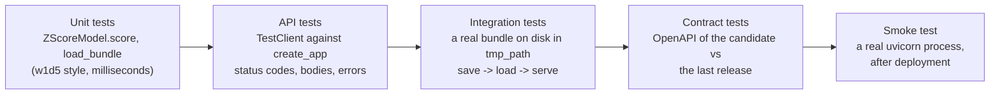
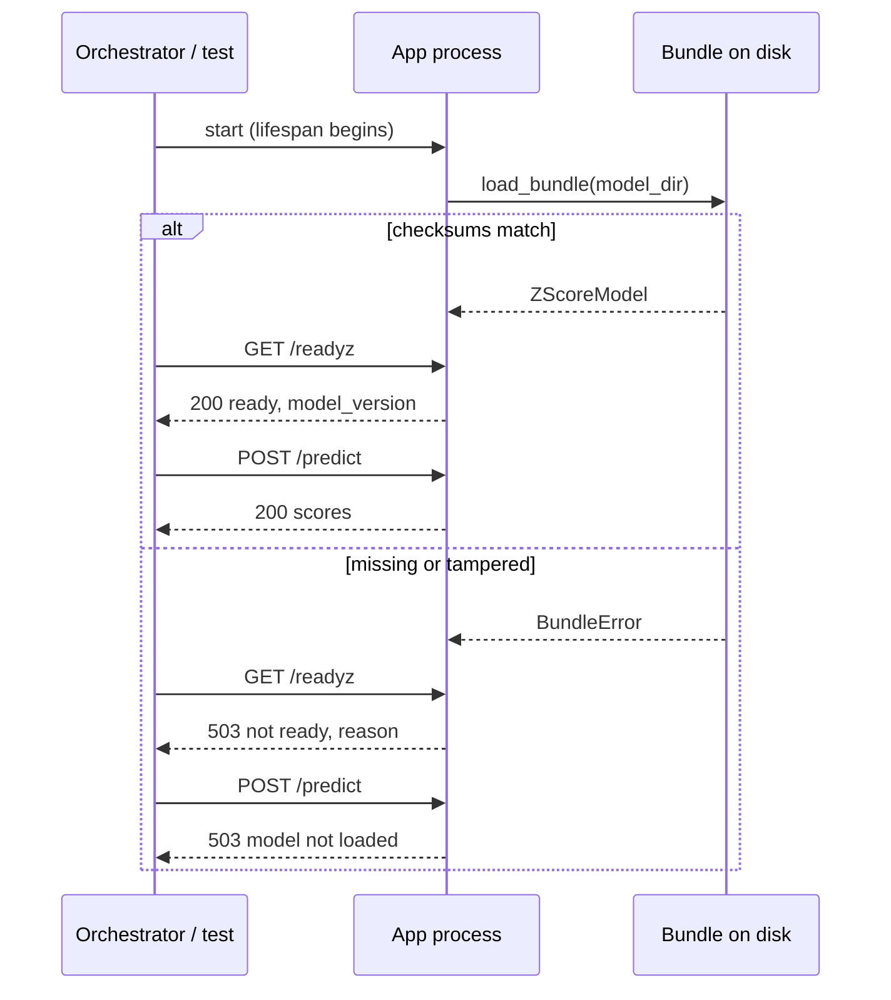
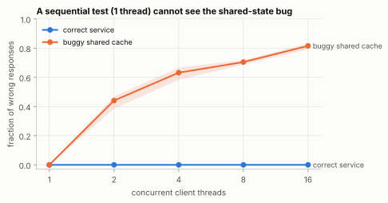
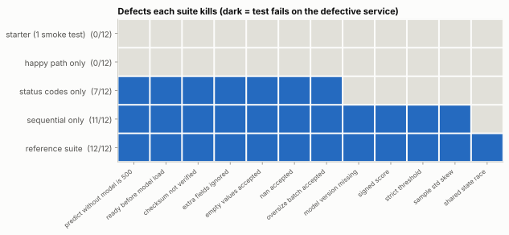
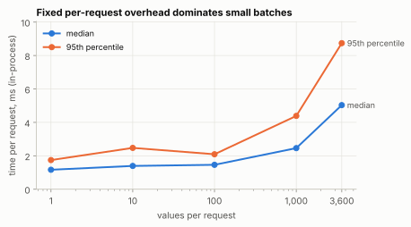

# W5D5 — Testing the service at the HTTP boundary

Unit id `w5d5_api_testing` · Week 5, day 5 · Handbook:
[H9.2 API, integration and contract tests](../../handbook/ch09_testing_ml_systems/h9_2_api_integration_contract_tests.md),
[H11.3 Lifecycle and concurrency](../../handbook/ch11_fastapi_input_validation/h11_3_lifecycle_and_concurrency.md)
· Content status: see [STATUS.md](../../STATUS.md)

## 1. Purpose

**Objective.** Write a test suite that pins down a prediction service's contract at the HTTP boundary,
including startup, degraded operation and concurrent load, and that is judged by the defects it
catches, not by the lines it runs.

**Why an applied ML engineer needs it.** Once a model sits behind an API, most production incidents
are not about the model's accuracy. They are a 500 where a 422 belonged, a readiness probe that said
"ready" before the model was loaded, a silently ignored misspelt field, a threshold applied with `>`
instead of `>=`, or a cache that mixes two users' requests under load. None of these shows up in an
offline evaluation, and most do not show up in a test that sends one valid request. In w1d5 you
graded a test suite for signal features by mutation; today the code under test is a service and the
mutations are the defects above.

**Deliverables.**
* `lab/tests/`: your suite for the service in `lab/service/` (contract in [lab/CONTRACT.md](lab/CONTRACT.md)).
* `challenge/compat.py`, `challenge/test_contract.py`, `challenge/COMPATIBILITY.md`: a breaking-change
  detector for OpenAPI documents, contract tests, and a written compatibility policy.

**Completion criteria.**
* `python wb.py check w5d5`: your suite passes on the correct service, runs in under 30 s, and fails
  on each of 12 defective variants of it (graded without network, from a temporary directory).
* `python wb.py check w5d5 --challenge` passes.
* You can explain, without notes, why the concurrency test is the only test that kills one of the
  defects, and why a status-code-only suite misses five.

**Prerequisites.**
[w1d5](../w1d5_testing_ml_code/README.md) (fixtures, tolerance, mutation grading),
[w5d4](../w5d4_fastapi_validation/README.md) (FastAPI, pydantic schemas, 422 vs 503),
w5d2 (checksummed bundles; see [the schedule](../../roadmap/SCHEDULE.md)). The lab ships its own snapshot of
the service, so you can start even if your own w5d4 service differs.

**Time budget (2 h essential).**

| Activity | Minutes |
|---|---|
| Read section 2 | 25 |
| Worked example: run the ETA tests and the race demo | 15 |
| Guided lab: fixtures, contract tests, lifecycle tests, concurrency test, integration test | 55 |
| Challenge: start `compat.py` and the contract test | 15 |
| Assessment and reflection | 10 |
| *Optional extension: finish the challenge; smoke-test a real uvicorn process; property-based request fuzzing* | *up to 60* |

## 2. Conceptual explanation

### 2.1 Where the tests sit

A service has more ways to be wrong than a function, so it gets more layers of tests. Each layer
answers a different question and has a different cost.



* **Unit tests** check the scoring arithmetic and the bundle loader directly. They are fast and
  precise but know nothing about HTTP.
* **API tests** call the app through Starlette's `TestClient`, which speaks ASGI to the app in the
  same process: no socket, no port, no server. They check what a client sees: status codes, JSON
  bodies, error formats. This is today's main layer.
* **Integration tests** cross a real boundary that the API tests stub: here, a bundle written to disk
  by `save_bundle`, read back by `load_bundle` during startup, and served.
* **Contract tests** compare the published interface (the OpenAPI document) with the last released
  one, so a change that breaks existing clients fails the build even if every behavioural test passes.
* **Smoke tests** run against the deployed process (`curl /readyz` after a deploy). They belong to the
  delivery pipeline (w6d3, w6d6), not to the unit suite, because they need a running server.

Your research analogue: unit tests are checking a filter's impulse response; API tests are checking
what the acquisition software hands to the classifier; integration tests replay a recorded session
file end to end; a smoke test is the first minute of a live BCI session.

### 2.2 The contract is the specification, not the code

Write tests from [lab/CONTRACT.md](lab/CONTRACT.md), not from `service/flowguard/api.py`. A test written
by reading the implementation tends to restate it ("the code calls `std()`, so I assert `std()`"), and
then it passes on whatever the code does. A test written from the contract asserts what a client is
promised: population standard deviation (the training-time convention), an inclusive threshold, 413 for
more than 3,600 values, 503 until the model is loaded.

Two kinds of assertion matter, and a suite needs both:

* **Status assertions**: did the service accept or refuse, and with which code? 422 means "your
  request is wrong; do not retry it unchanged". 503 means "I cannot answer now; retry later or go
  elsewhere". 500 means "the server has a bug". A client's retry logic depends on the difference, so a
  500 where a 422 belonged is a real defect, not a cosmetic one.
* **Content assertions**: is the answer right? A response can be 200 and wrong: signed scores, a
  strict threshold, the sample instead of the population standard deviation, another request's
  scores. [Figure 2](#figure-2) shows how many defects a status-only suite lets through.

### 2.3 Error paths and boundaries

Most defects live at the edges of the input space, so most tests should too:

| Edge | Example request | Contract |
|---|---|---|
| Empty | `"values": []` | 422 |
| Minimum | `"burn_in": [1.0]` (one value) | 422; two is the minimum |
| Maximum | 3,600 values / 3,601 values | 200 / 413 |
| Wrong type | `"values": ["high"]` | 422 |
| Unknown field | `"burnin": [...]` (misspelt) | 422; silently ignoring it would score with no burn-in check |
| Non-finite | `NaN`, `Infinity` | 422 |
| Exactly at threshold | score = threshold | `above_threshold` true (`>=`) |
| Degenerate | constant burn-in (std 0) | std treated as 1 |

**Non-finite numbers deserve a note.** Strict JSON has no `NaN`, and `httpx` (which `TestClient`
uses) refuses to encode one. Python's `json` module, pandas' `to_json` and several other clients
emit the literal `NaN` anyway, and FastAPI parses it with `json.loads`, which accepts it. So the test
sends raw bytes:

```python
raw = '{"burn_in": [0.0, 1.0], "values": [NaN]}'
client.post("/predict", content=raw, headers={"content-type": "application/json"})
```

While writing this lesson we found a real trap here (FastAPI 0.165, Starlette 1.7, pydantic 2.13):
FastAPI's default validation handler echoes the offending input in the 422 body, and a `NaN` in that
body cannot be serialised as strict JSON, so the "422" turns into a 500. The service therefore
installs its own handler that returns `{"loc", "msg", "type"}` without the input. It also stops a
3,600-value payload being echoed back in an error. Test for it: a 422 response must not contain the
input.

### 2.4 Lifecycle: startup, readiness, degraded operation

The model is loaded in the app's **lifespan** handler: code before `yield` runs at startup, before the
server accepts requests; code after it runs at shutdown. Two consequences for tests:

* `TestClient(app)` alone does **not** run the lifespan. `with TestClient(app) as client:` does
  ([Starlette TestClient docs](https://github.com/encode/starlette/blob/master/docs/testclient.md)).
  A test written without `with` sees an app that never loaded its model, which is exactly the
  "before startup" state, and useful to test on purpose.
* Loading can fail (missing file, edited file, wrong schema). The service then **starts degraded**:
  alive (`/healthz` 200) but not ready (`/readyz` 503, `/predict` 503). An orchestrator uses
  `/healthz` to decide whether to restart the process and `/readyz` to decide whether to send it
  traffic (w6d5, w7d5). A readiness probe that answers 200 before the model is loaded sends real
  traffic to a process that can only fail.



### 2.5 Concurrency: what runs at the same time

`/predict` is a plain `def` function. FastAPI runs such functions in a thread pool so they do not
block the event loop ([FastAPI, "Concurrency and async/await"](https://github.com/fastapi/fastapi/blob/master/docs/en/docs/async.md)).
So two requests can execute `predict` at the same time, in two threads of one process.

* **The GIL** lets only one thread execute Python bytecode at a time, but threads switch between
  bytecodes, and NumPy releases the GIL inside many operations. "Only one thread runs Python at once"
  does not mean "one request finishes before the next starts".
* **Per-request state is safe; shared mutable state is not.** Locals inside `predict` belong to one
  call. Anything on the module, the app object or the model object is shared by every concurrent
  request. Reading the model's parameters is fine (nobody writes them). Writing a "cache of the last
  request" and reading it back a moment later is a race: another thread may have overwritten it in
  between.
* **Worker processes** (`uvicorn --workers 4`) do not share memory, so a shared-state bug may hide
  inside one process and appear only when that worker gets concurrent requests. Process-level
  parallelism also multiplies memory: each worker loads its own copy of the model.
* **`async def` changes the picture.** An `async def` endpoint runs on the event loop itself; CPU-bound
  NumPy work there blocks every other request in that process. For CPU-bound inference, a sync `def`
  endpoint (thread pool) or separate worker processes are the usual choices; measure (w6d4).

A sequential test cannot see a race, because nothing runs concurrently. A concurrency test sends many
*different* requests from several threads and checks that each response belongs to its own request:

```python
with ThreadPoolExecutor(max_workers=8) as pool:
    results = list(pool.map(call, range(48)))      # each call uses distinct values
for i, scores in results:
    assert scores == pytest.approx([float(i)] * 5)
```

<a id="figure-1"></a>


*Figure 1 (worked-example service, real runs).* Fraction of 96 responses that carry another request's
result, by number of client threads; band = range over 3 repeats. The correct service is never wrong.
The defective one is never wrong with one thread, which is why only a concurrent test catches it.

### 2.6 Determinism, golden responses and brittleness

A **golden-response test** stores a full response body and compares future responses with it byte
for byte. It is quick to write and catches unexpected change, but it fails on every harmless change
too: a new optional field, a float printed with one more digit, reordered keys. Prefer assertions on
the fields that carry the contract (`pytest.approx` for scores, equality for flags and versions); keep
golden files for small, stable payloads and regenerate them deliberately in a reviewed change.

### 2.7 Contracts: what counts as a breaking change

The OpenAPI document that FastAPI generates (`app.openapi()`) is the machine-readable contract. A
change is **breaking** if a client written against the old document can fail against the new one.
Requests and responses are asymmetric:

| Change | Request side | Response side |
|---|---|---|
| Add an optional field | compatible | compatible (clients ignore unknown fields) |
| Add a required field | **breaking** | compatible |
| Remove a field | **breaking** if unknown fields are rejected (`extra="forbid"`) | **breaking** |
| Widen a type (`number` -> `number or null`) | compatible | **breaking** (clients now get `null`) |
| Tighten a constraint (`maxItems` 3600 -> 600) | **breaking** | - |
| Remove an endpoint or success status | **breaking** | **breaking** |

A contract test makes this automatic: compute the differences between the committed OpenAPI of the
last release and the candidate's, and fail the build on any breaking one unless the major version was
bumped (H9.2). That is today's challenge.

### 2.8 An industry example

A payments-risk team serves a fraud model behind an API. A refactor moves feature scaling from the
client library into the service and, in passing, renames `amount` to `amount_usd` "for clarity". The
service's own tests pass, because they were updated with the code. Every existing client keeps
sending `amount`; with `extra="ignore"` the field is silently dropped, `amount_usd` takes its default
of 0, and the model happily scores every transaction as small. Nothing returns an error. A contract
test against the last released schema would have flagged the newly required field and the removed
one; a request-validation test with `extra="forbid"` would have turned the silent failure into a 422.
(Illustrative composite, not a documented incident.)

### 2.9 Limitations and misconceptions

* **"TestClient tests the server."** It tests the app. Socket handling, timeouts, worker processes,
  TLS, proxies and real latency are outside it; that is what smoke and load tests are for (w6d4).
* **"High coverage means the API is tested."** The starter's single smoke test executes the lifespan,
  the loader and the health endpoint, and kills none of the 12 defects ([Figure 2](#figure-2)).
* **"A concurrency test that passes proves there is no race."** It shows that this race did not happen
  in this run. Races are probabilistic; the test is useful because the injected window is wide enough
  to be hit almost every time. Design state out (no shared mutable state) rather than test it out.
* **"422 vs 500 is cosmetic."** Retry logic, alerting and error budgets all key on the class of the
  status code (w7d1, w7d5).
* **"The OpenAPI document is the whole contract."** It cannot express "population standard deviation"
  or "inclusive threshold". Behavioural tests carry the semantics; contract tests carry the shape.

## 3. Worked example: testing a delivery-ETA service

A different service with the same structure, so you can see each technique before using it.

* `example/eta_service.py`: `POST /eta` with `{"distance_km", "recent_speeds_kmh"}`; ETA (minutes) =
  distance / median speed x 60 + `handling_min` from a JSON config loaded at startup. With
  `buggy_cache=True` it stores the median "to save work" on the app object and reads it back after a
  short pause: the shared-state race from 2.5.
* `example/test_eta_service.py`: fixtures (a config file in `tmp_path`, a started client), a happy
  path, three 422 cases, a raw-`NaN` case, a "no `with`, no startup" case, and a concurrency test. The
  `client` fixture is parametrised over the correct and the buggy variant so you can watch which test
  catches the defect.

**Key decisions.** Every test builds its own config in `tmp_path`, so tests cannot affect each other
through files (compare the interview rep in section 7). The concurrency test uses a distinct speed
per request, otherwise a mixed-up response would still look right. The client fixture uses `with`.

**Run it** (from the repository root):

```bash
python -m pytest lessons/w5d5_api_testing/example/test_eta_service.py -q
python lessons/w5d5_api_testing/example/race_demo.py
```

**Expected output** (authoring run, 2026-11-22). Twelve tests pass and exactly one fails: the
concurrency test against the buggy variant.

```
FAILED lessons/w5d5_api_testing/example/test_eta_service.py::test_concurrent_requests_are_isolated[buggy-cache]
1 failed, 12 passed in 0.50s
```

```
fraction of 96 responses that belong to another request
threads   correct  buggy cache
      1      0.00         0.00
      2      0.00         0.39
      4      0.00         0.59
      8      0.00         0.80
     16      0.00         0.79
```

The buggy fractions vary between runs (a second run gave 0.66 at 4 threads and 0.86 at 16); the
zeros do not. **Interpretation:** every other test, including the 422 and readiness tests, passes on
the buggy variant. One sequential request at a time is always answered correctly, so only a test that
creates concurrency can see this defect.

## 4. Guided lab: a suite for the flowguard service

The service in `lab/service/flowguard/` is the shipped detector from w4d5 behind the API from w5d4:
burn-in flow-rate |z| with an alert-budget threshold, a checksummed bundle, `create_app(model_dir)`
with `/healthz`, `/readyz`, `/version`, `/predict`. Its contract is [lab/CONTRACT.md](lab/CONTRACT.md).
Read the contract; treat the code as a black box.

**Run your tests** (from the repository root):

```bash
PYTHONPATH=lessons/w5d5_api_testing/lab/service python -m pytest lessons/w5d5_api_testing/lab/tests -q
python wb.py check w5d5          # mutation grading: 12 defective services
```

The grader copies `lab/tests/` to a temporary directory, blocks the network, puts the service (or a
defective copy of it) on `PYTHONPATH`, and runs your suite once on the correct service and once per
defect. A defect is killed when at least one of your tests fails on it. The starter's smoke test
passes everywhere and kills nothing.

**Task 1 — fixtures (10 min).** In `lab/tests/conftest.py`, write: a `model` fixture (a `ZScoreModel`
with threshold 3.0 and a model version string you choose); a `bundle_dir` fixture that calls
`save_bundle` into `tmp_path`; a `client` fixture that yields a started client (`with TestClient(...)`);
a `degraded_client` fixture on an empty directory. Choose a burn-in that makes the arithmetic easy:
`[-1.0, 1.0]` has mean 0 and population standard deviation 1, so score = |value|.

*Checkpoint:* `python -m pytest ... -q` collects your fixtures without errors.

**Task 2 — the happy path, with content (10 min).** One request with values that give known scores,
including a negative value. Assert the status, every score (`pytest.approx`), every flag, the
`model_version` and the `threshold`.

*Checkpoint:* `wb.py check w5d5` now reports fewer SURVIVED lines. Which ones went away?

**Task 3 — the edges (15 min).** Parametrise one test over the invalid bodies in 2.3 (expect 422 and
the `{"loc", "msg", "type"}` error format); send `NaN` and `Infinity` as raw bytes; test 3,600 values
(200) and 3,601 (413); test a value exactly at the threshold; test a burn-in where the population and
the sample standard deviation differ (`[0.0, 2.0]`: population std 1, sample std 1.414).

*Debugging:* a 422 test that fails with an exception instead of an assertion usually means the
service returned a 500 and `TestClient` re-raised the server error (its default). That is the defect
showing itself; read the traceback.

**Task 4 — lifecycle (10 min).** Ready after startup (`/readyz` 200 with the model version); not
ready before startup (no `with`); an empty model directory starts degraded (health 200, ready 503,
predict 503, version reports `null`); a bundle whose `model.json` you edit after `save_bundle` is
refused.

**Task 5 — concurrency (5 min).** Forty-odd requests from 8 threads, each with distinct values;
assert every response matches its own request.

*Debugging:* if the test is slow, you are sending large bodies; five values per request are enough.
If it passes on every defect, check that your values differ between requests.

**Task 6 — integration (5 min).** `save_bundle` -> `load_bundle` round trip equals the original model;
then serve that bundle and score values whose expected result you computed by hand with a non-trivial
burn-in (for example `[9.0, 11.0]`: mean 10, std 1).

**Meaningful result.** `wb.py check w5d5` all green: the suite passes on the correct service in a few
seconds and kills 12 of 12 defects. Record which test killed which defect in a comment at the top of
each test file; you will need that list for the assessment.



<a id="figure-2"></a>*Figure 2 (real runs of the grader).* Rows are test suites, columns the 12
defects; dark cells are kills. A status-code-only suite misses every defect in the *content* of a 200
response. The reference suite without its single concurrency test kills 11. Plot your own suite's
row mentally before looking at the hints.



*Figure 3 (real run, in-process, one machine; noisy).* Time per request through `TestClient`, 200
requests per batch size after warm-up. Median 1.2 ms for one value, 2.5 ms for 1,000, 5.0 ms for
3,600 in the final run (`figures/figure_data.csv`); repeated runs moved individual points by up to a
factor of two. Two lessons for test design: an API suite of a few dozen requests runs in well under a
second, and the 30 s limit leaves ample room for a concurrency test. These are not service latency
numbers: no network, no serialisation across processes, no concurrency (w6d4 measures those).

## 5. Independent challenge: catch the breaking change before release

`challenge/apps/v1.py` is the released API; `challenge/apps/v2.py` is a colleague's proposal described
as "fully backwards compatible". Without hints first:

1. Implement `breaking_changes(old, new) -> list[str]` in `challenge/compat.py` for OpenAPI documents
   produced by FastAPI. Rules are in [challenge/README.md](challenge/README.md).
2. In `challenge/test_contract.py`, write contract tests that would block the release of v2 and that
   pass for compatible changes.
3. Write `challenge/COMPATIBILITY.md`: the policy and a verdict on v2.

**Acceptance criteria.** `python wb.py check w5d5 --challenge` passes: 8 breaking changes detected,
each message naming the method and path; 6 compatible changes not flagged; your contract tests pass;
the policy has no TODO and its verdict discusses each breaking change in v2.

## 6. Progressive hints

Use them in order and only after a real attempt: [hint 1 (concept)](hints/hint1_concept.md),
[hint 2 (approach)](hints/hint2_approach.md), [hint 3 (partial implementation)](hints/hint3_partial.md).
The reference suite and the reference challenge solution are in `solutions/lessons/w5d5_api_testing/`.

## 7. Assessment

[assessment.md](assessment.md): reasoning questions, a design-choice explanation, an interview rep
(debugging a flaky API test, `interview_rep/test_flaky.py`) and a rubric.

## 8. Reflection and review

**You should now be able to, without help:** write fixtures that build an artifact in `tmp_path` and
start an app through its lifespan; test status codes and response content separately; test the edges
of a request schema including non-finite numbers; test startup failure and readiness; write a test
that creates concurrency and checks isolation; explain which changes to an OpenAPI document break
clients.

**Reflection prompt.** Think of the real-time BCI or acquisition code you have written. Which state
was shared between the acquisition thread and the processing thread, and how did you know it was
safe? Write three sentences in `progress/notes.md` (`python wb.py note w5d5 "..."`).

**Retrieval question (answer in a week, from memory).** A readiness probe returns 200 and `/predict`
returns 500 for every request. Name two different defects that produce exactly this picture, and the
test that would have caught each.

**Next.** [w5d6 — Project milestone 2](../w5d6_project_milestone_2/README.md): integrate the bundle,
batch inference and the API in your project, with tests at every layer and three-way score parity.

## Verification record

Executed on 2026-11-22, Python 3.13.18, FastAPI 0.165.0, Starlette 1.7.0, pydantic 2.13.5, httpx2
2.13.1 (`TestClient` imports `httpx2` in this Starlette version), numpy 2.5.3.

* `python tools/verify_checks.py lessons/w5d5_api_testing`: reference suite passes and kills 12/12
  defects; weak suites `happy_path_only` (0 kills), `status_codes_only` (7), `sequential_only` (11)
  and `needs_running_server` (fails on the correct service) are rejected; challenge reference passes,
  mutants `paths_only`, `no_ref_resolution`, `symmetric_fields` are rejected.
* The shipped starter fails 12 lab checks (kills 0 defects) and all 17 challenge checks.
* Lab grading takes about 5 s; the figure script about 35 s.
* Worked example and race demo: outputs above copied from runs. Interview rep: the suite fails when
  run in full and passes with `-k scores` (order dependence reproduced).
* Not verified: Python 3.11 and 3.12; time budget; uvicorn behaviour under `--workers` (stated from
  the uvicorn settings documentation, not executed here).
