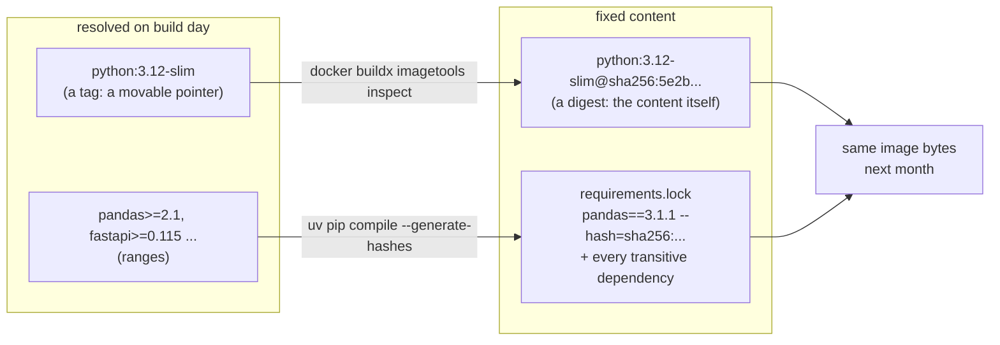
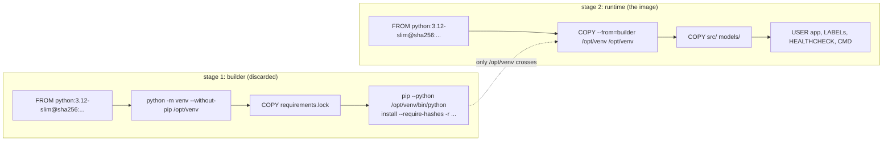
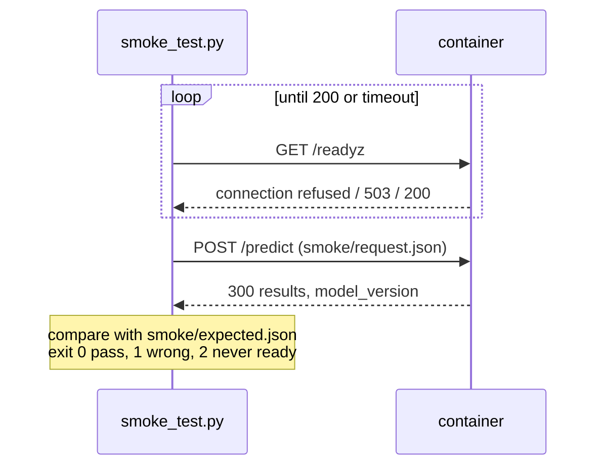
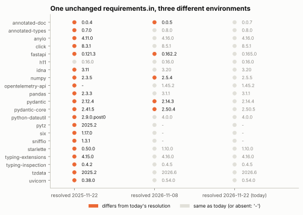
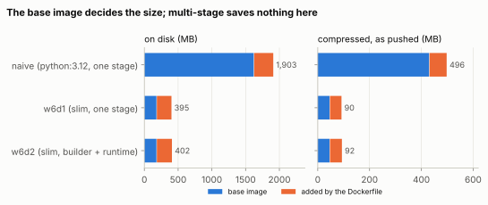
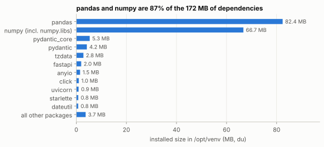

# w6d2 - Docker II: pinned dependencies, multi-stage builds, smoke tests

**Status: Execution verified** (see the verification record at the end).

| | |
|---|---|
| **Primary objective** | Make the flowguard image reproducible (base image pinned by digest, every dependency pinned with a hash), split the build into a builder and a runtime stage, measure what that does to size, and write a smoke test that tells "not ready", "wrong" and "right" apart. |
| **Deliverable** | `lab/requirements.lock` (hash-checked, full closure), a digest-pinned two-stage `lab/Dockerfile` with provenance labels, and `lab/scripts/smoke_test.py` with exit codes 0/1/2. |
| **Completion criteria** | `python wb.py check w6d2` passes (no Docker needed); with Docker, the smoke test passes against your container in under a minute; you can say how much smaller the multi-stage image is *here* and why. |
| **Handbook** | [H12.2 Pinning, multi-stage builds, smoke tests](../../handbook/ch12_docker_reproducible_environments/h12_2_pinning_multistage_smoke_tests.md) |

---

## 1. Purpose

**What you will learn.** Which parts of a Docker build are *not* reproducible even when the Dockerfile
does not change (the base image tag, every dependency range, and the build cache that hides both);
how to pin them (image digests, lockfiles with hashes, hash-checking mode); what a multi-stage build
is for and what it does and does not save; and how to smoke-test a container so that CI (w6d3) can
decide whether an image is fit to ship.

**Why an applied ML engineer needs it.** A model's behaviour is a function of its code, its weights
*and its numerical environment*. If `pandas` jumps a major version between your evaluation and your
deployment, the evaluation no longer describes what runs. Section 3.1 shows that the lab's own
`requirements.in` resolves to 20 different package versions today than it did a year ago, and to 5
different versions than two weeks ago, without a line changing. Teams discover this as "it worked
last month", usually in an incident.

**Prerequisites.**
* [w6d1](../w6d1_docker_basics/README.md): a working single-stage Dockerfile (this lab starts from its
  reference solution).
* [w4d4](../w4d4_experiment_tracking/README.md) and [w1d4](../w1d4_config_logging/README.md): recording
  versions and provenance for runs; the same idea, applied to the environment.
* Tools: `uv` (recommended; <https://docs.astral.sh/uv/>) or `pip-tools` to compile the lock; network
  access to PyPI for that step. Docker for the live parts (optional).

**Time budget (2 h essential + optional extension up to 1 h).**

| Activity | Minutes |
|---|---|
| Read sections 2 and 3 | 30 |
| Run the drift example (needs uv + network; otherwise read its recorded output) | 5 |
| Guided lab: lockfile, digest, two stages, labels, smoke test | 65 |
| Start the independent challenge (the drifted build) | 10 |
| Assessment questions and reflection | 10 |
| *Optional extension*: finish the challenge; run the live check; try `--no-compile` or dropping pandas from serving and measure the image | up to 60 |

---

## 2. Conceptual explanation

### 2.1 Intuition: a Dockerfile is a recipe, not a result

A build combines three inputs: your files, the base image, and the package index. Only the first is
in your repository. `FROM python:3.12-slim` names whatever image that tag points to *on build day*;
`pip install "pandas>=2.1"` installs whatever release is newest *on build day*. The Dockerfile is
therefore a recipe that reads two moving sources. To make the result reproducible you must turn both
into fixed content addresses: a digest for the image, a version *and hash* for every package.



### 2.2 Precise terms

| Term | Meaning |
|---|---|
| **Tag** | A human name for an image (`3.12-slim`) that the publisher moves to new builds (Python patch releases, Debian security updates). |
| **Digest** | `sha256:` of the image manifest (or of the multi-platform index). Content-addressed: the same digest always means the same bytes. |
| **Range / specifier** | `pandas>=2.1`: any version satisfying it may be installed. Note it admits pandas 3, a major release. |
| **Lockfile** | The output of a resolver: every package of the dependency *closure* (direct and transitive), pinned with `==`, ideally with the sha256 of every acceptable distribution file. |
| **Hash-checking mode** | pip refuses to install anything whose file hash is not listed, and requires every requirement to be pinned with `==`. Turned on by `--require-hashes`, and automatically as soon as any requirement carries a hash. |
| **Multi-stage build** | Several `FROM` stages in one Dockerfile; later stages copy selected files from earlier ones (`COPY --from=builder`). Only the last stage becomes the image. |
| **Smoke test** | A fast end-to-end check that the *artifact* starts and answers correctly on a known input. It tests the packaging, not the model's quality. |
| **Provenance labels** | OCI annotations such as `org.opencontainers.image.revision` (commit) and `.version`, stored in the image config. |

### 2.3 What exactly is not reproducible, and how each is pinned

| Source of drift | What changes | Pin | Update deliberately with |
|---|---|---|---|
| Base image tag | OS packages, Python patch version | `FROM python:3.12-slim@sha256:...` | `docker buildx imagetools inspect python:3.12-slim`, then rebuild and test |
| Direct dependencies | versions inside your ranges | lock with `==` | recompile the lock |
| Transitive dependencies | versions nobody named | the *whole closure* in the lock | recompile the lock |
| The file behind a version | a re-uploaded or tampered distribution | `--hash=sha256:...` | hashes are recomputed with the lock |
| Build cache | an old `RUN pip install` layer hides that a fresh build would differ | build from the lock; CI builds without cache regularly | `docker build --no-cache` |
| apt packages | `apt-get install curl` gets today's version | pin versions or avoid; prefer Python-only images | rebuild on a schedule |

Two subtleties. First, **the cache hides drift**: on your laptop `RUN pip install -r requirements.txt`
stays cached for weeks, so your builds look stable; the CI runner with a cold cache resolves afresh.
Second, **a lock has to record what was tested**, not what is newest: compiling the lock *today*
gives today's versions, which are not the ones your evaluation used (the challenge turns on exactly this).

### 2.4 Lockfiles, mechanically

You keep two files. `requirements.in` states what the code needs, as ranges (it is what you edit).
`requirements.lock` is generated from it and states what is installed:

```bash
uv pip compile requirements.in --generate-hashes --python-version 3.12 --python-platform linux -o requirements.lock
# or, with pip-tools:  pip-compile --generate-hashes --output-file requirements.lock requirements.in
```

`--python-version 3.12 --python-platform linux` resolves *for the image*, not for your laptop (the
course machines run Python 3.13; the image runs 3.12). The lab's lock pins 18 packages with 294
hashes: one hash per distribution file of each pinned version, so the same lock installs on any
platform PyPI has wheels for, but only those exact files.

In the image: `pip install --require-hashes -r requirements.lock`. If a dependency is missing from the
lock, hash-checking mode does not silently resolve it; it fails (measured on a top-level-only lock):

```text
ERROR: In --require-hashes mode, all requirements must have their versions pinned with ==. These do not:
    starlette>=1.6.0 from https://files.pythonhosted.org/.../starlette-1.10.0-py3-none-any.whl (from fastapi==0.165.0->...)
```

### 2.5 Multi-stage builds: what they are for



Whatever the builder needed and the runtime does not (compilers, headers, pip's caches, source
trees, downloaded archives, a `--mount`ed secret for a private index) stays in the discarded stage.
The value is largest when building needs things that running does not: a package without wheels
that must be compiled, `build-essential`, Node to build a front end, a model export step.

**Measured here, the honest result:** all of this service's dependencies ship as wheels, so the
builder needs nothing extra, and the runtime image is *not* smaller: 402 MB (multi-stage) against
395 MB (w6d1 single stage). The runtime venv has no pip (about 7 MB saved), but the lock resolved
pandas 3.1.1, which is 8 MB larger than the 3.0.5 that w6d1's top-level pins installed. What *does*
shrink an image here is the base (1.9 GB for `FROM python:3.12` against 0.4 GB for `-slim`) and the
dependency list itself: pandas and numpy are 87 % of the 172 MB of packages, and the service uses
pandas for a few lines of frame handling. Multi-stage builds remain worth knowing and using as the
default shape, because they keep build-time things out *by construction*; just do not expect them to
fix a size problem that comes from what you install.

### 2.6 Smoke tests: what they establish and what they do not

A smoke test runs the built artifact on a fixed input and compares the output with recorded
expectations. Ours: start the container, poll `/readyz` until 200 (or a timeout), POST
`smoke/request.json` (300 SYNTHETIC samples), and compare all 300 scores, the threshold decisions
and the model version with `smoke/expected.json`, which was computed by loading the same bundle
outside the container.



What a pass proves: the image starts, finds and loads *this* model, has a working dependency stack,
and computes the same numbers inside the container as the package computes outside it. What it does
not prove: anything about detection quality (that is evaluation, Weeks 3-4), performance under load
(w6d4), or behaviour on inputs unlike the fixture. Distinct exit codes matter because CI reacts
differently: "never ready" (2) points at start-up and configuration; "wrong" (1) points at the model,
the dependencies or the code.

### 2.7 Connection to what you already know

This is the environment half of reproducibility that research papers usually skip. A methods section
says "PyTorch, scikit-learn"; at best a supplementary `environment.yml` with ranges. You have probably
seen a published decoder give different numbers a year later and blamed seeds or data. The lock and
the digest are the equivalent of freezing the exact preprocessing pipeline and toolbox versions behind
an EEG result; the smoke test is the equivalent of re-running one known recording through the deployed
system and checking that the output matches the analysis bit for bit (here to a relative 1e-9).

### 2.8 An industry example

A fraud model is served from an image rebuilt nightly from `requirements.txt` with ranges. One night
scikit-learn's minor release changes a default in a preprocessing transformer; the nightly image picks
it up; no test fails, because unit tests use synthetic data and the model file still loads. Approval
rates move by 2 % and the team spends a week bisecting their own commits, none of which is the cause.
Two controls would have caught it at build time: a lock (the version would not have changed), and a
smoke test comparing scores on a fixed input with recorded ones (it would have failed the build).

### 2.9 Limitations and common misconceptions

* **"`pip freeze` is a lock."** It pins versions (not hashes) of whatever happens to be installed in
  your environment, including tools the service does not need, and for your laptop's platform.
* **"Pinning top-level packages is enough."** Their dependencies still float (section 2.4).
* **"A digest-pinned base is secure."** It is *stable*, including its unpatched vulnerabilities. Pin,
  then update on a schedule (rebuild, run the smoke test, review the diff). Stability and patching
  pull in opposite directions; the lock and digest make the update an explicit, testable change.
* **"Same lock, same image bytes."** Close, not identical: timestamps in layers and `.pyc` files
  generated at install time differ between builds. Behaviour is reproducible; byte-identical images
  need extra work (`SOURCE_DATE_EPOCH`, reproducible build tooling) that is beyond this course.
* **"Multi-stage builds make images small."** Only if the build needed things the runtime does not
  (section 2.5 measures the case where it did not).
* **"The smoke test passed, so the model is fine."** It passed on 300 synthetic samples it was
  calibrated on; it checks plumbing, not quality.
* **Scanning and SBOMs.** A software bill of materials lists what is in an image; scanners compare it
  with vulnerability databases. With a lock, your Python part of the SBOM is the lock itself. Tools
  exist (`docker scout`, Syft, Trivy); none is used in this course, and their output was not verified here.

---

## 3. Worked example

### 3.1 One `requirements.in`, three environments

```bash
python lessons/w6d2_docker_reproducibility/example/resolve_on_two_dates.py
```

It resolves the lab's `requirements.in` for Python 3.12 on Linux three times with uv, as of
2025-11-22, as of 2026-11-08 (two weeks ago) and today, using `uv pip compile --exclude-newer DATE`
(resolve as if PyPI had stopped at that date). Output of the run on 2026-11-22:

```text
package                       2025-11-22          2026-11-08  2026-11-22 (today)
--------------------------------------------------------------------------------
annotated-doc                      0.0.4               0.0.5               0.0.7   <- differs
annotated-types                    0.7.0               0.8.0               0.8.0   <- differs
anyio                             4.11.0              4.16.0              4.16.0   <- differs
click                              8.3.1               8.5.1               8.5.1   <- differs
fastapi                          0.121.3             0.162.2             0.165.0   <- differs
h11                               0.16.0              0.16.0              0.16.0
idna                                3.11                3.20                3.20   <- differs
numpy                              2.3.5               2.5.4               2.5.5   <- differs
opentelemetry-api                      -              1.45.2              1.45.2   <- differs
pandas                             2.3.3               3.1.1               3.1.1   <- differs
pydantic                          2.12.4              2.14.3              2.14.4   <- differs
pydantic-core                     2.41.5              2.50.4              2.50.5   <- differs
python-dateutil              2.9.0.post0               4.0.0               4.0.0   <- differs
pytz                              2025.2                   -                   -   <- differs
six                               1.17.0                   -                   -   <- differs
sniffio                            1.3.1                   -                   -   <- differs
starlette                         0.50.0              1.10.0              1.10.0   <- differs
typing-extensions                 4.15.0              4.16.0              4.16.0   <- differs
typing-inspection                  0.4.2               0.4.5               0.4.5   <- differs
tzdata                            2025.2              2026.6              2026.6   <- differs
uvicorn                           0.38.0              0.54.0              0.54.0   <- differs

20 of 21 packages differ between the dates; requirements.in did not change.
```



*Figure 1 (real resolutions, PyPI as of each date).* Orange = differs from today. **Interpretation.**
In a year, pandas crossed a major version (2.3.3 to 3.1.1: `pandas>=2.1` allows it), starlette went
from 0.50 to 1.10, and the dependency set itself changed (pytz, six and sniffio dropped,
opentelemetry-api added). In two weeks, five packages moved, including numpy and pydantic patch
releases. Nothing in the repository changed. Also note that even the course's w6d1 image, built from
top-level pins only, has pandas 3.0.5 and numpy 2.5.3, while today's full resolution has 3.1.1 and 2.5.5.

### 3.2 Pinning the base image

```text
$ docker buildx imagetools inspect python:3.12-slim
Name:      docker.io/library/python:3.12-slim
MediaType: application/vnd.oci.image.index.v1+json
Digest:    sha256:5e2bdb1b0d542d5039cffb8181c65930093949194a65c365dfb1b0fe13a4fa5b
Manifests:
  Name:        docker.io/library/python:3.12-slim@sha256:05a994d2344eb364cc186910f4fc8786a38215f39f00d0acc25bff33a08f4177
  Platform:    linux/amd64
  Annotations: org.opencontainers.image.version: 3.12.16-slim-trixie
  ...
```

The top-level `Digest` is the multi-platform *index*: pin that one, and each machine still pulls its
own architecture (amd64 on your laptop, arm64 on an ARM runner). Pinning the amd64 manifest digest
instead would break builds on other architectures.

### 3.3 The images, measured

The lab's reference solution was built and compared with the w6d1 image and with the naive first
attempt (`FROM python:3.12`, `COPY . .`, pip cache kept). Raw numbers: `figures/measurements.json`.



*Figure 2.* The base decides the size: `python:3.12` (Debian with compilers) alone is 1.62 GB. The
multi-stage image is 7 MB *larger* than the single-stage one (section 2.5 explains why).



*Figure 3 (`du` inside the w6d2 image).* If you need a smaller image, this chart says where to look.

Build times on the authoring host: without cache, 23.1 s (w6d1) and 26.2 s (w6d2); after editing one
line of `src/`, 1.5-1.9 s for w6d2, as fast as w6d1's good layer order (1.7-2.0 s).

Inside the w6d2 container (recorded):

```text
$ docker exec fgw6d2 sh -c 'id; python -m pip --version; which gcc'
uid=10001(app) gid=10001(app) groups=10001(app)
/opt/venv/bin/python: No module named pip
$ docker image inspect fgw6:d2 --format '{{json .Config.Labels}}'
{"org.opencontainers.image.description":"SKAB fault-score API (educational prototype)",
 "org.opencontainers.image.revision":"w6d2-authoring","org.opencontainers.image.title":"flowguard",
 "org.opencontainers.image.version":"0.6.0"}
```

The runtime venv has no pip and there is no compiler. (The base image's own system Python still has
pip under `/usr/local`; the service never uses it.)

### 3.4 The smoke test, three outcomes (recorded)

```text
$ python scripts/smoke_test.py --base-url http://127.0.0.1:8770 --timeout 30
PASS: ready after 1.5 s; model flowguard-z-1.0.0; 300 results, 200 scores match          (exit 0)

$ python scripts/smoke_test.py --base-url http://127.0.0.1:8771 --timeout 5               (nothing running)
FAIL (not ready after 5 s): ConnectError: [Errno 111] Connection refused                  (exit 2)

$ docker run ... -v /tmp/altbundle:/models/candidate:ro -e FLOWGUARD_MODEL_DIR=/models/candidate fgw6:d2
$ python scripts/smoke_test.py --base-url http://127.0.0.1:8772 --timeout 30
FAIL: response differs from the expected fixture:                                         (exit 1)
  model_version 'flowguard-z-1.1.0-candidate' != 'flowguard-z-1.0.0'
  sample 50: score 0.08386373743139677, expected None
  ...
```

The third run used the *same image* with a different model mounted read-only and selected through
`FLOWGUARD_MODEL_DIR` (w6d1, section 2.7): the smoke test catches that the artifact being served is
not the one that was validated.

---

## 4. Guided lab

Work in `lessons/w6d2_docker_reproducibility/lab/`. `Dockerfile` starts as the w6d1 reference.

### 4.1 Read what you have

Open `requirements.in` (ranges) and compare it with the w6d1 lab's `requirements.txt` (top-level
`==` pins). Write down, before compiling, which packages you expect the lock to contain.

### 4.2 Compile the lock

```bash
cd lessons/w6d2_docker_reproducibility/lab
uv pip compile requirements.in --generate-hashes --python-version 3.12 --python-platform linux -o requirements.lock
```

(pip-tools alternative: `pip install pip-tools`, then `pip-compile --generate-hashes --output-file
requirements.lock requirements.in`; it resolves for the Python you run it with, so run it with 3.12.)

*Checkpoint:* `python wb.py check w6d2` passes the five `test_lockfile.py` checks: exact pins, hashes,
full runtime closure, consistency with `requirements.in`, and no dev tools in the serving lock.
Your versions will differ from the reference lock's if you compile on another day. That is the
point of the lesson; the checks accept any consistent lock.

### 4.3 Pin the base by digest and split the stages

1. Look up the index digest: `docker buildx imagetools inspect python:3.12-slim` (or use the one in
   section 3.2). Declare it once, before the first `FROM`:
   `ARG PYTHON_BASE=python:3.12-slim@sha256:<digest>`.
2. **Builder stage**: `FROM ${PYTHON_BASE} AS builder`; create a venv without pip
   (`python -m venv --without-pip /opt/venv`); copy `requirements.lock`; install it into the venv with
   the base image's pip: `pip --python /opt/venv/bin/python install --require-hashes -r ...`
   (pip 25.0.1 is in the base image; `--python` needs pip 22.3 or newer).
3. **Runtime stage**: `FROM ${PYTHON_BASE} AS runtime`; `COPY --from=builder /opt/venv /opt/venv`;
   `ENV PATH=/opt/venv/bin:$PATH`; then everything from w6d1 that belongs to *running*: `src/`,
   `models/`, the user, `PYTHONPATH`, `FLOWGUARD_MODEL_DIR`, `EXPOSE`, `HEALTHCHECK`, `CMD`.
4. **Provenance**: in the runtime stage, `ARG VERSION=0.6.0` and `ARG REVISION=unknown`, and
   `LABEL org.opencontainers.image.version="${VERSION}" org.opencontainers.image.revision="${REVISION}"`.
   An `ARG` is visible only in its own stage and in stages based on it, and an `ARG` before the first
   `FROM` only to `FROM` lines, so declare these in the runtime stage. Declare them late, so a new
   commit hash does not invalidate earlier `RUN` instructions (w6d1, ARG and the cache).

*Checkpoint:* the seven `test_dockerfile.py` checks pass. `test_runtime_properties_from_w6d1_are_kept`
guards against losing the w6d1 properties in the rewrite.

### 4.4 The smoke test

Implement `scripts/smoke_test.py` (the docstring is the specification):

* `wait_until_ready(client, timeout)`: loop until `GET /readyz` is 200 or `time.monotonic()` passes the
  deadline; treat `httpx.HTTPError` (refused, reset, timeout) as "not yet"; return `None` or the last
  problem. Use `time.monotonic()`, not `time.time()`, for deadlines.
* `compare(body, expected, tolerance)`: version, length, then every score: both `None`, or both
  finite and equal within `tolerance * max(1, |expected|)`; then the threshold flags.
* `main`: exit 2 if never ready, 1 for any wrong answer (including a non-200 from `/predict`), 0 for a
  pass; one human-readable line of output.

*Checkpoint:* the six `test_smoke_test.py` checks pass. They start real uvicorn servers on 127.0.0.1
in the test process (correct; ready only after 3 s; never ready; a different model; the right version
name with wrong scores) and run *your script* against each, so no Docker is needed.

### 4.5 Build and smoke-test the container (if you have Docker)

```bash
docker build --build-arg REVISION="$(git rev-parse --short HEAD)" -t flowguard:0.6.0 .
docker image ls flowguard; docker history flowguard:0.6.0
docker image inspect flowguard:0.6.0 --format '{{json .Config.Labels}}'
docker run -d --rm --name fg -p 127.0.0.1:8000:8000 flowguard:0.6.0
python scripts/smoke_test.py --base-url http://127.0.0.1:8000; echo "exit=$?"
docker stop fg
WB_DOCKER=1 python -m pytest lessons/w6d2_docker_reproducibility/checks -q -k live   # from the repo root
```

Compare the size with your w6d1 image and explain the difference with `docker history` and
`docker run --rm --entrypoint sh flowguard:0.6.0 -c 'du -sh /opt/venv/lib/python3.12/site-packages/*'`.

**Debugging table.**

| Symptom | Likely cause |
|---|---|
| `In --require-hashes mode, all requirements must have their versions pinned with ==` | the lock is missing transitive dependencies (compiled from the wrong file, or edited by hand) |
| `THESE PACKAGES DO NOT MATCH THE HASHES` | the lock was compiled for another file of that version, or the file changed upstream; recompile, then investigate |
| `No matching distribution found` for a pinned version | the lock was compiled for another Python version or platform (`--python-version 3.12 --python-platform linux`) |
| runtime: `uvicorn: not found` | `PATH` does not include `/opt/venv/bin` in the runtime stage |
| runtime: `ModuleNotFoundError: numpy` although it is in the lock | the venv was created in a different path in the builder, or the builder and runtime bases differ (venvs are not relocatable) |
| labels show `revision: unknown` | `--build-arg REVISION=...` not passed, or `ARG REVISION` declared in another stage |
| smoke test exits 2 although the container runs | wrong host port, or `--host 127.0.0.1` inside (w6d1) |
| smoke test flaky in CI | it does not wait for `/readyz`, or the timeout is shorter than model loading |

---

## 5. Independent challenge: the build that drifted

[challenge/README.md](challenge/README.md): a tiny scoring service whose smoke test passed two weeks
ago fails today, with no change in the repository. You get a local package index (`challenge/wheelhouse/`,
two releases of a SYNTHETIC package), the original `build.sh`, and the scores recorded two weeks ago.
Find the cause, fix the build with a hash-checked lock so that it is reproducible *and* correct, and
write `challenge/DRIFT_REPORT.md`. Check with `python wb.py check w6d2 --challenge` (no network: the
checks install from the local wheelhouse).

---

## 6. Progressive hints

1. [Concept](hints/hint1_concept.md)
2. [Approach](hints/hint2_approach.md)
3. [Partial implementation](hints/hint3_partial.md)

The full reference solution is in `solutions/lessons/w6d2_docker_reproducibility/`.

---

## 7. Assessment

[assessment.md](assessment.md): six reasoning questions, one design-choice explanation, a rubric, and
a 15-minute interview rep (system design: "how do you make model images reproducible?").

---

## 8. Reflection and review

**You should now be able to, without notes:** list the sources of non-reproducibility in a Docker
build and pin each one; compile and use a hash-checked lockfile; pin a base image by index digest;
write a two-stage Dockerfile and say when it reduces size and when it does not; and write a smoke
test with exit codes that a CI system can act on.

**Reflection prompt (5 minutes, in `progress/notes.md`).** Pick a result from your own research that
you would want to reproduce in two years. Which of its inputs are moving targets (tags, ranges,
"latest" toolboxes, cloud services)? Which one would you pin first, and what would it cost you to keep
it pinned?

**Retrieval question for later (answer in w6d7 without looking).** Your lock pins every package with
`==` and hashes, and your base is pinned by digest. Name two ways the *behaviour* of your service can
still change between two builds, and what catches each.

**Next.** [w6d3 - continuous integration with GitHub Actions](../w6d3_ci/README.md) runs the
checks, builds this image and runs this smoke test on every push.

---

## Verification record

Executed on 2026-11-22 in the course authoring container: Python 3.13.18 (checks), Docker Engine
29.10.0 (BuildKit), uv 0.11.32, pip 25.0.1 in `python:3.12-slim` (Python 3.12.16, Debian trixie),
FastAPI 0.165.0, uvicorn 0.54.0, httpx 0.28.1, matplotlib 3.11.2 (figures only).

* `python tools/verify_checks.py lessons/w6d2_docker_reproducibility`: the reference passes the lab (18
  checks; the live check is skipped without `WB_DOCKER=1`) and the challenge (8 checks); all 7 lab
  mutants and 5 challenge mutants are rejected, each by the check named in its `MUTANT.md`. The shipped
  starters fail (lab: 11 failed, 5 errors; challenge: all 8).
* `WB_DOCKER=1 ... -k live` against the reference: passed (build with a revision build argument, label
  present, smoke test exit 0 against the container, UID not 0).
* The lab lock was compiled with `uv pip compile ... --generate-hashes --python-version 3.12
  --python-platform linux` on 2026-11-22 (18 packages, 294 hashes) and installed in hash-checking mode
  in the builder stage. pip's refusal of a top-level-only lock, of a lock without hashes, of a wrong hash
  and of a range was observed (messages quoted above and in the challenge answers).
* `example/resolve_on_two_dates.py`: output above (real PyPI resolutions with `--exclude-newer`).
* Image sizes, build times, the in-container probes and the smoke-test transcripts: recorded on a busy
  shared host with the base image substituted by a copy that also holds the sandbox proxy's CA
  certificate (+201 kB), via `--build-arg PYTHON_BASE=...`. Numbers in `figures/measurements.json`.
* Docker and pip behaviour was checked against the Dockerfile reference (multi-stage, `COPY --from`,
  ARG scope), docker/docs multi-stage and best-practices pages (pin base images by digest) and by
  execution; pages listed in H12.2.
* Not verified: pip-tools (not run; uv was used), byte-for-byte reproducibility of the image (not
  claimed), scanners and SBOM tools, Python 3.11/3.12 for running the checks locally, the time budget.
