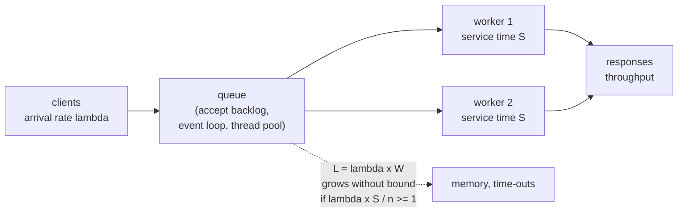
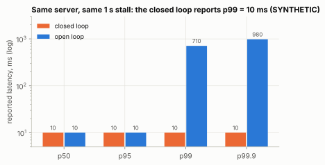
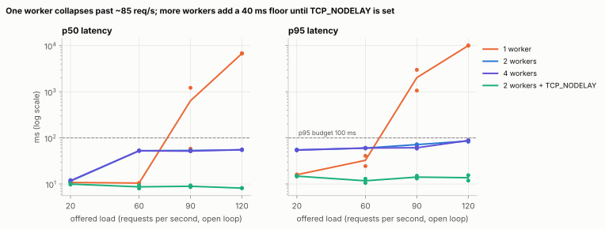
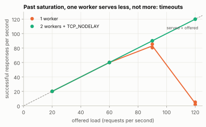
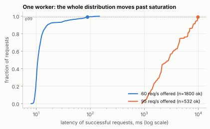

# W6D4 — Latency, throughput and resource use

Unit id `w6d4_latency_resources` · Week 6, day 4 · Handbook:
[H10.4 Latency and throughput](../../handbook/ch10_batch_online_inference/h10_4_latency_and_throughput.md)
· Content status: see [STATUS.md](../../STATUS.md)

## 1. Purpose

**Objective.** Measure the `flowguard` API's latency percentiles, throughput and memory under
controlled load, find what limits it, change one thing on the evidence, and show the effect with the
same method, against a stated budget.

**Why an applied ML engineer needs it.** "How fast is the model?" is rarely the question that matters.
The questions are: how many requests per second can this deployment serve while keeping p95 under the
budget, what happens when traffic exceeds that, and what does it cost in machines. They are answered by
measurement, and measurement of latency is easy to get wrong in ways that produce confident, optimistic
numbers. In this lesson the model's own computation turns out to be a small part of each request, and
the two real bottlenecks found are a single Python process and a 40 ms TCP interaction that nobody
would find by reading the model code.

**Deliverables.**
* `lab/loadtest.py`: an open-loop load generator and latency statistics (five functions).
* `lab/results/*.json` and `lab/LATENCY_REPORT.md`: your measurements, the bottleneck, the fix, the
  before/after, and what the measurement does not show.
* `challenge/capacity.py` and `challenge/CAPACITY.md`: a capacity plan for a fleet (section 5).

**Completion criteria.**
* `python wb.py check w6d4` passes (the generator and statistics, tested with fake servers).
* Your `LATENCY_REPORT.md` reports measurements you made, with the method, at three or more rates for
  at least two configurations, and names a bottleneck with evidence.
* `python wb.py check w6d4 --challenge` passes.
* You can explain without notes why a closed-loop benchmark under-reports tail latency, and what
  Little's law says about a service that is falling behind.

**Prerequisites.** [w5d4](../w5d4_fastapi_validation/README.md) (the service),
[w5d5](../w5d5_api_testing/README.md) (concurrency in FastAPI), [w6d3](../w6d3_ci/README.md) (why timing
checks are not CI gates). Linux for the memory readings (`/proc`). No new packages: `httpx` and
`uvicorn` are already installed. Optional, for the real request bodies: `python project/get_skab.py`.

**Time budget (2 h essential).**

| Activity | Minutes |
|---|---|
| Read section 2 | 25 |
| Worked example: closed vs open loop | 10 |
| Guided lab: tasks 1-5 (generator and statistics) | 35 |
| Guided lab: tasks 6-9 (measure, profile, fix, report) | 35 |
| Challenge: start `capacity.py` | 5 |
| Assessment and reflection | 10 |
| *Optional extension: finish the capacity plan; add a concurrency limit and measure overload behaviour; repeat with 4 workers* | *up to 60* |

Each measurement in tasks 6-8 takes about a minute. Close other heavy programs while measuring.

## 2. Conceptual explanation

### 2.1 Latency, throughput, budgets

* **Latency** of a request: time from when it should have been sent to when its response is complete.
* **Throughput**: completed requests per second. Offered load is what clients send; served load is
  what comes back successfully. Below capacity they are equal; past it they diverge.
* A **latency budget** (or service-level objective, SLO) is a statement such as "p95 <= 100 ms and
  p99 <= 250 ms with error rate <= 0.1 %, at up to N requests/s". It is stated before measuring, by
  working backwards from the user's need (an operator dashboard that must update within 2 s leaves the
  model service a fraction of that after queues, network and rendering).

The lab's budget is in `lab/budget.toml`: p95 <= 100 ms, p99 <= 250 ms, error rate <= 0.1 %.

### 2.2 Percentiles, not means

Latency distributions are skewed: most requests are fast, a few are very slow, and the slow ones are
what users remember and what time-outs hit. The mean mixes the two and describes nobody. Report
**p50** (typical), **p95** and **p99** (the tail), and the maximum with care (it is one request).

The p-th percentile of n sorted values, with linear interpolation (numpy's default):
$$h = \frac{(n-1)\,p}{100},\qquad P_p = x_{\lfloor h\rfloor} + (h-\lfloor h\rfloor)\,\bigl(x_{\lceil h\rceil} - x_{\lfloor h\rfloor}\bigr).$$
Two consequences. A p99 from 200 requests is decided by 2 of them; collect enough requests for the
percentile you report (thousands for p99). And percentiles do not average: the mean of five p95s is not
the p95 of the combined traffic. Aggregate the raw latencies (or histograms), not the percentiles.

### 2.3 Open loop, closed loop and coordinated omission

A **closed-loop** generator has a fixed number of virtual users; each sends a request, waits for the
response, then sends the next. When the server stalls, the users stall with it and *stop sending*:
the requests that real clients would have sent during the stall never exist, so their delays are never
measured. An **open-loop** generator schedules request i at $t_0 + i/\lambda$ regardless of responses,
as independent clients do, and measures each request **from its scheduled time**. This error of the
closed loop is called **coordinated omission**: the generator coordinates with the server and omits
exactly the bad measurements.

Your research parallel: a real-time BCI loop is closed (the next decision waits for the last), and you
measured per-cycle latency. A prediction service with thousands of independent machines is open: a
stalled server does not stop the machines from sending.

### 2.4 Little's law and queues

For any stable system, averaged over a long period,
$$L = \lambda\,W,$$
the average number of requests in the system equals the arrival rate times the average time each spends
in it. No distributional assumptions. Two uses:

* **Sizing.** A worker that serves one request at a time for $S$ seconds is busy a fraction
  $\rho = \lambda S$ of the time (utilisation). $n$ workers have utilisation $\lambda S/n$; to keep it
  below a target $\rho^\*$ you need $n = \lceil \lambda S / \rho^\* \rceil$ workers.
* **Diagnosis.** If $\lambda$ stays the same and $W$ grows from 10 ms to 2 s, $L$ grows 200-fold: the
  extra requests are sitting in queues, in memory. Past capacity ($\rho \ge 1$) the queue grows without
  bound until something gives: memory, time-outs, or the client.

Why not run at $\rho = 0.95$? Queueing delay grows like $\rho/(1-\rho)$ for simple queues: at 0.5 a
request waits about one service time on average, at 0.7 about 2.3, at 0.9 about 9, before even
considering the tail. Capacity plans therefore target 0.6-0.75.



### 2.5 Where the time goes inside one request

A request to `/predict` is more than the model: HTTP parsing, JSON decoding, pydantic validation of
every sample, building a DataFrame, scoring, building per-sample response objects, re-validating the
response model and encoding JSON, plus the hand-off from the event loop to a thread for a `def`
endpoint. `lab/profile_predict.py` re-enacts the path with `time.perf_counter` spans and runs
`cProfile` over complete requests. Measured for a 600-sample real request on the authoring machine:

```text
span medians over 50 runs:
  parse + validate request        0.62 ms
  build frame + score             2.26 ms
  build response objects          0.69 ms
  serialise response              0.26 ms
  sum of spans                    3.84 ms

end-to-end through TestClient (median, profiler on): 11.02 ms
```

The detector itself is inside "build frame + score". About two thirds of the request is framework and
transport work. Optimising the model would barely move the service.

### 2.6 Processes, threads and the GIL

FastAPI runs a `def` endpoint in a thread pool. Threads let a process wait on many slow I/O operations
at once, but CPU-bound Python code holds the global interpreter lock (GIL), so one process executes
Python bytecode on one core at a time. NumPy and pandas release the GIL inside some vectorised
operations, but per-sample pydantic work and JSON handling do not. So, for this service:

* more **threads** in one process: more requests *in progress*, not more completed per second;
* more **worker processes** (`uvicorn --workers N`): N independent interpreters, up to N cores of
  Python work, at the cost of N copies of the model and libraries in memory (measured: 90 MB idle for
  1 worker, 220 MB for 2, about 395 MB for 4).

A related trap from w4d5: numerical libraries that start their own thread pools (OpenMP, BLAS) inside
several worker processes oversubscribe the cores; that course measured 8,153 ms with default threading
versus 3.5 ms with one thread for the same scoring. `OMP_NUM_THREADS=1` per worker is the usual setting.

### 2.7 Memory under load

Resident set size (RSS, `VmRSS` in `/proc/<pid>/status`) is the memory a process occupies. It grows
with what is held: loaded libraries and the model (fixed), and requests in flight (proportional to $L$).
In this lab a single worker pushed past capacity grew from 90 MB to **2.1-2.8 GB** in under a minute,
holding queued 138 KiB request bodies and their parsed forms. In a container with a memory limit that
is an out-of-memory kill: overload becomes an outage. Bounded queues and concurrency limits that reject
excess work early (HTTP 503 with `Retry-After`) turn it back into graceful degradation; that is w7d5.

### 2.8 An industry example (illustrative composite, not a documented case)

A team load-tested its scoring API with a closed-loop tool and 10 virtual users, reported "p99 = 45 ms
at 200 requests/s", and sized production for it. In production, a nightly batch client sent 3,000
requests in a burst; the service queued them, p99 for interactive users went to 9 s, and pods were
killed for memory. Re-measured open loop, the same deployment kept p99 under budget only up to
120 requests/s. Nothing about the model had changed.

### 2.9 Limitations and misconceptions

* **"The benchmark says 10 ms, so the service is fast."** At which rate? Latency without offered load
  is half a number.
* **"Average latency is fine."** The mean hid the bimodal 2-worker distribution in this lab (some
  requests at 10 ms, many at 52 ms).
* **"More workers is always better."** It raised capacity here, and also exposed a 40 ms floor;
  with 4 cores, 4 workers plus the load generator compete for CPU.
* **"The load generator is neutral."** It uses CPU and has its own queues; on one machine it competes
  with the server. Watch its `late_starts` count: if the generator falls behind its schedule, the
  measurement is of the generator.
* **"Numbers from my laptop transfer."** Different CPUs, network, TLS, payloads. Re-measure on the
  target hosts; use laptop numbers to find mechanisms, not capacity.

## 3. Worked example: the same server, measured two ways (SYNTHETIC)

`example/coordinated_omission.py` simulates a single first-in-first-out server that takes exactly
10 ms per request but freezes for 1 s once, at t = 30 s. It "load-tests" it for 60 s at about
50 requests/s, first with one closed-loop virtual user (10 ms think time), then open loop. It is a
discrete-event simulation (no sleeping), so the output is exact and repeatable:

```bash
python lessons/w6d4_latency_resources/example/coordinated_omission.py
```

```text
closed loop  n= 2951 (49.2/s)  p50=  10.0  p95=  10.0  p99=   10.0  p99.9=   10.0  max= 1010.0 ms  >100 ms: 0.03%
open loop    n= 3000 (50.0/s)  p50=  10.0  p95=  10.0  p99=  710.1  p99.9=  980.0  max= 1010.0 ms  >100 ms: 3.07%
```



*Figure 1. SYNTHETIC simulation. Same server, same stall.*

**Interpretation.** The closed-loop user was stuck behind the stall for one request, so exactly one
latency of 1,010 ms was recorded (0.03 % of requests) and p99 is 10 ms. The open-loop schedule kept
sending: the 50 requests due during the stall all waited, and the 3 % of requests over 100 ms move
p99 to 710 ms. Real clients behave like the open loop. **Decisions in the code:** the server and the
stall are simulated in time arithmetic, so the result is not affected by the machine; latency in the
open loop is `finish - scheduled`, never `finish - actually_sent`.

## 4. Guided lab

`lab/` holds the week-5 service (`src/`, `models/`, `splits/`), the budget (`budget.toml`), three given
scripts (`measure_service.py`, `profile_predict.py`, `serve.py`), the report template
(`LATENCY_REPORT.md`) and your file, `loadtest.py`.

**Tasks 1-5 (35 min): implement `loadtest.py`.** The docstrings are the specification.

1. `percentile(values, q)`: linear interpolation, without numpy. *Checkpoint:* matches `numpy.percentile`.
2. `intended_schedule(rate, duration)`.
3. `run_open_loop(send, rate, duration)`: sleep until each scheduled time, *start* a task for the request,
   move on; gather at the end. Latency from the intended start. Exceptions become records with
   `status=None`.
4. `summarise(records, warmup_s, late_threshold_s)`: warm-up by intended time; percentiles over 2xx only;
   error rate over everything; throughput over the measured window; late starts.
5. `compare_to_budget(summary, budget)`.

```bash
python wb.py check w6d4
```

The checks use fake `send` functions (a 200 ms server, a stall that blocks the event loop, failures),
not the network. *Debugging:* "requests were sent late" means your loop awaits each response;
"latency must be finished - intended start" means you measured from the actual send.

**Task 6 (10 min): find the knee with one worker.**

```bash
python lessons/w6d4_latency_resources/lab/measure_service.py --workers 1 --rates 20 60 90 120 \
    --duration 10 --out lessons/w6d4_latency_resources/lab/results/workers1.json
```

Read p95 against the budget, served throughput against offered, and the RSS line. Real output on the
authoring machine (first repetition, `--duration 15`):

```text
workers=1 rate=   20/s  sent=  300  p50=   11.0  p95=   15.7  p99=   20.5 ms  errors=0.000  thr=  20.0/s  late=0  budget=OK
workers=1 rate=   60/s  sent=  900  p50=   10.4  p95=   24.4  p99=   81.0 ms  errors=0.000  thr=  60.0/s  late=1  budget=OK
workers=1 rate=   90/s  sent= 1350  p50= 1219.3  p95= 2993.0  p99= 3376.5 ms  errors=0.000  thr=  80.5/s  late=1  budget=MISSED
workers=1 rate=  120/s  sent= 1800  p50= 6843.1  p95=10072.6  p99=10324.2 ms  errors=0.974  thr=   1.8/s  late=639  budget=MISSED
server RSS 90 MB idle, 2494 MB after load (1 worker(s)); real SKAB valve1/13, first 600 samples
```

One worker serves about 83 requests/s at most. At 90/s the queue grows for the whole run; at 120/s
nearly every request times out at 10 s, the server completes only a handful per second, and its memory
reaches gigabytes. (The `late=639` at 120/s is the *generator* falling behind; that row measures an
overloaded machine as much as the service.)

**Task 7 (5 min): where does a request's time go?**

```bash
python lessons/w6d4_latency_resources/lab/profile_predict.py
```

Compare with section 2.5. Decide whether a faster model would move the knee.

**Task 8 (10 min): add workers, and look carefully.** Repeat task 6 with `--workers 2` (and `4` if you
have the time). The knee disappears below 120/s. Now compare p50 at 20/s and 60/s with the one-worker
run. Real means of two repetitions on the authoring machine:

| Configuration | 20/s p50 / p95 | 60/s p50 / p95 | 120/s p50 / p95 |
|---|---|---|---|
| `--workers 1` | 10.8 / 15.9 | 10.5 / 32.6 | 6767 / 10029 (95 % errors) |
| `--workers 2` | 11.6 / 54.9 | 52.8 / 60.1 | 54.7 / 85.5 |
| `--workers 4` | 11.8 / 54.4 | 52.5 / 60.3 | 55.7 / 87.8 |

A latency that does not depend on load is not queueing. Before reading on, write down a hypothesis.

*The answer.* About 52 - 11 = 41 ms is added to many requests whatever the rate, which matches the Linux
delayed-ACK timer: TCP's Nagle algorithm is holding back the last piece of the response until the
client acknowledges the previous one, and the client delays its acknowledgement. Servers normally
disable Nagle with `TCP_NODELAY`; asyncio does so automatically, but only for sockets whose protocol
number is `IPPROTO_TCP`. With `--workers N > 1`, uvicorn 0.54 creates the shared listening socket as
`socket.socket(family=AF_INET)`, protocol number 0, so asyncio skips it (both read in the installed
source). With one worker uvicorn lets asyncio create the socket and the problem does not occur.
Forcing `TCP_NODELAY` in the workers (a verification-only experiment) cut p50 at 60/s from 52 to 9.5 ms.

**Task 9 (10 min): apply the fix and report.** `lab/serve.py` starts the same app with N workers on a
listening socket created with `IPPROTO_TCP`. Measure with it:

```bash
python lessons/w6d4_latency_resources/lab/measure_service.py --launcher serve --workers 2 \
    --rates 20 60 90 120 --duration 10 --out lessons/w6d4_latency_resources/lab/results/serve2.json
```

Authoring machine, means of two repetitions: p95 14.8, 11.7, 14.1 and 13.7 ms at 20, 60, 90 and
120/s; p99 at most 43.9 ms; no errors; 239 MB. Fill in `lab/LATENCY_REPORT.md` from **your** numbers.



*Figure 2. Real measurements on the authoring machine (dots: two repetitions; lines: their mean).*



*Figure 3. Past saturation, served throughput falls: the queue fills, requests time out, and work
done on requests that will time out is wasted. Real measurements.*



*Figure 4. One worker, 30 s at 60/s and at 95/s (real; 532 of 2,850 requests at 95/s succeeded).*

## 5. Independent challenge: a capacity plan you can defend

Read [challenge/README.md](challenge/README.md). You size the service for 120,000 machines from the
single-worker curve you measured (`challenge/measured_curve.csv` holds the authoring machine's), with
Little's law, a utilisation target and a sensitivity analysis, and write a one-page plan.

Acceptance: `python wb.py check w6d4 --challenge` (numbers and memo structure), and the rubric in the
assessment for the reasoning.

## 6. Progressive hints

[Hint 1: concepts](hints/hint1_concept.md) · [Hint 2: approach](hints/hint2_approach.md) ·
[Hint 3: partial implementation](hints/hint3_partial.md)

## 7. Assessment

[assessment.md](assessment.md): reasoning questions, a design-choice explanation, the rubric and a
system-design interview rep on latency budgets.

## 8. Reflection and review

**You should now be able to, without notes:** write an open-loop generator that does not hide stalls;
report percentiles with enough samples; locate a service's knee and explain it with Little's law; tell
queueing from a fixed delay by how latency depends on load; choose between threads and processes for
CPU-bound Python; and size a deployment with a stated utilisation target.

**Reflection prompt.** Which latency number from your research systems (an online decoder, an
acquisition loop) was measured closed loop, and would the conclusion change if it had been measured
open loop?

**Later retrieval question (for the w6d7 review).** A service's p50 is 50 ms at 5 requests/s and
50 ms at 100 requests/s, while one request's server-side processing takes 10 ms. List three hypotheses
and the measurement that separates them.

**Next.** w6d5 deploys the container to one cloud route, behind an authorisation gate. See the
[schedule](../../roadmap/SCHEDULE.md).

## Verification record

Executed on the authoring machine (4-core shared Linux container), 2026-11-22: Python 3.13, FastAPI
0.165.0, uvicorn 0.54.0, httpx 0.28.1, pydantic 2.13.5.
* `python tools/verify_checks.py lessons/w6d4_latency_resources`: reference passes both parts; 5 lab
  and 4 challenge mutants rejected, each by its intended check. The starter fails all 19 lab checks and
  every challenge check.
* All measurements quoted come from `figures/measure.py` (two interleaved repetitions of 1, 2 and 4
  workers with the uvicorn command line and 2 workers with `serve.py`, plus one 30 s distribution run),
  plotted by `figures/make_figures.py`. `pgrep` confirmed no server was left running after each run.
* The TCP_NODELAY cause was confirmed by reading `asyncio.base_events._set_nodelay` and uvicorn's
  `Config.bind_socket` in the installed versions, and by a verification-only run that forced
  TCP_NODELAY in the workers (p50 52.3 -> 9.5 ms at 60/s).
* The worked example's output above is exact (deterministic simulation).
* **Not verified:** other uvicorn versions (the floor may be absent or fixed in yours: measure);
  `httptools`/`uvloop` (not installed); multi-machine load; behaviour beyond 120/s for 2 workers.
