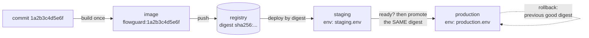
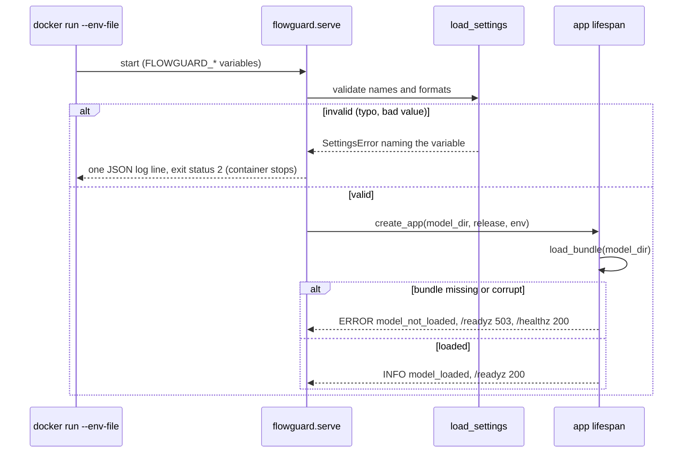
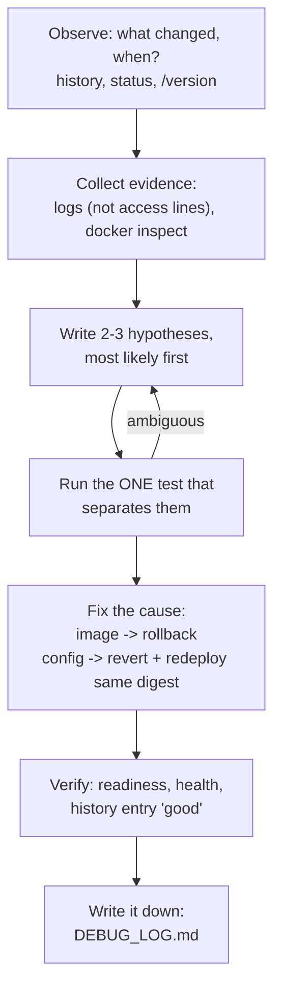
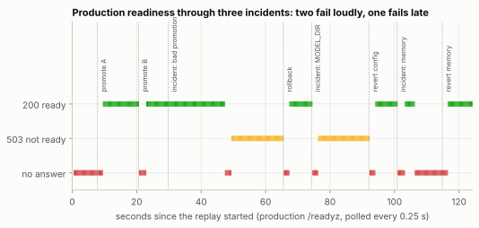
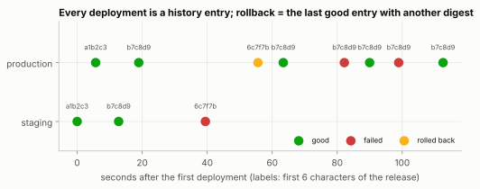
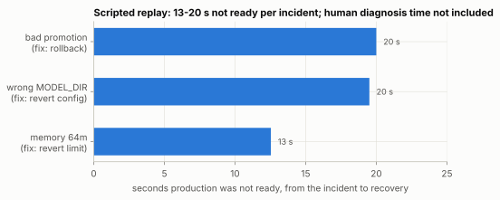

# w6d6 - Delivery and operational debugging (project milestone 3)

**Status: Execution verified** (see the verification record at the end). Everything runs locally with
Docker; nothing touches a cloud account.

| | |
|---|---|
| **Primary objective** | Promote an image by digest between environments, configure the service through its environment, diagnose three seeded production incidents from logs and container state, and fix each one correctly: roll back when the image is at fault, revert configuration when it is not. |
| **Deliverable** | Startup configuration validation (`flowguard.settings`), a digest-pinned rollback tool (`ops/rollback.py`), and `DEBUG_LOG.md` with three complete incident write-ups quoting real evidence. Milestone 3: the same practices in your project repository. |
| **Completion criteria** | `python wb.py check w6d6` passes; all three incidents diagnosed and fixed in your local environments, with `fgops.py history` showing the recovery; you can explain without notes why a rollback fixed one incident and would not have fixed the other two. |
| **Handbook** | [H14.2 Delivery, promotion, rollback](../../handbook/ch14_cicd/h14_2_delivery_promotion_rollback.md), [H15.2 Operational debugging](../../handbook/ch15_logging_monitoring_updates/h15_2_operational_debugging.md) |

---

## 1. Purpose

**What you will learn.** How a release travels from a build to production without being changed on the
way (build once, promote the digest), how the same image behaves differently through its configuration,
and how to debug a running service methodically: observe, form competing hypotheses, run the one test
that separates them, fix, verify, write it down. You will meet three incidents that look alike from the
outside ("production is not working") and have three different correct fixes.

**Why an applied ML engineer needs it.** Model services fail more often through delivery and configuration
than through the model: a bundle edited by hand, a path pointing at a model version the image does not
contain, a memory limit set from a guess. On-call work and interview debugging questions test the same
skill: reading evidence before acting, and knowing whether "roll back" is the fix or a way to make things
worse.

**Prerequisites.**
* [w6d5](../w6d5_cloud_deployment/README.md) (the container, JSON logs, `/version` with the release;
  this lab ships the same service snapshot, package 0.6.0).
* [w5d2](../w5d2_artifacts_versioning/README.md): bundles verified by checksum (incident 2 depends on it).
* Docker Engine running, with permission to run containers. Ports 5005, 8101 and 8102 on 127.0.0.1 free.
  About 1 GB of disk for images.

**Time budget (2 h essential + optional extension up to 1 h).**

| Activity | Minutes |
|---|---|
| Read sections 2 and 3, run the worked example | 30 |
| Lab tasks 1-3: settings validation, first releases, promotion | 30 |
| Lab tasks 4-5: rollback tool, three incidents and the debugging log | 45 |
| Start the challenge (postmortem) | 5 |
| Assessment and reflection | 10 |
| *Optional extension*: finish the postmortem; milestone 3 in your project repository (section 4, task 6) | up to 60 |

---

## 2. Conceptual explanation

### 2.1 Intuition: build once, move the same bytes



The image is the unit of release. Staging and production run **the same digest** with different
environment files. If production ran a rebuild of the same commit instead, "tested in staging" would be a
claim about a different artifact: rebuilds are not byte-identical. In the authoring run, three builds of the
same unchanged source tree produced three different digests (`sha256:1672158c...`, `sha256:4a558673...`,
`sha256:78b580ec...`), because layer metadata such as timestamps differs between builds.

### 2.2 Precise terms

* **Continuous delivery** keeps every change releasable and makes deploying a routine, reviewed step.
  **Continuous deployment** deploys every change that passes the pipeline automatically. Both rest on the
  same mechanics; they differ in who presses the button.
* **Tag versus digest.** A tag (`flowguard:1a2b3c4d5e6f`) is a name a registry *can* move (unless the
  repository is immutable, w6d5). A digest (`flowguard@sha256:...`) is the hash of the image manifest: it
  cannot point at different content. Deploying by digest makes the deployment record exact.
* **Promotion.** Deploying to the next environment the digest that the previous environment ran
  successfully. It never rebuilds. `fgops.py promote` refuses unless the source environment's current
  deployment is `good`.
* **Release history.** An append-only record of deployments: environment, release, digest, time, and
  outcome (`good`, `failed`, `rolled_back`). It is the first thing to read in an incident.
* **Rollback.** Redeploying the most recent *earlier* good digest. It undoes an image change. It does
  nothing for a configuration change made with the same image.
* **Configuration validation at startup.** The service checks its environment once and exits with one
  clear error if it is wrong (fail fast), instead of running with a silently wrong setting.
* **Liveness versus readiness, again.** A container can be running and live (`/healthz` 200) and not ready
  (`/readyz` 503, model not loaded). Deployment tooling must wait for readiness, and should watch for
  longer than one health-check cycle (incident 3).

### 2.3 Configuration: validate format at startup, existence by readiness



Two layers, on purpose. A **typo** in a variable name or a malformed value is a configuration bug that
can never fix itself: stop at once, with the variable's name in the error. A **missing or corrupt model**
is about the state of a file: the process stays up, keeps logging, and tells the platform through
readiness that it should not receive traffic. Both are visible in the first seconds of a deployment, which
is exactly where you want them.

### 2.4 The debugging method



The habit that matters most is the first box. In each incident of this lab, `fgops.py history` and the
service's own startup log lines identify the change within a minute; most wasted time in real incidents is
spent changing things before reading what already happened.

### 2.5 Connection to what you already know

In a real-time BCI session you never re-compiled the decoder between the dry run and the session with the
participant: you ran the binary you had tested. That is promotion by digest. When a session failed, you
checked what changed since the last good session (the montage file, the amplifier settings, the decoder
build) before touching anything: that is reading the release history first. And you separated "the decoder
is wrong" from "the configuration is wrong" before deciding between going back to the last decoder and
fixing a settings file: that is the rollback-versus-revert decision of this lesson.

### 2.6 An industry example

A team changes a feature-store endpoint in production through an environment variable; a model service
starts answering with defaults for a missing feature. The on-call engineer sees errors start at the time of
a recent image release and rolls back the image; nothing improves, because the image was never the cause,
and the rollback has now also removed an unrelated fix. The release history would have shown that the last
change was configuration, not code. (Illustrative composite, not a cited incident.)

### 2.7 Limitations and common misconceptions

* **"Rollback is always safe."** It is safe when the previous image is compatible with the current data,
  configuration and clients. A rollback across a schema or API change can break callers. And it does not
  fix configuration incidents (incidents 1 and 3 here).
* **"The deployment succeeded, so the service is fine."** Incident 3 answered `/readyz` with 200 for a few
  seconds and was then killed. A deployment should count as good only after the service stays healthy for
  longer than its failure modes take to appear.
* **"Logs show errors, so look for ERROR lines."** The OOM-killed container's last log line is a normal
  startup message: the kernel killed the process before it could log anything. Container state
  (`OOMKilled`, exit code 137 = 128 + SIGKILL) is evidence logs cannot provide.
* **"Healthy service, correct model."** None of this week's signals say whether predictions are right
  (the challenge's incident; week 7).
* **This is a local simulation.** Two containers on one machine stand in for environments; real
  environments differ in data, traffic and permissions, and "staging passed" means less than it does here.

---

## 3. Worked example: triage before you touch anything

`example/triage_logs.py` generates a SYNTHETIC JSON-lines log from a *different* service (a product
recommendation API, 40 minutes at about 5 requests per second, a new release `r2` at 10:20) and answers the
four first questions of any incident: what changed, how each release behaves, what the first error is, and
whether the effect is everywhere or in a slice.

```bash
python lessons/w6d6_cd_ops_debugging/example/triage_logs.py
```

Output (executed 2026-11-22, seed 7, reproducible):

```
SYNTHETIC log: 12256 lines

1. changes:
   2026-03-10T10:00:00+00:00  deploy r1
   2026-03-10T10:20:00+00:00  deploy r2
2. behaviour by release:
   r1:  5909 requests, 5xx  0.00%, p50  34.9 ms, p95  62.1 ms
   r2:  5936 requests, 5xx  6.50%, p50  53.1 ms, p95 251.0 ms
3. errors:
   first ERROR at 2026-03-10T10:20:00.539926+00:00 (0.5 s after the deploy at 2026-03-10T10:20:00+00:00): feature_store_timeout release=r2
     386 x feature_store_timeout (release r2)
4. 5xx rate by endpoint and release:
   r1 /recommend   0.00% of 4719
   r1 /similar     0.00% of 1190
   r2 /recommend   8.14% of 4741
   r2 /similar     0.00% of 1195
```

**Interpretation.** Within seconds of `r2` going out, `/recommend` (and only `/recommend`) starts failing at
8.1 % with feature-store timeouts, and its p95 latency hits the 250 ms timeout. `/similar` is unaffected.
That points at a change in `r2`'s `/recommend` path that calls the feature store, makes rollback to `r1`
the right mitigation (the image changed; nothing else did), and gives the follow-up a precise target.
Notice what the script does *not* do: it does not restart anything. Every number above comes from reading.

**Key code decisions.** One JSON object per line (so the triage is a `json.loads` per line, no regex); the
release id on every line (so behaviour can be split by release); deploys logged as events (so "what
changed" is a query, not a memory). The lab's service logs the same way.

---

## 4. Guided lab

Work in `lessons/w6d6_cd_ops_debugging/lab/`. Run every command from there. Files you edit:
`service/src/flowguard/settings.py` (task 1), `ops/rollback.py` (task 4) and `DEBUG_LOG.md` (task 5).
`ops/fgops.py` is given: read `deploy`, `promote` and `run_args` before task 2.

**Task 1 - Startup configuration validation (15 min).** Implement `load_settings` as specified in its
docstring. The service calls it before anything else (`flowguard/serve.py`), so until it works the
container cannot start.

```bash
python ../../../wb.py check w6d6 2>&1 | grep -E "settings|passed|failed"
```

*Checkpoint:* the `settings` checks pass. In particular, `FLOWGUARD_MODEL_DlR` (lower-case L instead of I)
must be an error that names it: an unknown variable is almost always a typo.

**Task 2 - Registry, first release, promotion (10 min).**

```bash
python ops/fgops.py registry-up
python ops/fgops.py build                     # tags with `git rev-parse --short=12 HEAD`
python ops/fgops.py deploy staging <release printed by build>
python ops/fgops.py promote                   # staging -> production, same digest
python ops/fgops.py status
python ops/fgops.py history
```

*Checkpoint:* both environments `running ... health=healthy readyz=200`, and `/version` shows the same
release with `"environment":"staging"` and `"environment":"production"`. Behind a TLS-intercepting proxy,
fill `service/wheels/` and export `PIP_INSTALL_OPTS` first (as in w6d5, task 1).

**Task 3 - A second release (5 min).** Make a small real change (for example bump `__version__` in
`service/src/flowguard/__init__.py` to `0.6.1`), commit it, then `build`, `deploy staging <new release>`,
`promote`. *Checkpoint:* `history production` shows two good releases with different digests. Run `docker
images 127.0.0.1:5005/flowguard --digests` and note that each release is one digest.

**Task 4 - The rollback tool (10 min).** Implement `select_rollback_target` and `image_reference` in
`ops/rollback.py` to the contract in its docstring; `main` is given. Then:

```bash
python ops/rollback.py production             # plan only: shows the target and the docker command
```

*Checkpoint:* the target is your *first* release, the command ends in `@sha256:...`, and the rollback checks
pass. Do not apply it.

**Task 5 - Three incidents (35 min).** Start each one, diagnose it from evidence only, fix it, verify, and
write it up in `DEBUG_LOG.md` (fields as in the template) **before** starting the next:

```bash
python ops/fgops.py scenario 1      # then diagnose and fix; then scenario 2; then scenario 3
```

Evidence you can use (and nothing else; do not read `fgops.py scenario` until you are done):

```bash
python ops/fgops.py status
python ops/fgops.py history production
docker logs fgops-production 2>&1 | grep -v uvicorn.access | tail -20
docker inspect -f '{{.State.Status}} oom={{.State.OOMKilled}} exit={{.State.ExitCode}}' fgops-production
git diff -- ops/env                  # configuration is version-controlled: what changed?
```

Fix tools: `python ops/rollback.py production --apply` (image problems), `python ops/fgops.py reset`
followed by `python ops/fgops.py deploy production <current release>` (configuration problems).



*Figure 1. Production `/readyz` polled every 0.25 s during the authoring replay of all three incidents
(real run, 2026-11-22; `solutions/.../record/record_incidents.py`). Two incidents fail loudly (503 from the
first second); the memory incident answers 200 for about 3 s and then stops answering. Short "no answer"
gaps are container replacements. Do not use this figure to solve the incidents; it shows symptoms only.*

**Debugging guidance.**
* If `status` shows `no container`, the deployment's container exited: `docker ps -a` and `docker inspect`
  still show the stopped container until the next deploy replaces it.
* The access log is noisy (the deploy tool polls `/readyz`); filter it out before reading.
* If a fix "works" but `history` still shows `failed` as the current entry, you fixed the container by hand
  outside the tool: redeploy through `fgops.py` so the record is true.
* When finished: `python ops/fgops.py cleanup` removes every container, the registry and the images.



*Figure 2. The release history at the end of the authoring replay (real). The hotfix release `6c7f7b` failed
in staging and was promoted by hand anyway; rollback then returned production to `b7c8d9`. The two later
failures are the same digest `b7c8d9` with broken configuration: rolling back to `a1b2c3` would have been the
wrong fix.*



*Figure 3. Time production was not ready per incident in the scripted replay (real; the script applied each fix
immediately). With a person diagnosing, add the minutes the diagnosis takes: the method in section 2.4 is
what keeps those minutes short.*

**Task 6 (optional extension) - Milestone 3 in your project.** In your `flowguard` project repository:
validate configuration at startup, tag images with the git SHA, deploy by digest, keep an append-only
release history, and write a one-page RUNBOOK with your three most likely incidents and their fixes. Submit
the repository link with `DEBUG_LOG.md` for review.

---

## 5. Independent challenge: a blameless postmortem

[challenge/README.md](challenge/README.md): an incident in a different service (a demand forecaster) whose
release passed every operational check and was still wrong for 47 minutes. Write the postmortem. Do it
without hints first.

```bash
python wb.py check w6d6 --challenge
```

---

## 6. Progressive hints

[hint 1: concept](hints/hint1_concept.md) - [hint 2: approach](hints/hint2_approach.md) -
[hint 3: partial implementation](hints/hint3_partial.md). The reference solution, including a reference
`DEBUG_LOG.md` with the authoring run's real evidence, is in `solutions/lessons/w6d6_cd_ops_debugging/`.
Open it only after your own write-ups are done.

---

## 7. Assessment

[assessment.md](assessment.md): reasoning questions, one design-choice explanation, a rubric, and a 10-15
minute debugging-narrative interview rep. Model answers: `solutions/lessons/w6d6_cd_ops_debugging/assessment_answers.md`.

---

## 8. Reflection and review

**You should now be able to, without notes:** explain why environments run digests and promotion never
rebuilds; validate configuration at startup with errors that name the variable; read a release history and
a container's state to locate a change; separate image incidents from configuration incidents and choose
rollback or revert accordingly; and write an incident up so that someone else can act on it.

**Reflection prompt (5 minutes, `progress/notes.md`).** Which incident took you longest, and what was the
first piece of evidence that, in hindsight, already contained the answer?

**Retrieval question for later (w7d7).** *Production is unhealthy right after a deployment. List, in order,
the first four things you look at, and for each say which kind of cause it would reveal or rule out.*

**Next.** w6d7: the week's review day (retrieval sheet and a timed debugging interview set); then week 7,
[service logging and metrics](../../roadmap/SCHEDULE.md), which adds the signals that would have caught the
challenge's incident.

---

## Verification record

Executed on 2026-11-22 in the authoring container (Python 3.13.18, Docker 29.10.0, local `registry:3`;
image Python 3.12-slim built from a local wheelhouse because the network intercepts TLS).

| What | Command | Result |
|---|---|---|
| Lab checks | `python tools/verify_checks.py lessons/w6d6_cd_ops_debugging --part lab` | reference passes (24 checks; the optional Docker test skipped); 6 of 6 wrong submissions rejected |
| Challenge checks | `python tools/verify_checks.py lessons/w6d6_cd_ops_debugging --part challenge` | reference passes; 4 of 4 wrong submissions rejected |
| Starter fails | `python -m pytest lessons/w6d6_cd_ops_debugging/checks -q` | 24 failed, 1 skipped (the optional Docker test) |
| Optional live check | `WB_DOCKER=1 ... pytest .../test_live_docker.py` against the reference | 1 passed in 51 s (build, deploy, promote, scenario 2, rollback, readiness 200, cleanup) |
| Full replay | `record_incidents.py` | all three incidents reproduced and fixed; log lines and history quoted in the reference `DEBUG_LOG.md` and figures 1-3 |
| Memory incident | `docker run --memory 64m` three times | `exited oom=true exit=137` each time; at 96 MiB the idle service used 63.7 MiB |
| Rebuild digests | three builds of the same tree | three different digests (section 2.1) |
| Worked example | `example/triage_logs.py` | output as quoted in section 3 |
| Clean-up | `fgops.py cleanup`; `docker ps -a` | no `fgops-*` containers or `127.0.0.1:5005/flowguard` images left |
