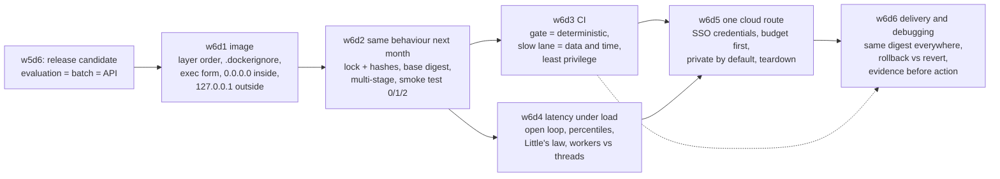

# w6d7 - Week 6 review and catch-up (light day)

**Time budget: 60-90 minutes.** No new material.

| Activity | Time |
|---|---|
| 1. Spaced-review items due today (from `w5d7`, plus the cold redo carried over from a short `w5d7`) | 5-10 min |
| 2. Retrieval sheet, from memory | 25 min |
| 3. Score it; choose what to redo | 10 min |
| 4. Redo one thing, cold and unassisted | 20-30 min |
| 5. Interview set 6: two debugging narratives and log arithmetic in code (timed, recorded) | 45 min, or the short form (32 min) |
| 6. Update progress flags and the spaced-review list | 5 min |

On a 60-minute day: activities 1-3, then the short form of 5 (N1 and C3), then 6. The cold redo moves
to `w7d7`.

## Purpose

Week 6 took the release candidate of Week 5 and made it something other people can run: an image whose
layers, user, command and context are deliberate; a build that gives the same behaviour next month; a
per-push gate that checks code and a scheduled lane that checks data and time; latency measured the way
clients experience it; one cloud route behind a cost and credential gate; and a delivery practice
where the same digest moves between environments and incidents are diagnosed from evidence. Today
checks whether you can retrieve those ideas without the lessons, and whether you can **reason aloud
about a failing system** under time pressure: the skill a debugging round in an interview measures, and
the one an on-call shift needs.

Units covered: `w6d1` Docker I (images, layers, a correct Dockerfile), `w6d2` Docker II (locks, digests,
multi-stage builds, smoke tests), `w6d3` continuous integration, `w6d4` latency, throughput and resource
use, `w6d5` one cloud deployment on AWS (authorisation-gated), `w6d6` delivery and operational debugging
(project milestone 3).

The week in one picture. Each arrow is a question the next lesson answers.



All numbers below come from the Week 6 lessons' authoring runs (2026-11-22) on the authoring machine
(Docker Engine 29.10, 4 cores). They describe that machine; your own measurements will differ, and the
mechanisms are what you should retrieve.

## 1. Spaced-review items due today (5-10 minutes)

Open the "Spaced review" list at the top of `progress/notes.md` and answer, closed book, every item
marked due `w6d7` (from `w5d7`: typically the decision order 422 → 503 → 400, the four bundle files and
their refusals, the five streaming decisions). Two consecutive *solid* answers remove an item; otherwise
it moves to `w8d7`.

If a short `w5d7` postponed its cold redo, do it now, before the retrieval sheet: a three-way parity test
from a blank file (evaluation path, `predict-batch`, API through `TestClient`) on one real experiment.

## 2. Retrieval sheet (25 minutes, closed book)

Rules as before: no lessons, handbook, repository or search; two to five sentences each; if you cannot
answer, write what you would check; open the key only when all twelve have an attempt.

**Docker I (w6d1)**

1. A colleague's container takes about 10 s to stop and exits with code 137. Name the two independent
   causes that each produce this, the one-line fix for each, and what `docker stop` does second by
   second. How long did the lesson's service take to stop with the exec form, and with a shell form?
2. A one-line edit to `src/` triggers a full reinstall of numpy and pandas on every build. Explain with
   the layer cost rule, give the fixed instruction order, and the measured rebuild times. Then: write the
   `.dockerignore` line that excludes every `__pycache__` directory, and explain why `-p 8000:8000` on a
   laptop and `--host 127.0.0.1` inside the container are both mistakes, with the symptom of the second.

**Docker II (w6d2)**

3. List the six sources of build drift and the pin for each. What happens in hash-checking mode when a
   transitive dependency is missing from the lock, and why is that the desired behaviour? Your lock pins
   every package with `==` and hashes, and the base is pinned by digest: name two ways the *behaviour* of
   the service can still change between two builds, and what catches each.
4. What is a multi-stage build for? The lesson measured it: single-stage slim against multi-stage, in MB;
   explain the result, and name what actually shrinks this image (with the numbers). What does the smoke
   test establish, what does it not, and what do its three exit codes mean for the person reading CI?

**Continuous integration (w6d3)**

5. State the test that decides whether a check belongs in the per-push gate or the scheduled lane. A
   colleague proposes "fail the pull request if F1 on the validation set drops by more than 0.01": two
   reasons this is a poor gate, and the design you would propose instead. What did the lesson's "under
   50 ms" test do as competing CPU load rose (0, 2, 4, 6 processes, 40 runs each)?
6. Four workflow defects, each with its consequence and fix: (a) no `permissions:` block; (b)
   `${{ secrets.TOKEN }}` written inside a `run:` script; (c) a cache key containing `github.sha`;
   (d) `python-version: [3.10, 3.11]`. Then: `@v7`, a 40-character commit SHA, `@main`: what each pins.
   Why can a gate that needs secrets not check pull requests from forks?

**Latency and resources (w6d4)**

7. Define coordinated omission and say which kind of load generator causes it. In the lesson's
   simulation (one 1 s stall, 50 requests/s, 60 s), what p99 did the closed loop report and what did the
   open loop report? Give the interpolation rule for a percentile, and two reasons to be careful with
   p99 and with averaging percentiles.
8. State Little's law and use it to size workers for a target utilisation; why target 0.6-0.75 rather
   than 0.95? Where did one worker saturate, and what happened to latency, errors and memory past it?
   Threads versus worker processes for this CPU-bound Python service: which raises throughput, and at
   what memory cost? A service's p50 is 50 ms at 5 and at 100 requests/s, while server-side processing
   takes 10 ms: three hypotheses and the measurement that separates them.

**One cloud deployment (w6d5)**

9. Where may credentials live in this course's AWS route, and where never (four places)? What does
   `aws sso login` give you that an access key does not? Distinguish the task execution role from a task
   role, and say why this service has only one of them. Why is the image tag the git SHA, in an
   immutable repository?
10. Write the cost structure of the deployment as a formula and say which term dominates; give the billed
    vCPU-hours of the lesson's four scenarios. Why is the budget alert created before anything billable?
    What does "not public" mean concretely (inbound rules, `allowed_cidr`, `allow_public`)? Which endpoint
    should the platform's health check probe, and why? What does a dry run prove, and what does it not?

**Delivery and operational debugging (w6d6)**

11. Tag versus digest; why does promotion never rebuild? What did three builds of the same source tree
    give? Production breaks right after a deployment: when is rollback the right fix, and when is it
    wrong? Use the lab's incidents (the bad hotfix bundle and the `MODEL_DIR` change) to illustrate both,
    and say what rollback would have done in the second.
12. Why does the lab validate configuration in two layers (startup versus readiness), and what does each
    layer do with `FLOWGUARD_MODEL_DlR=...` and with a missing model directory? In the memory incident,
    what did `/readyz` and the last log line show, and which piece of evidence revealed the cause? When
    should a deployment be recorded as `good`?

## 3. Score and choose (10 minutes)

Open [`solutions/lessons/w6d7_review/retrieval_answers.md`](../../solutions/lessons/w6d7_review/retrieval_answers.md).
Mark each answer **solid**, **shaky** or **missing** and record the lists:

```bash
python wb.py note w6d7 "solid: ...; shaky: ...; missing: ..."
```

## 4. Redo one thing, unassisted (20-30 minutes)

Choose one, in this priority order:

1. a Week 6 lab or challenge whose checks did not pass, or that you passed only with hint 3 or a solution;
2. a **Dockerfile from a blank file** for your own project's API: slim base pinned by digest, dependencies
   from a hashed lock before the code, non-root user, exec-form command on `0.0.0.0`, healthcheck on
   `/readyz`, an allow-list `.dockerignore`; then build it and run the smoke test against the image as
   shipped (no mounted model). If you have no Docker daemon, `python wb.py check w6d1` grades the files;
3. the task behind your weakest retrieval answer, for example: an open-loop load generator that measures
   from the intended start time, with a test against a fake server that stalls; or `select_rollback_target`
   over an append-only release history, with tests for "no earlier good release".

Protocol (unchanged)

* Fresh directory or branch, blank file. No earlier attempt, hints, solutions or lesson text.
* Timer: 25 minutes. Run the unit's checks at most twice.
  ```bash
  python wb.py check w6d1                  # example
  ```
* Record the conditions, then set the flag the evidence supports:
  ```bash
  python wb.py note w6d1 "cold Dockerfile, 25 min, no notes: static checks pass, unmounted smoke test passes"
  python wb.py mark w6d1 independent       # only if completion criteria were met under these conditions
  python wb.py mark w6d1 review            # otherwise
  ```

## 5. Interview set 6: debugging narratives and log arithmetic (45 minutes, timed and recorded)

[`interview/set6_debugging.md`](../../interview/set6_debugging.md):

* **N1 (12 minutes):** "ready on my laptop, 503 in staging". A different service with the same structure
  as yours; evidence cards are revealed as you ask for them.
* **N2 (12 minutes):** "twice the workers, five times the median latency". The team suspects the workers
  are fighting for CPU.
* **C3 (20 minutes):** per-endpoint p95 and error rate over a sliding window of JSON log lines, graded by
  tests.

```bash
python -m pytest interview/set6_tests -q        # the coding prompt
```

From this week on, the fading rule is the Weeks 6-8 one: timed, **spoken aloud and recorded**, and you
score the recording against the rubric (part A of `solutions/interview/set6.md`) **before** reading
anything else there. Write down the rubric areas you missed. For people coming from research they are
usually area 1 (restating the symptom precisely before forming hypotheses) and area 5 (keeping mitigation,
fix and prevention apart); the second design rep in `w7d7` and the narratives in Week 8 start from them.

## 6. Spaced review and progress flags (5 minutes)

**Spaced-review schedule.** Shaky and missing items from today are due on `w7d7` (one week), then on
`w8d7`. Items carried from `w5d7` that were not solid today move to `w8d7`. An item leaves the list after
two consecutive solid answers.

```
## Spaced review
- w6d7 Q8 (Little's law sizing, utilisation target)   - due w7d7
- w5d7 Q9 (decision order, 422 before 503)            - due w8d7   (second miss)
```

**Flags.** Set each from evidence:

```bash
python wb.py status
python wb.py mark w6d1 reading
python wb.py mark w6d1 guided            # lab checks passed (hints allowed)
python wb.py mark w6d1 independent       # challenge or cold redo passed without hints or solutions
python wb.py mark w6d4 review            # shaky or missing today
python wb.py mark w6d7 guided            # this session done
```

Checklist

- [ ] Due spaced-review items answered before anything else
- [ ] Twelve retrieval answers attempted before opening the key
- [ ] solid / shaky / missing recorded with `wb.py note`
- [ ] One cold redo done and its conditions recorded
- [ ] N1 and N2 recorded under the timer and scored against the rubric before reading part B
- [ ] `review` flags and the spaced-review list updated
- [ ] Project check (milestone 3): the image is built in CI from a clean checkout, smoke-tested as shipped,
      deployed by digest, and the release history records each deployment

**Next:** Week 7 starts with `w7d1` (structured logging and service metrics). Its objective, deliverable and
prerequisites are in [roadmap/SCHEDULE.md](../../roadmap/SCHEDULE.md).

---

*Content status and verification: see `STATUS.md`. Questions and answers were written against the final
Week 6 lessons on 2026-11-22; every number quoted is copied from those lessons' authoring runs. Interview set
6's coding reference was executed against its tests, and six deliberately wrong answers were rejected
(details in `solutions/interview/set6.md`).*

**Next session:** [w7d1_service_logging_metrics](../w7d1_service_logging_metrics/README.md).
