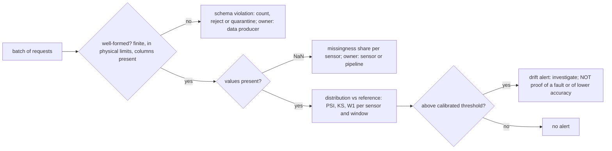
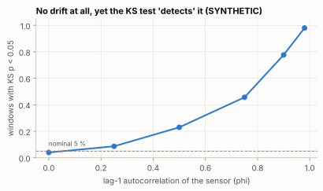
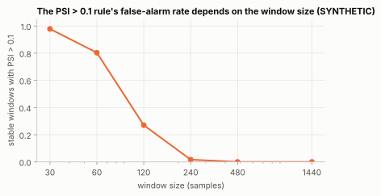
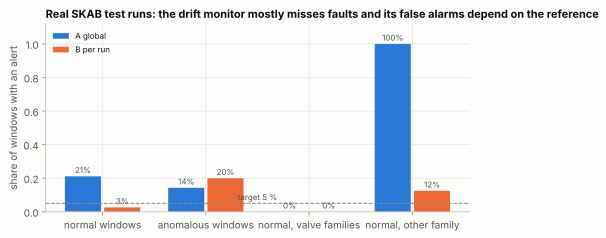
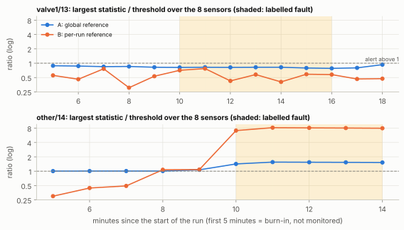

# W7D2 — Input monitoring and drift statistics

Unit id `w7d2_input_monitoring_drift` · Week 7, day 2 · Handbook:
[H15.3 Input monitoring and drift](../../handbook/ch15_logging_monitoring_updates/h15_3_input_monitoring_drift.md)
· Content status: see [STATUS.md](../../STATUS.md)

## 1. Purpose

**Objective.** Build an input monitor for the `flowguard` service that keeps three questions apart (is
the input well-formed? is data missing? has the distribution moved?), computes PSI, KS and Wasserstein-1
correctly, and sets its thresholds by **measuring** the false-alarm rate on stable data rather than by
folklore. Then replay real SKAB runs through it and report what it does and does not tell you.

**Why an applied ML engineer needs it.** Yesterday's metrics say whether the service answers; they say
nothing about whether the data it answers on still resembles the data the model was built for. Labels
for real faults arrive days or weeks later (w7d3), so input monitoring is often the earliest signal you
have. It is also one of the easiest things to do badly: a KS p-value on autocorrelated sensor data, or the
"PSI > 0.25" rule copied from credit scoring, will page someone every day or never. This lesson builds
the monitor so that its alarm rate is a number you chose, and then shows, on real data, why a drift alarm
is not a fault alarm and not a performance measurement.

**Deliverables.**
* `lab/src/flowguard/drift.py`: the statistics (task 1), schema/missingness/drift per window (task 2),
  calibrated thresholds (task 3).
* `lab/MONITORING_NOTES.md` (your own file): the replay results of task 4 and your reading of them.
* `challenge/stream_monitor.py`: a monitor for a synthetic e-commerce stream with a change calendar.

**Completion criteria.**
* `python wb.py check w7d2` passes (17 checks: agreement with SciPy for unequal sizes and ties, the empty-bin
  case, invariances, window cadence, violations kept out of the statistics, missingness kept separate,
  detection of a planted shift, and a held-out false-alarm rate within bounds).
* `lab/replay_drift.py` runs on real SKAB and your notes explain its table.
* `python wb.py check w7d2 --challenge` passes on 8 generated streams.
* You can explain, without notes, why a KS p-value is not a usable alarm on a 1 Hz sensor, and why the
  "PSI > 0.1" rule has no fixed false-alarm rate.

**Prerequisites.** [w7d1](../w7d1_service_logging_metrics/README.md) (what the service records),
[w3d5](../w3d5_uncertainty/README.md) (dependence and effective sample size),
[w4d1](../w4d1_timeseries_fundamentals/README.md) (autocorrelation), [w2d3](../w2d3_data_quality_ingestion/README.md)
(schema checks in a batch pipeline). `python project/get_skab.py` for task 4. No new packages (SciPy is
used only by the checks and the worked example).

**Time budget (2 h essential).**

| Activity | Minutes |
|---|---|
| Read section 2 | 25 |
| Worked example | 10 |
| Guided lab: task 1 (statistics) | 25 |
| Guided lab: task 2 (window report) | 20 |
| Guided lab: tasks 3-4 (calibration, real replay, notes) | 25 |
| Challenge: start `stream_monitor.py` | 5 |
| Assessment and reflection | 10 |
| *Optional extension: finish the challenge; add a multivariate check (Mahalanobis distance of window means); try KS and PSI as the alerting statistic in the replay and compare* | *up to 60* |

## 2. Conceptual explanation

### 2.1 Three questions, three owners



* A **schema violation** (a `-9999` sentinel, an infinity, a pressure of 9,000 bar) is a broken input.
  It must be counted and kept **out** of the distribution statistics: one sentinel value moves a
  Wasserstein distance by hundreds of units and would hide what the other 59 rows are doing.
* **Missingness** (NaN) is a different failure with a different owner (a sensor dropping out, a join
  that lost rows). It is reported as a share per sensor, not as a violation and not as drift.
* **Distribution shift** is a change in the values that pass both checks. It is evidence that something
  changed, not that the model got worse (section 2.6).

### 2.2 The statistics

For one sensor, a reference sample $R$ (size $m$) and a current window $C$ (size $n$), with empirical
CDFs $F_R$ and $F_C$:

* **Kolmogorov-Smirnov statistic.** $D = \sup_x |F_R(x) - F_C(x)|$, between 0 and 1. Unitless and
  invariant to monotone transformations of the sensor. Sensitive to location shifts near the middle of
  the distribution, less to the tails.
* **Wasserstein-1** (earth mover's distance). $W_1 = \int |F_R(x) - F_C(x)|\,dx$, in the **sensor's own
  units**: a pure shift of the whole distribution by $\delta$ gives exactly $W_1 = |\delta|$. That makes
  thresholds explainable ("the flow rate moved by about 0.8 L/min") and lets you compare them with the
  sensor's resolution.
* **Population Stability Index.** Cut the reference at its quantiles into $k$ bins (deciles here, open
  outer bins), let $p_i$ and $q_i$ be the reference and current shares, floored at $\epsilon = 10^{-4}$:

  $$\mathrm{PSI} = \sum_{i=1}^{k} (q_i - p_i)\,\ln\frac{q_i}{p_i} = \mathrm{KL}(q\,\|\,p) + \mathrm{KL}(p\,\|\,q).$$

  It is the symmetric (Jeffreys) divergence of the binned shares. The floor matters: a window whose values
  all fall above the reference maximum leaves nine empty bins, and without $\epsilon$ the logarithm is
  $-\infty$ (the lab's `psi_without_floor` mutant silently drops those bins with `nansum`, which removes
  exactly the evidence of drift).

All three statistics are **descriptions** of how far two samples are apart. None comes with a usable
false-alarm rate on monitoring data; that comes from calibration (section 2.4).

### 2.3 Why the textbook p-value fails here

A two-sample test assumes independent observations. Sensor data at 1 Hz are strongly autocorrelated:
consecutive seconds of flow rate are nearly the same value, so a 60-sample window contains far fewer than
60 independent pieces of information (w3d5's effective sample size). The KS test then believes it has
more evidence than it has. In the worked example, with **no drift at all**, the share of windows with
$p < 0.05$ rises from 5.5 % (independent samples) to 22 % (lag-1 autocorrelation 0.5), 75 % (0.9) and
98.5 % (0.98).



*Figure 1 (SYNTHETIC: stationary AR(1), reference 2,000 samples, window 240).* The opposite failure
appears with large samples: the example finds $p = 3 \times 10^{-8}$ for a 0.01 °C difference between
two 200,000-sample sets, below any thermometer's resolution. Significance is about sample size, not
about whether anyone should care.

**The PSI rule of thumb** ("< 0.1 stable, 0.1-0.25 moderate, > 0.25 major shift") comes from credit-risk
practice with large monthly samples. PSI under **no** drift grows like $(k-1)(1/n + 1/m)$, so its
false-alarm rate depends on the window size: with i.i.d. data and a 5,000-sample reference, 98 % of
30-sample windows exceed 0.1, about 27 % of 120-sample windows, and none of the 480-sample ones.



*Figure 2 (SYNTHETIC, i.i.d. normal data, 600 windows per size).* A fixed rule therefore means something
different at every window size, and nothing at all for autocorrelated data.

### 2.4 Thresholds by calibration, and multiple testing

Replace folklore with a measurement: replay windows of data you consider **stable** through the monitor,
look at the distribution of each statistic, and set the threshold at the quantile that gives the
false-alarm rate you can afford. Two details:

* **Multiple testing.** With $m$ sensors, a window alerts if *any* sensor exceeds its threshold. If each
  is calibrated to 5 %, the window-level rate is up to about $m \times 5\%$. The lab uses the Bonferroni
  split: each sensor at $\alpha/m$, so the window rate is at most about $\alpha$. On the lab's synthetic
  data with 4 sensors: 2.75 % of held-out stable windows alert with the correction, 13 % without.
* **What "stable" means is a decision.** If the calibration windows include the normal variation between
  machines, the thresholds become wide and small faults pass; if they do not, every new machine alerts.
  This is the reference-window choice of section 2.5, and it shows up immediately on real data.

With few calibration windows, a tail quantile is close to the maximum observed value; the measured
false-alarm rate on held-out data, not the nominal target, is what you report.

### 2.5 Choosing the reference

| Reference | Detects | False alarms come from | Typical use |
|---|---|---|---|
| Training data | anything new relative to training, including legitimate new machines | normal between-unit variation | "is the model being used outside its domain?" |
| A recent stable window (yesterday, last week) | sudden changes | slow, legitimate trends being re-flagged after every reset | operational change detection |
| The unit's own burn-in (per machine) | changes within a run | the burn-in itself not being representative | a fleet of machines with different set-points |

The lab compares the first and third on real data.

### 2.6 Drift is not degradation (preview of w7d3)

A drift alarm says the inputs changed. Whether predictions got worse depends on whether the change moves
data across the model's decision boundary and on whether the relation between inputs and labels
changed. Inputs can drift with no harm (a planned price change, a new but normal machine) and performance
can collapse with no input drift (the label meaning changes). Section 4, task 4, shows a stronger version:
on SKAB the drift monitor misses most of the labelled faults that the w4d5 detector catches, because a
calibrated drift monitor is tuned to tolerate exactly the kind of variation that separates experiments.

### 2.7 Connection to your research

You have seen all three failures in EEG: electrode impedance creeping up over a session (slow drift in
amplitude and line-noise power), a channel dropping out (missingness), an amplifier saturating at its
rail (a schema violation masquerading as a huge signal), and session-to-session shift between recording
days that breaks a classifier trained on day one. Your practice of re-referencing and per-session
normalisation is the "per-unit reference" row of section 2.5; cross-session transfer studies are the
"training data" row.

### 2.8 An industry example (illustrative composite, not a documented case)

An online retailer's demand model monitored PSI on 40 features with the 0.25 rule, daily windows of
about 2,000 rows. It almost never alerted, until a pricing change in one category triggered alerts on
six correlated features for two weeks, which the team learned to ignore. Three weeks later a tracking bug
doubled session lengths on the mobile app; the alert fired and was ignored with the others. The fix was
a change calendar (planned changes annotated and re-baselined), per-feature thresholds calibrated on
three months of stable days, and a separate missingness check. The challenge builds a small version of
exactly this.

### 2.9 Limitations and misconceptions

* "Drift alert means retrain." It means investigate. Retraining on a sentinel-filled or bug-inflated
  input would teach the model the bug.
* "Use the p-value, it is principled." Not with autocorrelated windows or huge samples (section 2.3).
* "PSI > 0.25 is the industry standard." It is a convention whose false-alarm rate depends on window and
  reference sizes.
* "Monitoring every feature is safer." Each extra feature adds false alarms unless the thresholds are
  corrected for multiple testing.
* Per-feature (univariate) monitors miss changes in the relation between features; the extension adds a
  multivariate check. A classifier two-sample test (train a model to tell reference from current and
  look at its AUC) is the general version; not built here.

## 3. Worked example: three ways a drift test misleads (SYNTHETIC)

`example/two_sample_tests.py` uses a building's supply-air temperature sensor sampled once a minute, so
the domain is different from the project. It is self-contained (NumPy, SciPy).

```bash
python lessons/w7d2_input_monitoring_drift/example/two_sample_tests.py
```

Output (exact, deterministic seed; about 5 s):

```text
1) KS test on windows of a stationary process (no drift): share of windows with p < 0.05
   phi = lag-1 autocorrelation; reference = 2,000 minutes, window = 240 minutes, 400 windows
   phi = 0.00:    5.5%   (nominal 5 %)
   phi = 0.50:   21.8%   (nominal 5 %)
   phi = 0.90:   75.0%   (nominal 5 %)
   phi = 0.98:   98.5%   (nominal 5 %)

2) PSI > 0.1 'moderate shift' rule on windows of i.i.d. data (no drift), reference 5,000
   window n =    30:  share PSI > 0.1 =  98.2%   median PSI = 0.350
   window n =    60:  share PSI > 0.1 =  77.7%   median PSI = 0.152
   window n =   240:  share PSI > 0.1 =   0.3%   median PSI = 0.037
   window n =  1440:  share PSI > 0.1 =   0.0%   median PSI = 0.006

3) A large sample makes any difference 'significant'
   KS p-value = 3.1e-08,  W1 = 0.0111 deg C
```

**Interpretation.** Part 1: the test is correct only for independent samples (5.5 % at $\phi = 0$);
building and process sensors typically have $\phi$ well above 0.9 at one-minute sampling. Part 2: the
same "moderate shift" rule fires on nearly every 30-sample window and never on a 1,440-sample window of
identical data. Part 3: W1 reports the difference in °C (0.011), which you can compare with the sensor's
resolution; the p-value cannot be compared with anything.

## 4. Guided lab

`lab/` holds the project snapshot (`flowguard.data`, `flowguard.splits`, `flowguard.limits` with the
w5d4 physical limits), the frozen manifest `splits/v2.json`, the given `replay_drift.py`, and
`src/flowguard/drift.py` with the TODOs. Given in `drift.py`: `bin_edges`, `DriftReport`, the buffering
`update` method, `stable_windows`, `alarm_rate`.

**Task 1 (25 min): the statistics.** `psi_from_proportions`, `psi`, `ks_stat`, `wasserstein1`. Build both
empirical CDFs on the **union** of the two samples (`np.searchsorted(sorted_x, grid, side="right") / n`);
KS is the largest gap, W1 the sum of gap × spacing of the grid. *Checkpoint:*

```python
import sys, numpy as np, scipy.stats as ss; sys.path.insert(0, "lessons/w7d2_input_monitoring_drift/lab/src")
from flowguard.drift import ks_stat, wasserstein1
a, b = np.random.default_rng(0).normal(size=17), np.random.default_rng(1).normal(0.3, 1.2, size=1000)
print(ks_stat(a, b) - ss.ks_2samp(a, b).statistic, wasserstein1(a, b) - ss.wasserstein_distance(a, b))  # ~0, ~0
```

*Debugging.* Off only for unequal sizes: you are pairing sorted values. Off only with ties: use
`side="right"` consistently. PSI is `inf` or `nan`: floor the shares.

**Task 2 (20 min): `split_violations` and `DriftMonitor.window_stats`.** Follow the numbered steps in the
docstring. The report counts violations, records missing shares, computes the three statistics on clean
finite values, and lists alerts as `(sensor, kind, value, threshold)`.
*Checkpoint:* `python wb.py check w7d2` — the cadence, schema and missingness tests pass.

**Task 3 (10 min): `calibrate_thresholds`.** Compute the statistic on every stable window, then for each
sensor the quantile that keeps the window-level rate near the target with $m$ sensors.
*Checkpoint:* all 17 checks pass. If only the held-out false-alarm test fails, re-read section 2.4.

**Task 4 (15 min): replay real data.**

```bash
python lessons/w7d2_input_monitoring_drift/lab/replay_drift.py
```

Protocol (in the script's docstring): one-minute windows, W1 on all eight sensors, target 5 %, calibration
on the development runs' normal operation after the 300-row burn-in, evaluation on the 7 test runs. Two
references: **A** the pooled burn-ins of all development runs, **B** each run's own burn-in. The reference
solution printed:

```text
reference                 A global (dev calibration windows, in-sample)  A global (test)  B per run (test)
normal_windows                                                    107.0           38.000            38.000
normal_alert_rate                                                   0.0            0.211             0.026
anomalous_windows                                                   0.0           35.000            35.000
anomalous_alert_rate                                                NaN            0.143             0.200
normal_alert_rate_valve1                                            0.0            0.000             0.000
normal_alert_rate_valve2                                            0.0            0.000             0.000
normal_alert_rate_other                                             0.0            1.000             0.125

sensors that fire most on anomalous test windows (A):
sensors
accelerometer2_rms    4
flow_rate             4
thermocouple          4
accelerometer1_rms    1
temperature           1
```



*Figure 3 (real SKAB, 7 test runs, 38 normal and 35 fully anomalous one-minute windows).*



*Figure 4 (real SKAB).* Shaded minutes are labelled faults; the dashed line is the alert level.

**What the replay shows (write your own reading in `MONITORING_NOTES.md` before reading this):**

* **Calibration in-sample says 0 %; the test runs say 21 % (A).** With 107 calibration windows and a
  per-sensor level of $1 - 0.05/8$, the threshold is essentially the largest value seen. All of A's false
  alarms come from the two `other`-family test runs (8 of 8 normal windows), whose temperature or
  vibration sits slightly outside anything in the development burn-ins. A global reference flags *new
  operating conditions*, which is its job and also why it is noisy across a fleet.
* **Reference B halves the problem differently:** 1 false alarm in 38 normal windows, because each run is
  compared with itself.
* **Neither is a fault detector.** Of 35 fully anomalous windows, A flags 5 and B 7. None of the 24
  anomalous windows of the four `valve1` test runs alerts under A, and 1 under B. The w4d5 z-score
  detector, built for the purpose, catches 5 of the 7 test faults. The calibrated drift monitor tolerates
  the variation between experiments, and a closing valve is smaller than that variation in one-minute
  windows of most sensors.
* **Small numbers.** 38 and 35 windows from 7 runs: these rates are descriptive, with wide uncertainty
  (w3d5); the conclusion "drift monitoring does not replace fault detection here" does not depend on the
  second decimal.

## 5. Independent challenge: expected and unexpected drift

Read [challenge/README.md](challenge/README.md). A SYNTHETIC shop's feature stream (70 days, 400 sessions
a day) contains a planned price increase listed in a change calendar, two unplanned bugs and a
missing-data outage. You write `challenge/stream_monitor.py` so that the planned change is annotated
rather than alerted, monitoring of the changed feature resumes after a re-baseline, and the unplanned
events are caught within two or three days, with few false alarms.

Acceptance: `python wb.py check w7d2 --challenge` (eight generated streams).

## 6. Progressive hints

[Hint 1: concepts](hints/hint1_concept.md) · [Hint 2: approach](hints/hint2_approach.md) ·
[Hint 3: partial implementation](hints/hint3_partial.md)

## 7. Assessment

[assessment.md](assessment.md): reasoning questions, a design-choice explanation, the rubric and an ML
fundamentals interview rep on two-sample tests.

## 8. Reflection and review

**You should now be able to, without notes:** separate schema violations, missingness and distribution
shift; compute KS, W1 and PSI correctly for samples of different sizes and with ties; explain why
p-values and the PSI rule of thumb do not give a false-alarm rate on monitoring data; calibrate
thresholds with a multiple-testing correction and measure the result on held-out stable data; choose a
reference and say what it will flag; and state why a drift alarm is neither a fault alarm nor a
performance measurement.

**Reflection prompt.** In a cross-session or cross-subject study of yours, which signal would have told
you on day one that the new session's data differed from training, and how many false alarms would it
have raised across your normal sessions?

**Later retrieval question (for the w7d7 review).** A monitor on 25 features, each with a threshold at
its own 99th percentile of stable daily values, alerts on about one day in five although nothing
changes. Explain the rate and two ways to fix it.

**Next.** [w7d3](../../roadmap/SCHEDULE.md): drift is not degradation — delayed labels and measured
performance.

## Verification record

Executed on the authoring machine (shared Linux container), 2026-11-22: Python 3.13, NumPy 2.5.3, pandas
3.0.5, SciPy 1.18.1, matplotlib 3.11.2 (figures only).

* `python tools/verify_checks.py lessons/w7d2_input_monitoring_drift`: the reference passes both parts;
  6 lab mutants and 4 challenge mutants are rejected, each by its intended check. The shipped starter
  fails all 17 lab checks and all challenge checks.
* KS and W1 were checked against `scipy.stats.ks_2samp(...).statistic` and
  `scipy.stats.wasserstein_distance` (equal to 1e-12) for unequal sizes and ties; PSI against the
  Jeffreys-divergence identity.
* The 2.75 % / 13 % held-out false-alarm rates in section 2.4 were measured on the checks' synthetic
  generator (40 held-out runs, 400 windows).
* `lab/replay_drift.py` (reference solution) ran on the real SKAB files; the table in task 4 is copied
  from that run and Figures 3-4 are drawn from its `results/` files. The worked example's output is exact.
* The challenge reference was run on seeds 0-9 while choosing the check bounds; the checks use seeds 0-7.
* **Not verified:** the origin of the PSI 0.1/0.25 convention (stated as credit-risk practice from
  memory); the classifier two-sample test (described, not built); Python 3.11/3.12; the time budget.
