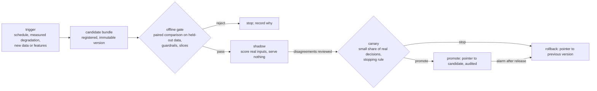
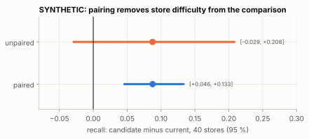
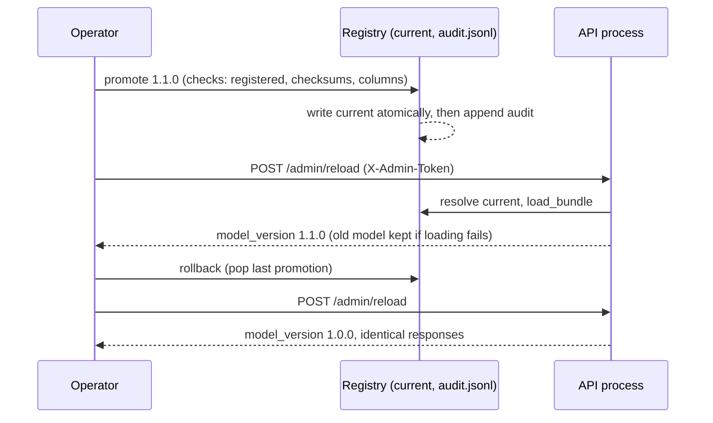
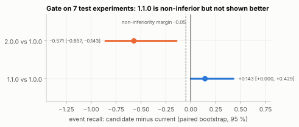
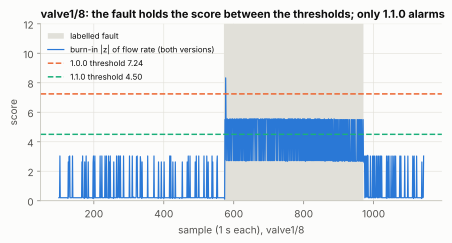
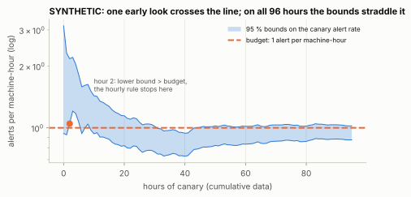

# w7d4 — Model updates: retraining triggers, shadow and canary, rollback

**Status:** Execution verified (see the verification record at the end).
**Handbook:** [H15.5 Updates and rollback](../../handbook/ch15_logging_monitoring_updates/h15_5_updates_and_rollback.md)
**Prerequisites:** [w7d3](../w7d3_drift_vs_degradation/README.md) (drift is not degradation),
[w5d2](../w5d2_artifacts_versioning/README.md) (bundles and the registry),
[w3d5](../w3d5_uncertainty/README.md) (paired comparisons), [w5d4](../w5d4_fastapi_validation/README.md) (the API).

---

## 1. Purpose

**What you will learn.** How a model is replaced in production without betting the service on one
number: what should trigger a candidate, the offline gate it must pass, how shadow scoring and a canary
add evidence the gate cannot give, and how a rollback becomes a boring, audited pointer move.

**Why an applied ML engineer needs it.** Shipping the first model is a project; replacing it is a
routine that happens for years. Teams that retrain on every drift alarm, promote on a single offline
number, or cannot say which model served a given request at 3 a.m. last Tuesday, will eventually ship a
regression they cannot undo quickly. "How do you roll out a new model safely?" is a standard system-design
interview question.

**Primary objective.** Implement `flowguard.update` (gate, shadow runner, promote, rollback, audit
log) and take two real candidate models through gate → shadow → promote → API reload → rollback.

**Deliverable.** A working `update.py` that passes the checks, the update report on real data, and a
canary decision write-up (the challenge).

**Completion criteria.**
- `python wb.py check w7d4` passes (guided practice).
- You can explain why candidate 1.1.0 is promoted under a non-inferiority policy and rejected under a
  superiority policy on the same evidence.
- `python wb.py check w7d4 --challenge` passes and your `CANARY.md` explains the repeated-looks problem
  in your own words (independent skill).

| Activity | Essential (2 h) | Optional (≤ 1 h) |
|---|---|---|
| Read sections 2-3 and run the worked example | 30 min | |
| Guided lab, tasks 1-5 | 55 min | |
| Real-data update report (task 6) | 15 min | change the gate policy and margins |
| Independent challenge (start) | 15 min | finish it |
| Assessment and reflection | 5 min | interview rep (15 min) |

---

## 2. Conceptual explanation

### 2.1 Intuition

A model update has two risks that need different evidence. **Is the candidate better (or at least not
worse) at the job?** needs labelled outcomes, which you have offline and, slowly, in production (w7d3).
**Does the candidate break anything operational?** (errors, latency, alert volume, a missing column)
needs real traffic, which you only have online. The offline gate answers the first with held-out data.
Shadow mode answers part of the second without risk: the candidate scores real inputs, nobody sees its
output. A canary answers the rest with bounded risk: a small share of real decisions comes from the
candidate. Rollback makes every step reversible in seconds.



### 2.2 Precise terms

* **Trigger**: what starts an update. *Scheduled* (every quarter), *performance-based* (a measured drop
  in labelled metrics, w7d3), *data-based* (new labels, new features), or *drift-based*. Drift alone is a
  weak trigger: input change says nothing about whether the model got worse, and a retrain on the drifted
  data may fit a transient.
* **Offline gate**: an automated comparison of candidate and current on the same held-out units with a
  predeclared decision rule. **Superiority**: promote only if the candidate is shown better (the lower end
  of the interval for the difference is above 0). **Non-inferiority**: promote if the candidate is shown not
  worse by more than a margin $\delta$ (lower end above $-\delta$), used when the candidate brings
  another benefit (cheaper, simpler, a stakeholder-approved trade-off).
* **Guardrail**: a metric that must not get worse beyond a limit, whatever happens to the primary metric
  (false alarms per hour, latency, error rate).
* **Slice check**: no regression beyond a margin on a predeclared critical subgroup (here, fault families).
* **Shadow mode**: the candidate receives copies of production inputs; its outputs are logged, never
  served. **Canary**: a share of traffic is served by the candidate, under a stopping rule.
  **Blue/green**: two complete environments; a router switch moves all traffic at once.
* **Rollback**: return to the previous known-good version. With a registry it is a pointer move (w5d2)
  plus a reload, provided the old version is still compatible with the current serving contract.
* **Lineage**: for every served prediction you can name the model version, its training data manifest,
  code version and threshold. What must be versioned together: model parameters, threshold and
  post-processing, input schema, preprocessing. A threshold changed outside the bundle is an unversioned model.

### 2.3 The mathematics you need

**Paired difference.** For units $i = 1..n$ (experiments) with per-unit outcomes $a_i$ (candidate) and
$b_i$ (current), the paired bootstrap resamples units with replacement and applies the *same* draw to both
models, so $\widehat{\Delta}^* = m(a^*) - m(b^*)$. Because $\mathrm{Var}(\bar a - \bar b) =
\mathrm{Var}(\bar a) + \mathrm{Var}(\bar b) - 2\,\mathrm{Cov}(\bar a, \bar b)$ and the covariance is large
when difficulty is shared across models, pairing shrinks the interval. In the worked example, 40 stores,
the paired interval is $[+0.046, +0.133]$ and the unpaired one $[-0.029, +0.208]$ for the same difference.

**Decision rules.** With interval $[L, U]$ for $\Delta = m(\text{candidate}) - m(\text{current})$:
superiority if $L > 0$; non-inferiority with margin $\delta$ if $L > -\delta$; reject otherwise.

**Rare-event canaries.** A canary sees a fraction $f$ of traffic for time $T$. With events at rate
$\lambda$ per unit, it observes about $f \lambda T$ events; for a fault-detection model, $f\lambda T$ faults
may be zero. A canary can bound guardrails that happen often (requests, errors, alerts) far better than
the primary metric. Each look at accumulating data is another test; checking a rule every hour at a 5 %
level is not a 5 % test (the challenge shows one).

### 2.4 Connection to what you already know

In a closed-loop BCI study you would not swap the decoder mid-session for one that scored better on
last week's calibration data; you would compare decoders on the same held-out trials (paired), run the
new one silently alongside the old one first (shadow), and keep the old one loadable. The same reasoning
applies, with two differences: production has no session boundary to reset at, and the person who must
undo a bad update at night may not be you, so the undo must be one command with an audit trail.

### 2.5 An industry example

A team replacing a demand-forecasting model compares candidate and current on the same stores and
weeks (the worked example below). An unpaired comparison of two overall error numbers would call a real
improvement "uncertain", because between-store difficulty dominates the variance. After the gate, the
candidate runs in shadow for two weeks; the team reviews the stores where the two disagree most, not the
averages. A 5 % canary then watches serving errors and latency; the forecast-error benefit itself is not
measurable in a two-week canary and was never meant to be.

### 2.6 Limitations and common misconceptions

* *"The candidate scored higher on the test set, ship it."* One number on a few units; no interval, no
  guardrail, no slice check, and every such look spends the test set (w3d3).
* *"Drift fired, so retrain."* See w7d3: drift is a reason to investigate, not evidence of degradation.
* *"Shadow mode proves the candidate is better."* Shadow outputs have no labels yet; it shows where the
  models disagree and that the candidate runs, not which one is right. It also only covers the traffic
  it sees (task 6 shows a case).
* *"A canary will tell us if recall improved."* Not for rare events. A canary bounds operational risk.
* *"Rollback = redeploy the old code."* Rollback should be a pointer move to an immutable, already-verified
  bundle, compatible with today's serving contract, with no rebuild.

---

## 3. Worked example: a paired gate for a stock-out model (SYNTHETIC)

`example/paired_gate_demo.py` (numpy only). 40 stores, 6 stock-outs each; store difficulty
$d_s \sim U(0.2, 0.9)$ is the probability that the current model catches a stock-out; the candidate's is
$\min(1, d_s + 0.06)$. Both models see the same stock-outs. Nothing here describes real stores.

```bash
python lessons/w7d4_model_updates_rollback/example/paired_gate_demo.py
```

Output (verbatim, authoring run):

```
recall: current 0.533, candidate 0.621, difference +0.088
stores where candidate caught more / fewer / same: 14 / 0 / 26
paired   95 % interval for the difference: [+0.046, +0.133]
unpaired 95 % interval for the difference: [-0.029, +0.208]
  superiority                    paired  : PROMOTE (lower end +0.046)
  superiority                    unpaired: reject (lower end -0.029)
  non-inferiority, margin 0.05   paired  : PROMOTE (lower end +0.046)
  non-inferiority, margin 0.05   unpaired: PROMOTE (lower end -0.029)
```

**Important code decisions.** `bootstrap(paired=True)` draws one index vector `i` and uses it for both
models; `paired=False` draws `j` independently. Everything else is identical, so the difference between
the two intervals is purely the shared store difficulty that pairing cancels.

**Interpretation.** The candidate is better in 14 stores and worse in none, yet the unpaired interval
includes 0: an unpaired superiority gate would reject a real improvement. Under non-inferiority both
promote, which shows the other side: the policy choice can matter more than the statistics. Decide the
policy before looking.



*Figure 1 (SYNTHETIC, worked example).*

**Reproduce.** Seeded (`default_rng(11)` for data, seed 0 for both bootstraps); exact on NumPy 2.5.3.

---

## 4. Guided lab

Work in `lab/`. The `flowguard` snapshot is complete except `src/flowguard/update.py`. Given modules:
`models` (the detector, `BurnInZ`), `registry` (bundles, `register`, `resolve`, `current_version`, and
`write_pointer`, which replaces the pointer atomically with `os.replace`), `serving.respond` (the one
definition of a response), `api.create_app` (serves whatever `current` names; `POST /admin/reload`),
`uncertainty.paired_bootstrap_diff`, `evaluation`, `replay`.

Run `python wb.py check w7d4` after each task (all 16 checks fail at the start).

**Task 1: `pooled_recall`, `pooled_far`.** Sum detected over sum events; sum false alarms over sum normal
hours; NaN when the denominator is 0. These are the metric functions the bootstrap will call on resampled
lists of per-experiment results.

**Task 2: `offline_gate(current, candidate, *, policy, margin, max_false_alarms_per_hour, slices,
slice_margin, n_boot, seed, level)`.** Inputs map experiment id → per-experiment counts for the same
experiments (raise `ValueError` otherwise, and for an unknown policy). Compute
`paired_bootstrap_diff(pooled_recall, candidate, current, ...)`. Set `checks["superior"]` ($L > 0$),
`checks["non_inferior"]` ($L > -\text{margin}$), `checks["guardrail"]` (candidate's pooled false alarms per
hour ≤ limit, or no limit), `checks["slices"]` (in every slice, candidate recall ≥ current − slice_margin).
Decision "promote" only if the policy's primary check, the guardrail and the slices all pass. Return
`reasons` that say which check failed and by how much.
*Checkpoint:* `test_non_inferior_but_not_better_depends_on_policy` and
`test_gate_is_paired_and_needs_the_same_experiments` pass. The second one plants a candidate that catches
exactly one extra fault and misses none: any paired resample has difference ≥ 0; an unpaired one does not.

**Task 3: `ShadowRunner` and `disagreements`.** `score(run_id, run)` must return exactly
`respond(current, run)`. Compute it **before** the candidate sees anything, give the candidate a **copy**
(`run.copy(deep=True)`), and catch **every** exception from the candidate. Append a record with
`run_id`, both versions, `current_alarms`, `candidate_alarms` (None on error), `candidate_error`.
`disagreements(log)` counts runs, runs whose alarm lists differ, alarms raised by only one model (an alarm
is "shared" if it overlaps any alarm of the other model), and candidate errors.
*Checkpoint:* `test_a_crashing_mutating_candidate_cannot_touch_serving` passes; it uses a candidate that
overwrites the input and then raises.

**Task 4: `audit_log`, `promote`.** Before moving anything: the version must be registered, its bundle
must verify (`load_bundle`), and its `input_schema.required` must be a subset of `serving_columns`
(raise `RegistryError` naming the missing columns). Refuse to promote the version that is already current.
Then call `write_pointer` and **only after it succeeds** append one JSON line to
`<root>/<name>/audit.jsonl`: `ts` (UTC ISO 8601), `action`, `from`, `to`, `actor`, `reason`.
*Checkpoint:* `test_pointer_move_is_atomic_and_audit_follows_success` (it makes `os.replace` fail and
checks that neither the pointer nor the audit log moved).

**Task 5: `rollback`.** Undo the most recent promotion that has not already been undone: walk the audit
log, push on `promote`, pop on `rollback`; the target is the `from` of the entry on top. Nothing to undo,
or a first promotion (whose `from` is None) → `RegistryError`. Check the target is still deployable, move
the pointer, audit with action `rollback`, return the target.
*Checkpoint:* all 16 checks pass, including `test_rollback_through_the_api_restores_exact_scores`, which
promotes, reloads the API with a token, rolls back, reloads again and compares responses byte for byte.



The admin token is read from `FLOWGUARD_ADMIN_TOKEN` at request time and compared with
`hmac.compare_digest`. Set it in the shell that starts the server
(`export FLOWGUARD_ADMIN_TOKEN=$(python -c "import secrets; print(secrets.token_hex(16))")`); never put
it in a file in the repository. Unset, the reload endpoint answers 403.

**Task 6: real data.** With your module in place:

```bash
python project/get_skab.py                                            # once
python lessons/w7d4_model_updates_rollback/lab/build_models.py        # about 1 minute
python lessons/w7d4_model_updates_rollback/lab/update_report.py
```

`build_models.py` builds three bundles from the 27 development experiments of the frozen manifest v2:
**1.0.0** (the w4d5 model, budget 1 false alarm per 8 h), **1.1.0** (the same detector re-tuned after the
reliability engineer accepted 1 false alarm per hour) and **2.0.0** (max |z| over flow rate and both
accelerometers). The report gates both candidates on the 7 test experiments, shadows 1.1.0 over the 20
valve recordings, then promotes, reloads, and rolls back through the API. Reference output:

```
model 1.0.0: threshold 7.2441, min_duration 30, merge_gap 10; dev 11/27 events, 0 false alarms in 5.001 h
model 1.1.0: threshold 4.5036, min_duration 30, merge_gap 10; dev 19/27 events, 5 false alarms in 5.001 h
model 2.0.0: threshold 7.2869, min_duration 30, merge_gap 0;  dev 12/27 events, 0 false alarms in 5.001 h
gate 1.1.0 non_inferiority: PROMOTE  recall 0.714 -> 0.857, diff +0.143 [+0.000, +0.429], candidate FA/h 0.00
gate 1.1.0 superiority:     REJECT   ... lower end of the recall difference is +0.000, needs > 0
gate 2.0.0 non_inferiority: REJECT   recall 0.714 -> 0.143, diff -0.571 [-0.857, -0.143];
                                     slice other: recall 0.00 < 1.00; slice valve1: recall 0.25 < 0.75
promote 2.0.0: refused: flowguard 2.0.0 needs columns the serving contract lacks: ['accelerometer1_rms', 'accelerometer2_rms']
shadow: {'runs': 20, 'runs_differ': 15, 'only_current': 0, 'only_candidate': 4, 'candidate_errors': 0,
         'served_responses_identical_to_current': True}
api: ('start', 'flowguard-1.0.0', 0)
api: ('promote 1.1.0 + reload', 'flowguard-1.1.0', 1)
api: ('rollback to 1.0.0 + reload', 'flowguard-1.0.0', 0)
reload with a wrong token -> 401
scores after rollback identical to before: True
```



*Figure 2 (real data, gate on the frozen test set).*



*Figure 3 (real data).* The one test experiment that separates the versions. The single-sample spike
above 7.24 is removed by `min_duration = 30`; 1.1.0 raises one alarm covering samples 575-970.

What the run shows, as found:

* **The policy decides, not the data.** 1.1.0 catches one more test fault (valve1/8, figure 3) and misses
  none, so the paired interval's lower end is exactly 0.000: non-inferior, not shown superior. With 7
  test experiments a one-fault improvement cannot be demonstrated; promoting it is a decision to accept the
  stakeholder's new alert budget, and the reason in the audit log says so.
* **The guardrail is weak evidence here.** The test set has 1.2 normal hours and 1.1.0 raised no false
  alarm in them; the exact Poisson upper bound for 0 events in 1.22 h is about 2.5 per hour, above the
  budget of 1. On development data 1.1.0 raised 5 false alarms in 5.0 h, exactly the budget it was tuned to.
* **2.0.0 is stopped twice.** It is worse (recall 1/7 against 5/7; on development data it looked marginally
  better, 12/27 against 11/27) and it needs accelerometer columns the gateway does not send, so `promote`
  refuses it before anything moves.
* **Shadow coverage matters.** In shadow over the 20 valve recordings, 1.1.0 raised 4 alarms that 1.0.0
  did not, and lengthened alarms in 15 of 20 runs; checked afterwards against the labels, all 4 extra alarms
  are on real faults (15 of 20 faults caught against 11). But all 5 of 1.1.0's development false alarms
  occurred in the `other` family (other/7, other/11 and other/12 one each, other/13 two), which this
  shadow traffic never contained. A shadow period must cover the slices where the candidate behaves
  differently, or it will look cleaner than production. Also, 16 of the 20 recordings are development
  data 1.1.0 was tuned on: shadow measures disagreement, not performance.
* **Rollback is exact.** After promote → reload → rollback → reload, the API's response for valve1/8 was
  identical to the original, and the audit log reads
  `promote None→1.0.0`, `promote 1.0.0→1.1.0`, `rollback 1.1.0→1.0.0`.

---

## 5. Independent challenge

Read a canary and decide: [challenge/README.md](challenge/README.md). You implement a stated stopping
rule and explain why one scenario changes its answer between hourly and final evaluation.



*Figure 4 (SYNTHETIC, scenario e of the challenge).* Read this after you have tried the challenge.

---

## 6. Progressive hints

1. [Conceptual hint](hints/hint1_concept.md)
2. [Suggested approach](hints/hint2_approach.md)
3. [Partial implementation](hints/hint3_partial.md)

The full reference solution is in `solutions/lessons/w7d4_model_updates_rollback/lab/`.

---

## 7. Assessment

[assessment.md](assessment.md): reasoning questions, a design-choice explanation, a rubric and a 15-minute
system-design interview rep on safe rollout.

---

## 8. Reflection and review

**You should now be able to, without notes:**
- name four update triggers and say why drift alone is a weak one;
- write superiority and non-inferiority rules for a paired difference and choose between them;
- implement a shadow runner that cannot affect serving;
- explain what a canary can and cannot measure for a rare-event model;
- make promotion and rollback atomic, compatibility-checked and audited.

**Reflection prompt (5 minutes, `progress/notes.md`).** Think of the last time you replaced a model or
pipeline in your research. Could you have restored the previous one, with the same outputs, in one
command a month later? What would you have needed to version together?

**Retrieval question for review day.** *A candidate improves the primary metric by 0.02 with a paired
interval of [−0.01, +0.05] and halves inference cost. The policy is non-inferiority with margin 0.02. What
does the gate decide, and what should the audit log's reason say?*

**Next.** [w7d5 — Reliability and failure handling](../w7d5_reliability/README.md): guards, fallbacks and
failure-injection drills for the service you can now update and roll back.

---

## Verification record

Executed on 2026-11-22, Python 3.13.18, NumPy 2.5.3, pandas 3.0.5, SciPy 1.18.1, FastAPI 0.165.0,
httpx 0.28.1, matplotlib 3.11.2.

| What | Command | Outcome |
|---|---|---|
| Worked example | `python example/paired_gate_demo.py` | output above, verbatim |
| Lab checks vs reference | `python tools/verify_checks.py lessons/w7d4_model_updates_rollback --part lab` | reference passes 16/16; 8 mutants rejected |
| Challenge checks vs reference | `... --part challenge` | reference passes 16/16; 4 mutants rejected |
| Shipped starters | `python -m pytest lessons/w7d4_model_updates_rollback/checks -q` | lab: 16 failed; challenge: 16 failed |
| Build bundles | `python solutions/.../lab/build_models.py` | about 52 s; operating points above |
| Update report | `python solutions/.../lab/update_report.py` | output above, about 1 s; API via FastAPI `TestClient` (no network) |
| Shadow alarms against labels | scripted in the authoring session with `flowguard.replay` | 1.0.0: 11 alarms, all true, 11/20 faults; 1.1.0: 15 alarms, all true, 15/20 faults |
| 1.1.0's development false alarms | scripted per experiment | other/7: 1, other/11: 1, other/12: 1, other/13: 2 |
| Canary logs | `python challenge/make_canary_logs.py --check` | reproduce byte for byte |
| Figures | `python figures/make_figures.py` | 4 SVGs + `figure_data.csv`, each viewed as PNG |

Not verified: Python 3.11/3.12 locally (CI covers the checks), the time budget, a real uvicorn process
(the API is exercised in-process with `TestClient`), and any claim about real plants' traffic.
