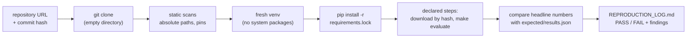
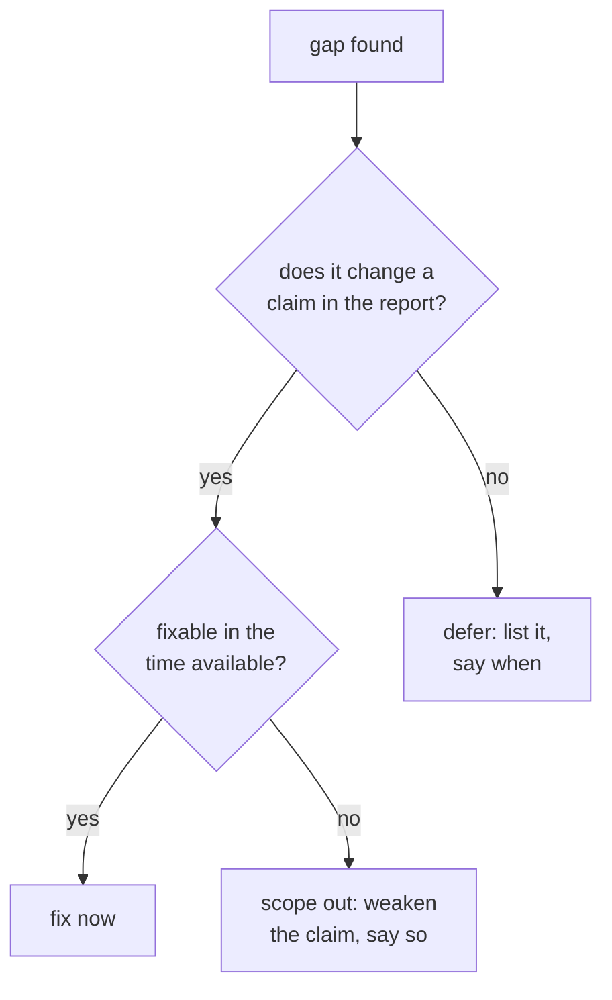
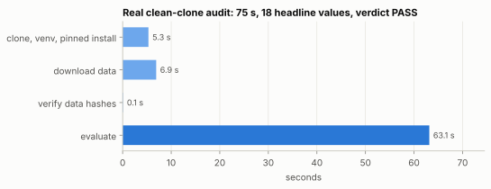
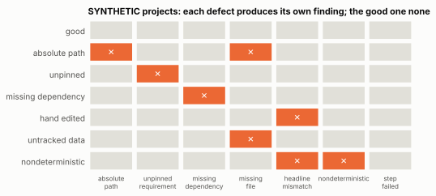

# W8D1 — Project completion audit: reproduce every headline number from a clean clone

Unit id `w8d1_project_completion` · Week 8, day 1 · Handbook:
[H8.3 Clean-clone reproduction](../../handbook/ch08_reproducible_experiments/h8_3_clean_clone_reproduction.md) ·
Content status: see [STATUS.md](../../STATUS.md)

**This is an independent integration session.** Like the milestones ([w4d6](../w4d6_project_milestone_1/README.md),
[w5d6](../w5d6_project_milestone_2/README.md), [w7d6](../w7d6_project_milestone_4/README.md)), the lab is a
contract and a checklist, not a walkthrough. Today you stop adding features and find out what your project can
actually show.

## 1. Purpose

**Objective.** Audit the flowguard project against its deliverables checklist and reproduce every headline
number from a fresh clone: new directory, new virtual environment, pinned dependencies, data downloaded and
verified by hash, one command per artifact, numbers compared with the committed report within stated
tolerances. You build the audit tool, run it on your repository, and write down what is missing and what you
will deliberately leave out.

**Why an applied ML engineer needs it.** "Can you rerun that?" is the first question a reviewer, a new
teammate or an interviewer asks about a result. A number that only exists on the author's laptop is an
anecdote. The audit turns "I think it is reproducible" into a log anyone can check, and it is the cheapest
way to find the hidden state that every project accumulates: a file that was never committed, a dependency
installed months ago, a number pasted into a report by hand.

**Deliverables.**
* `audit/clean_clone_check.py` (lab), passing `python wb.py check w8d1`.
* In your repository: `REPRODUCE.toml`, a fully pinned `requirements.lock`, `expected/results.json`, and
  `audit/REPRODUCTION_LOG.md` produced by the tool against your latest commit.
* `DELIVERABLES.md` (lab) for your project and `challenge/SCOPING_MEMO.md`.

**Completion criteria.**
* `python wb.py check w8d1`: the tool passes a reproducible SYNTHETIC project and fails six defective ones for
  the right reason; your `DELIVERABLES.md` accounts for every item in the project checklist.
* Your own repository's audit log, committed. A FAIL is acceptable if the memo says what you will do about it.
* `python wb.py check w8d1 --challenge` passes.

**Prerequisites.** All four milestones ([w4d6](../w4d6_project_milestone_1/README.md), [w5d6](../w5d6_project_milestone_2/README.md),
w6d6, [w7d6](../w7d6_project_milestone_4/README.md)); [w1d4](../w1d4_config_logging/README.md) (run directories and
provenance); [w6d2](../w6d2_docker_reproducibility/README.md) (lockfiles and pinning).

**Time budget (2 h essential).**

| Activity | Minutes |
|---|---|
| Read section 2; run the worked example | 20 |
| Lab: implement the seven functions of the audit tool until the checks pass | 45 |
| Lab: `REPRODUCE.toml`, lockfile and expected results in your repository; run the audit on it | 25 |
| Lab: `DELIVERABLES.md` | 10 |
| Challenge: gap list and scoping memo | 20 |
| *Optional extension: run the audit on Python 3.11 too (CI matrix or a second interpreter); add `repeat = 2`; audit a classmate's repository* | *up to 60* |

## 2. Conceptual explanation

### 2.1 What "reproducible from a clean clone" requires

A result is reproducible from a clean clone when someone with the repository URL, a commit hash and an
ordinary machine can regenerate it without asking you anything. Each word excludes a class of hidden state:

| Requirement | Hidden state it excludes | Where the course met it |
|---|---|---|
| **Clone**, not copy | files outside git: data, caches, notebook outputs, a local config | w1d6 (`.gitignore`), w2d3 (raw data immutable and downloaded) |
| **Fresh environment** | packages installed months ago, a different version on your laptop | w1d3 (venv), w6d2 (lockfile with transitive pins) |
| **Pinned** dependencies | `>=` resolves differently next month | w6d2: 20 of 21 packages changed in a year |
| **Data by hash** | a silently changed upstream file | `project/get_skab.py` and `MANIFEST.json` |
| **Frozen split** | a test set redrawn by a seed or a code change | w3d1: `splits/v2.json` |
| **One command per artifact** | manual steps between commands, notebooks run out of order | w4d6 (`make evaluate`) |
| **Generated numbers** | a number typed or "rounded up" in a report | w4d6, w7d6: reports built from `results.json` |
| **Deterministic execution** | unseeded randomness, thread counts, iteration order | w1d4 (seeds), w4d3 and w4d5 (thread pinning), w5d1 (CSV `float_precision`) |



### 2.2 Precise terms

* **Repeatability**: same person, same machine, same code, same result (a rerun).
* **Reproducibility** (in this course's sense): same code and data, different machine and environment, same
  result within a stated tolerance. That is what the clean clone tests.
* **Replicability**: a new implementation or new data reaching the same conclusion. Out of scope today;
  protocol B in w4d2 was a small step towards it (a held-out fault family).
* **Headline number**: a value a reader would quote from your report. Not every number in `results.json` needs
  to be audited, but every headline number must be.
* **Tolerance**: the largest difference you accept, stated before running. For deterministic CPU code
  `abs_tol = 1e-9` (or exact equality) is realistic; for GPU training or BLAS reductions across machines you
  may need a tolerance, and then you must say why and how big.

### 2.3 Tolerances, and why exact is the right default

Floating-point arithmetic is deterministic on one machine for one sequence of operations. Differences across
machines come from a different order of operations: multi-threaded reductions, vectorised kernels with
different widths, different library versions. Summing $n$ numbers in a different order changes the result by
at most about $n\,\varepsilon \sum_i |x_i|$ with $\varepsilon \approx 2.2 \times 10^{-16}$ for double precision, which
for the metrics in this project is far below $10^{-9}$. So a difference of $0.03$ in a PR-AUC is never
"floating-point noise": it is a different computation, different data or a number that was not produced by
the code. Start with exact comparison and relax a tolerance only with a stated reason.

### 2.4 The failures you will meet, and their signature in an audit

| Failure | What the audit sees | Fix |
|---|---|---|
| Absolute path (`/home/you/...`) | static scan hit; then a missing file in the clone | paths relative to the repository root, or configuration |
| Unpinned or missing dependency | `>=` in the lockfile; `ModuleNotFoundError` in the fresh venv | `pip freeze` in a clean venv, commit the full lock |
| Data not under version control and not downloaded | `FileNotFoundError` in the clone | a download step with hashes, or commit small data |
| Number edited by hand | headline mismatch, everything else fine | regenerate; never type numbers |
| Unseeded randomness or thread-dependent results | different numbers on a repeat of the same commit | seeds in config; `OMP_NUM_THREADS=1` where it matters |
| Results committed but code changed after | mismatch | regenerate and commit together; record the commit in provenance |

### 2.5 Connection to your research practice

You have reviewed papers whose results could not be rerun and you have probably written one or two. In EEG
work the hidden state is usually a preprocessed `.mat` file made by a script that no longer exists, or an
artefact-rejection step done by eye. The industry version is the same, but the cost is paid by a colleague
three months later instead of a reviewer. The cure is identical: make the raw-to-result path a command, then
prove it runs somewhere else.

### 2.6 An industry example

A team ships a demand model whose offline evaluation shows a 4 % error reduction. Six months later the model
degrades and someone tries to retrain it: the training notebook depends on a feature table that was rebuilt
since, the original environment used a pandas version with different groupby defaults, and nobody can
reproduce the 4 %. The team cannot tell whether the model degraded or never was as good as reported. A
clean-clone audit at release time, with the log archived next to the model, would have answered that
question in a minute.

### 2.7 Gap lists and scoping

An audit always finds gaps. The professional move is to decide, in writing, what to fix now, what to defer and
what to drop, with the time you actually have. A deliberate "out of scope, because..." reads as judgement; a
silent half-finished deliverable reads as a mistake.



### 2.8 Limitations and misconceptions

* "It runs on my machine in a fresh venv" is not a clean clone: your working tree still has untracked files.
* A Docker image is not a substitute: an image built from a dirty tree is reproducible only for that image.
  The audit should start from the commit.
* A PASS shows the numbers can be regenerated; it does not show they are right. Validity was the job of
  Weeks 2-4.
* Downloading data from a third party makes the audit depend on that party. The hash manifest tells you
  when the upstream changed; it cannot bring the old file back. Keep an archived copy where the licence allows.
* Matching the committed number exactly after a code change can hide a bug that did not move the headline.
  The audit is a floor, not a test suite.

## 3. Worked example: an audit by hand

`example/manual_audit.sh` builds a tiny SYNTHETIC project whose data folder is git-ignored, runs it in the
author's tree, then does by hand what your tool will automate.

```bash
bash lessons/w8d1_project_completion/example/manual_audit.sh
```

Output (copied from a run on 2026-11-25):

```text
== 1. the author's project (data/ is git-ignored)
mean = 4.0
tracked files: .gitignore summarise.py
== 2. clean clone + fresh venv, run the same command
FAILED in the clone: FileNotFoundError: [Errno 2] No such file or directory: 'data/values.csv'
== 3. fix: commit the (small) data file, then audit again
mean = 4.0
author and clone agree
```

What to notice: step 1 succeeds, and `git ls-files` already tells you why it should not be trusted (the data
is not tracked). Step 2 is the audit: clone, fresh venv (`--without-pip`, so nothing from your system leaks
in), same command. Step 3 fixes the cause, not the symptom. For SKAB the fix is not committing the data (the
licence is GPL-3.0 and the files are 4 MB) but a download step that checks hashes.

The same procedure, automated and run for real against the reference flowguard evaluation (the w4d6 lab
solution, a fully pinned lock from `pip freeze`, the SKAB download script, and the committed
`results.json` as the expected file) passed: 18 headline values, maximum difference 0, 75 s in total.



*Real run (2026-11-22, Python 3.13.18); values in `figures/figure_data.csv`. Most of the time is the
evaluation itself, with 2000 bootstrap replicates; the environment and data steps are cheap enough to run on
every release.*

## 4. Lab: build the audit tool, then audit your project

The checks run your tool against seven SYNTHETIC git repositories (built in a temporary directory by
`checks/synthetic_repo.py`): one reproducible project and six that each carry one defect.



*SYNTHETIC repositories; produced by running the reference tool (`figures/make_figures.py`). Two defects
produce a second, consequential finding: the absolute path also makes the file missing in the clone, and an
unseeded pipeline also misses its expected value. The checks require the root-cause code to be present.*

**Checklist.**

1. Read the module docstring of `lab/audit/clean_clone_check.py` and `lab/REPRODUCE.example.toml`.
   *Checkpoint:* you can say, for each finding code in `lab/README.md`, which function produces it.
2. Implement `clone`, `scan_absolute_paths` and `read_requirements`. Run
   `python wb.py check w8d1`: the `unpinned` and `absolute_path` cases should now pass.
3. Implement `make_venv`, `classify_failure` and `run_steps`. The venv must not see system site packages, or
   the `missing_dependency` case passes when it should fail. Steps run **in the clone**, never in the source.
4. Implement `compare_headline`. *Checkpoint:* all 14 audit checks pass (the other 4 grade `DELIVERABLES.md`).
5. In your repository: add `REPRODUCE.toml` (adapt the example), generate `requirements.lock` with
   `pip freeze` inside a fresh venv where you installed only your direct dependencies, copy the results file
   your report was generated from to `expected/results.json`, commit, and run
   `python lessons/w8d1_project_completion/lab/audit/clean_clone_check.py <your repo> --log <your repo>/audit/REPRODUCTION_LOG.md`.
6. Fill in `lab/DELIVERABLES.md` against the checklist in [project/README.md](../../project/README.md).

**Debugging guidance.**
* *`git clone` of a local path fails:* the source must be a git repository with at least one commit; uncommitted
  changes are (correctly) invisible to the audit.
* *The good project fails with `missing_dependency` on `encodings` or similar:* you probably set `PYTHONHOME`
  or `PYTHONPATH` for the step; remove them from the environment you pass.
* *Everything fails with `install_failed`:* the synthetic projects have an empty lock; create the venv without
  pip and skip the install when there is nothing to install.
* *Your own repository fails on the download step:* the audit machine needs network access to the data host;
  record that in the log rather than committing the data.

## 5. Independent challenge: gap list and scoping memo

See [challenge/README.md](challenge/README.md). From your audit log and `DELIVERABLES.md`, decide with a stated
number of hours what you fix now, defer or scope out, and what you will say about it. No hints.

## 6. Progressive hints

1. [Concept](hints/hint1_concept.md)
2. [Approach](hints/hint2_approach.md)
3. [Partial implementation](hints/hint3_partial.md)

## 7. Assessment

[assessment.md](assessment.md): reasoning questions, a design-choice explanation, the milestone rubric, and the
interview rep "how do I know your numbers are real?".

## 8. Reflection and review

**You should now be able to, without notes:** list the hidden state a clean clone excludes and the fix for each;
write a fully pinned lock; declare a project's reproduction steps and headline values in a file a tool can
read; read an audit log and tell a root cause from a consequence; and scope the remaining work in writing.

**Reflection prompt.** Pick one of your published papers. Which step from raw recording to figure would fail a
clean-clone audit today, and what would it take to fix it?

**Retrieval question (for the w8d7 retrospective).** Your audit passes on Python 3.13 and fails on 3.11 with a
headline mismatch of 0.0004 in one PR-AUC. List three hypotheses in the order you would test them.

**Next.** [w8d2: the technical report and its limitations](../w8d2_report_limitations/README.md), written from the
numbers you have just shown to be reproducible.

## Verification record

Executed on 2026-11-22 and 2026-11-25 (Python 3.13.18, Git 2.43.0):

* `python tools/verify_checks.py lessons/w8d1_project_completion`: lab reference passes 18 checks and all 7 lab
  mutants are rejected, each by its intended check; challenge reference passes 7 checks and all 4 challenge
  mutants are rejected. The shipped starter fails 15 of 18 lab checks; the memo template fails the challenge.
* Real audit: `solutions/lessons/w8d1_project_completion/real_audit/assemble_reference_repo.py` then the reference
  tool; PASS, 18 headline values, maximum difference 0, 75 s (log committed next to the script). Dependencies were
  installed from PyPI into the fresh venv.
* Worked example run; output above copied from it. Figures regenerated by `figures/make_figures.py` and viewed.
* Not verified: Python 3.11/3.12; Windows paths (the absolute-path pattern covers `C:\Users\` but was not run on
  Windows); the time budget.
