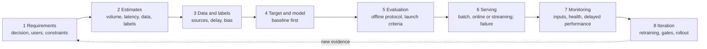
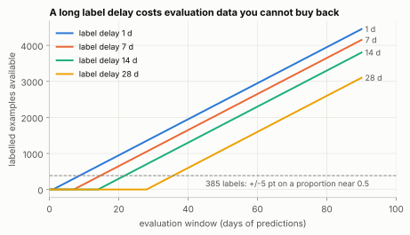
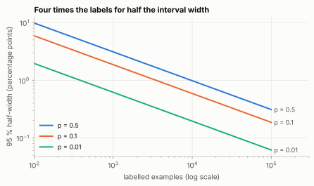
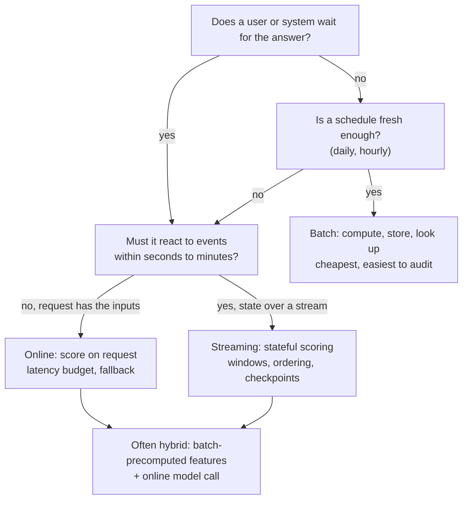
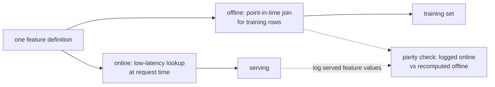
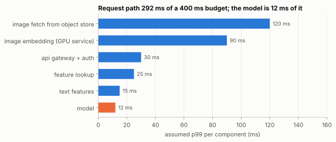

# w8d3 — ML system design: a repeatable structure, two timed designs

**Status:** Execution verified (see the verification record at the end).
**Handbook:** [H16.3 System design structure](../../handbook/ch16_system_design_communication/h16_3_system_design_structure.md)
**Prerequisites:** Weeks 5-7, in particular [w5d1](../w5d1_inference_pipeline/README.md) (one pipeline for
training and serving), [w6d4](../w6d4_latency_resources/README.md) (Little's law, latency budgets),
[w7d3](../w7d3_drift_vs_degradation/README.md) (delayed labels), [w7d4](../w7d4_model_updates_rollback/README.md)
(safe rollout); interview set 5 from the [w5d7 review](../w5d7_review/README.md) (your first design rep).

---

## 1. Purpose

**What you will learn.** A structure you can apply to any ML system-design question in 45 minutes,
the back-of-envelope arithmetic that turns hand-waving into decisions, and how to make trade-offs
explicit. You then apply it twice, timed, to domains you have not worked in: search ranking and
delivery-time estimation.

**Why an applied ML engineer needs it.** ML system design is a standard round in Machine Learning
Engineer and Applied Scientist loops, and the same reasoning is what a design review at work demands.
The round is rarely lost on modelling knowledge; it is lost on structure: no requirements, no label
story, no evaluation that matches deployment, no numbers. You have now built every part of such a
system once (flowguard); this session is about explaining one you have not built.

**Primary objective.** Produce two complete, timed, recorded designs and score them honestly against a
rubric, using an estimation worksheet you implemented yourself.

**Deliverable.** `lab/estimates.py` passing the checks; two recordings (or written transcripts) with
rubric scores in `progress/notes.md`; a design review of a flawed document (`challenge/REVIEW.md`).

**Completion criteria.**
- `python wb.py check w8d3` passes (guided practice).
- D1 done under exam conditions and self-scored before reading the worked answer.
- `python wb.py check w8d3 --challenge` passes and your review names the two blockers and fixes them
  (independent skill; score with the challenge rubric).

| Activity | Essential (2 h) | Optional (≤ 1 h) |
|---|---|---|
| Read sections 2-3, run the worked example | 30 min | |
| Guided lab: the estimation worksheet | 25 min | |
| D1, timed and recorded, then self-score | 55 min | |
| Assessment Q1-Q7 and reflection | 10 min | |
| D2, timed and recorded, then self-score | | 55 min |
| Challenge: design review (45 min) | on the review day if not today | |

---

## 2. Conceptual explanation

### 2.1 Intuition

An ML system-design question is a compressed version of the whole course. The interviewer gives you a
business problem and listens for whether you can turn it into a system that works and keeps working:
what exactly is predicted, from which data, judged by which number, served how fast, watched how, and
replaced how. A structure stops you from spending 30 minutes on the model and 0 minutes on labels.



The order is a default, not a script. Say it out loud at the start ("I'll clarify requirements, do some
numbers, then data and labels, evaluation, serving and monitoring; stop me if you want depth anywhere"),
then follow the interviewer.

### 2.2 Precise terms

* **Functional requirements:** what the system must output, for whom, when (e.g. a ranked list of 10
  documents per query; a delivery range at checkout).
* **Non-functional requirements:** latency (state the percentile: p95, p99), throughput (peak, not
  average), availability, cost, privacy, auditability.
* **Prediction time and label time:** when the model is called and when the truth becomes known.
  The gap is the **label delay**; it decides how fast you can evaluate and retrain (w7d3).
* **Batch inference:** predictions computed on a schedule and stored; **online inference:** computed on
  request inside a latency budget; **streaming inference:** computed continuously over event streams
  with state (w5d3).
* **Feature store:** a system that serves the same feature definitions offline (point-in-time correct
  training rows) and online (low-latency lookups). The concept matters more than the product: one
  definition, two execution paths, a parity test (w5d1).
* **Launch criteria:** the pre-registered evidence needed to replace the incumbent (offline gate,
  shadow, online test with guardrails; w7d4).
* **Back-of-envelope estimate:** an order-of-magnitude calculation from stated assumptions, with units.

### 2.3 The mathematics you need

All of it is arithmetic with units. Four relations cover most rounds.

**Peak rate.** $\lambda_{\text{peak}} = \dfrac{N_{\text{day}}}{86{,}400\ \text{s}} \times r$, where $r$ is the
peak-to-mean ratio (3-10 is typical for consumer traffic).

**Little's law for capacity.** Busy servers $L = \lambda W$, with $W$ the service time per request.
Replicas $= \left\lceil \dfrac{\lambda W}{c \cdot u} \right\rceil$ for $c$ cores per replica at target
utilisation $u$ (0.5-0.7 leaves room for bursts and garbage collection), and never fewer than two for
availability.

**Labels in an evaluation window.** With $n$ predictions per day, a fraction $\rho$ ever labelled and a
delay of $d$ days, a window of $w$ days holds $n \rho \max(0, w - d)$ labelled examples today.

**Labels needed for a precision target.** For a proportion near $p$, the normal-approximation 95 %
half-width is $h = 1.96\sqrt{p(1-p)/n}$, so $n = 1.96^2 p(1-p)/h^2$. Halving $h$ needs four times the
labels. For rare events use the Wilson interval (w3d5); this formula is for planning.

**Latency budget.** The model gets what is left after every other hop:
$t_{\text{model}} \le B - \sum_i t_i$. Percentiles do not add exactly, but adding p99s is a conservative
planning bound for a sequential path.

**Asymmetric costs choose a quantile.** If being late costs $c_\ell$ per unit and being early $c_e$, the
quoted value that minimises expected cost is the quantile $\tau = c_\ell/(c_\ell + c_e)$ of the outcome
distribution (D2 uses this).



*Figure 1 (planning arithmetic, 1,000 predictions a day with 5 % labelled; not data).* With a 28-day
delay, a 30-day window holds 100 labels; you need about 36 days just to reach 385 labels, the amount for
±5 points on a proportion near 0.5.



*Figure 2 (formula).* Slopes are −1/2 on log-log axes: every halving of the interval costs four times
the labels. Rare outcomes (p = 0.01) have narrow absolute intervals but huge relative ones.

### 2.4 Connection to what you already know

Designing a BCI study already follows this structure: the user and task (requirements), sampling rate
and channel count (estimates), the paradigm that yields labels and their timing relative to the signal
(labels), cross-subject evaluation (evaluation matching deployment), the real-time loop and its latency
(serving), artefact detection during sessions (monitoring) and recalibration between sessions
(iteration). The new parts are the scale of traffic, money as a constraint, and that nobody re-runs the
experiment if the system breaks at 3 a.m.

### 2.5 Choosing batch, online or streaming



Most production systems are hybrids: heavy features precomputed in batch or streaming jobs, a light
model called online. Training/serving parity becomes the main risk in a hybrid:



### 2.6 An industry example and the 45-minute plan

A ride-hailing company's dispatch team is asked to "predict cancellations". A strong design starts by
asking what decision the prediction changes (re-dispatch a driver early? show a different price?),
because that fixes the prediction time, the acceptable latency and the cost of each error. Two teams
that skipped that question shipped a model with excellent AUC that nobody could act on: the prediction
arrived after dispatch. The time plan below protects the parts that matter.

```mermaid
gantt
    title A 45-minute design round
    dateFormat mm
    axisFormat %M
    section Frame
    Requirements and clarifying questions :a1, 00, 4m
    Estimates with units                  :a2, after a1, 4m
    section Core
    Data and labels                       :a3, after a2, 6m
    Target, baseline, model               :a4, after a3, 5m
    Evaluation and launch criteria        :a5, after a4, 6m
    Serving and failure handling          :a6, after a5, 6m
    Monitoring and iteration              :a7, after a6, 4m
    section Interviewer
    Follow-up questions                   :a8, after a7, 10m
```



### 2.7 Limitations and common misconceptions

* *"The interviewer wants the best model."* They want a system that works, a baseline, and a reason to
  add complexity (w4d5). Naming a model family without a target and a metric scores nothing.
* *"Estimates must be accurate."* They must be in the right order of magnitude with stated assumptions.
  The value is in noticing that 12 queries/s is not a throughput problem, or that 220 ms does not fit in
  200 ms.
* *"More detail everywhere is better."* Time is the constraint. Go deep where the interviewer pushes and
  where the risk is (labels, evaluation, failure modes), shallow elsewhere.
* *"Monitoring = accuracy dashboard."* Labels are usually late. Monitor inputs, service health and proxy
  signals now, and performance when labels arrive (w7d1-w7d3).
* A structure is not a script. Interviewers who interrupt are giving you information; adapt.

---

## 3. Worked example: estimates for a listing-moderation model

**Scenario (constructed).** A marketplace receives 3 million new listings a day; a model must flag rule-
breaking listings within 400 ms at p99 before they go live; moderators review flagged listings, and a
0.1 % random sample of unflagged listings is audited to find misses. All numbers are stated assumptions
at the top of [`example/estimate_listing_moderation.py`](example/estimate_listing_moderation.py).

```bash
python lessons/w8d3_system_design/example/estimate_listing_moderation.py
```

Output (copied from a run; pure arithmetic, so identical everywhere):

```text
Quantity                               Arithmetic                                Result
Peak requests per second               3,000,000/86,400 x 4.0                    139 req/s
Prediction log storage                 per day x 600 B x 180 d x 3 copies        0.97 TB
Latency left for the model             400 ms - 280 ms                           120 ms (model needs 12 ms)
Busy cores at peak (Little's law)      139 req/s x 12 ms                         1.67
Model replicas                         busy / (4 cores x 0.6)                    1
Moderator labels per week              flagged x (7 - 1 day delay)               360,000
Audit labels per week (unflagged)      0.1 % audit x (7 - 1)                     18,000
Misses found by audits per week        audit labels x 0.4 % violation rate       72.0
Audits for +/-0.1 pt on the miss rate  1.96^2 p(1-p) / 0.001^2                   15,305 (~0.9 weeks)
```



*Figure 3 (assumed numbers from the worked example).* The model is 12 of 292 ms.

**Interpretation, as you would say it in the room.**
1. 139 requests/s is modest; **one replica is enough by arithmetic, but you run at least two** across
   zones for availability. The design problem is latency, not throughput.
2. The request path, not the model, uses the budget: image fetch and image embedding are 210 of 292 ms.
   The first optimisation is to embed images asynchronously at upload and hold the listing for a few
   seconds if the embedding is not ready, not to shrink the model.
3. **Moderator labels are plentiful but biased**: they only exist for flagged listings, so they measure
   precision, not recall. Misses are measured from the random audit: 18,000 audited listings a week
   contain about 72 violations, and estimating the miss rate to ±0.1 point needs about 15,300 audits, so
   one week of audits per estimate. That number is what decides whether you can detect a regression in
   recall within a week.
4. Logging 600 bytes per prediction for 180 days is under 1 TB; logging images would not be.

**Reproducibility.** Deterministic arithmetic; no data, no randomness. The figures are regenerated with
`python lessons/w8d3_system_design/figures/make_figures.py`, which also writes `figure_data.csv`.

---

## 4. Guided lab

The lab has two parts: a small worksheet that makes your estimates fast and correct, and the first timed
design.

**Task 1 — the estimation worksheet.** Open [`lab/estimates.py`](lab/estimates.py). Implement the six
functions; each docstring states the formula and the units. Every function must raise `ValueError` for
inputs that make the estimate meaningless (zero or negative volumes, fractions outside (0, 1], NaN).

*Checkpoint.*
```bash
python wb.py check w8d3
```
The checks compare your functions with the stated formulas over 40 seeded random inputs each, plus edge
cases (exact capacity boundaries, a window shorter than the label delay, an over-budget latency path).
They do not care how you write the code.

*Debugging guidance.* If `test_replicas_exact_boundary_and_minimum` fails, you are rounding instead of
taking the ceiling, or floating point turned 2.0 into 2.0000000000000004 (subtract a tiny epsilon before
`ceil`). If `test_latency_remaining` fails on the over-budget case, you are clipping negatives to zero:
an over-budget design should be visible.

**Task 2 — use it.** Reproduce three rows of the worked example's table with your functions in a Python
shell, and check them against the output above.

**Task 3 — D1 under exam conditions.** Open [`DESIGN_PROMPTS.md`](DESIGN_PROMPTS.md), set a 45-minute timer,
record yourself, and design D1 (knowledge-base search ranking). Use `estimates.py` for the numbers.
Keep 8 minutes for the follow-ups.

**Task 4 — score before reading.** Open only part A of
`solutions/lessons/w8d3_system_design/DESIGN_ANSWERS.md` and score your recording area by area
(Demonstrated / Partial / Not yet). Then read the worked answer and write in `progress/notes.md`: the
lowest-scoring area, what you would say differently, and one habit for the next rep.

**Optional extension — D2** (delivery-time estimates) under the same conditions.

---

## 5. Independent challenge — review a flawed design

[`challenge/README.md`](challenge/README.md): a colleague's design doc for routing support tickets with a
model. Write a review (findings with severity and concrete fixes, a verdict, a summary). It transfers the
structure from producing a design to critiquing one, which is what a design review at work and the
"what is wrong with this design?" interview variant both ask for. No solution in this directory.

## 6. Progressive hints

[Hint 1 — concept](hints/hint1_concept.md) · [Hint 2 — approach](hints/hint2_approach.md) ·
[Hint 3 — partial implementation](hints/hint3_partial.md)

## 7. Assessment

[`assessment.md`](assessment.md): seven reasoning questions (estimation, label delay, batch vs online,
the quantile design choice, parity, launch criteria, common failure patterns), the rubric, and the
interview rep, which today is the pair of timed designs.

## 8. Reflection and review

**You should now be able to, without notes:**
- open a design round with requirements that change the design, and say your plan in one sentence;
- produce peak rate, capacity, storage, latency headroom and label-volume estimates with units in under
  five minutes;
- choose batch, online or streaming with a reason, and describe how training/serving parity is kept;
- state launch criteria and a monitoring plan that respects label delay;
- review someone else's design and separate blockers from improvements.

**Reflection prompt (5 minutes, `progress/notes.md`).** Listen to the first five minutes of your D1
recording. Did you ask a question whose answer changed your design? If not, which question should you
have asked?

**Retrieval question for review day.** *A model makes 2 million predictions a day, 10 % are ever labelled,
labels arrive after 21 days, and you need ±2 points on a precision near 0.8. How many days of predictions
must your evaluation window cover?* (Answer from memory, then check with `estimates.py`.)

**Next.** [w8d4 — Coding and SQL interviews, timed](../w8d4_coding_interviews/README.md): the other half
of most loops, practised with the same honesty about timing and self-scoring.

---

## Verification record

Executed on 2026-11-22, Python 3.13.18, matplotlib 3.11.2 (figures only); no other dependencies.

| What | Command | Outcome |
|---|---|---|
| Worked example | `python lessons/w8d3_system_design/example/estimate_listing_moderation.py` | Output above, copied from the run |
| Figures | `python lessons/w8d3_system_design/figures/make_figures.py` | 3 SVGs + `figure_data.csv`; PNG copies viewed |
| Lab checks vs reference | `python tools/verify_checks.py lessons/w8d3_system_design --part lab` | Reference passes 25 checks; 7 mutants rejected |
| Challenge checks vs reference | `... --part challenge` | Reference review passes 8 checks; 5 mutants rejected |
| Starters fail | `python -m pytest lessons/w8d3_system_design/checks -q` | 25 failed (stubs raise `NotImplementedError`) |
| Worked-answer numbers | reference `estimates.py` on the prompt assumptions | Every table number in `DESIGN_ANSWERS.md` recomputed |

Not verified: the time budget (not trialled by a learner); the industry example in 2.6 is an
illustrative composite, not a cited incident; the newsvendor quantile result in 2.3 is standard decision
theory stated from memory (it follows from setting the derivative of expected linear cost to zero).
