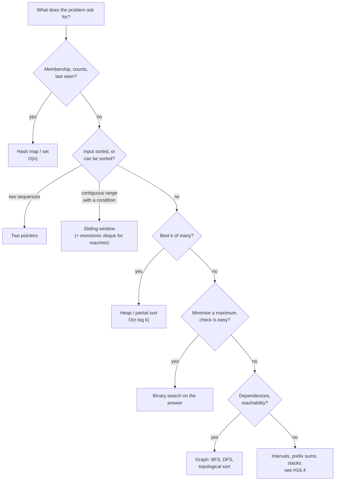
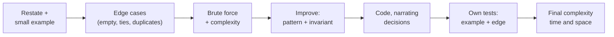
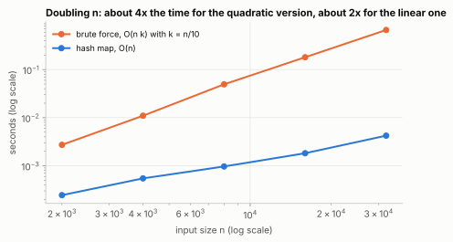
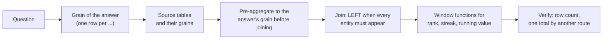
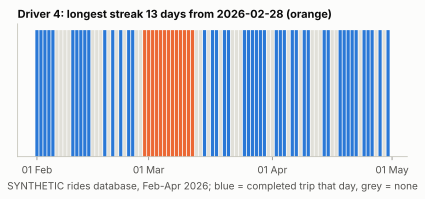

# w8d4 — Coding and SQL interviews, timed

**Status:** Execution verified (see the verification record at the end).
**Handbook:** [H16.4 Interview problem patterns](../../handbook/ch16_system_design_communication/h16_4_interview_problem_patterns.md)
**Prerequisites:** the interview reps so far ([interview/README.md](../../interview/README.md), sets 1-6),
[w2d1](../w2d1_sql_joins_grain/README.md) and [w2d2](../w2d2_sql_windows_timeseries/README.md) (SQL grain,
joins, window functions, gaps and islands), [w1d5](../w1d5_testing_ml_code/README.md) (writing your own tests).

---

## 1. Purpose

**What you will learn.** The small set of problem patterns that most data and ML coding rounds draw from,
a talk-aloud protocol that makes your reasoning visible, and how to test your own solution under time
pressure. Then you solve a timed set of six Python and three SQL problems and a 45-minute mock.

**Why an applied ML engineer needs it.** Almost every Machine Learning Engineer and Applied Scientist loop
has at least one coding round and often a SQL round. They are pass/fail gates that research experience
does not exempt you from, and they reward a specific skill: producing correct, efficient, tested code
while explaining it, in 20-45 minutes. The problems here are flavoured by ML and data work (labels,
alarms, sensors, pipelines, trips) so the practice transfers to the job as well.

**Primary objective.** Solve the essential subset of the timed set within the time boxes, talking aloud,
and log an error pattern for every miss.

**Deliverable.** Your solutions in `lab/python/` and `lab/sql/` passing the checks; recordings scored with
the talk-aloud rubric; an error log by pattern in `progress/notes.md`; the mock in `challenge/`.

**Completion criteria.**
- `python wb.py check w8d4` passes for the problems you attempted (guided practice is the essential
  subset: P1, P2, P3, Q1, Q2; the rest are the extension).
- Each attempted problem has a row in your error log: time, pass/fail, pattern, mistake.
- `python wb.py check w8d4 --challenge` passes on a single 45-minute attempt (independent skill).

| Activity | Essential (2 h) | Optional (≤ 1 h) |
|---|---|---|
| Read section 2, run the worked example | 25 min | |
| Timed: P1, P2, P3 (10 + 12 + 15 min) | 40 min | |
| Timed: Q1, Q2 (12 + 12 min) | 25 min | |
| Score recordings, error log, assessment Q1-Q7 | 30 min | |
| P4, P5, P6, Q3 | | 60+ min (or the review day) |
| Challenge: 45-minute mock | on the review day | |

---

## 2. Conceptual explanation

### 2.1 Intuition

A coding round tests three things at once: whether you can find an algorithm with the right complexity,
whether your code is correct at the edges, and whether the interviewer can follow your reasoning. Most
interview problems for data roles are variations of about a dozen patterns. Recognising the pattern is
most of the work; the rest is careful code and your own tests.



### 2.2 Precise terms

* **Time complexity:** how the running time grows with input size, in big-O, for the worst case unless
  stated otherwise. **Amortised:** average per operation over a sequence (a deque push and pop are O(1)
  amortised in a monotonic-deque window even though one step can pop many items).
* **Invariant:** a statement that holds before and after every loop iteration (e.g. "every alarm before
  index `i` is earlier than the current fault or already used"). Saying the invariant is how you argue
  correctness aloud.
* **Grain (SQL):** what one row of a table or intermediate result represents. Fan-out is a join that
  silently changes the grain.
* **Brute force:** the simplest correct algorithm, stated first so you have a baseline and a test oracle.

### 2.3 The talk-aloud protocol



Spend about two minutes on the first three boxes even when you think you know the answer: interviewers
score them, and it is where misunderstandings are caught cheaply. When stuck, say what is blocking you and
work a smaller example by hand.

### 2.4 The mathematics you need

Complexity arithmetic: an O(n²) algorithm on n = 200,000 is 4 × 10¹⁰ elementary steps, minutes to hours in
Python; O(n log n) is about 3.5 × 10⁶, well under a second. Doubling n doubles O(n), quadruples O(n²) and
slightly more than doubles O(n log n). A log-log plot of time against n has slope 1 for linear and 2 for
quadratic algorithms:



*Figure 1 (measured on the authoring machine; your times will differ, the slopes should not).* The worked
example's brute force against its hash-map version, k = n/10.

For numerical code, know one stability fact: the variance via E[x²] − E[x]² loses all precision when the
mean is large relative to the spread (catastrophic cancellation); use Welford's update or two passes.

### 2.5 Connection to what you already know

You have written these patterns in research code without naming them: event extraction from a binary
detector output is gaps and islands; matching detections to annotated events within a tolerance is two
pointers over sorted times; a running mean and variance for artefact thresholds is Welford; top-k channels
by power is a heap. The interview difference is the time box and the need to say why it is correct.

### 2.6 SQL rounds: grain first



The schema of today's database is in [`data/README.md`](data/README.md) (an ER diagram and the grain of each
table).

### 2.7 Limitations and common misconceptions

* *"Optimal complexity is all that counts."* A correct brute force with tests beats an unfinished optimal
  solution. Get a baseline, then improve.
* *"The checks passed, so I am done."* Checks verify outputs. The rubric scores the reasoning and the
  communication, which is half the interview.
* *"LeetCode-style practice is irrelevant to ML jobs."* The patterns appear constantly in data code
  (deduplication, windows, joins); the time pressure is what is artificial.
* Practising only easy problems feels productive and transfers poorly; the medium problems are the bar.

---

## 3. Worked example: a repeated reading within k

**Problem (not in the lab).** Flag every index whose value already appeared among the previous `k`
readings. Code: [`example/repeat_within_k.py`](example/repeat_within_k.py).

**Talk-aloud transcript (abridged).**
1. *Restate:* "Index i is flagged if some j with i − k ≤ j < i has the same value. Example `[1, 2, 1]`,
   k = 2: index 2 is flagged."
2. *Edges:* empty list; k = 0 flags nothing; a repeat exactly k back counts, k + 1 back does not.
3. *Brute force:* "Look back over the previous k values for every index: O(n k), which is O(n²) when k is
   proportional to n."
4. *Improve:* "Only the most recent index of each value matters, because if the most recent occurrence is
   more than k back, all earlier ones are too. A dict from value to last index gives O(n) time, O(distinct
   values) space." That sentence is the invariant.
5. *Tests:* the five asserts in `own_tests()`, then agreement with the brute force on 500 random cases.

```bash
python lessons/w8d4_coding_interviews/example/repeat_within_k.py
```

Output on the authoring machine (times vary between runs and machines):

```text
own tests pass; brute force and hash map agree on 500 random cases
       n       k  brute (s)  hash map (s)
    2000     200     0.0026       0.00024
    4000     400     0.0107       0.00058
    8000     800     0.0518       0.00408
   16000    1600     0.1593       0.00205
   32000    3200     0.6205       0.00442
```

**Interpretation.** Each doubling of n multiplies the brute force's time by about four, as O(n k) with
k = n/10 predicts; the hash map grows roughly linearly (single timings below a millisecond are noisy). At
n = 200,000 the brute force would need about 25 seconds, the hash map a few hundredths of a second.

**Reproducibility.** The random inputs are seeded; timings are not reproducible by nature. Figures are
regenerated with `python lessons/w8d4_coding_interviews/figures/make_figures.py`.

---

## 4. Guided lab — the timed set

All problem statements are in [`PROBLEMS.md`](PROBLEMS.md). Starters are in `lab/python/` (one function each;
the docstring is the specification) and `lab/sql/` (one query each).

**Task 1 — set up.** Read the conditions at the top of `PROBLEMS.md`. Start recording. Create a table in
`progress/notes.md` with columns: problem, minutes, passed, pattern, mistake, pattern of the mistake.

**Task 2 — P1, P2, P3** (10, 12 and 15 minutes). For each: restate, edge cases, brute force, improvement,
code, your own tests, then

```bash
python -m pytest lessons/w8d4_coding_interviews/checks -q -k p1      # then -k p2, -k p3
```

*Checkpoint.* Each problem has known-answer checks, a comparison with a slow brute force on hundreds of
random inputs, and a large-input check stopped after 4 seconds. If only the large-input check fails, your
answer is right and your complexity is not: look for a loop inside a loop or a repeated scan.

**Task 3 — Q1 and Q2** (12 minutes each). Write the grain comment first. The checks run your query on the
shipped database, on a database regenerated with another seed (a hard-coded answer fails there), and on
tiny hand-built databases with the trap the problem is about (several payment attempts per trip; tied
drivers).

*Debugging guidance.* If Q1's counts are too large, compare `SELECT COUNT(*)` of your intermediate result
with the number of March completed trips: a larger number is fan-out. If a city is missing, a `WHERE`
filter on the right-hand table has turned your `LEFT JOIN` into an inner join.

**Task 4 — score and log.** Score each recording with the rubric in [`assessment.md`](assessment.md). Fill
your error log. Then read only the "Notes on the timed set" table in
`solutions/lessons/w8d4_coding_interviews/assessment_answers.md` for the problems you finished.

**Optional extension — P4, P5, P6, Q3.** Same procedure. P4 has a numerical trap; P6 has a
recursion-depth trap; Q3 is the gaps-and-islands pattern.



*Figure 2 (SYNTHETIC rides database).* Q3 on one driver: 13 consecutive days from 28 February. The query
has to see days, not trips: this driver often completes several trips a day.

---

## 5. Independent challenge — a 45-minute mock

[`challenge/README.md`](challenge/README.md): two unseen problems (one Python, one SQL) in one 45-minute
sitting, recorded, scored with the same rubric. No solution in this directory.

## 6. Progressive hints

[Hint 1 — which pattern](hints/hint1_concept.md) · [Hint 2 — approach](hints/hint2_approach.md) ·
[Hint 3 — partial implementations](hints/hint3_partial.md). Each hint is split by problem, so reading the
line for one problem does not spoil the others.

## 7. Assessment

[`assessment.md`](assessment.md): seven reasoning questions (complexity of a plausible wrong approach,
`RANK` vs `ROW_NUMBER`, the variance design choice, binary search on the answer, grain invariants,
recursion in Python, what to do when stuck) and the talk-aloud rubric used for the interview rep, which
today is the timed set itself.

## 8. Reflection and review

**You should now be able to, without notes:**
- name the pattern of a typical data-flavoured coding problem within two minutes and say its complexity;
- explain correctness with an invariant while coding;
- write your own tests, including an edge case, before running anything;
- write SQL that states its grain, avoids fan-out, ranks within groups and finds streaks.

**Reflection prompt (5 minutes, `progress/notes.md`).** Which pattern appeared in more than one of your
mistakes today, and what will you check first next time?

**Retrieval question for review day.** *Without code: how do you return the longest run of consecutive
days per user in SQL, and what goes wrong if a user has two events on the same day?*

**Next.** [w8d5 — Explaining the project and defending trade-offs](../w8d5_project_explanation/README.md):
the remaining interview round, about the work you have built.

---

## Verification record

Executed on 2026-11-25, Python 3.13.18, SQLite 3.53.1, pandas 3.0.5, matplotlib 3.11.2 (figures only).

| What | Command | Outcome |
|---|---|---|
| Database | `python lessons/w8d4_coding_interviews/data/make_db.py --check` | Regenerated tables identical to the committed file |
| Worked example | `python lessons/w8d4_coding_interviews/example/repeat_within_k.py` | Own tests and 500 random comparisons pass; timings above from one run |
| Figures | `python lessons/w8d4_coding_interviews/figures/make_figures.py` | 2 SVGs + `figure_data.csv`; PNG copies viewed |
| Lab checks vs reference | `python tools/verify_checks.py lessons/w8d4_coding_interviews --part lab` | Reference passes 30 checks; 15 mutants rejected (at least one per problem) |
| Challenge vs reference | `... --part challenge` | Reference passes 6 checks; 5 mutants rejected |
| Starters fail | `python -m pytest lessons/w8d4_coding_interviews/checks -q` | 30 failed; challenge 6 failed |
| SQL expected results | pandas oracle in `checks/oracle.py` | Written independently of the reference SQL; agrees on two seeds |

Not verified: the time boxes (not trialled by a learner); behaviour on Windows (the large-input checks use
`signal.setitimer`, which is Unix-only, as is the course's target platform, Pop!_OS).
