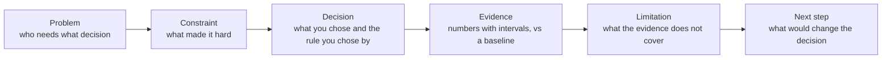
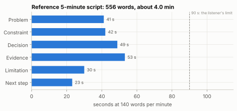
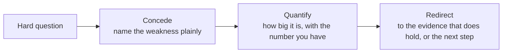

# W8D5 — Explaining the project and defending tradeoffs

Unit id `w8d5_project_explanation` · Week 8, day 5 · Content status: see [STATUS.md](../../STATUS.md)

## 1. Purpose

**Objective.** Deliver 30-second, 5-minute and 20-minute walkthroughs of flowguard, and answer
adversarial questions about evaluation, limitations and alternatives with evidence rather than with
reassurance.

**Why an applied ML engineer needs it.** In most interview loops the project discussion is where a
candidate with research experience wins or loses. Interviewers rarely ask "what is a z-score?"; they
ask "why didn't you ship the model with the best test score?" and listen for whether you know where
your evidence ends. At work the same skill decides whether your recommendation is adopted. You have
given many conference talks; the difference here is the listener: an engineer or manager who wants
the decision, the cost and the risk in five minutes, then pushes on the weakest point.

**Deliverable.** In `lab/`: written answers to twenty hard questions (`ANSWERS.md`), a 30-second
version, a 5-minute script, a 20-minute outline, a slide outline, and one recorded 5-minute run
scored in `SELF_SCORE.md`.

**Completion criteria.**

* `python wb.py check w8d5` passes (structure: all answers present, spoken length, cited artifacts exist).
* One recording of the 5-minute walkthrough, self-scored against the rubric in [assessment.md](assessment.md).
* Independent skill: `python wb.py check w8d5 --challenge` passes for a walkthrough of one of *your
  own* research projects and five adversarial answers, written without opening the hints.

**Prerequisites.** [w8d2](../w8d2_report_limitations/README.md) (technical report and limitations) and
the project milestones; the numbers you quote must come from your own runs. Assumed: you can present;
this session is about structure, priorities and honesty under pressure.

**Time budget (2 h essential).**

| Activity | Minutes |
|---|---|
| Read section 2, run the worked example (the script linter) | 20 |
| Guided lab: 30-second and 5-minute versions, first 10 answers | 55 |
| Record the 5-minute version once, watch it, self-score | 20 |
| Independent challenge: start the research walkthrough | 15 |
| Assessment and reflection | 10 |
| *Optional extension: remaining 10 answers, 20-minute outline and slides, a second recording* | *up to 60* |

## 2. Conceptual explanation

### 2.1 One story arc, three lengths

A technical project story that survives questioning has six beats, always in this order:



*The arc. Interviewers probe Evidence and Limitation; a script without them invites the question
you least want.*

The three lengths are the same arc at different resolution, not three different stories:

| Length | Words (at about 140 per minute) | What each beat gets |
|---|---|---|
| 30 seconds | 40-90 | one clause per beat; no numbers except the one that matters |
| 5 minutes | 550-800 | 40-130 words per beat; one number with its interval; one limitation |
| 20 minutes | an outline, not a script | each beat becomes 2-4 minutes with one visual; leave time for questions |

A spoken 5-minute slot holds about 550-650 words once pauses and a diagram are counted; the reference
script is 556 words, about four minutes of speech.



*Speaking time per beat of the reference 5-minute script, from `example/script_lint.py`. No beat
exceeds 90 seconds; Evidence is the longest, Next step the shortest.*

### 2.2 What to show: one diagram, one table, one failure

Three visuals carry a project discussion; more becomes a tour.

1. **One architecture diagram** - data to monitored service, ten boxes at most. It answers "what did
   you actually build?" and lets the interviewer point at the part they want to probe.
2. **One results table with intervals** - candidates, the decision metric with its interval, cost
   columns (latency, size). It answers "why this model?" without a word of defence.
3. **One failure example** - a fault you missed, with what the scores and logs showed. Nothing signals
   seniority faster than choosing to show your own miss and explaining it.

![Four development PR-AUC intervals: logistic 0.83 [0.76, 0.89], flow-rate z (chosen) 0.76 [0.68, 0.84], Mahalanobis 0.71 [0.60, 0.80], isolation forest 0.56 [0.49, 0.64]; test faults caught and model size next to each](figures/results_slide.svg)

*The results slide as a picture (REAL SKAB, w4d5 decision table). The chosen model is not the top
point estimate; the overlapping intervals and the cost columns are the argument.*

### 2.3 Answering adversarial questions: concede, quantify, redirect

Hard questions usually target a real weakness. Three moves, in order, keep the answer honest and short:



*The three moves. Skipping "concede" sounds defensive; skipping "quantify" sounds vague; skipping
"redirect" leaves the weakness as the last thing said.*

Example. *"Your test set has seven experiments - why believe anything?"* Concede: "It is small; I don't
claim precise numbers." Quantify: "Five of seven faults caught has an interval of roughly 0.36 to 0.92."
Redirect: "So my claims are relative and protocol-based: every decision was made on 27 development
experiments, the test set was looked at once, and the chosen model is clearly above the clock baseline."

### 2.4 Precise terms

* **Walkthrough** - a spoken explanation with a fixed structure and length, not a demo.
* **Headline number** - the one result you would keep if you could keep only one; always with its
  interval and its comparison.
* **Artifact** - something a listener could open: a report, a table, a commit, a test. Every claim in
  an answer should point at one.
* **Adversarial question** - one aimed at a real weakness; distinct from a clarifying question, which
  you answer directly.

### 2.5 Connection to what you know

Your conference talks follow a related arc (motivation, methods, results, discussion), but reviewers
reward novelty and a significant result, while an engineering audience rewards a correct decision
under constraints and a clear account of risk. Two habits transfer directly: stating the unit of
analysis (patients there, experiments here) and reporting per-unit results. One habit must be
dropped: leading with the method. In industry the method is the third thing you mention, after the
problem and the constraint.

### 2.6 Industry example (an illustrative composite, not a cited case)

A team proposes replacing a rule-based fraud screen with a model. The engineer who gets the decision
through does not open with model architecture. They say: the screen blocks 2 % of good customers
(problem); labels arrive after 60 days (constraint); we chose the model that keeps good-customer
blocks flat while catching more fraud (decision); on the last two months it catches 9 [6, 12] more
fraud cases per 10,000 at equal blocking (evidence); we have not seen a holiday season (limitation);
so we shadow it until January (next step). Every question that follows has a slot to land in.

### 2.7 Limitations and misconceptions

* **"More detail shows more competence."** It shows less judgement. Depth is for the follow-up question.
* **"Never mention weaknesses."** Interviewers find them in 30 seconds; mentioning them first moves
  the conversation to how you handled them.
* **"Numbers are always better than words."** A number without its comparison and interval is a
  liability under questioning ("0.88 compared with what?").
* **"A script makes you sound rehearsed."** Scripts are for preparation; deliver from the six beats.
  The recording will show whether you are reading.
* **This lesson does not make a weak project strong.** It makes your evidence audible. If an answer
  needs a number you do not have, that is a finding for the project, not a wording problem.

## 3. Worked example: linting a walkthrough

`example/ledgerline_2min.md` is a 2-minute walkthrough of the w3d6 transfer exercise (SYNTHETIC
data), chosen because its honest result is unflattering: the model did *not* beat the rule.
`example/script_lint.py` makes the structure visible: speaking time per section, missing beats,
numbers in the Evidence section without an interval, and jargon.

```bash
python lessons/w8d5_project_explanation/example/script_lint.py lessons/w8d5_project_explanation/example/ledgerline_2min.md
```

Output from the authoring run (2026-11-25):

```text
section           words  seconds
Problem              68       29
Constraint           62       27
Decision             54       23
Evidence             39       17
Limitation           48       21
Next step            45       19
total               316      135

WARN 'Evidence' uses 'bootstrap': explain it or replace it for a non-specialist
WARN Evidence: number without uncertainty -> "The rule reached a weekly top-fifteen precision of 0.727...."
2 warning(s)
```

Interpretation. The structure is complete and balanced. Both warnings are real. "Bootstrap" needs
three words of translation ("resampling customers"). And the rule's 0.727 has no interval because the
reference evaluation never computed one: the linter exposes that the comparison "model 0.722
[0.651, 0.783] vs rule 0.727" mixes an interval with a bare number. The honest wording is "the rule
falls inside the model's interval, so the model is not shown to be better". Run the linter on the
reference 5-minute script in the solutions tree and it flags several numbers too: the linter is a
heuristic that asks "is the uncertainty stated nearby?", not a judge. Read each warning and decide.

Reproduce with any Python >= 3.11; the linter uses only the standard library.

## 4. Guided lab

Work in `lab/`. Use your own project's numbers and artifact paths; set `WB_PROJECT_DIR` to your
flowguard repository if the artifacts you cite live there (`export WB_PROJECT_DIR=~/projects/flowguard`).

1. **30 seconds (10 min).** Write `WALKTHROUGH_30S.md`: one clause per beat, 40-90 words. Read it aloud
   with a timer. *Checkpoint:* under 35 seconds spoken.
2. **5 minutes (30 min).** Write `WALKTHROUGH_5MIN.md` with the six headings. Put one number with its
   interval in Evidence and one real limitation in Limitation. Run the linter on it and fix or
   consciously accept each warning. *Checkpoint:* `python wb.py check w8d5` passes the two
   walkthrough checks.
3. **Twenty answers (25 min essential for the first ten).** Open `QUESTIONS.md`. For each question,
   find the artifact that answers it *before* writing - if none exists, write that down as a gap
   rather than inventing a confident answer. Use concede-quantify-redirect where the question targets
   a weakness. Keep each to 40-130 words. *Checkpoint:* the answer checks for Q01-Q10 pass.
4. **Record (20 min).** Record the 5-minute version (phone or `ffmpeg`/OBS), watch it once, fill in
   `SELF_SCORE.md` against the rubric in [assessment.md](assessment.md). One change only for the next take.
5. **Extension.** Remaining answers; `OUTLINE_20MIN.md` (timed parts, 18-22 min); `SLIDES.md` with the
   three visuals of section 2.2.

**Debugging the checks.** "cited artifact(s) not found": the path is relative to the course root or to
`WB_PROJECT_DIR`; no leading `./` or `~`. "words" counts tokens with a letter or digit; code blocks
are not counted. "placeholder": remove every `TODO`.

## 5. Independent challenge

Translate one of **your own** research projects (a study you led; EEG/iEEG or other) into the same
structure, plus a translation to industry, and answer five adversarial questions about it. Details
and acceptance criteria: [challenge/README.md](challenge/README.md). Do not use numbers you cannot
source; where your paper reported no interval, say so.

## 6. Progressive hints

[Hint 1 - concept](hints/hint1_concept.md) · [Hint 2 - approach](hints/hint2_approach.md) ·
[Hint 3 - partial](hints/hint3_partial.md)

## 7. Assessment

[assessment.md](assessment.md): reasoning questions, the walkthrough rubric, and the interview rep
(a recorded 5-minute walkthrough followed by three questions drawn at random from the bank).

## 8. Reflection and review

* **You should now be able to:** give flowguard in 30 seconds, 5 minutes and 20 minutes from the same
  six beats; answer the twenty questions with an artifact behind each; and show your own failure case
  without defensiveness.
* **Reflection prompt:** which question did you most want to avoid, and what does that say about the
  project's weakest evidence?
* **Later retrieval question:** without notes, give the three moves for an adversarial question and
  apply them to "why only seven test experiments?".
* **Next:** [w8d6 final assessment](../w8d6_final_assessment/README.md) - an independent sample to
  set next to the Week 1 diagnostic.

## Verification record

Executed 2026-11-25 on Python 3.13: `python tools/verify_checks.py lessons/w8d5_project_explanation`
(lab: reference passes, 5 mutants rejected; challenge: reference passes, 4 mutants rejected); shipped
starters fail; worked example and figure script run, outputs quoted above. Every number in the
reference answers was checked against the cited lesson's text or committed result files. The research
walkthrough reference is **fictional** and labelled so. Not verified: speaking rates (140 words per
minute is a planning value; measure yours), Python 3.11/3.12.
