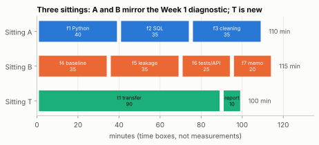
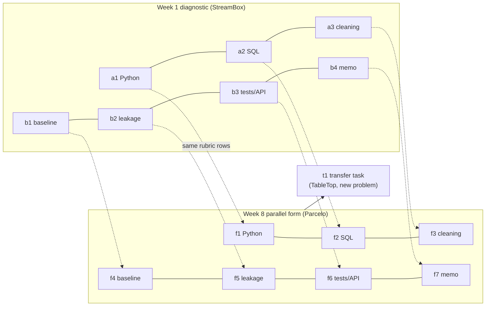

# W8D6 — Final independent assessment

Unit id `w8d6_final_assessment` · Week 8, day 6 · Content status: see [STATUS.md](../../STATUS.md)

## 1. Purpose

**Objective.** Produce a second, independent sample of evidence on the skills the Week 1 diagnostic
probed, plus one complete transfer evaluation on a problem you have not seen, so that Week 1 and
Week 8 can be compared section by section.

**Why an applied ML engineer needs it.** A course produces artifacts, but artifacts made with
lessons, hints and reference code beside you do not show what you can do alone. Interviews and the
first months of a job do. This sitting is the closest the course gets to that: time-boxed, no hints,
no assistant, on data you have not seen.

**Deliverable.** Your `lab/` files for every section, `t1_transfer/lab/REPORT.md`, a completed
[`SUBMISSION.md`](SUBMISSION.md), and [`COMPARISON.md`](COMPARISON.md) filled in after review.

**Completion criteria.**

* All three sittings taken under the stated conditions (time boxes, no hints, no solutions, no assistant).
* `SUBMISSION.md` filled in honestly, including help used and checks passing at time-out.
* After review against `solutions/lessons/w8d6_final_assessment/SCORING.md`: `COMPARISON.md` and the
  evidence log in `progress/SKILLS_LEDGER.md` updated.

**Prerequisites.** Weeks 1-7. Your Week 1 diagnostic submission, if you made one (for the comparison;
the assessment itself does not need it).

**Time budget.** This unit is longer than a core session and spans three sittings. Take them on
consecutive days; the w8d7 retrospective follows sitting T.

| Sitting | Sections | Minutes |
|---|---|---|
| A | f1 Python, f2 SQL, f3 cleaning | 110 + 10 for `SUBMISSION.md` |
| B | f4 baseline, f5 leakage, f6 tests/API, f7 memo | 115 + 10 for `SUBMISSION.md` |
| T | t1 transfer task | 90 + 10 for the conditions box and commit |



*Time boxes per section and sitting (planning values from the section READMEs, not measurements).*

## 2. What a parallel form is, and how to compare two sittings fairly

A **parallel form** tests the same skills at the same difficulty with different material. Sections
f1-f7 mirror a1-b4 of the diagnostic one for one: same time boxes, same kinds of planted defects,
same check style, same rubric rows - but a new business (Parcelo, a B2B parcel platform), new
schemas, new leaks and a new memo scenario. You may recognise the *patterns* (a NULL in a `NOT IN`, a
column written after the outcome); recognising a pattern in new clothes is exactly the transferable
skill.



*Each Week 8 section is scored with the same rubric rows as its Week 1 counterpart; t1 has no Week 1
counterpart and is compared with the w3d6 transfer sitting instead.*

Rules for a fair comparison (they are why the conditions matter):

1. **Same conditions as Week 1.** Time boxes, official documentation only, no assistant, no solutions.
   Declared help caps a section at *Partial*, as in Week 1. That is information, not a penalty.
2. **Compare per aspect, not per section.** "SQL NULL semantics: Partial -> Demonstrated" is
   meaningful; "SQL got better" is not.
3. **One sitting is one sample.** A change of one level on one aspect may be noise (a lucky or tired
   day). A consistent change across related aspects, plus the course artifacts, is evidence.
4. **No numeric score.** Evidence levels only: *Demonstrated independently*, *Partial*, *Not yet
   demonstrated*. The ledger keeps demonstrated, self-reported and unassessed apart.
5. **If you skipped the Week 1 diagnostic**, Week 8 is your first independent sample. Say so in
   `COMPARISON.md`; do not reconstruct Week 1 from memory.

What this assessment still does **not** cover: Docker, CI, cloud deployment, monitoring and live
system design (those are evidenced by the project milestones and the w8d3 design reps), and coding
under an interviewer's eyes (w8d4).

## 3. Worked example: reading one comparison row

Suppose Week 1 b2 gave: "Target leakage - Partial (the obvious column removed, the recency-looking
column kept); Validation design - Partial (grouped by customer, not forward in time)". In Week 8, f5
gives "both columns removed with mechanisms; forward-in-time split with the label-window argument".
The comparison row reads:

| Aspect | Week 1 (b2) | Week 8 (f5) | Change | Evidence |
|---|---|---|---|---|
| Target leakage | Partial | Demonstrated | up | f5 FINDINGS rows 1-2, within time box, no help |
| Validation design | Partial | Demonstrated | up | f5 `make_split` + FINDINGS; also w3d1 challenge |

Whereas "f5 checks pass after 25 minutes of check-driven attempts" with a thin FINDINGS.md would stay
*Partial* even if Week 1 was *Not yet* - passing checks is necessary, never sufficient.

## 4. Taking the assessment (the "lab")

Work in each section's `lab/` directory. Run checks as often as you like - they are your feedback
loop, as tests are at work.

| Sitting | Section | Task | Time box |
|---|---|---|---|
| A | [f1_python](f1_python/README.md) | debug and refactor a scan-report module | 40 min |
| A | [f2_sql](f2_sql/README.md) | five queries on `parcelo.db` | 35 min |
| A | [f3_cleaning](f3_cleaning/README.md) | clean a dirty account export | 35 min |
| B | [f4_baseline](f4_baseline/README.md) | frame a lapse-risk task, baselines, metric at a call budget | 35 min |
| B | [f5_leakage](f5_leakage/README.md) | find the leaks in a colleague's evaluation and fix it | 35 min |
| B | [f6_testing_api](f6_testing_api/README.md) | tests graded by what they catch; a request schema; API concepts | 25 min |
| B | [f7_explain](f7_explain/README.md) | a 350-word decision memo | 20 min |
| T | [t1_transfer](t1_transfer/README.md) | a complete leak-free evaluation of a new problem | 90 min |

```bash
python wb.py check lessons/w8d6_final_assessment/f1_python          # one section's checks
python -m pytest lessons/w8d6_final_assessment/f1_python/checks -q  # the same, directly
```

Every starter **fails** its checks: that is the intended starting state. Data for all sections is
SYNTHETIC and documented in [data/README.md](data/README.md).

## 5. Independent challenge

The whole unit is independent. There is no separate challenge.

## 6. Progressive hints

None, by design. If you get stuck, stop at the time box and write down where you were; an unfinished
section is information.

## 7. Assessment

Review is done by reading your submission against
`solutions/lessons/w8d6_final_assessment/SCORING.md` and the per-section `NOTES.md` rubrics - **after**
you have submitted. Self-review is allowed if no reviewer is available: score yourself, then read the
reference, then score again, and record both.

## 8. Reflection and review

* **What you should now be able to say:** which aspects moved between Week 1 and Week 8, with
  evidence; which did not; which were never assessed.
* **Reflection prompt:** in which section did you notice yourself reaching for a course pattern
  (pipeline, temporal split, `NOT EXISTS`) automatically, and in which did you have to think it through?
* **Later retrieval question:** without looking, list the three conditions that make a sitting count
  as "Demonstrated independently".
* **Next:** [w8d7 retrospective](../w8d7_retrospective/README.md) turns this comparison into your
  evidence portfolio and the plan for the next eight weeks.
