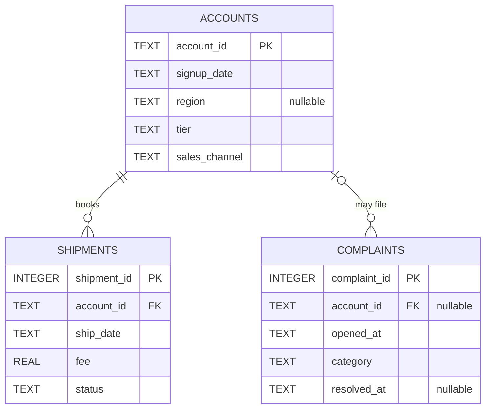

# Assessment data: "Parcelo" and "TableTop" (SYNTHETIC)

All files in this directory are **simulated** by `make_data.py` from a fixed seed. Parcelo is a
fictional B2B parcel-shipping platform (used by sections f1-f6); TableTop is a fictional restaurant
reservation service (used by the transfer task t1). The data has planted properties (data-quality
defects, join traps, columns that leak the outcome) so that the assessment can observe how you work.

**What you cannot conclude from it:** anything about real logistics customers or diners, about which
model family is better, or about realistic effect sizes. Scores here measure only whether an
evaluation was set up correctly on this simulation.

```bash
python lessons/w8d6_final_assessment/data/make_data.py            # regenerate every file
python lessons/w8d6_final_assessment/data/make_data.py --check    # confirm the files match the generator
```

Byte-identical regeneration was confirmed with the versions in `docs/TESTED_VERSIONS.md`; other
NumPy/pandas versions may produce different random streams or float formatting. The committed files
are the reference.

## `parcelo.db` (SQLite) - used by f2

Dates are ISO-8601 text.

**accounts** - one row per business account (700)

| Column | Type | Notes |
|---|---|---|
| account_id | TEXT, primary key | `A00001` ... |
| signup_date | TEXT `YYYY-MM-DD` | |
| region | TEXT, nullable | home depot code (`ALA`, `AST`, `SHY`, `KRG`, `AKT`); NULL when not recorded |
| tier | TEXT | `starter` / `business` / `enterprise` |
| sales_channel | TEXT | `inbound` / `outbound` / `partner` / `marketplace` |

**shipments** - one row per shipment (about 23,600)

| Column | Type | Notes |
|---|---|---|
| shipment_id | INTEGER, primary key | increases with time of creation |
| account_id | TEXT, foreign key | |
| ship_date | TEXT `YYYY-MM-DD` | a lost parcel is often re-shipped the same day as a new shipment |
| fee | REAL | USD charged for the shipment |
| status | TEXT | `delivered` / `lost` / `returned` |

**complaints** - one row per complaint (about 600)

| Column | Type | Notes |
|---|---|---|
| complaint_id | INTEGER, primary key | |
| account_id | TEXT, nullable | NULL for complaints filed through the public web form |
| opened_at | TEXT `YYYY-MM-DD HH:MM:SS` | |
| category | TEXT | `damage` / `delay` / `billing` / `other` |
| resolved_at | TEXT, nullable | NULL while open |



*Tables in `parcelo.db` (SYNTHETIC). One account books many shipments and may file complaints; a complaint may have no account.*

## `accounts_dirty.csv` - used by f3

A raw CRM export; described in `../f3_cleaning/README.md`. Uncleaned on purpose.

## Lapse snapshot files - used by f4 and f5

One row per **account per monthly snapshot** (the 1st of each month of 2025, for accounts active on
that day). An account appears in up to 12 rows and stops appearing after it lapses.

| Column | Meaning |
|---|---|
| account_id | account key |
| snapshot_date | the 1st of a month; the day the prediction would be made |
| tier, region, sales_channel | account attributes (region may be missing) |
| tenure_days | days since signup, as of snapshot_date |
| monthly_fee | platform fee in force on snapshot_date (USD) |
| employees | employees of the customer company (as recorded at signup) |
| shipments_30d | shipments in the 30 days before snapshot_date |
| avg_parcel_kg | mean parcel weight in recent shipments (sometimes missing) |
| complaints_90d | complaints filed in the 90 days before snapshot_date |
| lost_parcels_90d | lost parcels in the 90 days before snapshot_date |
| promo_active | 1 if a promotional rate is active on snapshot_date |
| **lapsed_30d** | **label**: 1 if the account stopped shipping or closed within 30 days after snapshot_date |

* `lapse_train.csv`, `lapse_test.csv` (f4): the columns above, already split by the data team.
* `lapse_export_full.csv` (f5): all snapshots in one file, plus two further columns exactly as they
  arrive from other systems:

| Column | Source system's description |
|---|---|
| winback_call_logged | "1 if account management logged a win-back call for this account in the cycle" (CRM) |
| last_pickup_offset_days | "date of the account's last pickup in the warehouse system minus snapshot_date, in days" (warehouse export, generated at export time) |

## `reservations.csv` - used by t1

One row per reservation at one of 10 restaurants, service dates 2024-01-01 to 2024-12-31 (8,752
rows, about 2,500 guests). Sorted by service date.

| Column | Meaning |
|---|---|
| reservation_id | reservation key |
| restaurant_id | `R01` ... `R10` |
| customer_id | guest key (guests book repeatedly) |
| booked_at | when the reservation was made |
| service_date | the day of the meal |
| slot | `lunch` / `dinner` |
| party_size | number of guests |
| lead_days | days between booking and service |
| channel | `phone` / `web` / `app` / `partner` (third-party booking site) |
| deposit_paid | 1 if a deposit was taken at booking |
| prior_visits | the guest's reservations with an earlier service date |
| prior_no_shows | no-shows among those earlier reservations |
| customer_no_show_rate | "the guest's no-show rate" (guest profile, as exported at year end) |
| table_released_at | "when the table was released to walk-ins" (floor system) |
| reminder_reply | "reply to the reminder message" (messaging system; reminders go out on the morning of the service day) |
| **no_show** | **label**: 1 if the guest did not come and did not cancel |
