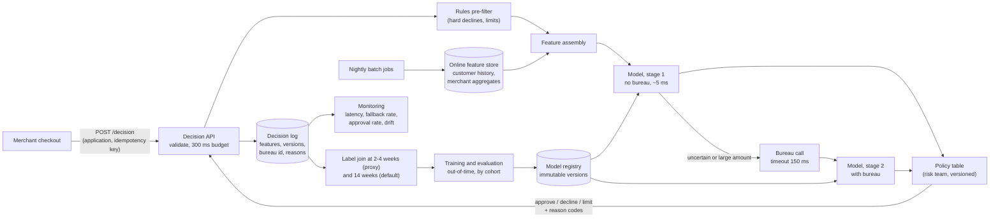

# Interview set 5 - rubrics (part A) and worked answers (part B)

**Order of use (Weeks 3-5 rule).** After the first timed attempt read **part A only** and score what
you actually said or wrote. Second attempt for every area below "Demonstrated". Then part B.

Reference code: `solutions/interview/set5/c2.py`; wrong answers the tests reject:
`solutions/interview/set5_wrong/`.

Verified in the authoring session (2026-11-22; Python 3.13.18, FastAPI 0.165.0, Starlette 1.7.0,
pydantic 2.13.5, pytest 9.1.1): `SET5_DIR=solutions/interview/set5 python -m pytest interview/set5_tests -q`
gives 20 passed in under 1 s; the shipped stub errors on all 20; each wrong answer fails at least one
test (table at the end).

**About D1.** The BNPL scenario and every number in it (volumes, latency budget, 14-week label delay,
85 % approval rate, bureau cost and latency) are **assumptions stated in the prompt**, chosen to make the
design trade-offs concrete. They are not facts about any real company. Consumer-credit regulation
(adverse-action notices, fairness and explainability rules) differs by country and is **not covered**
here beyond "a declined customer must receive a reason"; in a real design, name the regulation that
applies and involve the people who own it.

Evidence levels per area: **Demonstrated**, **Partial**, **Not yet**.

---

# Part A - rubrics

## D1 - eight areas (score each)

**1. Requirements and constraints**
- [ ] Asked or stated: decision latency budget (300 ms p99) and what happens on timeout
- [ ] The decision is a policy (approve / decline / approve a smaller amount), owned by the risk team; the model supplies a risk estimate
- [ ] Cost asymmetry stated in money: a default loses roughly the principal; a wrong decline loses the merchant fee and a customer
- [ ] Non-functional: reason codes for declines, audit reproducibility, peak load, bureau cost

**2. Data and labels, including delay**
- [ ] Target defined precisely: P(any instalment > 60 days past due | approved application), observed about 14 weeks after the decision
- [ ] The label delay drives everything: the newest training data is about 3.5 months old; early proxies (first instalment missed) exist but are not the target
- [ ] **Selective labels**: outcomes only for approved applications; the training population is the rules engine's approvals, not all applicants. Named at least one remedy: a small randomised exploration slice, reject inference with stated assumptions, or evaluating only within the approved region
- [ ] Point-in-time features: only data as of the decision timestamp (customer history snapshot, bureau response at that time); no post-decision fields such as "number of payments made"

**3. Offline evaluation protocol and leakage risks**
- [ ] **Out-of-time** split (train on older cohorts, validate and test on later cohorts whose labels have matured), not a random row split
- [ ] Repeat customers handled: grouped by customer, or at least a check that the same customer does not sit on both sides of a split used for model selection
- [ ] Leakage risks named: post-decision features, label-defining fields, merchant-level target encoding computed on all data, bureau data pulled after the decision
- [ ] Metrics tied to the policy: default rate and approval rate at the operating point (or expected loss per approved application), calibration (the risk team sets thresholds on probabilities), with intervals; AUC alone is not the answer

**4. Serving path and latency budget**
- [ ] Online, synchronous scoring for the decision; features split into **precomputed** (customer history, merchant aggregates refreshed in batch into a low-latency store) and **request-time** (basket, session)
- [ ] A latency budget broken down: bureau call 80-150 ms is the largest item, so it is called conditionally (only when the cheap model is uncertain or the amount is large), or in parallel with feature lookup, with a timeout
- [ ] Training/serving skew prevented: one feature definition used by training and serving, or logged online features replayed offline (parity check)

**5. Artifacts and versioning**
- [ ] Model bundle carries the feature list, input schema, preprocessing state, threshold or policy table reference, training data cohort and code version; no pickles across trust boundaries, or a pinned format
- [ ] Every decision logged with model version, policy version, feature values (or a hash and a pointer), bureau response id, and the reason codes: reproducible for audit months later
- [ ] Immutable versions; rollback is switching a pointer

**6. API contract and failure handling**
- [ ] A typed request/response contract (amount, currency, basket, ids), strict validation, 422 versus 4xx domain errors versus 503
- [ ] **Fallback decision** defined for every failure: model or store down, bureau timeout, invalid features. Usually the rules engine or a conservative policy (approve only small amounts for known good customers); never an unbounded "approve all"
- [ ] Idempotency on retries (the same application id gets the same decision), timeouts below the merchant's 1 s

**7. Monitoring and retraining**
- [ ] Immediate signals (no labels needed): latency, error and fallback rates, approval rate per segment, input drift (amount, merchant mix, missing bureau data), score distribution
- [ ] Delayed signals: early-delinquency proxies at 2-4 weeks, true default at about 14 weeks, by cohort; drift is not degradation until labels confirm it
- [ ] Retraining trigger and gate: scheduled (cohorts mature monthly) plus triggered by confirmed degradation; offline gate on an out-of-time test, then shadow, then a limited rollout

**8. Iteration plan and trade-offs**
- [ ] A first version that is shippable: e.g. gradient-boosted trees or a scorecard on application and history features, behind the rules engine as a fallback, launched in **shadow mode**
- [ ] What to measure before replacing the rules (follow-up 3) and what to postpone (bureau optimisation, reject inference refinements)
- [ ] At least one trade-off quantified (bureau cost versus default reduction; latency versus feature richness; interpretability versus accuracy)

**Follow-ups** (score separately; each Demonstrated if it reaches the core point)
- [ ] F1 ordered checks: selective labels / population shift (newly approved segments never seen in training), cohort maturity and the comparison being made on the same definition, calibration drift, input drift (merchant mix, sales season), skew between offline and online features
- [ ] F2 bureau outage: timeout, no retries in the request path, fallback policy without bureau data for its duration, monitored fallback rate, alert; decisions logged as "bureau unavailable" for later review
- [ ] F3 better than the rules: shadow scoring on live traffic first (no outcome change), then a randomised or champion-challenger split with a small share, compared on mature cohorts at equal approval rate (or equal default rate); not an offline comparison on the rules engine's own approvals alone

**Delivery**
- [ ] Spent no more than about 3 minutes on requirements before giving structure
- [ ] Drew or named the components and the data flows, including where labels come back
- [ ] Gave numbers with conditions; stated assumptions out loud when not given

**Levels.** **Demonstrated** = at least six of eight areas Demonstrated, including areas 2 and 3, and two
of three follow-ups. **Partial** = a coherent design but labels, evaluation or failure handling only
on prompting. **Not yet** = the answer is mostly about model architecture.

Commonest failure for researchers: twenty minutes on the model (features, architecture, AUC) and no
mention of selective labels, the 14-week delay, or what happens when a dependency is down.

## C2 - the request contract

- [ ] Before coding: 422 = the body does not match the declared shape (types, ranges, unknown fields,
      non-finite numbers); 400 = shape is valid but a rule across fields fails (`amount_mismatch`).
      The amount rule needs two fields at once and has a business meaning, so it gets its own code.
- [ ] `extra="forbid"` on both models; `allow_inf_nan=False`; length limits on lists and strings
- [ ] A custom `RequestValidationError` handler that returns `loc`, `type`, `msg` without the input
- [ ] Readiness checked inside the handler, after FastAPI's validation (so an invalid body gets 422)
- [ ] After coding: `GET /score` returns 405 (the path exists, the method does not)

Levels: **Demonstrated** = all tests pass within 15 minutes and both explanations given. **Partial** =
tests pass with more time, or the 422/400 distinction is not explained. **Not yet** = the default
handler is kept (a `NaN` becomes a 500) or unknown fields are accepted.

---

# Part B - worked answers

## D1 - an example design (about 25 minutes spoken)

This is one defensible design, not the only one. Assumptions not given in the prompt are marked.

**Requirements (3 minutes).** The product decision is approve / decline / approve-with-lower-limit
within 300 ms p99. The risk team owns the policy; my system supplies a calibrated probability of
default and reason codes. Costs: a default costs most of the outstanding principal (I would ask for the
recovery rate); a wrong decline costs the merchant fee (assume a few percent of the basket) and
possibly the customer. So the policy threshold depends on basket size
and is a table, not a constant. Non-functional: 200 requests/s at peak, audit reproducibility,
reasons for declines.

**Target and labels.** `y = 1` if any instalment of the application is more than 60 days past due.
Known about 14 weeks after the decision, so a model trained today has labels up to about 3.5 months
ago. Early proxies: first instalment missed (known after 2-4 weeks), used for monitoring, not as the
target. **Selective labels:** only the 85 % the rules approved have outcomes. A model trained on them
learns risk *within the rules' approval region*; its scores for applicants the rules would decline are
extrapolation. Remedy in v1: keep the rules as a hard pre-filter so the model only decides inside the
region it has data for; in parallel, a small randomised exploration slice (for example approve a
small share of borderline declines up to a low limit, with the risk team's agreement and a budget),
which over time gives unbiased outcomes outside the region.

**Features (point in time).** Request time: amount, currency, basket (items, categories), merchant,
device and session signals. Precomputed: customer history with the company (past applications,
instalments paid on time, current exposure), merchant aggregates (historic default rate, computed only
from cohorts *before* the decision date). Bureau: called only when needed (below). Everything is
snapshotted as of the decision timestamp; no field that changes after the decision is allowed.

**Offline evaluation.** Out-of-time: train on cohorts of months 1-12, validate on month 13, test on
month 14, all with matured labels. Grouped check: the same customer must not drive model selection by
appearing in train and validation; for a credit model the deployment question is "future applications,
mostly from known customers", so out-of-time is primary and customer grouping a secondary check.
Leakage audit: post-decision payment fields, merchant target encodings computed on all data, bureau
data pulled at a later date. Metrics at the operating point the risk team would choose: approval rate
and default rate (and expected loss) per segment, calibration curves (thresholds are set on
probabilities), all with bootstrap intervals over customers. Baseline: the rules engine evaluated on
the same cohorts and definitions.

**Serving path.**

Latency budget (assumed figures, to be measured): validation and rules 10 ms, feature store lookup
15 ms, stage-1 model 5 ms, bureau 80-150 ms when called, stage-2 model 5 ms, policy and logging 10 ms:
about 45 ms without the bureau and under 200 ms with it, leaving margin under 300 ms p99. The bureau is
the dominant latency and a per-call cost, so it is called only when stage 1 is uncertain or the amount
is above a limit; the share of calls is itself a policy parameter with a measured cost-benefit.

Skew: feature definitions live in one library used by the batch jobs and the online assembly; every
decision logs the features it used, and a daily job replays a sample of logged requests through the
offline pipeline and compares (parity, as in w5d1/w5d6).

**Artifacts and versions.** Model bundle: features and schema, preprocessing, model, calibration map,
training cohort range and data hash, code commit, evaluation card with intervals. Policy table
versioned separately (it changes for business reasons). Each decision logs model version, policy
version, feature values, bureau response id and reasons: an auditor can recompute the decision.

**API contract and failures.** Typed request (C2 is a slice of it), strict validation: 422 for a
malformed request, 400 for inconsistent input (basket does not sum to the amount), 503 only internally;
to the merchant the API always returns a decision within budget. Fallbacks: bureau timeout → stage-1
decision with a stricter policy for that case; feature store or model unavailable → rules engine
decision (it is still there); everything logged with a fallback flag. Idempotency key: a retried
application id returns the logged decision instead of re-scoring.

**Monitoring and retraining.** Without labels: p99 latency, error and fallback rates, bureau call
share, approval rate by merchant and segment, score distribution and input drift (amount, merchant
mix, missing values). With delayed labels: first-instalment miss rate at 2-4 weeks per cohort, default
at 14 weeks, calibration by cohort. Drift alerts open an investigation; only degradation on matured or
proxy labels triggers retraining outside the monthly schedule. Every new version goes through the
out-of-time gate, shadow scoring on live traffic, then a limited rollout with rollback by pointer.

**Iteration plan.** v1: gradient-boosted trees or a scorecard on application and history features,
rules as pre-filter and fallback, shadow mode for 4-6 weeks (scores logged, rules still decide), then
a champion-challenger split on a small share. v2: conditional bureau calls with measured value per
call, reason codes from the model (monotone constraints or a scorecard keep them faithful). Later:
exploration slice and reject inference, merchant-specific policies.

## Follow-ups

**F1. Defaults higher than predicted after two months.** Check in this order: (1) **are we comparing
like with like**: two months is before any cohort has a final 14-week label, so "defaults" are probably
an early proxy or a partial count; compare the same definition at the same age; (2) **population
shift**: did the model approve segments the rules used to decline (selective labels: no training data
there), or did the merchant mix change (a new large merchant, a sale)? (3) **calibration drift** by
cohort and segment; (4) **input drift and skew**: features computed differently online (log replay),
bureau data missing more often (fallback path); (5) only then, genuine concept change (economy).

**F2. Bureau outage, 40 minutes, Black Friday.** Requests keep meeting the budget because the bureau
call has a timeout and no retry in the request path; after repeated timeouts a circuit breaker stops
calling it. Decisions fall back to the stage-1 model with a stricter policy for the cases that would
have needed the bureau (lower limits, or decline above an amount), as agreed with the risk team in
advance. Fallback rate is alerted; decisions are logged as "bureau unavailable" for later review.

**F3. Better than the rules engine?** Offline comparison on the rules engine's own approvals is biased
in the rules' favour (outcomes exist only where the rules said yes). So: shadow scoring on live traffic
first (decisions unchanged; check latency, stability, and how many decisions would differ), then a
randomised champion-challenger split on a small share of traffic with exposure limits, compared on
matured cohorts at **equal approval rate** (default rate) or **equal default rate** (approval rate),
with intervals. Decide the comparison metric and sample size before starting.

## C2 - notes on the reference

* `ConfigDict(extra="forbid", allow_inf_nan=False)` on both models. Without `allow_inf_nan=False` a NaN
  amount is still rejected by the range, but reported as `less_than_equal` ("too large"), which is
  untrue; the test checks the type.
* The custom handler is what keeps a NaN from becoming a 500: FastAPI's default 422 body echoes the
  input, and a NaN in that body cannot be written as strict JSON (the same finding as w5d5).
* The amount rule lives in the handler, not in a `model_validator`: a validator would raise inside
  validation and turn the business error into a 422 without its own code.
* Readiness is checked inside the handler, after FastAPI has validated the body, so the decision order
  is 422 → 503 → 400 → 200.

## C2 wrong answers and the tests that reject them

| Wrong answer (`solutions/interview/set5_wrong/`) | What it does | Result (authoring run) |
|---|---|---|
| `c2_default_handler` | keeps FastAPI's default validation handler | 13 failed, 7 passed: no `error`/`details` body, input echoed, `NaN` and `Infinity` become 500 |
| `c2_extra_ignored` | no `extra="forbid"` at the top level | 1 failed (`amount_usd` silently ignored) |
| `c2_mismatch_as_422` | amount rule as a `model_validator` | 1 failed (422 instead of 400 `amount_mismatch`) |
| `c2_ready_before_validation` | checks readiness before validating | 1 failed (invalid body to a cold service gets 503) |
| `c2_range_only_nan` | `allow_inf_nan=True`, relies on the range | 3 failed (non-finite reported as `less_than_equal`) |

Command used for each: `SET5_DIR=solutions/interview/set5_wrong/<name> python -m pytest interview/set5_tests -q`.
