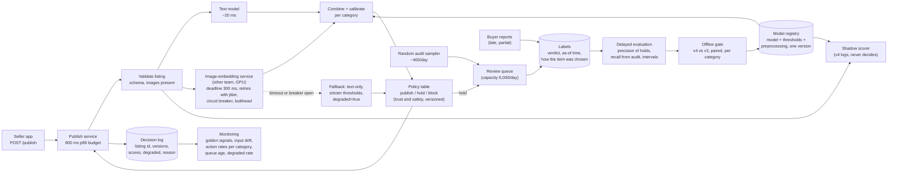

# Interview set 7 - rubrics (part A) and worked answers (part B)

**Order of use (Weeks 6-8 rule).** Listen to your recording and score it against **part A only**, area by
area, before reading anything else here. Re-record every area scored below "Demonstrated". Then part B.

Reference code: `solutions/interview/set7/c2.py`; wrong answers the tests reject:
`solutions/interview/set7_wrong/`.

Verified in the authoring session (2026-11-22; Python 3.13.18, pytest 9.1.1):
`SET7_DIR=solutions/interview/set7 python -m pytest interview/set7_tests -q` gives 16 passed in under
1 s; the shipped stub fails all 16; each of the ten wrong answers fails at least one test (table at the
end).

**About D1.** The marketplace, its volumes, latencies, review capacity and the v3/v4 numbers are
**constructed** for the exercise. The mechanisms the rubric rewards are the ones measured in Week 7 on
real SKAB data: a drift monitor that does not see a performance change and vice versa (w7d2, w7d3),
precision measured on investigated cases being biased upward (w7d3), a shadow period that misses the
slice where the candidate differs (w7d4), a fallback that is much worse than the model and must say so
(w7d5). Legal and regulatory duties for marketplace content differ by jurisdiction and are **not
covered**; in a real design, name the rules that apply and the people who own them.

Evidence levels per area: **Demonstrated**, **Partial**, **Not yet**.

---

# Part A - rubrics

## D1 - eight areas (score each)

**1. What "operating" means here; requirements that change the design**
- [ ] Restated the job: the model exists; the design is monitoring, labels, updates and failure handling around a publish-path decision with three outcomes (publish, hold, block)
- [ ] Named the binding constraints with numbers: 800 ms p99 publish budget, the image service's 400 ms p99, review capacity 6,000/day against ~25,000 holds/day at 2.1 % (so holds already exceed capacity, or the 2.1 % is spread over more than reviews), weekend review delay
- [ ] Separated the decision policy (thresholds per category, owned by trust and safety / policy) from the model's scores; asked or assumed the cost asymmetry (a prohibited item published versus a legitimate seller blocked)

**2. Labels: delay, coverage and selection**
- [ ] Reviewer verdicts exist **only for held listings**: they measure precision of holds, never recall; buyer reports cover an unknown fraction of published bad listings and arrive late
- [ ] Named verification bias explicitly (w7d3): any metric computed on reviewed items is biased by how items were chosen for review
- [ ] Proposed the fix: a **random audit sample** of published (and blocked) listings reviewed on a fixed budget, as the only unbiased estimate of recall and of the published-bad rate; sized it (for example 300-500 a day out of 6,000 review slots) and said why it is worth the capacity
- [ ] As-of evaluation: metrics computed only from labels that had arrived by the evaluation date; report reviews and buyer reports with their delays

**3. Monitoring in layers, with what each layer cannot see**
- [ ] Service: golden signals (traffic, errors, latency p99 against 800 ms, saturation), degraded/fallback rate, timeouts to the image service (w7d1)
- [ ] Inputs: schema and missing images, distribution of text length, language, category mix, price; calibrated thresholds rather than "PSI > 0.25" (w7d2)
- [ ] Outputs and actions: score distribution and hold/block rates **per category and per language**, review queue length and age, seller re-submission rate after a block
- [ ] Performance from labels: confirm rate of holds (precision), recall from the random audit, with intervals and the number of labelled events stated; and said plainly that drift is not degradation and a quiet dashboard is not proof of quality (w7d3)

**4. Serving path and failure handling**
- [ ] A synchronous path with an explicit budget split (validation, text model, image embedding with a timeout well under the remaining budget, policy, logging), and what is asynchronous (batch re-scoring of recent listings, re-review)
- [ ] Image service: deadline, bounded retries with jitter, circuit breaker, bulkhead (w7d5); **fallback = text-only scoring with stricter thresholds or "publish and re-score when images are available"**, decided in advance with trust and safety, answers flagged `degraded`, fallback rate alerted
- [ ] Never "block everything" or "publish everything" silently; idempotency for retried publish calls (same listing id, same decision); readiness versus liveness for the scoring service

**5. Safe rollout of v4**
- [ ] Offline gate before anything else: v4 versus v3 on the **same** labelled set (including audit labels, not only past holds), paired comparison per category with intervals, guardrails (hold rate, block rate on legitimate sellers, latency), slices (categories, languages, new sellers) (w7d4)
- [ ] Shadow mode: v4 scores live traffic, decisions still from v3; disagreement analysis reviewed by moderators; shadow must cover the slices where v4 differs (weekends, every category)
- [ ] Canary on a small share with **stopping rules decided before starting**; recognised that the primary metric (recall) cannot be measured in a short canary, so the canary guards operational and rate metrics and the audit measures quality later
- [ ] Rollback as a pointer move to v3 with its own thresholds (model, thresholds and preprocessing versioned together); rehearsed

**6. Retraining, feedback loops and adaptation**
- [ ] Feedback loop named: the model decides what gets reviewed, so training only on reviewed items teaches it its own blind spots; the audit sample and buyer reports break the loop
- [ ] Adversarial sellers: re-submissions after a block are a signal and a data source; near-duplicate detection as a separate guard
- [ ] Retraining triggers: scheduled (new labels monthly) and measured degradation from audit labels; **not** drift alone; every retrain goes through the same gate

**7. Policy changes (concept shift)**
- [ ] A new category is a concept change: no drift monitor and no existing label will flag it
- [ ] Short term: rules or keyword/image-match lists maintained by the policy team, routing matches to review; seed labelling of examples; temporary stricter routing in the affected categories with the review-capacity cost stated
- [ ] Medium term: collect labels, evaluate a new category head on them before shipping, rollout as in area 5

**8. Trade-offs and operability**
- [ ] At least two trade-offs quantified (review capacity versus hold threshold; audit size versus confidence interval width; latency budget versus waiting for images)
- [ ] Alerts mapped to actions (who is paged for what), a runbook, and severity (w7d5, w7d6)
- [ ] Said what they would build first and what they would postpone

**Follow-ups** (score separately; each Demonstrated if it reaches the core point)
- [ ] F1: the confirm rate is **precision on the held subset**; fewer holds with higher precision is exactly what a model that holds only the obvious cases would produce, and also what a better model would produce. The data shown cannot tell them apart: recall is unmeasured. Asked for the audit (or buyer-report rate on published listings, with its delay) and per-category hold rates; noted the review queue may also have changed reviewer behaviour
- [ ] F2: timeouts at the image service; circuit breaker opens; text-only fallback with stricter thresholds or deferred image scoring; `degraded` flag and metric; no retry storm (jitter, bounded attempts, Retry-After); moderators see more holds or a "re-scored later" queue, which the plan sized in advance; post-incident re-scoring of listings published in degraded mode
- [ ] F3: rules and lists now, labelling and evaluation next; do **not** retrain the whole model on a handful of examples, do not ship an unevaluated classifier head, do not claim coverage that has not been measured

**Delivery**
- [ ] Spent no more than about 3 minutes on the model itself
- [ ] Drew the components and the flows, including where labels come back and where they are biased
- [ ] Gave numbers with conditions; stated assumptions aloud when not given

**Levels.** **Demonstrated** = at least six of eight areas Demonstrated, including areas 2 and 3, and two
of three follow-ups. **Partial** = a coherent design but labels, monitoring or failure handling only on
prompting. **Not yet** = the answer is mostly about the image encoder or the model architecture.

Commonest failure for researchers: accepting the 62 % → 78 % confirm rate as evidence that v4 is better,
and proposing "monitor accuracy" without saying where unbiased labels would come from.

## C2 - the retry wrapper

- [ ] Before coding: retryable = connection errors, timeouts, 429 and 503 (honouring `Retry-After`),
      502/504; never 400, 404, 409, 413, 422; 500 only if the dependency's 500s are known to be transient
- [ ] Full jitter from `[0, min(cap, base * 2 ** (n - 1)))`, not the bound itself
- [ ] `Retry-After` honoured and capped; deadline checked **before** sleeping, including time spent in `fn`
- [ ] Re-raises the original exception; catches `Exception`, not `BaseException`
- [ ] After coding: with `rand = lambda: 1.0` every client sleeps the same schedule, so 2,000 requests
      arrive together again at each step (the w7d5 retry storm); a deadline frees the *caller*, while the
      embedding service keeps working on abandoned requests unless it supports cancellation, which is why
      the caller also needs a bulkhead and a circuit breaker

Levels: **Demonstrated** = all tests pass within 15 minutes and both explanations given. **Partial** =
tests pass with more time, or the explanations are missing. **Not yet** = no jitter, retries of
non-retryable errors, or a deadline that is checked only after sleeping.

---

# Part B - worked answers

## D1 - an example design (about 25 minutes spoken)

This is one defensible design, not the only one. Assumptions not given in the prompt are marked.

**Restating the job (2 minutes).** The model exists. My job is to put it in the publish path within
800 ms p99, know whether it is working, ship v4 without breaking anything, and keep publishing safe when a
dependency fails. Three decisions: publish, hold, block. Thresholds per category belong to trust and
safety; my system provides calibrated scores per category, reason codes and the plumbing.

A capacity check first, because it changes everything: 1.2 million listings a day at a 2.1 % hold rate is
about 25,000 holds a day against 6,000 review slots. Either most holds are auto-blocked, or the queue
already overflows, or the 2.1 % is measured differently. I would ask; I assume (stated) that high scores
are blocked automatically, the middle band is held, and holds are capped near capacity. So the **hold
threshold is a capacity decision** as much as a quality one.

**Labels: where they come from and what they are biased by.**

* Reviewer verdicts exist only for held listings. They give the precision of the hold band. They never
  show a prohibited listing the model published.
* Buyer reports on published listings are late (hours to weeks) and cover an unknown fraction.
* Blocked listings get no label unless the seller appeals.

So every number we can compute today is conditioned on the model's own choices (w7d3, verification bias).
The single most valuable addition is a **random audit**: reserve, say, 400 of the 6,000 daily review slots
for a uniform random sample of published listings plus a smaller sample of blocked ones. At a published
bad rate around 0.3 % (assumed), 400 a day gives about 1.2 bad listings a day, or about 36 a month: enough
for a monthly recall estimate per major category with a stated interval, not a daily one (w7d3: label count,
not sample count, sets the interval width). Audit labels are the **only** unbiased evidence of recall and
the reference for every model comparison.

**Monitoring, in layers.**

1. *Service* (w7d1): publish latency p99 against 800 ms, error rate, image-service timeout rate,
   degraded rate, in-flight requests. SLO on the publish call; burn-rate alerts.
2. *Inputs* (w7d2): missing-image share, text length, language mix, category mix, price distribution,
   thresholds calibrated on a stable month. A drift alert means "investigate", not "retrain".
3. *Outputs and actions*: score distribution and hold/block rates per category and language, review queue
   length and age, appeal rate, re-submission rate after blocks. These move within minutes and are the
   fastest proxies.
4. *Performance* (w7d3): hold precision from verdicts (daily, biased towards the hold band by design),
   recall and published-bad rate from the audit (monthly, unbiased), buyer reports as a lagging check.
   Each with its label count and interval. I would say aloud what each layer cannot see: a new prohibited
   category moves none of the first three.

**Failure handling.** Budget (assumed): validation 10 ms, text model 20 ms, image embedding with a
300 ms deadline, combination and policy 10 ms, logging 10 ms; about 350 ms worst case before network,
inside 800 ms. One retry at most inside the budget, with jitter, and only for timeouts and 503/429; a
circuit breaker opens after repeated failures so we stop sending load to a struggling service; a bulkhead
caps concurrent image calls. Fallback decided in advance with trust and safety: text-only score with
stricter thresholds (more holds, routed to a "degraded" queue that is re-scored with images when the
service recovers). Every degraded answer is flagged in the log and counted. Never a silent "publish all".

**Shipping v4.** (1) Offline gate: v4 against v3 on the same labelled data, which must include audit
labels; paired comparison per category with intervals (w7d4); guardrails on hold rate, false blocks of
established sellers, latency; slice checks on languages and new sellers. (2) Shadow for two weeks
including weekends and every category: v4 scores everything, decisions still from v3; moderators review
a sample of disagreements. (3) Canary on 5 % of sellers (assignment by seller, so one seller does not see
both models), stopping rules fixed in advance on operational and rate metrics; quality is judged later
from the audit, because a two-week canary cannot measure recall. (4) Rollback by moving the registry
pointer to v3 with v3's thresholds; rehearsed before the canary.

**Retraining and the feedback loop.** Training only on reviewed items teaches the model its own blind
spots: items it never holds are never labelled. Audit labels and buyer reports enter training with their
selection recorded. Re-submissions after blocks feed a near-duplicate guard and the training set. Retrain
monthly as labels accumulate, or when the audit shows a drop; drift alone opens an investigation.

**Iteration plan.** First: the publish path with fallback and the decision log, v3 only, plus the
random audit (it takes months to accumulate). Then v4 through gate, shadow, canary. Later: per-category
thresholds tuned to review capacity, appeal analytics, near-duplicate detection.

## Follow-ups

**F1. Hold rate 2.1 % → 1.4 %, confirm rate 62 % → 78 %: is v4 better?** Not established. The confirm rate
is precision on the items v4 chose to hold. A model that holds only the most obvious cases has fewer holds
and higher precision, and it may publish many prohibited listings that nobody will ever review. A better
model could produce the same two numbers. What would separate them: recall and published-bad rate from
the random audit (which this marketplace did not have; this is why it is in the design), buyer-report rate
on published listings at equal age, and hold and block rates per category (a drop concentrated in one
category is suspicious). Also check whether reviewers changed: with a shorter queue they may review more
carefully or differently. This is the w7d3 lesson: precision from investigated cases is biased upward,
and recall from what is reported is an upper bound.

**F2. Image service times out on 30 % of calls during a sale.** The 300 ms deadline keeps the publish call
inside its budget. Retries are bounded and jittered and respect `Retry-After`; once the failure rate
crosses its threshold the circuit breaker opens and we stop calling for a cool-down period, which helps
the other team recover. Listings scored without images get the text-only score with stricter thresholds,
`degraded = true`, and go to a queue re-scored when images are available. Moderators see more holds; the
plan sized this (for example, a cap on degraded holds per hour and an agreed decision about what happens
above the cap). The degraded rate pages the on-call engineer; afterwards, every listing published in
degraded mode is re-scored.

**F3. A new prohibited category, effective tomorrow, no labels.** This is concept shift: no input monitor
and no current label will show it. This week: the policy team supplies keywords, brand lists and reference
images; matches are routed to review (not auto-blocked unless legal requires it), with the review-capacity
cost stated and accepted. Moderators label what they see, which seeds a training set. Next weeks: a
category head trained and evaluated on those labels plus a targeted audit, shipped through gate, shadow and
canary. Do not: retrain the whole model on twenty examples, ship an unevaluated head, or report coverage of
the new category that nobody has measured.

## C2 - notes on the reference

* The loop counts calls, so `max_attempts = 1` means no retry, and after the last call the original
  exception is re-raised with a bare `raise`, keeping its type, traceback and `retry_after`.
* The deadline is checked before sleeping, using elapsed time including the time spent inside `fn`:
  sleeping first and then discovering the budget is spent wastes the caller's remaining time.
* `except Exception` rather than `except BaseException`: Ctrl-C and `SystemExit` must stop the program even
  if a predicate says "retry everything".
* Full jitter (`rand() * bound`) can return 0. "Equal jitter" (`bound / 2 + rand() * bound / 2`) is a
  defensible policy in general but not what the prompt asks for; it never de-synchronises clients by less
  than half the bound.
* With `rand = lambda: 1.0` the schedule is deterministic: every client that failed together retries
  together. w7d5's worked example measured what that does: all 200 simulated clients landed in the same
  100 ms bucket, ten times capacity, at each step, and half gave up.

## C2 wrong answers and the tests that reject them

| Wrong answer (`solutions/interview/set7_wrong/`) | What it does | Result (authoring run) |
|---|---|---|
| `c2_no_jitter` | sleeps the capped exponential itself | 2 failed, 14 passed |
| `c2_equal_jitter` | half the bound fixed, half random | 2 failed, 14 passed |
| `c2_exponent_off_by_one` | first delay bound `2 * base` | 5 failed, 11 passed |
| `c2_retries_everything` | ignores the retry predicate | 1 failed, 15 passed |
| `c2_one_extra_attempt` | counts retries, not calls | 2 failed, 14 passed |
| `c2_wraps_error` | raises a new `RuntimeError` when giving up | 2 failed, 14 passed |
| `c2_ignores_retry_after` | always jitters | 1 failed, 15 passed |
| `c2_uncapped_retry_after` | honours `Retry-After` without the cap | 1 failed, 15 passed |
| `c2_sleeps_past_deadline` | checks the deadline after sleeping | 2 failed, 14 passed |
| `c2_catches_baseexception` | retries `KeyboardInterrupt` | 1 failed, 15 passed |

Command used for each: `SET7_DIR=solutions/interview/set7_wrong/<name> python -m pytest interview/set7_tests -q`.
