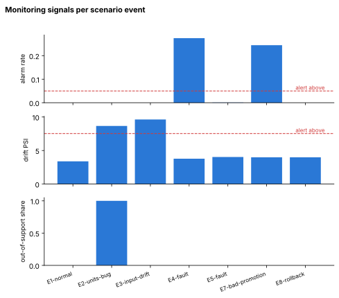

# Monitoring demonstration: flowguard on SKAB test experiments

Generated by `python -m flowguard monitor-demo` (flowguard 0.9.0). Do not edit by hand: re-run the command.

## Timeline

| # | Event | Kind | Model version | Expected | Signals fired | Result |
|---|---|---|---|---|---|---|
| 1 | E1-normal | normal | flowrate-z-2026.11 | no_alert | none | as expected |
| 2 | E2-units-bug | bad_input | flowrate-z-2026.11 | out_of_support | out_of_support, drift | as expected |
| 3 | E3-input-drift | drift | flowrate-z-2026.11 | drift | drift | as expected |
| 4 | E4-fault | fault | flowrate-z-2026.11 | detector | alarm_rate, detector | as expected |
| 5 | E5-fault | fault | flowrate-z-2026.11 | detector | none | not detected (expected detector) |
| 6 | E6-labels | labels | flowrate-z-2026.11 | delayed_eval | delayed_eval | as expected |
| 7 | E7-bad-promotion | promote | flowrate-z-2026.12-rc1 | alarm_rate | alarm_rate, detector | as expected |
| 8 | E8-rollback | rollback | flowrate-z-2026.11 | version_restored | version_restored | as expected |

## Per-event observations

| Event | Values | Alarm rate | Alarm events | Out-of-support values | PSI | Degraded responses |
|---|---|---|---|---|---|---|
| E1-normal | 560 | 0.0000 | 0 | 0 | 3.3819 | 0 |
| E2-units-bug | 560 | 0.0000 | 0 | 560 | 8.6621 | 0 |
| E3-input-drift | 560 | 0.0000 | 0 | 0 | 9.6241 | 0 |
| E4-fault | 1140 | 0.2746 | 1 | 0 | 3.7757 | 0 |
| E5-fault | 1144 | 0.0009 | 0 | 0 | 4.0356 | 0 |
| E7-bad-promotion | 560 | 0.2446 | 3 | 0 | 3.9869 | 0 |
| E8-rollback | 560 | 0.0000 | 0 | 0 | 3.9869 | 0 |

Delayed labels (E6-labels): 3 labelled replays, 2 labelled faults, 1 detected, 0 false alarm events, event recall 0.5000. Covers labelled traffic only.

## Summary

| Quantity | Value |
|---|---|
| events | 8 |
| events_as_expected | 7 |
| drift_threshold | 7.5253 |
| alarm_rate_budget | 0.0500 |
| values_scored | 5084 |
| out_of_support_values | 560 |
| faults_labelled | 2 |
| faults_detected | 1 |
| false_alarm_events_labelled | 0 |
| server_restarts | 2 |

## Registry history

* promote -> `flowrate-z-2026.11`: demo start: shipped model
* promote -> `flowrate-z-2026.12-rc1`: candidate with a mistyped threshold
* rollback -> `flowrate-z-2026.11`: alarm rate above budget after promotion

Service processes started: 3; all stopped: True.
