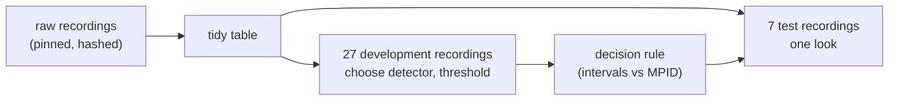
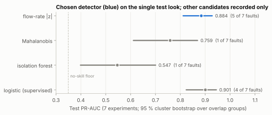
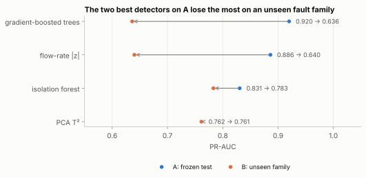

# flowguard: fault detection on a water-circulation testbed

Technical report · educational research prototype, not validated on any real plant · every number in this
report is read from `results.json`, which `build_results.py` assembles from files committed in the course
(the `sources` block names each one).

## 1. Problem and stakeholder

A plant reliability engineer wants an alarm soon after a pump circuit leaves normal operation, and few
enough false alarms to keep trusting it. We translated that into: score every sample from past data only,
raise an alarm when the score stays above a threshold, and choose the threshold so that the alarm rate on
normal operation stays within one false alarm per 8 hours. Success is measured per fault event (was it
detected, and how late), with point-level PR-AUC as a secondary, threshold-free summary.

The data come from a laboratory testbed. Nothing here shows that the method transfers to a real plant.

## 2. Data and provenance

The Skoltech Anomaly Benchmark (SKAB, version `v0.9`) holds 35 recordings (46,806 rows at about one
sample per second): 16 `valve1`, 4 `valve2`, 14 `other` and 1 fault-free run. It is downloaded at a pinned
commit with a SHA-256 hash per file (`project/get_skab.py`) and is not redistributed, because the licence
is GPL-3.0. The 34 labelled recordings contain exactly one fault segment each, and 35 % of labelled rows
are anomalous, so at the sample level the positive class is not rare.

Three properties of the data shaped everything that follows:

* 1,290 rows appear in two files each, and in 235 of them the two files disagree on the label.
* In 31 of 34 recordings the fault starts at row 550-600. A "detector" that scores elapsed time alone reaches
  F1 0.835, so any feature that encodes position in the recording leaks the experimental protocol.
* The fault-free recording sits far from the normal part of the other runs, so every detector is normalised
  on the first 100 rows of its own run (always normal) instead of on that recording.

## 3. Protocol and leakage controls

The unit of analysis is the recording. A frozen split manifest (`splits/v2.json`) holds 7 test and 27
development recordings; recordings that share rows are kept on the same side, which leaves 23 independent
development clusters and 7 test clusters. All choices (features, detector, threshold, alarm post-processing)
were made on development data. The test set was looked at once, after the decision. Elapsed time and
timestamps are forbidden as features.

Intervals are 95 % percentile intervals from a cluster bootstrap that resamples overlap groups (2000
replicates, seed 0); event recall uses a Wilson interval because it is a proportion over 7 events. A
difference smaller than the minimum practically important difference of 0.05 PR-AUC was not treated as a
reason to prefer the more complex model.

## 4. Results

**Development comparison.** The supervised logistic regression on causal window features scored 0.834
[0.762, 0.895] against 0.765 [0.680, 0.845] for the single-sensor flow-rate z-score; the paired difference was
0.069 [0.022, 0.128]. The interval excludes zero but does not exclude differences below the 0.05 threshold
we set in advance, so the comparison is inconclusive by our rule. The Mahalanobis detector (0.705) and an
isolation forest (0.562) did worse. *Intervals: cluster bootstrap over development overlap groups.*

**Test, one look.** Operating points were fixed on development data.

| Detector | Role | PR-AUC [95 % CI] | Faults detected | Recall [Wilson 95 %] | Median delay, s |
|---|---|---|---|---|---|
| flow-rate z-score | chosen | 0.884 [0.811, 0.928] | 5 of 7 | [0.36, 0.92] | 100 |
| logistic regression | recorded | 0.901 [0.824, 0.945] | 4 of 7 | | 186 |
| Mahalanobis | recorded | 0.759 | 1 of 7 | | |
| isolation forest | recorded | 0.547 | 1 of 7 | | |

*PR-AUC intervals: cluster bootstrap over the 7 test recordings; recall interval: Wilson.* No false alarm
occurred in about 1.2 hours of normal operation in the test recordings, which is too little time to confirm
the budget of one per 8 hours.

**Unseen fault family (protocol B).** Training on the valve families and testing on the `other` family, the
gradient-boosted trees fell from 0.920 to 0.636 [0.462, 0.836] and the flow-rate z-score from 0.886 to 0.640
[0.527, 0.781], while the isolation forest (0.831 to 0.783) and PCA T² (0.762 to 0.761) held their level.
*Intervals: cluster bootstrap over the held-out family's recordings.*

**Neural comparison.** A small convolutional autoencoder trained with 5 seeds reached a mean test PR-AUC of
0.754 (standard deviation 0.068 over seeds). Against Mahalanobis the paired difference was -0.057 [-0.194,
0.104]: no evidence that the neural model is better. *Interval: cluster bootstrap over test recordings.*

## 5. Error analysis

The chosen detector missed `valve1/8` and `valve2/0`. Detected faults were flagged after 59 to 186 seconds
(median 100). The supervised model's extra development PR-AUC came mostly from samples well inside fault
segments, where the z-score also alarms; at the event level it detected one fault fewer on test. The
duplicated rows with conflicting labels sit mainly near segment boundaries, which limits how precisely
detection delay can be measured.

## 6. Decision

We ship the flow-rate z-score. It is not shown to be practically worse than any candidate, it is the simplest
(one sensor, two parameters, a model file of a few hundred bytes), it needs no labels to retrain, and it does
not depend on the fault families seen in training. The supervised model would be reconsidered if more
labelled recordings of new fault types became available.

## 7. Serving and monitoring

The same `Detector` object scores in evaluation, batch and the HTTP API; on all 46,806 rows the three paths
agree exactly (maximum difference 0). The service validates input against the data dictionary, flags values
outside the training support (all 560 values of a simulated units bug were flagged), and degrades
explicitly to a fallback rule when the model cannot be loaded. A scripted monitoring demonstration replayed
8 events; 7 behaved as expected and one real fault (`valve1/8`) was reported as not detected. Updates go
through an offline gate: a re-tuned threshold improved recall by +0.143 [0.000, 0.429] on the paired test
comparison and was promoted under a non-inferiority rule, not as an improvement. *Interval: paired cluster
bootstrap over the 7 test recordings.*

## 8. Limitations

* **Seven test recordings and 34 faults in total.** Impact: test recall of 5 of 7 is compatible with
  anything from about 0.36 to 0.92, and no difference smaller than the intervals can be claimed.
  Mitigation: every result carries an interval with its resampling unit; decisions use a pre-registered
  minimum practically important difference.
* **Label noise from duplicated rows.** 1,290 shared rows, 235 with conflicting labels. Impact: some ground
  truth is wrong, mostly near fault boundaries, which blurs detection delay. Mitigation: overlap groups stay
  together in every split; adjudicating the labels needs the testbed authors.
* **A laboratory testbed, not a plant.** Impact: no claim about real equipment, sensors, maintenance
  practice or fault rates. Mitigation: the report calls the system an educational prototype; a pilot on real
  data would need its own evaluation.
* **New fault families.** The two best detectors on the frozen test lost about a quarter of their PR-AUC on an
  unseen family. Impact: performance on fault types absent from the data is unknown and probably lower.
  Mitigation: the chosen detector needs no fault labels; protocol B is reported next to protocol A.
* **Input drift is a weak fault signal.** The drift monitor alerted on only 14 % to 20 % of fault windows, and
  a sensor recalibration raised PSI to 6.1 to 8.9 without changing which faults were caught. Impact: drift
  alerts mean "inputs changed", not "the model is failing". Mitigation: delayed-label evaluation is the
  performance signal; drift is routed to data checks.
* **Degradation without drift.** A threshold regression cut recall from 11 of 20 to 4 of 20 with no drift
  alert. Impact: a configuration error can go unnoticed until labels arrive. Mitigation: configuration is
  versioned with the model and passes the offline gate.
* **A weak fallback.** In degraded mode the fallback rule detects 2 of 7 test faults against 5 of 7 for the
  model. Impact: degraded mode protects availability, not detection. Mitigation: every degraded response says
  so (`degraded: true`), and degraded-mode time is a monitored signal.
* **A thin drift-alert margin.** The drift threshold is 7.53 and a healthy test recording reached 7.38.
  Impact: false drift alerts will occur. Mitigation: the runbook states the expected false-alarm rate and
  the first diagnostic step.

## 9. Reproducibility

A clean-clone audit (`audit/clean_clone_check.py`) cloned the evaluation code into an empty directory,
installed the fully pinned `requirements.lock` in a fresh virtual environment, downloaded the data by hash,
ran `make evaluate`, and compared 18 headline values with the committed results: verdict PASS, maximum
difference 0, in 75 s (`real_audit/REPRODUCTION_LOG.md` in the `w8d1` solutions). Versions:
`Python 3.13.18`, `numpy 2.5.3`, `pandas 3.0.5`, `scikit-learn 1.9.1`, `scipy 1.18.1`.
