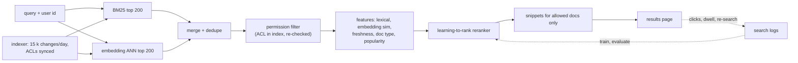
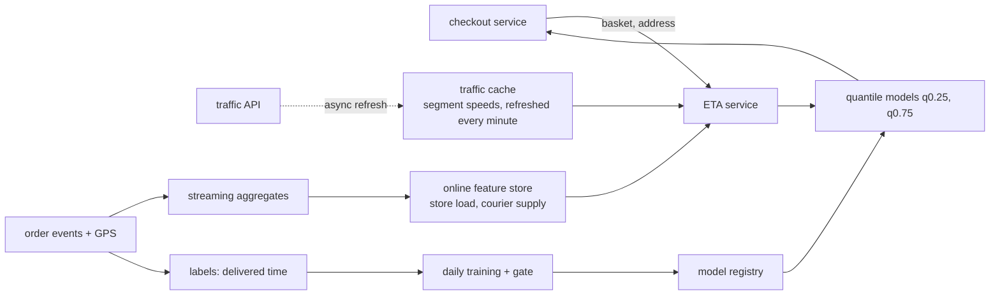

# w8d3 design prompts — rubrics (part A) and worked answers (part B)

Score your recording against part A **before** reading part B. The worked answers are one good answer,
not the answer: an interviewer accepts a different architecture that is justified with the same rigour.
All numbers are computed with the reference `estimates.py` from the assumptions stated in the prompts,
plus the assumptions marked *assumed* below.

---

# Part A — rubrics

Each design is scored on eight areas: **Demonstrated** (clear, specific, with numbers or a protocol),
**Partial** (named but vague, or correct but late), **Not yet** (missing or wrong). A mid-level loop
typically expects Demonstrated on areas 1-5 and at least Partial on 6-8.

## D1 — knowledge-base search ranking

| # | Area | Demonstrated looks like |
|---|---|---|
| 1 | Requirements and scope | Asks about latency budget, volume, permissions, and what "better" means to users; states that the goal is the right document in the top few results for engineers, measured by success, not by clicks alone |
| 2 | Estimation | Peak ≈ 12 queries/s (so throughput is not the problem; latency is); 4 M docs × 3 KB embedding ≈ 12 GB fits in memory on one node; latency budget split with the reranker's share |
| 3 | Data and labels | Clicks are biased by position and presentation; uses dwell time and quick re-search as signals; proposes a small human-judged set from the writers with a realistic weekly throughput; never trains on restricted content shown to unauthorised users |
| 4 | Architecture | Two stages: candidate retrieval (BM25 plus embedding nearest neighbours) → permission filter → learning-to-rank reranker; snippets generated only after the permission check |
| 5 | Evaluation | Offline nDCG@10 on judged queries plus click-model or counterfactual estimates on logs; then interleaving or an A/B test on a success metric; slices by department, document type and query type |
| 6 | Serving and safety | Permissions enforced at retrieval and re-checked at render; no cross-user caching of results; fallback to BM25 if the reranker is slow or down |
| 7 | Monitoring and iteration | Success rate and zero-result rate per slice; index freshness; feature/score drift; periodic retraining with fresh logs and a gate |
| 8 | Trade-offs and follow-ups | Explains offline/online mismatch (position bias, judged set not representative, novelty); cold-start for unseen error messages (lexical match on exact strings, code-aware tokenisation); small-slice regressions need a longer window or targeted judgements |

**Common weak answers.** Starting with "fine-tune a large language model" before requirements; treating
clicks as ground truth; forgetting permissions entirely (a launch-blocking privacy incident); reporting
only an offline metric; quoting a QPS problem that does not exist at 12 queries/s.

## D2 — delivery-time estimates

| # | Area | Demonstrated looks like |
|---|---|---|
| 1 | Requirements and scope | Clarifies what is shown (a range), who is hurt by which error, and that late costs about 3x an over-estimate; asks how the estimate is used (checkout conversion vs operations planning) |
| 2 | Estimation | 3 M estimate requests/day, peak ≈ 104/s; latency split within 150 ms with the traffic API off the request path; replicas from Little's law; GPS storage in TB per year |
| 3 | Data and labels | Label = actual delivery time from the order stages, available within about an hour; cancelled orders handled explicitly; training rows built **as of checkout time** (point-in-time features), one row per order not per request |
| 4 | Modelling target | Predicts quantiles (or a distribution), not the mean; chooses the upper quantile from the cost ratio: τ = 3/(3+1) = 0.75; optionally decomposes by stage |
| 5 | Evaluation | Time-based split; pinball loss at the chosen quantiles and **coverage** of the shown range per city and hour; compares with the current formula on the same period |
| 6 | Serving and safety | Online feature store for store load and courier supply; traffic speeds cached per road segment and refreshed asynchronously; degraded mode with wider ranges; timeout to the formula |
| 7 | Monitoring and iteration | Near real-time coverage and lateness per city (labels arrive within an hour); feature freshness; drift in load features; frequent retraining with a gate and shadow |
| 8 | Trade-offs and follow-ups | Explains MAE vs coverage; traffic API outage plan; new-city cold start with pooled models, conservative quantile and fast recalibration |

**Common weak answers.** Regressing the mean with MAE as the only metric; using features that exist only
after checkout (assigned courier, actual pick time) in training; one training row per estimate request
(over-weights indecisive customers); calling the traffic API synchronously on every request; ignoring the
new city until asked.

---

# Part B — worked answers

## D1 — knowledge-base search ranking (about 35 minutes spoken)

**Clarify (4 min).** Who searches and for what: engineers looking for runbooks and design docs, often under
time pressure (on-call). "Better" = the user finds what they need without re-searching. Hard constraints:
500 ms p95; permissions must never leak. No judged data today.

**Estimate (4 min).**

| Quantity | Arithmetic | Result |
|---|---|---|
| Peak queries per second | 250,000/86,400 × 4 | ≈ 12 /s |
| Embedding index | 4 M docs × 768 dims × 4 bytes | ≈ 12 GB (fits in memory on one node) |
| Query/click logs for a year, 3 copies | 250 k queries × 252 working days ≈ 63 M queries × 2 KB × 3 copies | ≈ 0.38 TB |
| Latency left for reranking | 500 − (120 network and render + 80 BM25 + 30 vector search + 25 permission filter + 40 feature fetch), *assumed* | 205 ms |
| Reranker replicas | 12 /s × 60 ms (*assumed* LTR over 200 candidates) on 2-core replicas at 60 % | 1 by arithmetic; run 2+ for availability |
| Judged pairs for ±5 pt on a success proportion | 1.96² × 0.25 / 0.05² | 385 judged queries per slice you want to read |

Throughput is small; latency and permissions are the design constraints.

**Architecture.**

**Labels (6 min).** Implicit feedback: a click followed by ≥ 30 s dwell and no re-search within 2 minutes
counts as a success; a quick back-and-re-search as a failure. Clicks are position-biased, so estimate
propensities with a small amount of result randomisation (swap positions 2-4 for 1 % of traffic) and weight
by inverse propensity, or train on pairwise preferences from the same result list. Explicit judgements:
6 writers × 3 h × about 60 judgements/hour ≈ 1,000 per week (*assumed*); spend them on a stratified set of
queries (runbooks, error messages, design docs, each department) with 20 graded results each.

**Evaluation (6 min).** Offline: nDCG@10 on the judged set, and inverse-propensity-weighted success on held-
out later weeks of logs (time-based split). Online: interleaving against BM25 first (needs far fewer queries
to detect a preference), then an A/B test on success rate and zero-result rate, with slices by department,
document type and query type. Launch criterion: success rate not worse in any large slice and better overall.

**Serving and safety (5 min).** Permissions enforced in the retrieval index (ACL fields synced from the
directory) and re-checked against the authorisation service before snippets are built; results are never
cached across users. If the reranker exceeds its time budget or fails, return the BM25 order and log the
fallback. Version model, features and index schema together.

**Monitoring and iteration (4 min).** Daily success, zero-result and re-search rates per slice; index lag
(time from edit to searchable); score distribution drift; weekly retraining on fresh logs through an
offline gate and a short interleaving check.

**Follow-ups.**
1. *Offline up, CTR flat.* Position bias and presentation dominate clicks; the judged set may not represent
   live queries; gains may sit in queries users already solved on page one; CTR may be the wrong metric
   (a better first result can reduce clicks). Check slice-level and success metrics, not CTR alone.
2. *Unseen error message.* Embeddings generalise poorly to exact strings: keep a lexical path with
   code-aware tokenisation, boost exact-phrase matches, and show "no results" honestly with a link to ask in
   the Q&A channel; log zero-result queries as a content gap report.
3. *Legal team regression.* Slice metrics by the searcher's department; the legal slice is small, so use a
   longer window, paired comparison on the same queries via interleaving, and targeted judgements; set a
   guardrail per large department before launch.

## D2 — delivery-time estimates (about 35 minutes spoken)

**Clarify (4 min).** The estimate is shown as a range at checkout; customers react to lateness against the
upper bound. Late costs about 3x an over-estimate. The estimate influences conversion, so a pessimistic
model loses orders. Ask: can the estimate change after checkout (yes, tracking updates later, out of scope).

**Estimate (4 min).**

| Quantity | Arithmetic | Result |
|---|---|---|
| Estimate requests per day | 600,000 orders × 5 | 3 M |
| Peak requests per second | 3,000,000/86,400 × 3 | ≈ 104 /s |
| Latency left after the path | 150 − (20 network + 15 feature store + 5 cached traffic lookup + 10 two quantile models), *assumed* | 100 ms headroom |
| Replicas | 104 /s × 25 ms per request on 2-core replicas at 60 % | 3 (and 2+ zones) |
| GPS storage for a year, 3 copies | 4,000 courier-days × 8,640 pings × 100 B × 365 × 3 (*assumed*) | ≈ 3.8 TB |
| Labels per day | 600,000 × 0.985 delivered, label within about an hour | ≈ 560,000 |
| Labels in a new city's first week | 5,000 orders/day (*assumed*) × 0.985 × 7 | ≈ 34,000 |
| Orders to measure 0.75 coverage to ±1 pt | 1.96² × 0.75 × 0.25 / 0.01² | ≈ 7,200 per city-slice |

Labels are plentiful and fast: unlike most ML systems, performance can be monitored nearly in real time.

**Target and model (6 min).** Predict quantiles of delivery time given the state at checkout. With
asymmetric costs, the quoted upper bound that minimises expected cost is the quantile
τ = c_late / (c_late + c_early) = 3/(3+1) = 0.75; show a range from roughly the 0.25 to the 0.75 quantile
(*product decision*). Gradient-boosted trees with quantile (pinball) loss, one model per quantile, or a
stage-wise decomposition (store wait + picking + courier travel) when per-stage targets help diagnose error.
Features as of checkout: store open orders and pickers on shift, courier supply in the zone, basket size,
distance and road-segment speeds, hour of week, weather. Training rows are reconstructed point-in-time
from event logs: one row per order at its final checkout, never using the assigned courier or actual pick
time.

**Architecture.**

**Evaluation (6 min).** Time-based split (train on weeks 1..k, test on the following two weeks), report
pinball loss at both quantiles, coverage of the range (target ≈ 50 % inside, ≤ 25 % late), share of orders
late by more than 10 minutes, all per city and hour band; compare with the current formula on the same
weeks. Online: A/B on conversion and late-order rate jointly; the business decision is the trade-off curve.

**Serving and safety (5 min).** The traffic API is never on the request path: a cache of segment speeds
with a staleness limit (e.g. 10 minutes), then historical speeds by hour of week. Any degraded input widens
the range and sets a `degraded` flag; a 100 ms internal timeout falls back to the formula.

**Monitoring and iteration (4 min).** Coverage and lateness per city per hour, available within an hour of
delivery; feature freshness; supply/demand drift; daily retraining through a gate (no city worse beyond a
margin) and shadow scoring before promotion.

**Follow-ups.**
1. *MAE better, more late orders.* MAE rewards the median; the shown upper bound was moved down, so more
   orders exceed it. Measure coverage and lateness, not MAE alone; train the upper bound at τ = 0.75.
2. *Traffic API down at peak.* Served from the cache, then historical speeds; ranges widen; alert on cache
   age; the checkout never waits for the API.
3. *New city.* A pooled model across cities with city-level features (density, store type, road speeds)
   plus a conservative upper quantile; shadow on the first orders; recalibrate after the first week
   (about 34,000 labelled orders), then city-specific checks before trusting it fully.

---

## Senior versus mid-level expectations (for self-assessment)

The rubric above is pitched at mid-level. A senior candidate is additionally expected to drive the
conversation (set the agenda, timebox, check alignment), to quantify trade-offs in business terms (cost
of lateness vs lost conversion), to anticipate organisational issues (who owns labels, the permission
system, on-call), and to propose a phased plan with what to build first and what to defer. Use your own
recordings: if you consistently reach Demonstrated on areas 1-6 within 40 minutes **without** prompts,
and handle the follow-ups with specific mechanisms, you are performing at mid-level; aiming at senior
roles needs evidence of the extra behaviours above, not a different architecture.
