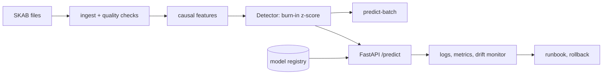

# Slide outline (reference)

## 1. Problem: catch pump faults early without alarm fatigue

Stakeholder, decision, unit of prediction, event-level success criteria. Educational prototype on a lab testbed.

## 2. Data and the traps that shaped the protocol

34 experiments, 8 sensors at 1 Hz; 1,290 duplicated rows (235 with contradictory labels); the clock baseline at F1 0.835.

## 3. Architecture

## 4. Results with intervals (development; test looked at once)

| Candidate | Dev PR-AUC [95 % CI] | Test events caught | Size |
|---|---|---|---|
| flow-rate z-score (chosen) | 0.76 [0.68, 0.84] | 5/7 | 370 B |
| Mahalanobis | 0.71 [0.60, 0.80] | 1/7 | 920 B |
| isolation forest | 0.56 [0.49, 0.64] | 1/7 | 759 kB |
| logistic regression | 0.83 [0.76, 0.89] | 4/7 | 1 kB |

## 5. Why not the bigger models

Boosted trees: 0.920 on seen fault families, 0.636 on an unseen family. Neural autoencoder: 0.754 ± 0.068 over five seeds.

## 6. Failure example: the fault we missed

TODO pick the example. valve1/8: the score stays below threshold; the drift monitor is quiet too. What would have caught it, and what it says about single-sensor detection.

## 7. Operating the service

Parity exact over 46,806 rows; p50 52 ms -> 9.5 ms after the Nagle fix; degraded mode with an explicit flag; rollback verified byte-identical.

## 8. Limitations and next steps

Lab data, seven test experiments, contradictory labels; next: more experiments, label review, pilot with delayed labels.
