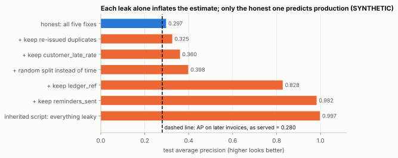

# Leak report: late-payment model (reference)

Data: `lessons/w3d1_leakage/data/invoices.csv`, SYNTHETIC. Effect = test average precision of the
reference model (`honest_eval.py`) with that one leak switched back on and everything else fixed. All
numbers from `lessons/w3d1_leakage/figures/make_figures.py` (2026-11-22).

| # | Kind | Where | Why unavailable at issue time | Evidence | Effect on AP | Fix |
|---|---|---|---|---|---|---|
| 1 | Target / proxy | `reminders_sent` | reminders are sent after the due date passes, mostly to late payers | top importance 0.563; alone it nearly separates the classes | 0.297 -> 0.982 | drop |
| 2 | Shortcut (identifier) | `ledger_ref` | collections re-keys late invoices into a 900000+ range | importance 0.305; every value above 900000 is a late invoice | 0.297 -> 0.828 | drop; ids are never features |
| 3 | Temporal aggregate | `customer_late_rate` | late rate over all the customer's export invoices, including the row and later ones | differs from a recomputation over earlier months only; `prior_late_rate` matches that recomputation | 0.297 -> 0.360 | drop; keep `prior_late_rate` |
| 4 | Duplicate | re-issued invoices (about 9 %) | a re-issue is the same event with the same outcome, 20-70 days later | groups of rows equal in customer, terms, discount and `aux_*`, different id and date | 0.297 -> 0.325 | keep the first issue only, before splitting |
| 5 | Group / temporal (split) | random 80/20 split | the model scores later invoices; same customer-month invoices share a cash shock | random split vs time split | 0.297 -> 0.398 | split at 2024-09-01 |

## Structural flaw without a planted effect

`StandardScaler` (and `get_dummies` + `fillna(0)`) fitted on all rows before the split. Moving it inside
the pipeline does not measurably change the number here; it is fixed because a served model never sees
the test period's statistics and because the check cannot tell harmless from harmful leakage. (Mutant
`scaling_fitted_on_all_rows` reports almost the same AP and is still rejected by a behavioural check.)

## The number

* Inherited script reports: 0.997.
* My estimate: 0.297 at a test prevalence of 0.175 (train 8,703 invoices before 2024-09-01, test 2,180 after).
* Why I believe mine: on later invoices generated as the scoring service would see them (post-outcome
  fields empty), the same model reaches 0.280 at prevalence 0.189.

## What I could not rule out

That `aux_*` fields are produced after issue (they behave like noise, which is consistent with either);
that `n_prior_invoices` and `prior_late_rate` are back-filled in the export (they match a point-in-time
recomputation here, which a real audit would confirm with the data owner).
