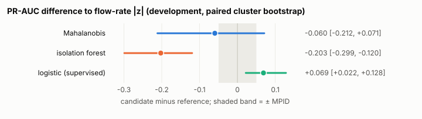

# flowguard evaluation report: milestone 1

Generated by `make evaluate` from the files named under Provenance. Do not edit by hand.

## Problem

Raise an alarm soon after the SKAB water-circulation testbed leaves normal operation, with at most one false alarm per 8 hours of normal operation. Educational prototype; no claim about any real plant.

## Data

| Quantity | Value |
|---|---|
| Rows | 46806 |
| Experiments | 35 |
| Anomalous fraction of labelled rows | 0.349 |

Experiments by family: anomaly-free 1, other 14, valve1 16, valve2 4. Source, licence and hashes: `project/README.md` and `data/raw/skab/MANIFEST.json`.

## Protocol

| Setting | Value |
|---|---|
| Split | frozen manifest `v2.json`: 27 development experiments, 7 test experiments |
| Unit of resampling | overlap group: 23 development clusters, 7 test clusters |
| Calibration | first 100 rows of every run, excluded from evaluation |
| Bootstrap | 2000 replicates, seed 0, percentile intervals at level 0.95 |
| MPID (point-level PR-AUC) | 0.05 |

Development data chooses the operating point and the model; the test set is looked at once.

## Results

### Development comparison

| Candidate | PR-AUC [95 % CI] | Difference to reference [95 % CI] | Reading | Events at budget | False alarms per hour | Size, bytes | Pareto |
|---|---|---|---|---|---|---|---|
| flow-rate \|z\| | 0.765 [0.680, 0.845] | reference | equivalent | 11 of 27 | 0.000 | 370 | yes |
| Mahalanobis | 0.705 [0.597, 0.800] | -0.060 [-0.212, 0.071] | inconclusive | 8 of 27 | 0.000 | 920 | no |
| isolation forest | 0.562 [0.491, 0.639] | -0.203 [-0.299, -0.120] | worse | 3 of 27 | 0.000 | 759036 | no |
| logistic (supervised) | 0.834 [0.762, 0.895] | 0.069 [0.022, 0.128] | inconclusive | 13 of 27 | 0.000 | 1045 | yes |

Pareto front over PR-AUC (max), false alarms per hour (min) and size (min). Latency is measured separately (w4d5) because it depends on the host.

### Test, one look (operating points fixed on development data)

| Candidate | Role | PR-AUC [95 % CI] | Events detected | Recall [Wilson 95 %] | False alarms | Median delay, s |
|---|---|---|---|---|---|---|
| flow-rate \|z\| | chosen | 0.884 [0.811, 0.928] | 5 of 7 | [0.36, 0.92] | 0 | 100 |
| Mahalanobis | record only | 0.759 [0.611, 0.869] | 1 of 7 | [0.03, 0.51] | 0 | missed |
| isolation forest | record only | 0.547 [0.399, 0.700] | 1 of 7 | [0.03, 0.51] | 0 | missed |
| logistic (supervised) | record only | 0.901 [0.824, 0.945] | 4 of 7 | [0.25, 0.84] | 0 | 186 |

## Error analysis

Chosen candidate (flow-rate |z|), test experiments:

| Experiment | Family | Detected | Delay, s | False alarms |
|---|---|---|---|---|
| other/1 | other | yes | 100 | 0 |
| other/14 | other | yes | 59 | 0 |
| valve1/10 | valve1 | yes | 186 | 0 |
| valve1/13 | valve1 | yes | 75 | 0 |
| valve1/5 | valve1 | yes | 91 | 0 |
| valve1/8 | valve1 | no | - | 0 |
| valve2/0 | valve2 | no | - | 0 |

Development experiments by family (out-of-fold where the model is trained):

| Family | Experiments | Events detected | False alarms |
|---|---|---|---|
| other | 12 | 3 of 12 | 0 |
| valve1 | 12 | 6 of 12 | 0 |
| valve2 | 3 | 2 of 3 | 0 |

## Decision

**flow-rate |z|.** flow-rate |z|: no candidate is shown to be practically better, so the simplest candidate that is not shown to be worse.

Rule fixed in advance: among the candidates, the simplest one shown practically better than the reference (whole interval above the MPID); otherwise the simplest one not shown worse.

## Limitations

* 7 independent test clusters: test intervals are wide, and no comparison between candidates is made on test data.
* One laboratory testbed and three fault families; nothing here is evidence about other equipment.
* Labels mark whole anomalous segments; some duplicated rows carry contradictory labels (project/README.md).
* Latency and size are host-dependent and are reported in the w4d5 decision memo, not here, so that this report rebuilds byte for byte.

## Provenance

| Item | Value |
|---|---|
| Split manifest sha256 | `a9f4e2438e666e04bb89b9364f938ffa01554969298c16b9e9eb2082bd005314` |
| Tidy data sha256 | `437c2ff433aced23a5142d3f97ddc3ef8b4f78ead5908757b4e900754cdf4ef4` |
| Code version | `41a95b50065d-dirty` |
| Python | `3.13.18` |
| numpy | `2.5.3` |
| pandas | `3.0.5` |
| scikit-learn | `1.9.1` |
| scipy | `1.18.1` |

Schema `flowguard-evaluation/1`. Rebuild: `make evaluate`.
