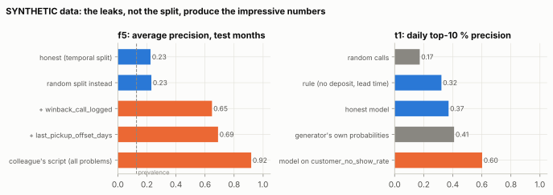

# Final assessment scoring guidance

**Read after submitting.** Same principles as `solutions/diagnostic/SCORING.md`: evidence levels per
aspect (*Demonstrated independently*, *Partial*, *Not yet demonstrated*), no numeric score, declared
help caps a section at *Partial*, passing checks is necessary but never sufficient, one sitting is one
sample. Until a real submission has been reviewed, nothing is known about the result.

## How to review

1. Run every section's checks on the submitted `lab/` directories and record pass counts:
   `for s in lessons/w8d6_final_assessment/*/checks; do python -m pytest $s -q -p no:cacheprovider | tail -1; done`
2. Read code and written files against each section's `NOTES.md` in this directory
   (`f1_python/NOTES.md` ... `t1_transfer/NOTES.md`). Assign a level per rubric row.
3. Note minutes used against time boxes and any declared help.
4. Fill in `lessons/w8d6_final_assessment/COMPARISON.md` row by row, using the Week 1 evidence table in
   `solutions/diagnostic/SCORING.md` (if the diagnostic was taken).
5. Update `progress/SKILLS_LEDGER.md`: move an aspect to "Demonstrated" only with a line in the
   evidence log (date, unit, conditions, outcome, reviewer). Aspects never sampled stay "Unassessed".

## Section map

| Week 8 | Mirrors | Rubric rows | Planted traps (details in the section NOTES) |
|---|---|---|---|
| f1_python | a1 | Debugging; Python semantics; Error handling; Refactoring | int weight, bare except, mutable default, in-place sort, `.seconds`, divisor, tie order |
| f2_sql | a2 | Joins and aggregation; NULL semantics; Fan-out; Window functions | COUNT(*) vs distinct, NOT IN + NULL, fan-out, same-day tie |
| f3_cleaning | a3 | Finding defects; pandas fluency; Time zones; Judgment | stale versions, DD.MM.YYYY, offsets, annual fees, sentinels |
| f4_baseline | b1 | Framing; Baselines; Metric under imbalance; Communication | call budget metric, hard labels, threshold vs top-k |
| f5_leakage | b2 | Target leakage; Validation design; Preprocessing leakage; Scientific honesty | post-outcome flag, future-derived recency, random split, all-rows preprocessing |
| f6_testing_api | b3 | Test design; Validation; API concepts; Validation vs evaluation | group, empty-fold, mutation, seed clauses; extra fields; idempotent side effects |
| f7_explain | b4 | Technical reasoning; Prioritisation; Actionability; Communication | random split of time series, two holiday seasons, MAPE vs cost, wrong baseline |
| t1_transfer | w3d6 challenge | seven rows in `t1_transfer/NOTES.md` | three post-decision columns, booking-date split, global top-k |

## What the leaks are worth (measured, SYNTHETIC)

*Produced by `figures/make_figures.py` (2026-11-22). In both tasks the leaky columns, not the split or
the preprocessing, create the impressive numbers; on f5 the random split has no measurable effect on
this data, and a strong submission says so instead of asserting one.*

## Interpreting the comparison

| Pattern | Reading |
|---|---|
| Up on most aspects, sittings within time boxes, no help | strong evidence the course content transferred |
| Up only where checks guide you (behaviour), flat on written aspects | skills present, explanation not yet; practise the written parts (memos, FINDINGS) |
| Flat on f2/f3 while the rest moves | Week 2 mechanics need spaced practice; schedule SQL/pandas reps in the next plan |
| Down on one aspect | one sample; re-test that aspect once before concluding anything |
| t1 passes checks but the report is thin | evaluation mechanics transferred; communication of uncertainty did not |

Do not convert the comparison into a percentage or a "readiness" claim. The retrospective (w8d7)
uses it to plan the next eight weeks.

## Verification record (author side)

For every checked section (f1-f6, t1) `python tools/verify_checks.py lessons/w8d6_final_assessment/<section>`
was run: the reference passes and every mutant is rejected; the shipped starters fail. The data
generator reproduces the committed files byte for byte (`make_data.py --check`). f7 is rubric-only.
